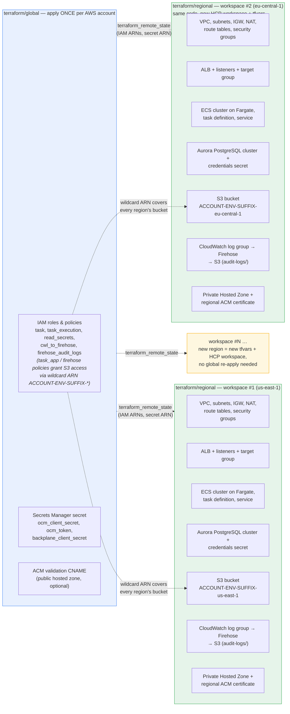

# Deployment

## Overview

Infrastructure is split into two Terraform roots that must be applied in order:

| Root         | Path                  | Scope                                                                                                      | Apply cadence    |
|--------------|-----------------------|------------------------------------------------------------------------------------------------------------|------------------|
| **global**   | `terraform/global/`   | Account-wide: IAM, Secrets Manager, ACM validation CNAME                                                   | Once per account |
| **regional** | `terraform/regional/` | One deployment per AWS region: VPC, ALB, ECS on Fargate, Aurora, S3 bucket, CloudWatch, Route 53 PHZ, regional ACM certificate | Once per region  |

The regional root reads IAM ARNs, the Secrets Manager ARN, and the public
hosted zone ID directly from the global workspace's Terraform state via
`terraform_remote_state`. The only value copied by hand is `db_password`,
which is authored in Vault — see
[docs/database-and-compute.md](database-and-compute.md). The S3 bucket
is created directly in each regional workspace — `s3_bucket_name_suffix` must
match the value set in the global workspace so its IAM wildcard ARN covers
the bucket.

### Resource ownership and multi-region fan-out



- **Blue (global)** — created once, shared by every region: IAM roles/policies,
  the app secret, and (optionally) the ACM validation CNAME.
- **Green (regional)** — created per region: networking, ALB, ECS compute, the
  region's own S3 bucket, the Firehose audit-log pipeline, and DNS/TLS.
- **Yellow** — adding region N+1 only touches `terraform/regional`: a new
  tfvars file / HCP Terraform workspace. `global` is never re-applied — its
  IAM wildcard ARN (`ACCOUNT-ENVIRONMENT-SUFFIX-*`) already covers any
  region's bucket by construction.

See [docs/networking.md](networking.md) for the DNS and TLS architecture.

> **Not yet deployed.** The regional root has never been applied in any
> environment. See [docs/database-and-compute.md](database-and-compute.md) for
> the Aurora/Fargate design decisions.
---

## Table of Contents

1. [HCP Terraform (CI/CD)](#hcp-terraform-cicd)
2. [Local Testing](#local-testing)
3. [Verification](#verification)
4. [Adding a New Region](#adding-a-new-region)

---

## HCP Terraform (CI/CD)

The existing workspaces are managed by the Boundary repository's
[`hcp-terraform/rosa-trusted-actions/main.tf`](../../../hcp-terraform/rosa-trusted-actions/main.tf).
The meta-workspace and both workload workspaces were rebound in place from the
archived Trusted Actions repository. Inspect the current Git-managed settings
**and live HCP runs/settings** before planning or approving changes: the
cutover temporarily set `auto_apply` and `auto_apply_run_trigger` to `false`,
then [restored both to `true`](https://github.com/openshift-online/rosa-boundary/pull/517)
after successful workspace runs. Do not assume an old runbook describes
today's apply gate; the first meta cutover run auto-applied unexpectedly.

### Workspace summary

| Workspace                     | Working directory    | Must apply before       |
|-------------------------------|----------------------|-------------------------|
| `rosa-trusted-actions-global` | `components/trusted-actions/terraform/global`   | all regional workspaces |
| `rosa-trusted-actions-stage`  | `components/trusted-actions/terraform/regional` | —                       |

### Apply order

```
1. rosa-trusted-actions-global   (creates S3, IAM, Secrets, CNAME)
         │
         └─ run trigger fires automatically
                  ↓
2. rosa-trusted-actions-stage    (reads global outputs via remote state)
```

The `source_workspaces` setting queues a stage run after a successful global
apply. Whether that queued run applies automatically depends on the current
`auto_apply_run_trigger` setting and effective HCP configuration. The global
workspace permits the stage workspace to read its remote state via
`remote_state_consumer_workspaces`. Review global and stage plans separately;
the meta plan alone does not establish whether AWS resources will change.

### Workspace variables

The [workspace definitions](../../../hcp-terraform/rosa-trusted-actions/main.tf)
in the Boundary repository are the source of truth for Git-managed workspace
variables; the stage workspace supplies the complete `app_config` file rather
than only individual Backplane/OCM settings. Keep sensitive credentials in
approved sensitive variables/variable sets; never commit them or edit the
Git-managed workspace variables directly in HCP.

**Global workspace** (`rosa-trusted-actions-global`):
| Variable                  | Sensitive | Notes                                            |
|---------------------------|-----------|--------------------------------------------------|
| `aws_region`              | no        | Provider region, e.g. `us-east-1`                |
| `environment`             | no        | `stage` or `prod`                                |
| `s3_bucket_name_suffix`   | no        | Suffix segment of the IAM wildcard ARN pattern; must match the regional workspace's value |
| `internal_fqdn`           | no        | e.g. `rosa-trusted-actions.internal.company.com` |
| `public_zone_id`          | no        | Route 53 public zone ID (add when ready for TLS) |
| `backplane_client_secret` | **yes**   |                                                  |
| `ocm_client_secret`       | **yes**   |                                                  |
| `ocm_token`               | **yes**   |                                                  |

**Regional workspace** (`rosa-trusted-actions-stage`):

| Variable              | Sensitive | Notes                                          |
|-----------------------|-----------|------------------------------------------------|
| `aws_region`          | no        | e.g. `us-east-1`                               |
| `environment`         | no        | `stage` or `prod`                              |
| `vpc_id`              | no        | Leave empty to let Terraform create a VPC      |
| `s3_bucket_name_suffix` | no      | Suffix segment of the bucket name; must match the global workspace's value |
| `private_subnet_ids`  | no        | Two subnets in different AZs                   |
| `public_subnet_ids`   | no        | Two subnets (needed only when `vpc_id` is set) |
| `container_image`     | no        | Full image URI with digest                     |
| `app_config`          | no        | Complete application config file (config.yaml); see the workspace definitions |
| `public_zone_id`      | no        | Must match global workspace value              |
| `db_password`         | **yes**   | Aurora master password; authored in Vault      |

`db_password` never rotates. Changing it rotates the Aurora master password on
the next apply and breaks every running task, so a forced ECS deployment must
follow — see [docs/database-and-compute.md](database-and-compute.md).

IAM ARNs and the Secrets Manager ARN are **not** workspace variables in the
regional workspace — they are read automatically from the global workspace's
remote state. The S3 bucket is owned by the regional workspace itself.

---

## Local Testing

For testing against an AWS account directly (without HCP Terraform), each root
is applied with the Terraform CLI using a local state backend. The only
complication is that `terraform/regional/remote_state.tf` points to the HCP
Terraform remote backend by default. Terraform's **override file** feature
solves this without touching any source file: a gitignored
`local_override.tf` placed in `terraform/regional/` replaces the remote
backend with a local one that reads from the global state file on disk.

### Step 1 — apply global

```bash
cd terraform/global

terraform init

terraform apply \
  -var="aws_region=us-east-1" \
  -var="environment=stage" \
  -var="s3_bucket_name_suffix=rosa-trusted-actions" \
  -var="internal_fqdn=rosa-trusted-actions.internal.company.com" \
  -var="backplane_client_secret=$BACKPLANE_CLIENT_SECRET" \
  -var="ocm_client_secret=$OCM_CLIENT_SECRET" \
  -var="ocm_token=$OCM_TOKEN"
```

Or use a var-file (never commit secrets):

```hcl
# terraform/global/terraform.tfvars  (gitignored)
aws_region            = "us-east-1"
environment           = "stage"
s3_bucket_name_suffix = "rosa-trusted-actions"
internal_fqdn         = "rosa-trusted-actions.internal.company.com"
```

```hcl
# $HOME/.config/rosa-ta/secrets.tfvars  (outside the repo)
backplane_client_secret = "..."
ocm_client_secret       = "..."
ocm_token               = "..."
```

```bash
terraform apply \
  -var-file=terraform.tfvars \
  -var-file=$HOME/.config/rosa-ta/secrets.tfvars
```

### Step 2 — create the regional override file

Create this file **once** on your machine. It is gitignored and never
committed. It overrides the `data "terraform_remote_state" "global"` block in
`remote_state.tf` to use the local state file produced by Step 1 instead of
the HCP Terraform remote backend.

```hcl
# terraform/regional/local_override.tf — LOCAL TESTING ONLY. Gitignored.
data "terraform_remote_state" "global" {
  backend = "local"
  config = {
    path = "../global/terraform.tfstate"
  }
}
```

### Step 3 — apply regional

```bash
cd ../regional

terraform init

terraform apply \
  -var="aws_region=us-east-1" \
  -var="environment=stage" \
  -var="s3_bucket_name_suffix=rosa-trusted-actions" \
  -var="vpc_id=vpc-008ef33919b443f10" \
  -var='private_subnet_ids=["subnet-0042826174855e520","subnet-0f9392e3159168d6f"]' \
  -var='public_subnet_ids=["subnet-01821c41d92b0f8b1","subnet-0f52e06526c080dfa"]' \
  -var="container_image=quay.io/redhat-user-workloads/rosa-tenant/rosa-trusted-actions@sha256:<digest>" \
  -var="internal_fqdn=rosa-trusted-actions.internal.company.com" \
  -var='app_config=actions:
  aws_allowed_regions: [us-east-1]
  ocm:
    base_url: https://api.stage.openshift.com
    client_id: <ocm_client_id>
  backplane:
    base_url: https://api.stage.backplane.openshift.com
    client_id: <backplane_client_id>
  roles:
    - id: SREP
      amsResource: BackplaneOsdSrepResource
' \
  -var="db_password=$ROSA_TA_DB_PASSWORD"
```

Or with var-files — keep the password out of the in-repo file, as the global
root does:

```hcl
# terraform/regional/terraform.tfvars  (gitignored)
aws_region            = "us-east-1"
environment           = "stage"
s3_bucket_name_suffix = "rosa-trusted-actions"
vpc_id                = "vpc-008ef33919b443f10"
private_subnet_ids    = ["subnet-0042826174855e520", "subnet-0f9392e3159168d6f"]
public_subnet_ids     = ["subnet-01821c41d92b0f8b1", "subnet-0f52e06526c080dfa"]
container_image       = "quay.io/redhat-user-workloads/rosa-tenant/rosa-trusted-actions@sha256:<digest>"
internal_fqdn         = "rosa-trusted-actions.internal.company.com"
app_config            = <<-YAML
  actions:
    aws_allowed_regions: [us-east-1]
  ocm:
    base_url: https://api.stage.openshift.com
    client_id: <ocm_client_id>
  backplane:
    base_url: https://api.stage.backplane.openshift.com
    client_id: <backplane_client_id>
  roles:
    - id: SREP
      amsResource: BackplaneOsdSrepResource
YAML
```

```hcl
# $HOME/.config/rosa-ta/regional-secrets.tfvars  (outside the repo)
db_password = "..."   # from Vault
```

A file separate from the global root's `secrets.tfvars`: each root warns about
variables it does not declare, so sharing one file across both is noisy.

```bash
terraform apply \
  -var-file=terraform.tfvars \
  -var-file=$HOME/.config/rosa-ta/regional-secrets.tfvars
```

### How the override works

Terraform processes files ending in `_override.tf` after all other files in
the directory and merges their blocks on top. A `data` block with the same
type and name as one in a regular file **completely replaces** it. The source
file `remote_state.tf` is never modified — the override exists only in the
local working copy and is gitignored.

```
remote_state.tf          →  data "terraform_remote_state" "global" { backend = "remote" ... }
local_override.tf        →  data "terraform_remote_state" "global" { backend = "local"  ... }
                                                                      ↑ wins at apply time
```

### Teardown

Destroy regional before global (global owns IAM roles that regional's ECS
tasks depend on at runtime).

```bash
cd terraform/regional && terraform destroy \
  -var-file=terraform.tfvars \
  -var-file=$HOME/.config/rosa-ta/regional-secrets.tfvars
cd ../global          && terraform destroy \
  -var-file=terraform.tfvars \
  -var-file=$HOME/.config/rosa-ta/secrets.tfvars
```

---

## Verification

```bash
# From terraform/regional/ after apply
cd terraform/regional

# Tasks running
aws ecs list-tasks \
  --cluster rosa-trusted-actions \
  --region us-east-1 \
  --query 'taskArns'

# Health check — must be run from inside the VPC (bastion, SSM session, or ECS exec)
curl $(terraform output -raw internal_fqdn)/health
# {"status":"healthy","version":"..."}

# Container logs
aws logs filter-log-events \
  --log-group-name "$(terraform output -raw cloudwatch_log_group)" \
  --region us-east-1 \
  --filter-pattern "started"
```

---

## Adding a New Region

1. Reuse the existing global workspace and review its output/state sharing;
   its IAM policy covers regional buckets by name. Do not create a duplicate
   global stack for each region.

2. Create a new HCP Terraform workspace entry in the Boundary repository's
   [`hcp-terraform/rosa-trusted-actions/main.tf`](../../../hcp-terraform/rosa-trusted-actions/main.tf)
   following the `rosa-trusted-actions-stage` block. Set `working_directory =
   "components/trusted-actions/terraform/regional"` and provide the
   region-specific variables, including `app_config`. Each region gets its
   **own** Aurora cluster, so author a fresh `db_password` in Vault for it
   rather than reusing another region's.

3. Add the new workspace name to the global definition's
   `remote_state_consumer_workspaces` so it can read global remote state.

4. Set the new workspace's `source_workspaces` to the global workspace.

5. Review the resulting HCP plans and effective apply settings with the
   deployment owners before applying. `terraform_remote_state` then reads
   the global outputs.

For local testing of the new region, follow the [Local Testing](#local-testing)
steps with the appropriate `aws_region`, `vpc_id`, and subnet variables for
that region. The same `local_override.tf` file works unchanged — it points to
the shared `terraform/global/terraform.tfstate` regardless of which region is
being tested.
