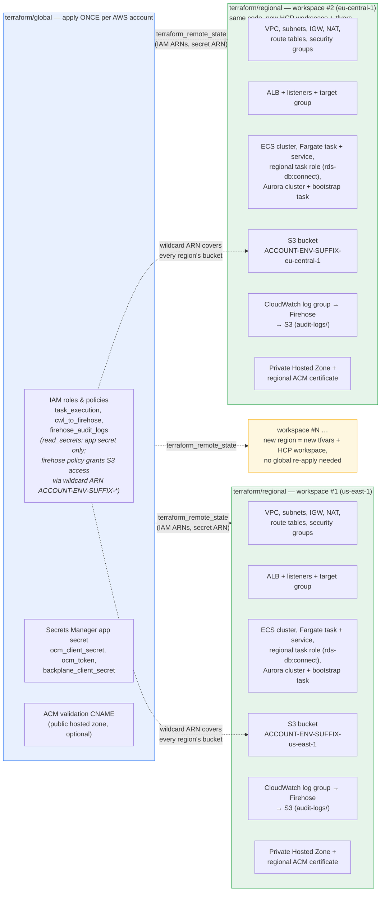

# Deployment

## Overview

Infrastructure is split into two Terraform roots that must be applied in order:

| Root         | Path                  | Scope                                                                                                      | Apply cadence    |
|--------------|-----------------------|------------------------------------------------------------------------------------------------------------|------------------|
| **global**   | `terraform/global/`   | Account-wide: IAM (task execution role, audit-log roles), Secrets Manager app secret, ACM validation CNAME | Once per account |
| **regional** | `terraform/regional/` | One deployment per AWS region: VPC, ALB, ECS Fargate, Aurora PostgreSQL, S3 bucket, CloudWatch, Route 53 PHZ, regional ACM certificate | Once per region  |

The regional root reads IAM ARNs, the Secrets Manager ARN, and the public
hosted zone ID directly from the global workspace's Terraform state via
`terraform_remote_state`. No values need to be copied by hand. The S3 bucket
is created directly in each regional workspace — `s3_bucket_name_suffix` must
match the value set in the global workspace so its IAM wildcard ARN covers
the bucket.

### Resource ownership and multi-region fan-out



- **Blue (global)** — created once, shared by every region: the task
  execution role, audit-log roles/policies, the app secret, and (optionally)
  the ACM validation CNAME.
- **Green (regional)** — created per region: networking, ALB, ECS Fargate
  compute, the region's Aurora cluster and task role, the region's own S3
  bucket, the Firehose audit-log pipeline, and DNS/TLS.
- **Yellow** — adding region N+1 only touches `terraform/regional`: a new
  tfvars file / HCP Terraform workspace. `global` is never re-applied — the
  firehose policy's S3 wildcard ARN (`ACCOUNT-ENVIRONMENT-SUFFIX-*`) already
  covers any region's bucket by construction, and each region creates its own
  task role and Aurora cluster.

See [docs/networking.md](networking.md) for the DNS and TLS architecture.

---

## Table of Contents

1. [HCP Terraform (CI/CD)](#hcp-terraform-cicd)
2. [Database (Aurora + IAM authentication)](#database-aurora--iam-authentication)
3. [Local Testing](#local-testing)
4. [Verification](#verification)
5. [Adding a New Region](#adding-a-new-region)

---

## HCP Terraform (CI/CD)

The existing workspaces are managed by the Boundary repository's
[`hcp-terraform/rosa-trusted-actions/main.tf`](../../../hcp-terraform/rosa-trusted-actions/main.tf).
The meta-workspace and both workload workspaces were rebound in place from the
archived Trusted Actions repository. Inspect the current Git-managed settings
**and live HCP runs/settings** before planning or approving changes: the
cutover temporarily set `auto_apply` and `auto_apply_run_trigger` to `false`,
then [restored both to `true`](https://github.com/openshift-online/rosa-boundary/pull/517)
after successful workspace runs. Do not assume an old runbook describes
today's apply gate; the first meta cutover run auto-applied unexpectedly.

### Workspace summary

| Workspace                     | Working directory    | Must apply before       |
|-------------------------------|----------------------|-------------------------|
| `rosa-trusted-actions-global` | `components/trusted-actions/terraform/global`   | all regional workspaces |
| `rosa-trusted-actions-stage`  | `components/trusted-actions/terraform/regional` | —                       |

### Apply order

```
1. rosa-trusted-actions-global   (creates S3, IAM, Secrets, CNAME)
         │
         └─ run trigger fires automatically
                  ↓
2. rosa-trusted-actions-stage    (reads global outputs via remote state)
```

The `source_workspaces` setting queues a stage run after a successful global
apply. Whether that queued run applies automatically depends on the current
`auto_apply_run_trigger` setting and effective HCP configuration. The global
workspace permits the stage workspace to read its remote state via
`remote_state_consumer_workspaces`. Review global and stage plans separately;
the meta plan alone does not establish whether AWS resources will change.

### Workspace variables

The [workspace definitions](../../../hcp-terraform/rosa-trusted-actions/main.tf)
are the source of truth for Git-managed stage variables. In particular, the
stage workspace now supplies the complete `app_config` file rather than only
individual Backplane/OCM settings. Both workspaces have AWS dynamic credential
attachments and the global workspace shares state with stage. Keep sensitive
credentials in approved sensitive variables/variable sets; never commit them
or edit the Git-managed workspace variables directly in HCP. Regional IAM
ARNs and the Secrets Manager ARN come from global remote state. The regional
workspace owns its own S3 bucket.

---

## Database (Aurora + IAM authentication)

Each regional root provisions an Aurora PostgreSQL cluster
(`terraform/regional/rds.tf`) with IAM database authentication enabled. The
service runs on Fargate and connects as the `trusted_actions_app` database
user, authenticating with a 15-minute RDS IAM token minted per connection —
**no database password exists anywhere in the application's runtime**. TLS is
mandatory (`sslmode=verify-full`) and verifies the Aurora certificate against
the RDS CA bundle baked into the image at `/etc/ssl/certs/rds-global-bundle.pem`.

### Roles and secrets

| Principal | What it holds |
|---|---|
| `APP_NAME-task-REGION` (regional task role) | Runtime grants (S3, CloudWatch, ECS Exec) plus an inline `rds-db:connect` policy scoped to `dbuser:<this cluster's resource ID>/trusted_actions_app` only — structural cross-region isolation |
| `APP_NAME-bootstrap-execution-REGION` | The sole reader of this cluster's exact master-secret ARN; nothing else |
| `trusted_actions` (Aurora master user) | Password fully RDS-managed (`manage_master_user_password = true`): RDS creates the secret, rotates it every 7 days, and deletes it with the cluster. Reserved for bootstrap and break-glass |
| `trusted_actions_app` (application user) | Created by the bootstrap; owns the database and schema, holds `rds_iam` and `CREATEDB` |

The master password never enters Terraform state, the task definition, or any
log: the only consumer is the bootstrap task, where ECS injects the secret as
an environment variable at task start.

**Never create `aws_secretsmanager_secret_rotation` with `rotation_enabled =
false`** for the master secret. The documented disable path is a parking
resource with a known gotcha: if it is ever introduced, it must
`depends_on` the cluster *instance* or AWS silently re-enables rotation after
the instance provisions. RDS-managed rotation is the design; there is nothing
to park.

### `rds:ModifyDBCluster` caveat

Anyone holding `rds:ModifyDBCluster` (plus `secretsmanager:RotateSecret`) can
force an immediate master-secret rotation out of band. That is harmless to
the service — it never uses the master secret — but it rotates the credential
break-glass would use. Watch CloudTrail for `ModifyDBCluster` events touching
`APP_NAME` clusters outside planned applies if that matters to your threat
model.

### `db_*` variables

`db_engine_version`, `db_instance_class`, `db_instance_count`, `db_username`,
`db_name`, `db_backup_retention_period`, `db_preferred_backup_window`,
`db_deletion_protection`, `db_skip_final_snapshot`,
`db_performance_insights_enabled`, `db_kms_key_id` configure the cluster
(defaults in `terraform/regional/variables.tf`; the stage workspace sets
`db_engine_version`, `db_instance_class`, and `db_bootstrap_enabled`). There
is deliberately **no `db_password` variable**.

### `db_bootstrap_enabled`

The bootstrap task (`terraform/regional/bootstrap.tf`) runs the image's
`bootstrap` subcommand with the master secret: it creates `trusted_actions_app`,
grants it `rds_iam` and `CREATEDB`, and transfers database/schema ownership.
The SQL is idempotent — re-running is a no-op.

Gated off by default (`db_bootstrap_enabled = false`). On a greenfield
apply:

1. Apply with `db_bootstrap_enabled = true` once. The `null_resource`
   run-task executes and the apply fails loudly if the bootstrap task fails.
2. Set it back to `false`. The resource's triggers (cluster resource ID,
   username, db name, image) deliberately exclude the master-secret ARN so
   RDS's 7-day rotation never re-triggers a bootstrap run. A post-rotation
   bootstrap run succeeds anyway — the subcommand reads the current secret
   value and every statement is idempotent.

### Break-glass runbook

When the application user path is broken and master-level database access is
needed, run the bootstrap task definition with a `psql` entrypoint. The
master secret is fetched at task start by the bootstrap execution role; the
password exists only in that task's environment.

```bash
# 1. Fetch the master secret (readable only by the bootstrap execution role's
#    policy — an admin with secretsmanager:GetSecretValue on the ARN, or an
#    assume-role into it). Get the exact ARN from the cluster:
SECRET_ARN="$(aws rds describe-db-clusters --db-cluster-identifier rosa-trusted-actions \
  --query 'DBClusters[0].MasterUserSecret[0].SecretArn' --output text)"
SECRET="$(aws secretsmanager get-secret-value --secret-id "$SECRET_ARN" \
  --query SecretString --output text)"
MASTER_USER="$(echo "$SECRET" | jq -r .username)"
MASTER_PASSWORD="$(echo "$SECRET" | jq -r .password)"

# 2. Connect with verify-full and the image's CA bundle (adjust host from
#    describe-db-clusters Endpoint):
psql "postgres://${MASTER_USER}:${MASTER_PASSWORD}@<cluster-endpoint>:5432/trusted_actions?sslmode=verify-full&sslrootcert=/etc/ssl/certs/rds-global-bundle.pem"
```

The `psql` client is not part of the deployed image; run it from an operator
environment with VPC reachability to the cluster endpoint (the Aurora SG
admits 5432 from the Fargate task SG only, so this requires a bastion, SSM
session, or a temporary SG rule — an audited, deliberate act). The master
user remains a member of `trusted_actions_app` after the ownership transfer,
so break-glass retains full privileges on the application database.

---

## Local Testing

For testing against an AWS account directly (without HCP Terraform), each root
is applied with the Terraform CLI using a local state backend. The only
complication is that `terraform/regional/remote_state.tf` points to the HCP
Terraform remote backend by default. Terraform's **override file** feature
solves this without touching any source file: a gitignored
`local_override.tf` placed in `terraform/regional/` replaces the remote
backend with a local one that reads from the global state file on disk.

### Step 1 — apply global

```bash
cd terraform/global

terraform init

terraform apply \
  -var="aws_region=us-east-1" \
  -var="environment=stage" \
  -var="s3_bucket_name_suffix=rosa-trusted-actions" \
  -var="internal_fqdn=rosa-trusted-actions.internal.company.com" \
  -var="backplane_client_secret=$BACKPLANE_CLIENT_SECRET" \
  -var="ocm_client_secret=$OCM_CLIENT_SECRET" \
  -var="ocm_token=$OCM_TOKEN"
```

Or use a var-file (never commit secrets):

```hcl
# terraform/global/terraform.tfvars  (gitignored)
aws_region            = "us-east-1"
environment           = "stage"
s3_bucket_name_suffix = "rosa-trusted-actions"
internal_fqdn         = "rosa-trusted-actions.internal.company.com"
```

```hcl
# $HOME/.config/rosa-ta/secrets.tfvars  (outside the repo)
backplane_client_secret = "..."
ocm_client_secret       = "..."
ocm_token               = "..."
```

```bash
terraform apply \
  -var-file=terraform.tfvars \
  -var-file=$HOME/.config/rosa-ta/secrets.tfvars
```

### Step 2 — create the regional override file

Create this file **once** on your machine. It is gitignored and never
committed. It overrides the `data "terraform_remote_state" "global"` block in
`remote_state.tf` to use the local state file produced by Step 1 instead of
the HCP Terraform remote backend.

```hcl
# terraform/regional/local_override.tf — LOCAL TESTING ONLY. Gitignored.
data "terraform_remote_state" "global" {
  backend = "local"
  config = {
    path = "../global/terraform.tfstate"
  }
}
```

### Step 3 — apply regional

```bash
cd ../regional

terraform init

terraform apply \
  -var="aws_region=us-east-1" \
  -var="environment=stage" \
  -var="s3_bucket_name_suffix=rosa-trusted-actions" \
  -var="vpc_id=vpc-008ef33919b443f10" \
  -var='private_subnet_ids=["subnet-0042826174855e520","subnet-0f9392e3159168d6f"]' \
  -var='public_subnet_ids=["subnet-01821c41d92b0f8b1","subnet-0f52e06526c080dfa"]' \
  -var="container_image=quay.io/redhat-user-workloads/rosa-tenant/rosa-trusted-actions@sha256:<digest>" \
  -var="internal_fqdn=rosa-trusted-actions.internal.company.com" \
  -var='app_config=actions:
  allowed_namespaces: []
  ocm:
    base_url: https://api.stage.openshift.com
    client_id: <ocm_client_id>
  backplane:
    base_url: https://api.stage.backplane.openshift.com
    client_id: <backplane_client_id>
  roles:
    - id: SREP
      amsResource: BackplaneOsdSrepResource
'
```

Or with var-files:

```hcl
# terraform/regional/terraform.tfvars  (gitignored)
aws_region            = "us-east-1"
environment           = "stage"
s3_bucket_name_suffix = "rosa-trusted-actions"
vpc_id                = "vpc-008ef33919b443f10"
private_subnet_ids    = ["subnet-0042826174855e520", "subnet-0f9392e3159168d6f"]
public_subnet_ids     = ["subnet-01821c41d92b0f8b1", "subnet-0f52e06526c080dfa"]
container_image       = "quay.io/redhat-user-workloads/rosa-tenant/rosa-trusted-actions@sha256:<digest>"
internal_fqdn         = "rosa-trusted-actions.internal.company.com"
app_config            = <<-YAML
  actions:
    allowed_namespaces: []
  ocm:
    base_url: https://api.stage.openshift.com
    client_id: <ocm_client_id>
  backplane:
    base_url: https://api.stage.backplane.openshift.com
    client_id: <backplane_client_id>
  roles:
    - id: SREP
      amsResource: BackplaneOsdSrepResource
YAML
```


```bash
terraform apply -var-file=terraform.tfvars
```

### How the override works

Terraform processes files ending in `_override.tf` after all other files in
the directory and merges their blocks on top. A `data` block with the same
type and name as one in a regular file **completely replaces** it. The source
file `remote_state.tf` is never modified — the override exists only in the
local working copy and is gitignored.

```
remote_state.tf          →  data "terraform_remote_state" "global" { backend = "remote" ... }
local_override.tf        →  data "terraform_remote_state" "global" { backend = "local"  ... }
                                                                      ↑ wins at apply time
```

### Teardown

Destroy regional before global (global owns IAM roles that regional's ECS
tasks depend on at runtime).

```bash
cd terraform/regional && terraform destroy -var-file=terraform.tfvars
cd ../global          && terraform destroy \
  -var-file=terraform.tfvars \
  -var-file=$HOME/.config/rosa-ta/secrets.tfvars
```

---

## Verification

```bash
# From terraform/regional/ after apply
cd terraform/regional

# Tasks running
aws ecs list-tasks \
  --cluster rosa-trusted-actions \
  --region us-east-1 \
  --query 'taskArns'

# Health check — must be run from inside the VPC (bastion, SSM session, or ECS exec)
curl $(terraform output -raw internal_fqdn)/health
# {"status":"healthy","version":"..."}

# Container logs
aws logs filter-log-events \
  --log-group-name "$(terraform output -raw cloudwatch_log_group)" \
  --region us-east-1 \
  --filter-pattern "started"
```

---

## Adding a New Region

1. Reuse the existing global workspace and review its output/state sharing;
   its IAM policy covers regional buckets by name. Do not create a duplicate
   global stack for each region.

2. Create a new HCP Terraform workspace entry in
   `hcp-terraform/rosa-trusted-actions/main.tf` following the
   `rosa-trusted-actions-stage` block. Set `working_directory =
   "components/trusted-actions/terraform/regional"` and provide the
   region-specific variables, including `app_config`.

3. Add the new workspace name to the global definition's
   `remote_state_consumer_workspaces` so it can read global remote state.

4. Set the new workspace's `source_workspaces` to the global workspace.

5. Review the resulting HCP plans and effective apply settings with the
   deployment owners before applying. `terraform_remote_state` then reads
   the global outputs.

For local testing of the new region, follow the [Local Testing](#local-testing)
steps with the appropriate `aws_region`, `vpc_id`, and subnet variables for
that region. The same `local_override.tf` file works unchanged — it points to
the shared `terraform/global/terraform.tfstate` regardless of which region is
being tested.

A deployment can also be confined to the clusters of particular regions,
through `actions.allowed_cluster_regions` in `app_config` (or
`ROSA_TA_ALLOWED_CLUSTER_REGIONS`). The target cluster's own OCM region is
judged against that list before authorization, for both Kubernetes and AWS
actions. It is a list rather than a single region so one deployment can serve
a group of them:

```yaml
actions:
  allowed_cluster_regions: [us-east-1, us-east-2]
```

**Every deployment leaves it unset**, including the regional roots and the HCP
workspace definitions, so actions reach clusters in every region — the way
they behaved before the setting existed. Confining a deployment is a decision
to take deliberately, not a default to inherit: the boundary applies to
Kubernetes actions as well, and those have never been region-bounded, so
turning it on denies cross-region `get`, `describe-nodes` and the rest along
with the AWS reads.

This replaced `actions.aws_allowed_regions` / `ROSA_TA_AWS_ALLOWED_REGIONS`,
which asked the same question of the same value — an AWS action's region is
always its target cluster's own — but only for AWS actions, and refused to
start when unset. A deployment that still sets the old key will start and
ignore it. Note the net effect for AWS: the old key pinned each region's
deployment to its own region, and leaving the new one unset lifts that, so a
deployment that wants the old AWS behaviour has to say
`allowed_cluster_regions: [<its region>]` and accept that Kubernetes actions
are confined too. `actions.aws_allowed_operations` is unchanged and still the
gate on AWS writes.
