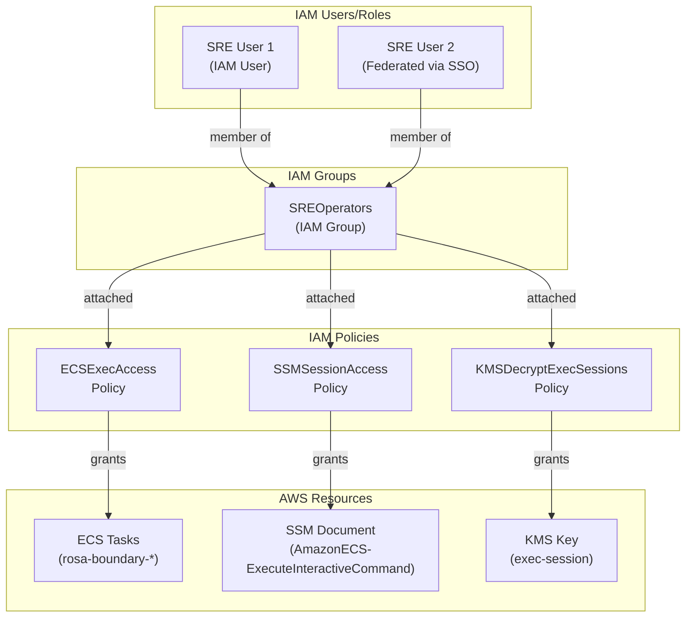

# AWS IAM Policies for Boundary Integration

## Overview

Configure AWS IAM policies to enable users to connect to ECS Fargate containers via Boundary and SSM. This requires permissions for ECS Exec, SSM sessions, and KMS decryption.

## IAM Architecture



## IAM Policy: ECS Exec Access

**Policy Name**: `BoundaryECSExecAccess`

**`iam-policy-ecs-exec.json`:**

```json
{
  "Version": "2012-10-17",
  "Statement": [
    {
      "Sid": "ECSExecCommand",
      "Effect": "Allow",
      "Action": [
        "ecs:ExecuteCommand"
      ],
      "Resource": "arn:aws:ecs:us-east-2:641875867446:task/rosa-boundary-*/*",
      "Condition": {
        "StringEquals": {
          "ecs:cluster": "arn:aws:ecs:us-east-2:641875867446:cluster/rosa-boundary-dev"
        }
      }
    },
    {
      "Sid": "ECSDescribeTasks",
      "Effect": "Allow",
      "Action": [
        "ecs:DescribeTasks",
        "ecs:DescribeTaskDefinition"
      ],
      "Resource": "*"
    },
    {
      "Sid": "ECSListTasks",
      "Effect": "Allow",
      "Action": [
        "ecs:ListTasks"
      ],
      "Resource": "*",
      "Condition": {
        "StringEquals": {
          "ecs:cluster": "arn:aws:ecs:us-east-2:641875867446:cluster/rosa-boundary-dev"
        }
      }
    }
  ]
}
```

## IAM Policy: SSM Session Access

**Policy Name**: `BoundarySSMSessionAccess`

**`iam-policy-ssm-session.json`:**

```json
{
  "Version": "2012-10-17",
  "Statement": [
    {
      "Sid": "StartSSMSession",
      "Effect": "Allow",
      "Action": [
        "ssm:StartSession"
      ],
      "Resource": [
        "arn:aws:ecs:us-east-2:641875867446:task/rosa-boundary-*/*",
        "arn:aws:ssm:us-east-2:641875867446:document/AmazonECS-ExecuteInteractiveCommand"
      ]
    },
    {
      "Sid": "TerminateSSMSession",
      "Effect": "Allow",
      "Action": [
        "ssm:TerminateSession"
      ],
      "Resource": "arn:aws:ssm:us-east-2:641875867446:session/${aws:username}-*",
      "Condition": {
        "StringLike": {
          "ssm:resourceTag/aws:ssmmessages:target-id": "ecs:rosa-boundary-*"
        }
      }
    }
  ]
}
```

## IAM Policy: KMS Decryption

**Policy Name**: `BoundaryKMSDecryptExecSessions`

**`iam-policy-kms-decrypt.json`:**

```json
{
  "Version": "2012-10-17",
  "Statement": [
    {
      "Sid": "DecryptECSExecSessions",
      "Effect": "Allow",
      "Action": [
        "kms:Decrypt",
        "kms:DescribeKey"
      ],
      "Resource": "arn:aws:kms:us-east-2:641875867446:key/*",
      "Condition": {
        "StringEquals": {
          "kms:ViaService": "ssm.us-east-2.amazonaws.com"
        },
        "StringLike": {
          "kms:EncryptionContext:aws:ssm:SessionId": "*"
        }
      }
    },
    {
      "Sid": "GenerateDataKeyForSessions",
      "Effect": "Allow",
      "Action": [
        "kms:GenerateDataKey"
      ],
      "Resource": "arn:aws:kms:us-east-2:641875867446:alias/rosa-boundary-dev-exec-session"
    }
  ]
}
```

## IAM Policy: CloudWatch Logs (Optional)

For viewing session logs:

**Policy Name**: `BoundaryCloudWatchLogsRead`

**`iam-policy-cloudwatch-logs.json`:**

```json
{
  "Version": "2012-10-17",
  "Statement": [
    {
      "Sid": "DescribeLogGroups",
      "Effect": "Allow",
      "Action": [
        "logs:DescribeLogGroups",
        "logs:DescribeLogStreams"
      ],
      "Resource": "arn:aws:logs:us-east-2:641875867446:log-group:/ecs/rosa-boundary-*"
    },
    {
      "Sid": "ReadSessionLogs",
      "Effect": "Allow",
      "Action": [
        "logs:GetLogEvents",
        "logs:FilterLogEvents"
      ],
      "Resource": "arn:aws:logs:us-east-2:641875867446:log-group:/ecs/rosa-boundary-*/ssm-sessions:*"
    }
  ]
}
```

## Optional: cross-account CloudWatch metric read (ROSAENG-68823)

An external monitoring system can read this deployment's CloudWatch metrics
without any long-lived credential, by assuming a dedicated role. The role is
**off by default** and is created only when explicitly enabled.

The role is split across the two Terraform roots the way every other shared
identity is:

| Piece | Owner | Input |
|-------|-------|-------|
| Role identity and trust policy | `deploy/account` | `enable_metrics_read_role`, `metrics_read_trusted_principal_arns`, `metrics_read_session_duration` |
| Inline permission grant | `deploy/regional` | `enable_metrics_read_grant` |

Enable them in that order, in two separate applies: the regional root resolves
the role by name and fails with `NoSuchEntity` if the account root has not
created it yet. Enable the grant only in the workspace whose `aws_region`
matches `legacy_policy_region`; the grant is account-global, so any other region
fails the plan rather than managing a duplicate policy on the same role.

**Trust.** An explicit allowlist of complete caller ARNs, for example
`arn:aws:iam::<caller-account-id>:role/<caller-role>` or
`arn:aws:sts::<caller-account-id>:assumed-role/<caller-role>/<session-name>`.
Account roots, service principals, partial names and wildcards are rejected by
variable validation. That validation is load-bearing: IAM rejects a partial
wildcard such as `role/*`, but it accepts a bare `*` as an anonymous principal,
which would make the role assumable by anyone in the partition. Prefer the plain
role ARN — a session ARN pins trust to one session name.

**Permissions.** Exactly four read actions, and nothing else:

```json
{
  "Version": "2012-10-17",
  "Statement": [
    {
      "Effect": "Allow",
      "Action": [
        "cloudwatch:ListMetrics",
        "cloudwatch:GetMetricData",
        "cloudwatch:GetMetricStatistics",
        "tag:GetResources"
      ],
      "Resource": "*"
    }
  ]
}
```

CloudWatch metric reads cannot be scoped by resource ARN, which is why
`Resource` is `*`. The AWS managed `CloudWatchReadOnlyAccess` policy is
deliberately **not** used: it also grants logs and autoscaling reads this role
has no reason to hold.

`tag:GetResources` is the Resource Groups Tagging API, which collectors use for
tag-based metric discovery. Unlike the three `cloudwatch:` actions it is
cross-service by nature: it returns the ARNs and tag keys/values of tagged
resources across services, though it exposes no service configuration or data.
Grant it only while a discovery job needs it.

No `Describe`/`List` permission for any other AWS service is granted, so a
collector that needs metrics from another service still requires a reviewed
change to this grant, not a configuration change on the caller's side.

## Content publishing and replication identities

Every deployment of [`deploy/account`](../../deploy/account/README.md) creates
one publisher role per configured source repository and creates or resolves the
account's GitHub Actions OIDC provider. Publishers have no enablement flag.
A separate replication role dedicated to content buckets is also always created,
independently of the optional audit replication identity.

**These identities carry no permissions.** As with every other shared role, the
grants are owned by the regional root and arrive in a separate, later change.
An enabled role is assumable but holds no content access from this
configuration until then. Nothing in the account root references a bucket, a
KMS key or another Terraform state. This describes what the account state
declares; it is not a claim that no resource-based policy elsewhere names the
role, which only an account review can establish.

| Identity | Role name | Trusted by |
| --- | --- | --- |
| ops-sop publisher | `<prefix>-publisher-ops-sop` | GitHub Actions, `openshift/ops-sop` on `master` |
| managed-notifications publisher | `<prefix>-publisher-managed-notifications` | GitHub Actions, `openshift/managed-notifications` on `master` |
| rosa-claude-plugins publisher | `<prefix>-publisher-rosa-claude-plugins` | GitHub Actions, `openshift-online/rosa-claude-plugins` on `main` |
| content replication | `<prefix>-content-replication-role` | `s3.amazonaws.com` |

Each publisher's trust policy is a single statement:

```json
{
  "Version": "2012-10-17",
  "Statement": [{
    "Effect": "Allow",
    "Action": "sts:AssumeRoleWithWebIdentity",
    "Principal": { "Federated": "arn:aws:iam::<account-id>:oidc-provider/token.actions.githubusercontent.com" },
    "Condition": {
      "StringEquals": {
        "token.actions.githubusercontent.com:aud": "sts.amazonaws.com",
        "token.actions.githubusercontent.com:sub": "repo:openshift/ops-sop:ref:refs/heads/master"
      }
    }
  }]
}
```

`StringEquals` with a scalar subject restricts trust to the configured repository
and default-branch subject; it does **not** restrict the triggering event to a
merge. Scheduled runs, `workflow_dispatch` and `pull_request_target` workflows
can also present a matching default-branch subject. Privileged publishing
workflows must not check out or execute untrusted PR code, and their triggers
and permissions require separate review in the source repositories.

A list of subjects, a second audience, or a subject such as
`repo:openshift/ops-sop:pull_request` would expand the accepted subjects or
audiences. This configuration cannot express them: the subject is built from a
fixed template and the inputs are validated, so colons, full refs, wildcards
and empty values are rejected before a policy is rendered.

Be precise about the operator, because it is easy to state this wrongly. Under
`StringEquals` the subject is matched literally, so a `*` inside the value is
an ordinary character and would match no token any workflow presents — such a
subject is inert, not broad. Under `StringLike`, `*` and `?` are
metacharacters; a `StringLike` condition whose value contains neither still
matches exactly one string. The risk is the combination of `StringLike` with a
value containing a metacharacter, which is why this configuration both emits
`StringEquals` and refuses to store a `*`.

Note also what validation does *not* do. It constrains the shape of each value;
it does not restrict which owner, repository or branch an operator configures.
Trust is pinned to the three agreed sources by the configured
`content_publisher_sources` — the shipped defaults — and the account tests
assert the complete rendered subject set, so an unconfigured repository or
branch is excluded by the rendered policy rather than by input validation.
Repointing a publisher at a fork or another branch is a deliberate, reviewable
configuration change.

Terraform tests assert the rendered documents; they do not exercise
AWS, so real enforcement still needs an actual `AssumeRoleWithWebIdentity` from
a publishing workflow.

The content replication role's trust is S3 service only, with no condition,
matching the existing audit replication role exactly. It is a separate identity
so content replication and audit replication never share permissions.

Consume the identities through the account outputs — `content_publisher_roles`,
`content_publisher_role_arns`, `content_replication_role_arn` and
`github_actions_oidc_provider_arn` — rather than reconstructing names. See the
[account README](../../deploy/account/README.md) for the provider create /
reference / adopt modes and the enablement order.

## Creating Policies

```bash
# Set variables
AWS_PROFILE=scuppett-dev
AWS_ACCOUNT=641875867446
AWS_REGION=us-east-2

# Create ECS Exec policy
aws iam create-policy \
  --profile $AWS_PROFILE \
  --policy-name BoundaryECSExecAccess \
  --policy-document file://iam-policy-ecs-exec.json

# Create SSM Session policy
aws iam create-policy \
  --profile $AWS_PROFILE \
  --policy-name BoundarySSMSessionAccess \
  --policy-document file://iam-policy-ssm-session.json

# Create KMS Decrypt policy
aws iam create-policy \
  --profile $AWS_PROFILE \
  --policy-name BoundaryKMSDecryptExecSessions \
  --policy-document file://iam-policy-kms-decrypt.json

# Create CloudWatch Logs policy (optional)
aws iam create-policy \
  --profile $AWS_PROFILE \
  --policy-name BoundaryCloudWatchLogsRead \
  --policy-document file://iam-policy-cloudwatch-logs.json
```

## IAM Group for SRE Users

**Create IAM group and attach policies:**

```bash
# Create group
aws iam create-group \
  --profile $AWS_PROFILE \
  --group-name BoundaryECSAccess

# Attach policies
aws iam attach-group-policy \
  --profile $AWS_PROFILE \
  --group-name BoundaryECSAccess \
  --policy-arn "arn:aws:iam::${AWS_ACCOUNT}:policy/BoundaryECSExecAccess"

aws iam attach-group-policy \
  --profile $AWS_PROFILE \
  --group-name BoundaryECSAccess \
  --policy-arn "arn:aws:iam::${AWS_ACCOUNT}:policy/BoundarySSMSessionAccess"

aws iam attach-group-policy \
  --profile $AWS_PROFILE \
  --group-name BoundaryECSAccess \
  --policy-arn "arn:aws:iam::${AWS_ACCOUNT}:policy/BoundaryKMSDecryptExecSessions"

# Optional: CloudWatch Logs read access
aws iam attach-group-policy \
  --profile $AWS_PROFILE \
  --group-name BoundaryECSAccess \
  --policy-arn "arn:aws:iam::${AWS_ACCOUNT}:policy/BoundaryCloudWatchLogsRead"
```

## Adding Users to Group

### For IAM Users

```bash
aws iam add-user-to-group \
  --profile $AWS_PROFILE \
  --group-name BoundaryECSAccess \
  --user-name jane.doe
```

### For Federated Users (SSO)

If using AWS SSO/Identity Center:

1. Create Permission Set in AWS SSO
2. Attach the four policies to permission set
3. Assign permission set to users/groups

## Terraform Integration

Add to `deploy/regional/iam.tf`:

```hcl
# IAM policies for Boundary users
resource "aws_iam_policy" "boundary_ecs_exec" {
  name        = "BoundaryECSExecAccess"
  description = "Allows Boundary users to execute commands in rosa-boundary ECS tasks"
  policy      = file("${path.module}/policies/iam-policy-ecs-exec.json")
}

resource "aws_iam_policy" "boundary_ssm_session" {
  name        = "BoundarySSMSessionAccess"
  description = "Allows Boundary users to start SSM sessions to ECS tasks"
  policy      = file("${path.module}/policies/iam-policy-ssm-session.json")
}

resource "aws_iam_policy" "boundary_kms_decrypt" {
  name        = "BoundaryKMSDecryptExecSessions"
  description = "Allows decryption of ECS Exec session data"
  policy      = file("${path.module}/policies/iam-policy-kms-decrypt.json")
}

# IAM group for SRE users
resource "aws_iam_group" "boundary_ecs_access" {
  name = "BoundaryECSAccess"
}

resource "aws_iam_group_policy_attachment" "boundary_ecs_exec" {
  group      = aws_iam_group.boundary_ecs_access.name
  policy_arn = aws_iam_policy.boundary_ecs_exec.arn
}

resource "aws_iam_group_policy_attachment" "boundary_ssm_session" {
  group      = aws_iam_group.boundary_ecs_access.name
  policy_arn = aws_iam_policy.boundary_ssm_session.arn
}

resource "aws_iam_group_policy_attachment" "boundary_kms_decrypt" {
  group      = aws_iam_group.boundary_ecs_access.name
  policy_arn = aws_iam_policy.boundary_kms_decrypt.arn
}
```

## Verification

Test IAM permissions:

```bash
# Test ECS Exec permission
aws ecs execute-command \
  --cluster rosa-boundary-dev \
  --task <task-arn> \
  --container rosa-boundary \
  --command "/bin/echo test" \
  --interactive \
  --dry-run

# Test SSM session permission
aws ssm start-session \
  --target ecs:rosa-boundary-dev_<task-id>_rosa-boundary

# Test KMS decrypt (via ECS Exec)
# If ECS Exec works, KMS permissions are valid
```

## Least Privilege Recommendations

### Per-Incident IAM Policies (Advanced)

For stricter isolation, create per-incident IAM policies:

```json
{
  "Sid": "IncidentSpecificAccess",
  "Effect": "Allow",
  "Action": ["ecs:ExecuteCommand"],
  "Resource": "arn:aws:ecs:us-east-2:ACCOUNT:task/rosa-boundary-dev/*",
  "Condition": {
    "StringEquals": {
      "ecs:cluster": "arn:aws:ecs:us-east-2:ACCOUNT:cluster/rosa-boundary-dev",
      "aws:ResourceTag/cluster-id": "rosa-prod-01",
      "aws:ResourceTag/incident-number": "123"
    }
  }
}
```

Attach dynamically during incident creation, detach on closure.

### MFA Requirement

Add MFA condition to sensitive operations:

```json
{
  "Condition": {
    "BoolIfExists": {
      "aws:MultiFactorAuthPresent": "true"
    },
    "NumericLessThan": {
      "aws:MultiFactorAuthAge": "3600"
    }
  }
}
```

## Session Recording Access

ECS Exec sessions are logged to CloudWatch. To view logs:

```bash
# List log streams for a task
aws logs describe-log-streams \
  --log-group-name "/ecs/rosa-boundary-dev/ssm-sessions" \
  --order-by LastEventTime \
  --descending \
  --max-items 10

# View session logs
aws logs get-log-events \
  --log-group-name "/ecs/rosa-boundary-dev/ssm-sessions" \
  --log-stream-name "rosa-boundary/<task-id>/<timestamp>"
```

## Audit Bucket Access

Users should NOT have direct S3 access (write-only for containers):

```json
{
  "Sid": "DenyDirectS3Access",
  "Effect": "Deny",
  "Action": ["s3:*"],
  "Resource": "arn:aws:s3:::*-rosa-boundary-*/*",
  "Condition": {
    "StringNotEquals": {
      "aws:PrincipalArn": [
        "arn:aws:iam::ACCOUNT:role/rosa-boundary-dev-task-role"
      ]
    }
  }
}
```

Audit retrieval should go through separate read-only role (compliance team).

## Terraform Variables

Add to `deploy/regional/variables.tf`:

```hcl
variable "boundary_user_group_name" {
  description = "IAM group name for Boundary ECS access"
  type        = string
  default     = "BoundaryECSAccess"
}

variable "create_boundary_iam_resources" {
  description = "Create IAM policies and group for Boundary integration"
  type        = bool
  default     = false
}
```

## Published content grants (regional)

Every `deploy/regional` deployment creates its content bucket, bootstraps the
regional AWS-managed key and attaches the shared task role's content read grant.
Publisher grants are created only for supplied publisher role ARNs in the source
Region; replication grants are created only when destinations are configured.
The identities themselves are created by `deploy/account`; the regional state
only grants them permissions, and every policy name carries the regional suffix
so one Region cannot overwrite another's.

**Publisher** (`content-publish-<key>`, one per source key, source Region only):

| Action | Resource | Why it is needed |
|---|---|---|
| `s3:ListBucket` (conditioned on `s3:prefix`) | content bucket | `aws s3 sync` enumerates the prefix |
| `s3:PutObject` | `<bucket>/<prefix>*` | covers PutObject, CreateMultipartUpload, UploadPart, CompleteMultipartUpload |
| `s3:DeleteObject` | `<bucket>/<prefix>*` | `--delete` removes objects no longer in the source |
| `s3:AbortMultipartUpload` | `<bucket>/<prefix>*` | the CLI aborts a failed multipart upload |
| `kms:GenerateDataKey` | regional `aws/s3` key | required by PutObject and CreateMultipartUpload under SSE-KMS |
| `kms:Decrypt` | regional `aws/s3` key | required by UploadPart and CompleteMultipartUpload |

Deliberately absent, each because no actual call path uses it: `s3:GetObject`
(sync compares size and last-modified time from the listing), `s3:PutObjectTagging`
(the CLI sets no tags), `kms:Encrypt` (SSE-KMS writes use GenerateDataKey), and
`kms:DescribeKey` (never called, and the `kms:ViaService` condition would deny a
direct call anyway because it does not arrive through S3).

Supplied role ARNs must be **path-less** (`arn:<partition>:iam::<account>:role/<name>`),
which is the only shape `deploy/account` emits. `PutRolePolicy` takes a role
name and role names are unique per account, so a path-qualified ARN whose
basename matched a real role would attach the policy to a role other than the
one the ARN names. Such input is rejected rather than silently normalised.

**Runtime** (`s3-content-read`, on the shared task role): `s3:ListBucket` and
`s3:GetObject` on the local Region's published prefixes plus `kms:Decrypt`. This
direction genuinely downloads and decrypts, so both are required. It has no
write action and no cross-Region ARN. The task role is shared across Regions,
so its effective permissions are the union of these regional grants; this does
not isolate task identities by Region.

**Replication** (`content-replication`, owned by the source Region): exactly the
minimal AWS-documented SSE-KMS replication set —
`s3:GetReplicationConfiguration`, `s3:ListBucket`,
`s3:GetObjectVersionForReplication`, `s3:GetObjectVersionAcl`,
`s3:ReplicateObject`, `s3:ReplicateDelete`, `kms:Decrypt` on the source key and
`kms:Encrypt` on each destination key. `kms:GenerateDataKey` is omitted: it is
needed only to replicate plaintext objects. Bucket default SSE-KMS encrypts
uploads that omit the encryption header; the policy rejects explicitly different
algorithms and SSE-C. This identity is separate from the audit
replication role, which must never carry content permissions.

KMS statements are scoped by `kms:EncryptionContext:aws:s3:arn` to the relevant
object ARNs — correct because S3 Bucket Keys are not enabled — and by
`kms:ViaService` to the S3 endpoint of each key's own Region.

## Next Steps

- [User Access Guide](../runbooks/user-access-guide.md) - End-user authentication workflow
- [Keycloak Realm Setup](keycloak-realm-setup.md) - Configure OIDC client
