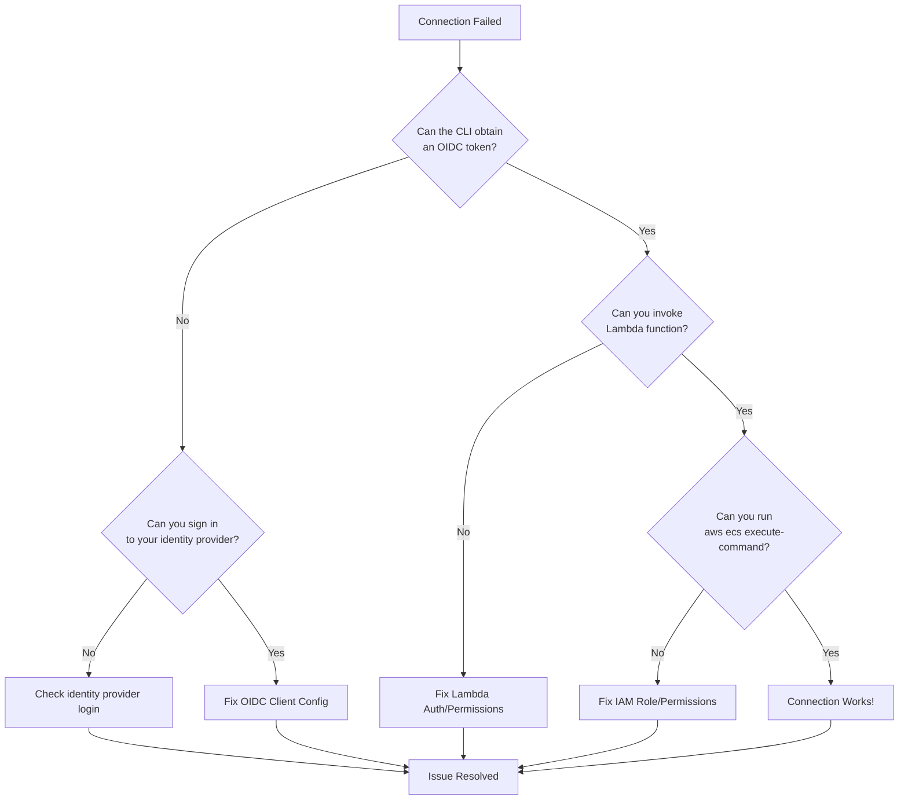

# Troubleshooting Guide

## Overview

This guide provides solutions to common issues when using Boundary with an external OIDC provider, AWS Lambda, and ECS Fargate.
Before running any command that uses `KEYCLOAK_ISSUER_URL`, set it for the
profile you are troubleshooting (see [OIDC issuer diagnostics](#oidc-issuer-diagnostics)).

## Troubleshooting Decision Tree



## Common Issues by Component

### 1. OIDC Sign-In Issues

#### "Invalid username or password"

**Symptoms:**
- The identity provider's login page rejects your credentials
- The browser flow never returns to the CLI callback

**Solutions:**

1. Confirm the profile points at the intended issuer and realm:
   ```bash
   ./bin/rosa-boundary config get keycloak_url
   ./bin/rosa-boundary config get keycloak_realm
   ```

2. Confirm the issuer serves OIDC discovery:
   ```bash
   curl -fsS "$KEYCLOAK_ISSUER_URL/.well-known/openid-configuration"
   ```

3. Retry `./bin/rosa-boundary login --force`. Account and password problems
   belong to the identity provider's operator — for Red Hat EmployeeIDP, the
   identity team. See [Getting Access](user-access-guide.md#getting-access).

#### "Realm not found"

**Symptoms:**
- The provider reports that the realm does not exist
- OIDC discovery returns 404

**Solutions:**

1. Compare the configured realm with the operator-supplied value:
   ```bash
   ./bin/rosa-boundary config get keycloak_realm
   ```
   The issuer is the base URL plus `/realms/<realm>`; `keycloak_url` must not
   already include the realm path.

2. Verify discovery resolves for that realm:
   ```bash
   curl -fsS "$KEYCLOAK_ISSUER_URL/.well-known/openid-configuration"
   ```

3. If discovery works for a different issuer than the one you configured, the
   CLI and the deployment disagree. Ask the deployment operator which issuer the
   Lambda and the IAM OIDC provider trust (`keycloak_issuer_url`).

#### "User not found in group"

**Symptoms:**
- Authentication succeeds but Lambda denies access
- Lambda returns "User is not a member of ... group"

**Solutions:**

1. Ask the deployment operator which groups are configured in `required_groups`.
2. Request membership upstream. EmployeeIDP group memberships are LDAP-synced and
   managed through app-interface or Rover rather than in a provider admin console;
   see [Getting Access](user-access-guide.md#getting-access). For personal dev,
   contact the administrator of the approved realm.
3. After membership propagates, force a fresh login so the new claim is in the
   token:
   ```bash
   ./bin/rosa-boundary login --force
   ```

### 2. OIDC Token Issues

#### "Token signature verification failed"

**Symptoms:**
- Lambda rejects OIDC token
- Error: "Invalid token signature"

**Solutions:**

1. Check JWKS endpoint is accessible:
   ```bash
   curl "$KEYCLOAK_ISSUER_URL/protocol/openid-connect/certs"
   ```

2. Confirm the profile's issuer and client ID match what the deployment trusts.
3. Retry with a fresh token: `./bin/rosa-boundary login --force`.

#### "Token expired"

**Symptoms:**
- "Token has expired" error from Lambda
- Old cached token

**Solutions:**

Refresh the token for the selected profile: `./bin/rosa-boundary login --force`.

### 3. Lambda Function Issues

#### "AccessDenied" when invoking Lambda

**Symptoms:**
- AWS denies the CLI's `lambda:InvokeFunction` request.

**Solutions:**

1. Confirm the profile points to the intended Lambda and invoker role.
2. Ask the deployment operator to confirm that the invoker role grants
   `lambda:InvokeFunction` for that function in the selected region. See
   [CLI authentication](../architecture/cli-authentication.md).

#### "User is not a member of required group"

**Symptoms:**
- Lambda returns 403 with group membership error
- User authenticated but not authorized

**Solutions:**

Follow [User not found in group](#user-not-found-in-group) above.

#### "Lambda timeout" or "No response"

**Symptoms:**
- Long delay then timeout error
- No response from Lambda

**Solutions:**

1. Check Lambda logs:
   ```bash
   aws logs tail /aws/lambda/rosa-boundary-dev-create-investigation --follow
   ```

2. Verify Lambda has network access to ECS/IAM/EFS APIs
3. Check Lambda execution role permissions

### 4. AWS IAM Role Issues

#### "AccessDenied" when assuming role

**Symptoms:**
- `aws sts assume-role-with-web-identity` fails
- Cannot assume returned IAM role

**Solutions:**

1. Verify OIDC provider trust relationship:
   ```bash
   aws iam get-role --role-name rosa-boundary-dev-user-<sub>
   ```

2. Check OIDC provider exists:
   ```bash
   aws iam list-open-id-connect-providers
   aws iam get-open-id-connect-provider --open-id-connect-provider-arn <arn>
   ```

3. Verify thumbprint matches Keycloak certificate

#### "AccessDenied" when executing ECS command

**Symptoms:**
- Role assumed successfully but ECS Exec fails
- "User is not authorized to perform: ecs:ExecuteCommand"

**Solutions:**

1. Check task tags match your username:
   ```bash
   aws ecs describe-tasks \
     --cluster rosa-boundary-dev \
     --tasks <task-arn> \
     --query 'tasks[0].tags'
   ```

2. Verify IAM role policy has tag-based condition:
   ```bash
   aws iam get-role-policy \
     --role-name rosa-boundary-dev-user-<sub> \
     --policy-name ExecuteCommandOnOwnedTasks
   ```

3. Ensure you're using the correct role (check `aws sts get-caller-identity`)

### 5. ECS Task Issues

#### "Task not found"

**Symptoms:**
- Task ARN returned by Lambda doesn't exist
- `aws ecs describe-tasks` returns empty

**Solutions:**

1. Verify task ARN is correct
2. Check task didn't fail to start:
   ```bash
   aws ecs describe-tasks \
     --cluster rosa-boundary-dev \
     --tasks <task-arn> \
     --query 'tasks[0].{lastStatus:lastStatus,stopCode:stopCode,stoppedReason:stoppedReason}'
   ```

3. Check CloudWatch logs for task startup errors:
   ```bash
   aws logs tail /ecs/rosa-boundary-dev --follow
   ```

#### "Task stopped unexpectedly"

**Symptoms:**
- Task was running but now stopped
- Connection dropped mid-session

**Solutions:**

1. Check stop reason:
   ```bash
   aws ecs describe-tasks \
     --cluster rosa-boundary-dev \
     --tasks <task-arn> \
     --query 'tasks[0].{stopCode:stopCode,stoppedReason:stoppedReason,exitCode:containers[0].exitCode}'
   ```

2. Check CloudWatch logs for errors
3. Verify EFS mount succeeded
4. Check for resource limits (CPU/memory)

#### "ECS Exec not enabled"

**Symptoms:**
- "Execute command failed: enable-execute-command is not enabled"

**Solutions:**

1. Verify task was launched with `--enable-execute-command`:
   ```bash
   aws ecs describe-tasks \
     --cluster rosa-boundary-dev \
     --tasks <task-arn> \
     --query 'tasks[0].enableExecuteCommand'
   ```

2. If false, this is a Lambda bug - contact administrator
3. As workaround, use manual scripts to launch task:
   ```bash
   cd deploy/regional/examples
   ./launch_task.sh <task-family>
   ```

### 6. Network and Connectivity Issues

#### "Cannot reach the OIDC issuer"

**Symptoms:**
- Timeout connecting to Keycloak
- DNS resolution fails

**Solutions:**

1. Check the issuer responds:
   ```bash
   curl -fsS "$KEYCLOAK_ISSUER_URL/.well-known/openid-configuration"
   ```

2. Verify DNS resolves for the issuer host:
   ```bash
   nslookup "$(printf '%s' "$KEYCLOAK_ISSUER_URL" | awk -F/ '{print $3}')"
   ```

3. If the host resolves but connections hang, check local egress (proxy, VPN, or
   corporate network policy) for HTTPS to that host.

#### "SSM session failed to start"

**Symptoms:**
- ECS Exec authorized but SSM connection fails
- "Failed to start session" error

**Solutions:**

1. Verify SSM agent is running in container:
   ```bash
   aws logs tail /ecs/rosa-boundary-dev --follow
   # Look for "Successfully registered with SSM"
   ```

2. Check KMS key permissions:
   ```bash
   aws kms describe-key --key-id <key-id>
   ```

3. Verify task has SSM IAM permissions

## Diagnostic Commands

### OIDC issuer diagnostics

Select the intended CLI profile first. If you use environment overrides, use
the effective base URL and realm rather than the saved values shown below.

```bash
# Show the saved base URL and realm; config get reports saved values only and
# ignores ROSA_BOUNDARY_* overrides, so compare them with your environment too
./bin/rosa-boundary config get keycloak_url
./bin/rosa-boundary config get keycloak_realm

# Derive the issuer from the base URL and realm
base_url="$(./bin/rosa-boundary config get keycloak_url)"
realm="$(./bin/rosa-boundary config get keycloak_realm)"
KEYCLOAK_ISSUER_URL="${base_url%/}/realms/$realm"

# Test OIDC endpoints of the configured issuer
curl "$KEYCLOAK_ISSUER_URL/.well-known/openid-configuration"
curl "$KEYCLOAK_ISSUER_URL/protocol/openid-connect/certs"

# Compare with the issuer AWS trusts for role assumption
aws iam list-open-id-connect-providers
```

### Lambda Diagnostics

```bash
# Get Lambda configuration
aws lambda get-function-configuration \
  --function-name rosa-boundary-dev-create-investigation

# Check Lambda logs
aws logs tail /aws/lambda/rosa-boundary-dev-create-investigation --follow
```

### IAM Diagnostics

```bash
# List OIDC providers
aws iam list-open-id-connect-providers

# Get provider details
aws iam get-open-id-connect-provider \
  --open-id-connect-provider-arn <arn>

# Get role details
aws iam get-role --role-name rosa-boundary-dev-user-<sub>

# List role policies
aws iam list-role-policies --role-name rosa-boundary-dev-user-<sub>

# Get policy document
aws iam get-role-policy \
  --role-name rosa-boundary-dev-user-<sub> \
  --policy-name ExecuteCommandOnOwnedTasks
```

### ECS Diagnostics

```bash
# List tasks
aws ecs list-tasks --cluster rosa-boundary-dev

# Describe task
aws ecs describe-tasks \
  --cluster rosa-boundary-dev \
  --tasks <task-arn>

# Get task logs
aws logs tail /ecs/rosa-boundary-dev --follow

# Check SSM session logs
aws logs tail /ecs/rosa-boundary-dev/ssm-sessions --follow

# Test ECS Exec directly
aws ecs execute-command \
  --cluster rosa-boundary-dev \
  --task <task-arn> \
  --container rosa-boundary \
  --interactive \
  --command "/bin/bash"
```

## Error Messages and Solutions

### "invalid_grant: Code not valid"

**Cause:** PKCE authorization code already used or expired

**Solution:**
```bash
./bin/rosa-boundary login --force
```

### "Unauthorized: Invalid token"

**Cause:** Token signature invalid or issuer mismatch

**Solution:**
1. Verify `KEYCLOAK_ISSUER_URL` is correct
2. Check JWKS endpoint is accessible
3. Regenerate token

### "Task definition not found"

**Cause:** Lambda failed to create task definition or it was deleted

**Solution:**
1. Check Lambda logs for errors
2. List task definitions:
   ```bash
   aws ecs list-task-definitions --family-prefix rosa-boundary-dev
   ```
3. Re-run investigation creation

### "EFS mount failed"

**Cause:** EFS access point doesn't exist or network issue

**Solution:**
1. Verify access point exists:
   ```bash
   aws efs describe-access-points \
     --file-system-id <fs-id>
   ```
2. Check security groups allow NFS (port 2049)
3. Verify subnets have EFS mount targets

## Logs Collection

### Collect full diagnostic bundle

```bash
#!/bin/bash
BUNDLE_DIR="rosa-boundary-diagnostics-$(date +%Y%m%d-%H%M%S)"
mkdir -p "$BUNDLE_DIR"

# OIDC issuer discovery metadata (no provider-side logs are available to users)
curl -sS "$KEYCLOAK_ISSUER_URL/.well-known/openid-configuration" \
  > "$BUNDLE_DIR/oidc-discovery.json"

# Lambda logs (last 1 hour)
aws logs filter-log-events \
  --log-group-name /aws/lambda/rosa-boundary-dev-create-investigation \
  --start-time $(($(date +%s) * 1000 - 3600000)) \
  > "$BUNDLE_DIR/lambda-logs.json"

# ECS logs
aws logs tail /ecs/rosa-boundary-dev --since 1h \
  > "$BUNDLE_DIR/ecs-task-logs.txt"

# Task details
aws ecs describe-tasks \
  --cluster rosa-boundary-dev \
  --tasks <task-arn> \
  > "$BUNDLE_DIR/ecs-task-details.json"

tar -czf "$BUNDLE_DIR.tar.gz" "$BUNDLE_DIR"
echo "Diagnostic bundle: $BUNDLE_DIR.tar.gz"
```

## Performance Issues

### "Slow OIDC authentication"

**Causes:**
- Network latency to the identity provider
- Slow responses from the provider itself

**Solutions:**
1. Time the discovery endpoint: `time curl -so /dev/null "$KEYCLOAK_ISSUER_URL/.well-known/openid-configuration"`
2. Check local egress (proxy or VPN) for added latency
3. Reuse the cached token rather than forcing a login on every command
4. If the provider itself is slow, raise it with the team that operates it

### "Slow Lambda invocation"

**Causes:**
- Lambda cold start
- Network latency
- IAM API throttling

**Solutions:**
1. Check Lambda duration in CloudWatch metrics
2. Increase Lambda memory if needed
3. Use provisioned concurrency for critical times

### "Slow ECS Exec connection"

**Causes:**
- SSM agent startup delay
- Network latency
- KMS key throttling

**Solutions:**
1. Wait 10-15 seconds after task reaches RUNNING
2. Check CloudWatch metrics for SSM latency
3. Use keep-alive script for long sessions

## Escalation Paths

### Identity Provider Issues
1. Confirm the issuer's discovery and JWKS endpoints respond
2. Confirm the required group/claim is present for your account
3. Contact the team that operates the provider — the identity team for Red Hat
   EmployeeIDP; this repository does not operate it

### Lambda Issues
1. Check CloudWatch Logs
2. Review Lambda execution role
3. Contact AWS support

### IAM/Permission Issues
1. Verify OIDC provider configuration
2. Review IAM role policies
3. Contact AWS administrators

### ECS/Container Issues
1. Check task definition
2. Review CloudWatch Logs
3. Test container locally with podman

## Known Limitations

1. **EFS Access Point Limit**: Maximum 10,000 access points per filesystem
2. **Token Cache Duration**: OIDC tokens cached for 4 minutes
3. **IAM Role Limit**: Soft limit of 1000 roles per account (one per user)
4. **Task Definition Limit**: 1,000,000 revisions per family (shouldn't be reached)
5. **SSM Session Limit**: 25 concurrent sessions per instance (Fargate tasks)

## Additional Resources

- [Architecture Overview](../architecture/overview.md) - OIDC issuer, claims, and provider configuration
- [AWS IAM Policies](../configuration/aws-iam-policies.md) - IAM role policies
- [User Access Guide](user-access-guide.md) - End-user workflow
- [Investigation Workflow](investigation-workflow.md) - Admin workflow
