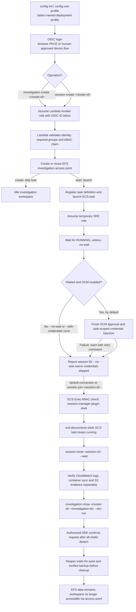

# CLI Workflow Flowcharts

These flows describe the named-profile CLI. Select an approved Boundary account and region using `--profile <name>` or `config use-profile <name>` before operating. See the [user access guide](runbooks/user-access-guide.md) and [investigation workflow](runbooks/investigation-workflow.md) for prerequisites, audit checks, and recovery. An investigation workspace can outlive multiple sessions; a Boundary session ID identifies an ECS task, **not** its ECS Exec/SSM connection.

The `session close --wait` result proves only STOPPED, not S3 sync; the investigation remains open. An attached shell blocks a new investigation close request, even the requester's own: disconnect and retry. A running task without a shell does not block acceptance. If a shell is observed after acceptance, the reaper waits without a new request. `--force` grants consent to stop tasks, not to interrupt shells or skip backup verification. A background reaper can stop a shell-less session at its configured timeout or any managed session at eight hours of task age; it does not replace explicit audit verification.
