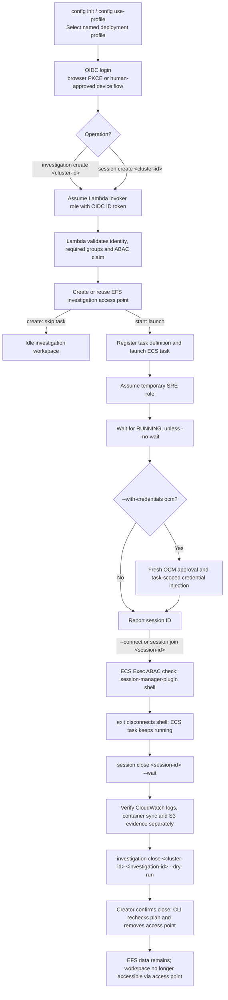

# CLI Workflow Flowcharts

These flows describe the named-profile CLI. Select an approved Boundary account and region using `--profile <name>` or `config use-profile <name>` before operating. See the [user access guide](runbooks/user-access-guide.md) and [investigation workflow](runbooks/investigation-workflow.md) for prerequisites, audit checks, and recovery. An investigation workspace can outlive multiple sessions; a Boundary session ID identifies an ECS task, **not** its ECS Exec/SSM connection.

The `session close --wait` result proves only STOPPED, not S3 sync; the investigation remains open. `investigation close` without `--force` refuses active or still-stopping sessions; with `--force`, it waits for STOPPED before deleting the access point. The CLI checks the creator's `oidc_sub` tag, but regional IAM does not enforce that owner boundary for other AWS clients. Creation racing with close remains possible. A background reaper stops sessions past their tagged deadline; it does not replace explicit audit verification.
