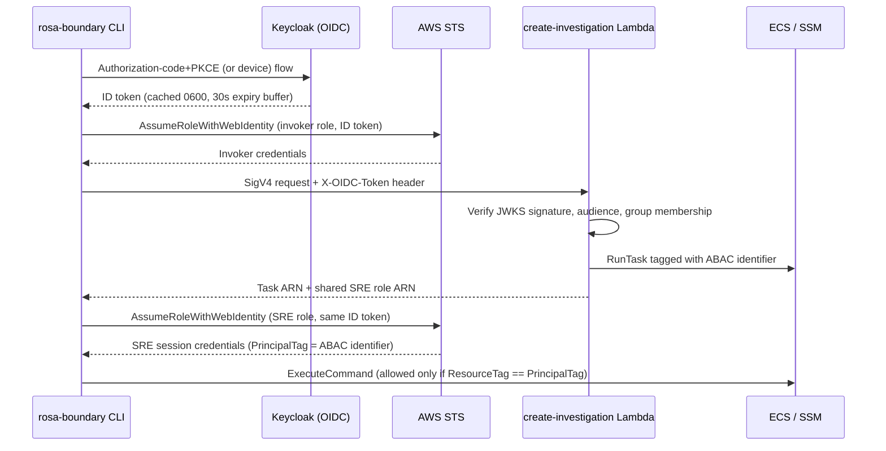

# Identity and Access Architecture (Boundary)

Boundary's identities all federate external OIDC tokens into AWS IAM, but there are two independent trust boundaries and one shared provisioning layer:

- **Keycloak OIDC → AWS IAM**: operators and the `create-investigation` Lambda exchange Keycloak-issued ID tokens for AWS credentials, gated by group membership and ABAC session tags. This covers CLI login, Lambda-side token validation, and ECS Exec isolation.
- **GitHub Actions OIDC → AWS IAM**: a separate trust relationship lets specific GitHub repositories' workflows assume dedicated publisher roles to push content, with no relation to the Keycloak identities above.
- **The `shared-iam` Terraform module** (`deploy/account/modules/shared-iam`), invoked from `deploy/account/main.tf`, is the single place that creates every one of these account-global identities — SRE/invoker/Lambda roles as well as the GitHub Actions publisher and replication roles — so regional Terraform roots never define their own identities, only grants against ARNs they look up.

This page covers only Boundary's own identity model. Trusted Actions uses a separate OCM-JWT/AMS authorization model for its own actions and is documented on its own page; see [Trusted Actions authorization](trusted-actions-authorization.md).

## CLI login and AWS credentials

The default CLI login is an authorization-code flow with PKCE: `GetTokenWithOptions` checks the token cache first, then `acquireBrowserToken` creates a verifier/challenge and CSRF state, starts a local callback listener, opens the browser, and exchanges the callback code at the Keycloak token endpoint. A separate device-authorization flow (`--use-device-code`, or a default forced by configuration) lives in its own module, `acquireDeviceToken`: it posts to the provider's device endpoint, displays a verification URL and user code, and polls the token endpoint on the provider-supplied interval until approval, denial, or expiry. Both flows return a raw ID token to the same caller, `getTokenWithOptionsAndDeps`, which validates its expiration before caching it.

The returned ID token is cached with mode `0600` (re-applied with `os.Chmod` on every write in case an older cache was created with broader permissions). Cache reads parse the JWT expiration and treat tokens expiring within a 30-second buffer as unusable, deleting a malformed cache file outright. A freshly obtained token is also rejected before caching if it does not have at least that same 30-second remaining lifetime, which maps to the same `expirationBuffer` constant used by the cache reader. An explicit force-login bypasses the cache entirely. The CLI's central pre-run hook, `commandPreRun` in `internal/cmd/cli.go`, authenticates AWS-dependent commands, reuses a cached token when possible, and retries once with a fresh login for recognized token-authentication failures (`isAuthError`) via `assumeRoleWithRetryOptions`.

`commandPreRun` selects the AWS role to assume before invocation based on the invoked command: `investigation create` and `session create` assume the invoker role (session name `rosa-boundary-invoker`), and both also require `invoker_role_arn` and `lambda_function_name` to be configured; every other operational command (`session list`, `session join`, `session close`, `investigation list`, `investigation close`, credential configuration) assumes the shared SRE role directly (session name `rosa-boundary-session`) and requires `sre_role_arn`.

`session create` (`runStartSession` in `internal/cmd/start_session.go`) performs a second, explicit role assumption after its Lambda call: it invokes the Lambda with SigV4 credentials from the invoker-role session, then calls `assumeRoleWithRetryOptions` again — this time against the SRE role ARN returned by the Lambda (or an operator-configured `sre_role_arn` override), using a session name derived from the Lambda-reported owner — to obtain the credentials used for ECS operations. This is a two-stage flow: the invoker credential authorizes the Lambda invocation only, while the returned/configured SRE role credential is used for ECS task waiting, credential configuration, and ECS Exec. By contrast, `investigation create` (`runCreateInvestigation` in `internal/cmd/create_investigation.go`) only ever authenticates with the invoker role: it makes a single Lambda call (`CreateInvestigationOnly`, which sets `skip_task`) to create the investigation's EFS access point without launching an ECS task, so no second role assumption is needed.

The Lambda Function URL is configured for AWS IAM authorization. The regional invoker policy grants `lambda:InvokeFunction` on the function ARN because the CLI uses direct Lambda SDK invocation; the Lambda independently checks the OIDC token supplied in `X-OIDC-Token` (with a Bearer header fallback). Thus a valid AWS invocation credential does not replace application-level token validation.

## Lambda authorization

Before resource creation, the Lambda validates required configuration and the request, then routes the token by its unverified `iss` claim to a configured issuer's JWKS endpoint (primary Keycloak realm, and optional stage/prod OIDC providers). The selected key is used to verify the RS256 signature, expiration, and expected audience. Unsupported issuers and failed validation are rejected. After validation, the handler checks that the identity belongs to at least one configured required group/role, accepting either the flat `groups` claim or `realm_access.roles` shape.

The handler extracts the configured ABAC identifier from the `https://aws.amazon.com/tags` principal-tags claim. When the configured key is the default `username`, it can fall back to `preferred_username`; for a non-default key, a missing tag is rejected rather than silently using a different identity. The Lambda applies that identifier to the ECS task resource tag and returns the shared SRE role ARN in the response for the caller's second role assumption.

## Shared-role ABAC for ECS Exec

Account Terraform defines the shared SRE role (`aws_iam_role.sre_shared` in `deploy/account/modules/shared-iam/oidc.tf`) with OIDC trust and `sts:TagSession`, so AWS can map the token's principal tags into session tags. The role's trust policy is built from up to three federated principals — the primary Keycloak provider plus optional stage and prod providers, each created in `deploy/account/oidc.tf` and passed into the module as an ARN — with an audience condition scoped to each provider's own client ID, and optional `aws:RequestTag/uuid` and `aws:RequestTag/roles` conditions when the UUID allowlist or group-enforcement switches are enabled. Regional Terraform owns its ECS Exec policy: the task statement compares `ecs:ResourceTag/<abac_tag_key>` with `${aws:PrincipalTag/<abac_tag_key>}`. A missing or non-matching tag therefore does not satisfy the task condition. The ABAC key is configurable, and must agree across the OIDC claim, task tag, and IAM condition.

The role also grants supporting list/describe, stop, EFS access-point cleanup, and SSM/KMS permissions used by operator workflows. These are distinct from the task-tag-conditioned `ecs:ExecuteCommand` permission; shared-role assumption is the authorization boundary for investigation cleanup. Integration tests check the audience-scoped OIDC trust, `sts:TagSession`, dynamic PrincipalTag policy expression, and task tagging rather than a per-user role model.



*Two-stage authorization for `session create`: an invoker-role credential authorizes the Lambda call, and a second, independently assumed shared SRE role credential (tagged via ABAC) authorizes ECS task access. `investigation create` only performs the first stage, since it creates an EFS access point but no ECS task.*

## GitHub OIDC for content publishing

A second, unrelated OIDC trust lets specific GitHub repositories publish content, entirely independent of Keycloak and the SRE/invoker roles above. `deploy/account/github-oidc.tf` manages the account's GitHub Actions OIDC provider (issuer `https://token.actions.githubusercontent.com`) in one of three modes selected by `create_github_actions_oidc_provider` and `adopt_existing_resources`:

- **create** (default): this Terraform state creates and owns `aws_iam_openid_connect_provider.github_actions`.
- **reference** (`create_github_actions_oidc_provider = false`): the provider is looked up by issuer URL via a data source and is not managed here — useful when another account state already owns it.
- **adopt** (`create_github_actions_oidc_provider = true` and `adopt_existing_resources = true`): an existing provider is imported into this state using a declarative `import` block.

AWS allows only one OIDC provider per issuer URL per account, so these modes are mutually exclusive by construction; picking the wrong one fails the plan rather than silently duplicating or destroying the provider. No thumbprint is pinned — the argument is optional and computed by the AWS provider, which AWS itself keeps current for this issuer. The audience is hard-coded to `sts.amazonaws.com` as a local rather than exposed as a variable, specifically so no workspace configuration can widen what the publisher trust policies accept.

The resolved provider ARN and audience are passed from the account root into the `shared_iam` module (`local.github_actions_provider_arn`, `local.github_actions_audience` in `deploy/account/main.tf`), which creates the actual publisher identities in `deploy/account/modules/shared-iam/content-publishing.tf`:

- **One IAM role per source repository** (`aws_iam_role.content_publisher`, named `<role_name_prefix>-publisher-<key>`), never a single shared publisher role — so a compromised workflow in one repository cannot use another repository's identity once regional content grants exist. The default `content_publisher_sources` map (defined in `deploy/account/variables.tf`) pins three repositories: `ops-sop` (`openshift/ops-sop`, branch `master`), `managed-notifications` (`openshift/managed-notifications`, branch `master`), and `rosa-claude-plugins` (`openshift-online/rosa-claude-plugins`, branch `main`).
- Each role's trust policy uses `sts:AssumeRoleWithWebIdentity` with `StringEquals` conditions on `<issuer-host>:aud` (the fixed `sts.amazonaws.com` audience) and `<issuer-host>:sub`, where the subject is built from a fixed template, `repo:<repository>:ref:refs/heads/<branch>`. Input validation on `content_publisher_sources` rejects a repository or branch value containing its own `:` segment, a `*`, or a full ref (for example `refs/pull/1/merge`), so no configuration can turn this into a trust condition for a pull request, a merge ref, or a GitHub Actions environment. A resource precondition also rejects the module if the account root did not resolve a provider ARN.
- A dedicated **content replication role** (`aws_iam_role.content_replication`) exists independently of the publisher roles and of the pre-existing audit replication role: it trusts the S3 service principal with no condition, matching the audit role's trust shape but kept as a separate identity with its own name, description, and tags.
- Like the rest of this module, these resources grant **identity and trust only** — no bucket, KMS key, or region is referenced here. The regional Terraform root is responsible for attaching the actual S3/KMS content-publishing and replication permissions; until that lands, a publisher role is assumable but holds no content access from this configuration alone.

<!-- openwiki: mermaid parse failed and this diagram was converted to a text fence so it does not break rendering. Fix the diagram source and restore the mermaid fence. Parser error: Heuristic: an unescaped angle bracket inside a label breaks rendering; rephrase the label. -->
```text
sequenceDiagram
    participant GH as GitHub Actions workflow
    participant OIDC as GitHub OIDC provider (AWS IAM)
    participant STS as AWS STS
    participant Pub as content_publisher role
    participant S3 as Content bucket / KMS (regional grants)

    GH->>OIDC: Workflow OIDC token (sub = repo:<owner/name>:ref:refs/heads/<branch>)
    GH->>STS: AssumeRoleWithWebIdentity (publisher role for that source)
    STS->>STS: StringEquals on aud (sts.amazonaws.com) and sub (exact repo+branch)
    STS-->>GH: Publisher session credentials
    GH->>S3: Publish content (permissions granted by regional root, not here)
```

*GitHub Actions OIDC federation into a per-repository publisher role. The account root only creates identity and trust; regional Terraform separately grants the S3/KMS permissions a publisher session can use.*

## The shared-iam module: account-wide identity provisioning

All of the identities above — SRE/invoker/Lambda roles, the metrics-read role, the S3 replication role, and the GitHub Actions publisher/replication roles — are created by one module, `shared_iam`, instantiated once from `deploy/account/main.tf`. This is deliberate: the module's own commentary is explicit that regional states must never configure `inline_policy`, `managed_policy_arns`, or exclusive policy-assignment resources on these roles directly, only augment them, so that identity creation stays centralized while permissions stay regional.

The account root resolves every externally-trusted OIDC provider before calling the module:

- The primary, stage, and prod Keycloak providers are created in `deploy/account/oidc.tf` and their ARNs (`aws_iam_openid_connect_provider.keycloak.arn`, and the stage/prod equivalents when those issuer URLs are configured) are passed into `shared_iam` as `keycloak_provider_arn`, `stage_keycloak_provider_arn`, and `prod_keycloak_provider_arn`.
- The GitHub Actions provider is created or looked up in `deploy/account/github-oidc.tf`, and its resolved ARN and fixed audience are passed in as `github_actions_provider_arn` and `github_actions_audience`. The module deliberately exposes no account-root variable for the audience, so a workspace cannot widen it beyond `sts.amazonaws.com`.

The module's `outputs.tf` is the stable contract the rest of the account and every regional root depend on:

- `roles` is a fixed-shape map of name/ARN pairs for the core operational roles (execution, task, `sre_shared`, `lambda_invoker`, the three Lambda roles, Bedrock invocation logging, and the optional S3-replication and metrics-read roles), re-exported at the account root as `shared_roles`.
- `content_publisher_roles` is a separate, configuration-dependent map keyed by each source's stable short key, each entry carrying its name, ARN, repository, branch, and exact trust subject — kept apart from `roles` specifically so that map's shape does not vary by workspace. The account root re-exports this as `content_publisher_roles` and a flattened `content_publisher_role_arns` convenience map.
- `content_replication_role` is the dedicated content-replication identity, re-exported as `content_replication_role_arn`.
- The account root also exports `github_actions_oidc_provider_arn`, so downstream consumers get the resolved ARN regardless of whether this state created, referenced, or adopted the provider.

Regional Terraform roots never read account Terraform state directly; they consume these role names/ARNs (and the `account_role_name_prefix` / `legacy_policy_region` contract from `regional_iam_contract`) via IAM lookups, and attach their own scoped grants. This keeps identity issuance (who can assume what, and under which federated/claim conditions) entirely in the account root, while permissions (what an assumed role can actually do) stay owned by regional roots — the same split that applies to the SRE shared role's ECS Exec ABAC policy described above.

## Evidence-backed claims

- The CLI uses an OIDC authorization-code flow with PKCE (with a separately implemented device-authorization alternative), caches the ID token with restrictive permissions, and rejects tokens within a 30-second expiration buffer both on cache read and immediately after acquisition. [OIDC flow](repo://internal/auth/oidc.go#L57-L184) · [device flow](repo://internal/auth/device.go#L40-L124) · [token cache](repo://internal/auth/token.go#L16-L138)
- CLI authentication selects the invoker role for `investigation create` and `session create`, and the shared SRE role directly for other operational commands; `session create` invokes the Lambda first and then assumes the SRE role via a second, explicit `assumeRoleWithRetryOptions` call, while `investigation create` makes a single invoker-only Lambda call and never assumes the SRE role. [pre-run role selection](repo://internal/cmd/cli.go#L56-L136) · [session create two-stage flow](repo://internal/cmd/start_session.go#L33-L131) · [investigation create single-stage flow](repo://internal/cmd/create_investigation.go#L22-L60)
- The Lambda validates signed OIDC tokens against configured issuer JWKS/audience, checks required group membership, and derives the task ABAC identifier from claims before creating resources. [claims extraction and group/ABAC checks](repo://lambda/create-investigation/handler.py#L181-L256) · [issuer routing and JWKS verification](repo://lambda/create-investigation/handler.py#L374-L457)
- The shared SRE role requires OIDC session tagging and regional IAM policy gates ECS Exec on equality between the task resource tag and the caller's principal tag. [role trust](repo://deploy/account/modules/shared-iam/oidc.tf#L12-L85) · [regional ABAC policy](repo://deploy/regional/iam.tf#L188-L213)
- Lambda invocation is protected with AWS IAM/SigV4 and the function separately validates the OIDC token; the regional invoker policy targets direct Lambda invocation. [invocation permission](repo://deploy/regional/iam.tf#L260-L275) · [Lambda URL authorization](repo://deploy/regional/lambda-create-investigation.tf#L162-L182)
- `deploy/account/github-oidc.tf` manages the GitHub Actions OIDC provider in three mutually exclusive modes (create, reference-only, or adopt-via-import) selected by `create_github_actions_oidc_provider` and `adopt_existing_resources`, pins the client audience to the fixed local `sts.amazonaws.com` rather than a variable, and omits a thumbprint since AWS computes it. [provider modes](repo://deploy/account/github-oidc.tf#L1-L63) · [import block](repo://deploy/account/github-oidc.tf#L65-L72) · [audience/mode variables](repo://deploy/account/variables.tf#L170-L174)
- The `shared-iam` module creates one dedicated IAM role per configured GitHub content-publisher source (never a shared publisher role), trusting GitHub Actions OIDC via `StringEquals` on a fixed `repo:<repository>:ref:refs/heads/<branch>` subject and the pinned audience; input validation rejects wildcards, colons, and full refs in the source configuration so no input can widen the subject to a pull request, merge ref, or environment. [publisher role and trust policy](repo://deploy/account/modules/shared-iam/content-publishing.tf#L18-L70) · [source validation](repo://deploy/account/modules/shared-iam/variables.tf#L72-L113) · [default sources](repo://deploy/account/variables.tf#L176-L187)
- A dedicated content-replication IAM role, separate from the pre-existing audit replication role, trusts the S3 service principal with no condition and is always created alongside the publisher roles. [content replication role](repo://deploy/account/modules/shared-iam/content-publishing.tf#L72-L89)
- These content-publishing and replication roles carry identity and trust only; the account root never references a regional bucket, KMS key, or region, so a publisher role is assumable but grants no content access until a separate regional change attaches permissions. [module scope](repo://deploy/account/modules/shared-iam/content-publishing.tf#L1-L16)
- `deploy/account/main.tf` instantiates the `shared_iam` module exactly once as the sole creator of every account-global identity (SRE/invoker/Lambda roles, metrics-read, S3 replication, and the GitHub Actions publisher/replication roles), resolving the Keycloak and GitHub Actions OIDC provider ARNs beforehand and passing them in as inputs; regional roots only attach grants to these identities, never define their own. [module instantiation and provider wiring](repo://deploy/account/main.tf#L42-L77) · [Keycloak provider resources](repo://deploy/account/oidc.tf#L1-L51)
- The `shared-iam` module's outputs separate a fixed-shape `roles` map (core operational identities) from a configuration-dependent `content_publisher_roles` map keyed by source, plus a distinct `content_replication_role`, so the account root and regional roots can consume stable identity references independent of how many publisher sources are configured. [module outputs](repo://deploy/account/modules/shared-iam/outputs.tf#L1-L35) · [account-level re-exports](repo://deploy/account/outputs.tf#L22-L41)

## Related pages

- [System overview](system-overview.md)
- [Trusted Actions authorization](trusted-actions-authorization.md)
- [Keycloak deployment](../integrations/keycloak-deployment.md)
- [Credential lifecycle](../security/credential-lifecycle.md)
- [Investigation lifecycle](../workflows/investigation-lifecycle.md)
</content>
