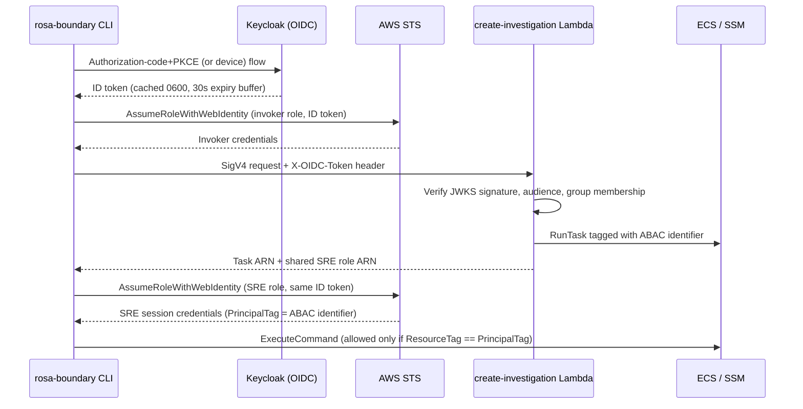

# Identity and access control

ROSA Boundary uses Keycloak-issued OIDC ID tokens at separate trust boundaries. The CLI obtains a token for the operator, AWS STS exchanges it for temporary credentials, and the investigation Lambda validates the token again before creating a workspace or task. AWS IAM and ECS resource tags—not local CLI filtering—enforce task-level ECS Exec isolation.

## CLI login and AWS credentials

The default CLI login is an authorization-code flow with PKCE: `GetTokenWithOptions` checks the token cache first, then `acquireBrowserToken` creates a verifier/challenge and CSRF state, starts a local callback listener, opens the browser, and exchanges the callback code at the Keycloak token endpoint. A separate device-authorization flow (`--use-device-code`, or a default forced by configuration) lives in its own module: it posts to the provider's device endpoint, displays a verification URL and user code, and polls the token endpoint on the provider-supplied interval until approval, denial, or expiry. Both flows return a raw ID token to the same caller, which validates its expiration before caching it.

The returned ID token is cached with mode `0600` (re-applied with `os.Chmod` on every write in case an older cache was created with broader permissions). Cache reads parse the JWT expiration and treat tokens expiring within a 30-second buffer as unusable, deleting a malformed cache file outright. A freshly obtained token is also rejected before caching if it does not have at least that same 30-second remaining lifetime, which maps to the same `expirationBuffer` constant used by the cache reader. An explicit force-login bypasses the cache entirely. The CLI's central pre-run hook (`authenticateIfNeeded`) authenticates AWS-dependent commands, reuses a cached token when possible, and retries once with a fresh login for recognized token-authentication failures (`isAuthError`) via `assumeRoleWithRetryOptions`.

`authenticationRole` selects the AWS role to assume before invocation: `create-investigation` and `start-task` assume the Lambda invoker role, while every other operational command assumes the shared SRE role directly. `start-task` performs a second, explicit role assumption after its Lambda call: it invokes the Lambda with SigV4 credentials from the invoker-role session, then calls `assumeRoleWithRetryOptions` again—this time against the SRE role ARN returned by the Lambda (or an operator override)—to obtain the credentials used for ECS operations. This is a two-stage flow: the invoker credential authorizes Lambda invocation only, while the returned/configured SRE role credential is used for ECS task waiting, credential configuration, and ECS Exec.

The Lambda Function URL is configured for AWS IAM authorization. The regional invoker policy grants `lambda:InvokeFunction` on the function ARN because the CLI uses direct Lambda SDK invocation; the Lambda independently checks the OIDC token supplied in `X-OIDC-Token` (with a Bearer header fallback). Thus a valid AWS invocation credential does not replace application-level token validation.

## Lambda authorization

Before resource creation, the Lambda validates required configuration and the request, then routes the token by its unverified issuer claim to a configured issuer's JWKS endpoint. The selected key is used to verify the RS256 signature, expiration, and expected audience. Unsupported issuers and failed validation are rejected. After validation, the handler checks that the identity belongs to at least one configured required group/role, accepting either the flat `groups` claim or `realm_access.roles` shape.

The handler extracts the configured ABAC identifier from the AWS session-tags claim. When the configured key is the default `username`, it can fall back to `preferred_username`; for a non-default key, a missing tag is rejected rather than silently using a different identity. The Lambda applies that identifier to the ECS task resource tag and returns the shared SRE role ARN for the caller's second role assumption.

## Shared-role ABAC for ECS Exec

Account Terraform defines the shared SRE role with OIDC trust and `sts:TagSession`, so AWS can map the token's principal tags into session tags. Regional Terraform owns its ECS Exec policy: the task statement compares `ecs:ResourceTag/<abac_tag_key>` with `${aws:PrincipalTag/<abac_tag_key>}`. A missing or non-matching tag therefore does not satisfy the task condition. The ABAC key is configurable, and must agree across the OIDC claim, task tag, and IAM condition.

The role also grants supporting list/describe, stop, EFS access-point cleanup, and SSM/KMS permissions used by operator workflows. These are distinct from the task-tag-conditioned `ecs:ExecuteCommand` permission; shared-role assumption is the authorization boundary for investigation cleanup. Integration tests check the audience-scoped OIDC trust, `sts:TagSession`, dynamic PrincipalTag policy expression, and task tagging rather than a per-user role model.

*Two-stage authorization: an invoker-role credential authorizes the Lambda call, and a second, independently assumed shared SRE role credential (tagged via ABAC) authorizes ECS task access.*

## Evidence-backed claims

- The CLI uses an OIDC authorization-code flow with PKCE (with a separately implemented device-authorization alternative), caches the ID token with restrictive permissions, and rejects tokens within a 30-second expiration buffer both on cache read and immediately after acquisition. [OIDC flow](repo://internal/auth/oidc.go#L58-L188) · [device flow](repo://internal/auth/device.go#L42-L131) · [token cache](repo://internal/auth/token.go#L16-L138)
- CLI authentication selects the invoker role for investigation creation/start and uses the shared SRE role for operational commands; `start-task` invokes Lambda first and then assumes the SRE role via a second, explicit `assumeRoleWithRetryOptions` call. [pre-run role selection](repo://internal/cmd/root.go#L171-L228) · [start-task sequence](repo://internal/cmd/start_task.go#L98-L159)
- The Lambda validates signed OIDC tokens against configured issuer JWKS/audience, checks required group membership, and derives the task ABAC identifier from claims before creating resources. [token extraction and checks](repo://lambda/create-investigation/handler.py#L107-L135) · [claims and authorization](repo://lambda/create-investigation/handler.py#L175-L260) · [issuer verification](repo://lambda/create-investigation/handler.py#L362-L405)
- The shared SRE role requires OIDC session tagging and regional IAM policy gates ECS Exec on equality between the task resource tag and the caller's principal tag. [role trust](repo://deploy/account/modules/shared-iam/oidc.tf#L12-L85) · [regional ABAC policy](repo://deploy/regional/iam.tf#L143-L168)
- Lambda invocation is protected with AWS IAM/SigV4 and the function separately validates the OIDC token; the regional invoker policy targets direct Lambda invocation. [invocation permission](repo://deploy/regional/iam.tf#L215-L230) · [Lambda URL authorization](repo://deploy/regional/lambda-create-investigation.tf#L162-L182)

## Related pages

- [System overview](system-overview.md)
- [Keycloak deployment](../integrations/keycloak-deployment.md)
- [Credential lifecycle](../security/credential-lifecycle.md)
- [Investigation lifecycle](../workflows/investigation-lifecycle.md)
