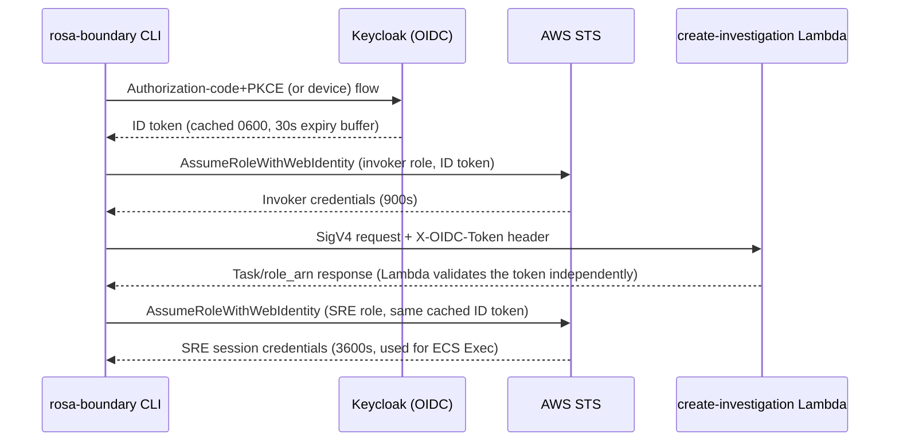

# Identity and access architecture

The Boundary CLI never stores a long-lived AWS credential. Every authenticated command obtains a Keycloak-issued OIDC ID token (interactively, or from a local cache) and exchanges it for short-lived AWS credentials via `sts:AssumeRoleWithWebIdentity`.

This page is scoped to that CLI-side mechanism: the PKCE and device-code token-acquisition flows, the on-disk token cache, and the logic that picks which AWS role a given command assumes and retries a failed assumption. It does not duplicate:

- the account-level Terraform that creates the Keycloak OIDC provider(s) and the shared SRE/invoker IAM roles and their trust policies — see [Credential lifecycle](../security/credential-lifecycle.md);
- the Keycloak realm/client configuration, the required ID token claims, and the `create-investigation` Lambda's own JWKS-based token validation — see [Keycloak and OIDC provider integration](../integrations/keycloak-deployment.md);
- the broader request path from CLI to ECS task — see [System overview](system-overview.md) and [Investigation lifecycle](../workflows/investigation-lifecycle.md).

## CLI flag and option plumbing (`internal/cmd/auth_options.go`)

Flag parsing and other auth-adjacent plumbing shared across every authenticating command is centralized in `internal/cmd/auth_options.go` rather than duplicated per command: `addOutputFlag`/`commandOutput` register and validate the `-o/--output text|json` flag used by every auth-bearing leaf, `tokenOptions` builds the `auth.Options{UseDeviceCode: cfg.OIDCUseDeviceCode}` value passed into every token-acquisition call from the resolved profile, and `configureDeviceCode` guards the `config init` bootstrap path so a saved device-flow preference is set only by an explicit `--use-device-code=true` on that command — bootstrap never inherits a preference from an existing profile or environment.

## Token acquisition: PKCE browser flow and device-code flow

All PKCE/device-code token acquisition, caching, and clearing is owned by the dedicated `internal/auth` package (`oidc.go`, `device.go`, `callback.go`, `token.go`), not by `internal/cmd`:

- `GetTokenWithOptions` → `getTokenWithOptionsAndDeps` (`internal/auth/oidc.go`) is the single entrypoint both flows share: unless `force` is set, it checks the cache (`CachedTokenForConfig`) first, dispatches to `acquireBrowserToken` or `acquireDeviceToken` based on `Options.UseDeviceCode`, validates that the resulting token has at least `expirationBuffer` (30s) of remaining lifetime before accepting it, and persists it via `SaveTokenForConfig`.
- The **PKCE browser-callback flow** (`acquireBrowserToken`, delegating to `internal/auth/callback.go`) is the default when device mode is not selected. It generates a PKCE verifier/challenge and a CSRF `state`, starts a local callback HTTP server on `127.0.0.1:8400` (`startCallbackServer`) before opening the system browser, and waits for the redirect. The callback handler rejects a missing `code` and a `state` mismatch (treated as a possible CSRF attempt), and sanitizes any provider-supplied `error`/`error_description` by stripping ASCII control characters and capping length before ever echoing them into the browser response — guarding against terminal/HTML injection from an untrusted redirect. A successful callback is exchanged for an ID token at the Keycloak token endpoint (`exchangeCode`).
- The **device-authorization flow** (`acquireDeviceToken` in `internal/auth/device.go`) is a distinct, separately implemented path selected by explicit `--use-device-code=true` (bare flag means true), else `ROSA_BOUNDARY_OIDC_USE_DEVICE_CODE`, else the selected profile's saved `oidc_use_device_code`, else default `false` — the same precedence `config init` bootstrap deliberately bypasses (see above). It also builds a PKCE challenge, posts to the provider's device-authorization endpoint, and validates the response defensively before use: it rejects an `expires_in` that is zero, negative, or over an hour; a verification URI that is empty, non-`http(s)`, or embeds the device code itself; an oversized user code or URI; or any ASCII control character in either value. Only after those checks does it print the verification URL and user code to stderr and begin polling. Polling honors `authorization_pending` (keep waiting), `slow_down` (add 5s to the interval), `access_denied`, and `expired_token`; the whole exchange is bounded by a context timeout equal to the provider's `expires_in`, and a polling interval larger than that window is rejected outright rather than risk an unreachable poll.
- Both flows return a raw ID token to the same caller, `getTokenWithOptionsAndDeps`, so cache format, the 30-second expiration buffer, and persistence behavior are identical regardless of which flow produced the token.

## Token cache (`internal/auth/token.go`)

The ID token cache is scoped per OIDC issuer and client: `CachedTokenForConfig`/`SaveTokenForConfig` key cache entries by the profile's Keycloak issuer URL (`issuerForConfig`, built from `KeycloakURL` + `/realms/<Realm>`) and client ID, so switching profiles or issuers never reuses another deployment's cached token, and a legacy unscoped cache is not trusted once a profile is configured. The cache file is written with mode `0600`, re-applied via `os.Chmod` on every write in case an older cache was created with broader permissions. On read, an entry whose JWT cannot be parsed is deleted outright; an entry that is within the 30-second expiration buffer is treated as absent (without deletion). A freshly obtained token is rejected before caching under the same buffer. An explicit force-login bypasses the cache entirely.

## Role selection in `commandPreRun` (`internal/cmd/cli.go`)

`commandPreRun` is Cobra's `PersistentPreRunE`, so it runs for every leaf command after argument/flag validation but before the command body. Offline `config` subcommands and `login` return early without resolving a profile or requesting credentials. For every other command it resolves the active profile, then picks **one** of two roles, a session name, and an STS duration, before calling `assumeRoleWithRetryOptions` once:

- **Invoker role** (`cfg.InvokerRoleARN`, session `rosa-boundary-invoker`, `invokerSTSDurationSeconds` = 900s) is selected when either:
  - the command is `investigation close --status` (a status-only lookup), or
  - the command is `create` under `session` or `investigation`.

  These commands additionally require `invoker_role_arn` and `lambda_function_name` in the resolved profile (plus `ecs_cluster_name` when the command is under `session`), since they call the `create-investigation` Lambda directly with SigV4 credentials from this role.
- **Shared SRE role** (`cfg.SRERoleARN`, session `rosa-boundary-session`, `sreSTSDurationSeconds` = 3600s) is the default for every other authenticated command, and requires `sre_role_arn`. Beyond that base requirement:
  - `investigation list` additionally requires `efs_filesystem_id` (it scans EFS access points, not a running task) instead of `ecs_cluster_name`; every other SRE-rooted command requires `ecs_cluster_name`.
  - `session join --auto-close` additionally requires `invoker_role_arn` and `lambda_function_name` even though the join itself assumes the SRE role — this fails on missing configuration before the interactive sign-in starts, rather than only once the session ends and auto-close tries to call the Lambda.
  - `investigation close` (without `--status`) additionally requires `efs_filesystem_id`, and — unless `--dry-run` is set — also `invoker_role_arn` and `lambda_function_name`. Close is a request to a close service, not direct CLI deletion: `commandPreRun` assumes the SRE role so the command can preview the workspace, and the close command itself separately assumes the invoker role (`internal/cmd/close_investigation.go`) to submit the request. A dry run never submits, so it never needs invoker credentials.

Before assuming either role, `commandPreRun` validates both `invoker_role_arn` and `sre_role_arn` (when set) against the profile's `account_id` with `checkRoleAccounts`, rejecting an ARN from a different 12-digit AWS account outright. It then builds a `PKCEConfig` from the profile's Keycloak URL/realm/client ID and calls `assumeRoleWithRetryOptions` with the selected role/session/duration and `auth.Options{UseDeviceCode: cfg.OIDCUseDeviceCode}`; the resulting ID token and credentials are cached in `cachedAuthResult` for the command body to read via `getAuthResult`.

## STS role assumption and retry (`internal/cmd/root.go`)

Role selection and retry orchestration are split across two distinct `internal/cmd` files, not merged into token acquisition itself. `assumeRoleWithRetryOptions` and its retry predicate `isAuthError` are defined in `internal/cmd/root.go`, separately from `cli.go`'s role-selection logic. This function is what actually drives `internal/auth`: it checks `CachedTokenForConfig` to know whether the token it is about to use came from the cache, requests a token via `GetTokenWithOptions` (triggering whichever OIDC flow is configured if no valid cache exists), and calls `AssumeRoleWithWebIdentity` for the given role ARN, session name, and duration.

If STS rejects a *cached* token with a recognized auth error — `isAuthError` matches `ExpiredToken`, `InvalidClientTokenId`, or an `InvalidIdentityToken` whose message does not also mention a claim, principal, or tag failure (which would indicate a permanent trust-policy mismatch rather than a stale token) — `assumeRoleWithRetryOptions` explicitly clears that cache entry with `auth.ClearToken` and retries exactly once with a forced fresh login through the same OIDC flow; it never silently switches between browser and device mode on retry, and it never retries a token that was not served from the cache (a freshly acquired token failing STS is treated as a hard failure). `SignatureDoesNotMatch` is deliberately excluded from `isAuthError`, since that error indicates clock skew or request-signing problems that a retry cannot fix.

`rosa-boundary login` (`runLogin` in `internal/cmd/config_commands.go`) calls `auth.GetTokenWithOptions` directly, with no role assumption at all; it exists purely to obtain, reuse, or force-refresh (`--force`) a cached ID token ahead of time.

## Two-stage assumption for `session create`

`session create` (`runStartSession` in `internal/cmd/start_session.go`) performs a second, explicit role assumption after its Lambda call: it invokes the Lambda with SigV4 credentials from the invoker-role session `commandPreRun` already established, then selects the role ARN to assume next — the operator-configured `sre_role_arn` override if set, otherwise the `role_arn` the Lambda returned — rejecting the call outright if neither is available, and validates that ARN against the selected profile's `account_id` via `checkRoleAccounts` before using it. It then builds a `PKCEConfig` from the profile's Keycloak URL/realm/client ID and calls `assumeRoleWithRetryOptions` again — this time against that resolved SRE role ARN, using a session name derived from the Lambda-reported owner (falling back to `rosa-boundary-sre`) — to obtain the credentials used for ECS operations. Because the same OIDC ID token is typically still cached from the first assumption, this second call usually reuses it rather than triggering another interactive login.

This is a two-stage flow: the invoker credential authorizes the Lambda invocation only, while the returned/configured SRE role credential is used for ECS task waiting, credential configuration, and ECS Exec. By contrast, `investigation create` only ever authenticates with the invoker role: it makes a single Lambda call that creates the investigation's EFS access point without launching an ECS task, so no second role assumption is needed.

The Lambda Function URL itself is configured for AWS IAM authorization: the regional invoker policy grants `lambda:InvokeFunction` on the function ARN because the CLI uses direct Lambda SDK invocation, and the Lambda independently checks an OIDC token supplied in `X-OIDC-Token` (with a Bearer header fallback). A valid AWS invocation credential therefore does not replace application-level token validation — see [Keycloak and OIDC provider integration](../integrations/keycloak-deployment.md) for how the Lambda verifies that token and derives the ABAC identity it tags onto the launched ECS task, and [Credential lifecycle](../security/credential-lifecycle.md) for how the shared SRE role's trust policy and session-tag conditions are defined in Terraform.

*The CLI's two-stage role assumption for `session create`: an invoker-role credential authorizes the Lambda call, and a second, independently assumed SRE role credential authorizes ECS task access. A failed `AssumeRoleWithWebIdentity` against a cached token triggers exactly one forced-login retry through the same OIDC flow (not pictured).*

## Related pages

- [Credential lifecycle](../security/credential-lifecycle.md) — the account-level Terraform that defines the Keycloak OIDC provider(s), the shared SRE/invoker IAM roles, and their ABAC trust-policy conditions.
- [Keycloak and OIDC provider integration](../integrations/keycloak-deployment.md) — realm/client configuration, required ID token claims, and the Lambda's own JWKS-based token validation.
- [System overview](system-overview.md) — where this authentication step sits in the overall CLI-to-task request path.
- [Investigation lifecycle](../workflows/investigation-lifecycle.md) — the create/session/close commands whose role selection is described above.
