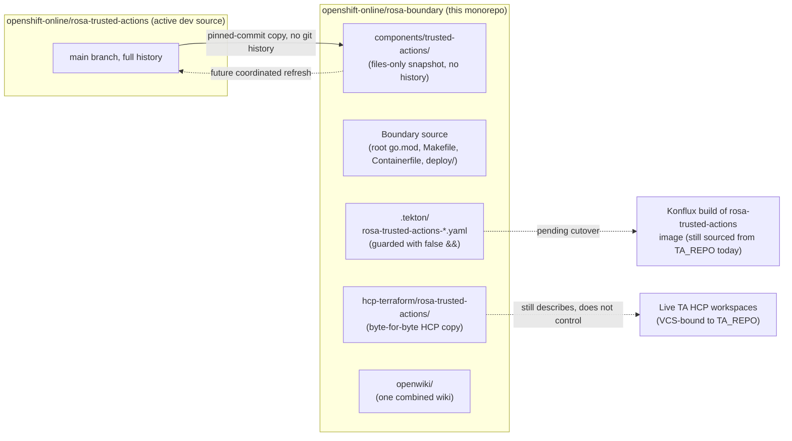

## Why this page exists

Trusted Actions (TA) source now lives inside the `openshift-online/rosa-boundary`
repository alongside Boundary, but the two products remain separate components
with separate owners, build systems, and deployment pipelines. This page
describes that co-existence: what was imported, what boundaries were put in
place, and which systems still point at the original TA repository rather than
at the copy in this monorepo.

This is **not** a description of a merged product. Treat Boundary and Trusted
Actions as two components that happen to share one Git repository and one
generated wiki.

## What the import was

Trusted Actions files were copied from `openshift-online/rosa-trusted-actions`
`main` at commit `8ce39a7344b52444576fc1e44ab1f532fd0dfac4`. This was a
**files-only** import:

- No Trusted Actions commits or per-file Git history were imported into
  `rosa-boundary`.
- `openshift-online/rosa-trusted-actions` remains the historical reference
  and, until a coordinated cutover, the **active development source** for TA.
  It must not be archived before that cutover is verified with its owners.
- Of the 238 files imported or reconciled at that baseline, 226 are
  byte-for-byte copies at their mapped destination; twelve were transformed
  (ownership metadata, Tekton repo/path/context fields, the `false &&`
  pre-cutover guard, whitespace/newline fixes, `renovate.json` reconciliation,
  and replacing `CLAUDE.md` with a component-scoped `AGENTS.md`).
- 45 TA-repo OpenWiki artifacts (`openwiki/**`, generated pages, Claims, and
  any `.openwikiignore`) were deliberately **not** imported.

See the [migration inventory and refresh procedure](../../docs/trusted-actions-monorepo-migration.md)
and [source co-location notes](../../docs/trusted-actions-source-colocation.md)
for the full accounting; this page summarizes their architectural
consequences rather than repeating the inventory.



## Two components, two toolchains

Boundary and Trusted Actions each own a complete, independent build and
deploy toolchain inside the single repository. Nothing about the import
merges these toolchains:

| Component | Source and build | Terraform roots | HCP definitions |
| --- | --- | --- | --- |
| Boundary | Repository root (`go.mod`, `Makefile`, `Containerfile`) | `deploy/account/`, `deploy/network/`, `deploy/regional/` | `hcp-terraform/rosa-boundary/` and `hcp-terraform/aws-creds/` |
<!-- openwiki: broken internal link [../../components/trusted-actions] file "../../components/trusted-actions" does not exist. Fix the href or restore the target, then delete this comment. -->
<!-- openwiki: broken internal link [../../hcp-terraform/rosa-trusted-actions] file "../../hcp-terraform/rosa-trusted-actions" does not exist. Fix the href or restore the target, then delete this comment. -->
| Trusted Actions | [`components/trusted-actions/`](../../components/trusted-actions) (independent `go.mod`, `Makefile`, `Containerfile`) | `components/trusted-actions/terraform/global/` and `components/trusted-actions/terraform/regional/` | [`hcp-terraform/rosa-trusted-actions/`](../../hcp-terraform/rosa-trusted-actions) |

Consequences of this split:

- Run Trusted Actions commands from `components/trusted-actions/` (for
  example, `make -C components/trusted-actions test`). Root `go test ./...`
  and root Makefile targets do **not** exercise the nested Go module.
- The Go module path and both components' container image destinations are
  unchanged by the import.
- `components/` names independently built parts, not necessarily
  long-running services. Boundary's `lambda/` directory has not moved into
  `components/boundary/`; that relocation is a separate, not-yet-made change
  because Terraform packaging, Make targets, tests, and Konflux all still
  reference today's root-level paths.
- Running `pre-commit` from the component directory instead of the repo root
  selects the copied TA `.pre-commit-config.yaml`, an unmodified snapshot
  that has not been adapted for monorepo paths and whose linter cannot
  handle the current Go toolchain. Root pre-commit, run from the repository
  root, is the supported hook configuration; it scans TA files for secrets
  and builds the TA Go module separately, but TA's own lint step is not yet
  merged into the root gate.

See [Trusted Actions overview](trusted-actions-overview.md) for TA's internal
architecture and [HCP Terraform workspaces](../infrastructure/hcp-terraform-workspaces.md)
for how both components' Terraform roots map to live workspaces.

## Ownership boundaries (OWNERS)

Three OWNERS boundaries keep Boundary and TA approvals independent even
though the files sit in one repository:

- [`components/trusted-actions/OWNERS`](../../components/trusted-actions/OWNERS)
  and [`hcp-terraform/rosa-trusted-actions/OWNERS`](../../hcp-terraform/rosa-trusted-actions/OWNERS)
  both set `options.no_parent_owners: true`, so inherited Boundary owners
  cannot approve TA-only changes under these trees. Both list the same
  TA maintainer/approver/reviewer set (`bergmannf`, `Makdaam`,
  `Nikokolas3270`, `RaphaelBut`, `rolandmkunkel`, `petrkotas`, `zmird-r`,
  `gvnnn`, `xiaoyu74`).
- [`.tekton/OWNERS`](../../.tekton/OWNERS) splits approval **within the same
  directory** by filename pattern rather than by subdirectory, because both
  components' pipeline definitions live in `.tekton/`: Boundary-prefixed
  pipeline files (and the shared `OWNERS` file itself) are approved by the
  Boundary team, while `rosa-trusted-actions-*.yaml` files are approved by
  the TA team. The `.tekton/OWNERS` file itself remains Boundary-owned
  because changing it can alter approval rules for either component.
- These two new ownership files (`hcp-terraform/rosa-trusted-actions/OWNERS`
  and `.tekton/OWNERS`) were authored for the monorepo, not copied from the
  original TA repository.

The intended TA-only, Boundary-only, and mixed-path PR approval behavior
should be validated against live Prow/Tide behavior rather than assumed from
these files alone.

## Tekton pipelines: present but held

The copied Trusted Actions image PipelineRuns,
[`rosa-trusted-actions-pull-request.yaml`](../../.tekton/rosa-trusted-actions-pull-request.yaml)
and [`rosa-trusted-actions-push.yaml`](../../.tekton/rosa-trusted-actions-push.yaml),
were adapted for their new location: the repo annotation now points at
`openshift-online/rosa-boundary`, the build context (`path-context`) is
`components/trusted-actions`, and the PR/push `pathChanged()` filters match
the component directory and each pipeline file.

These definitions exist in `.tekton/` and are otherwise fully formed
Konflux PipelineRuns, but their triggers are **not active**. Both
`pipelinesascode.tekton.dev/on-cel-expression` fields are prefixed with
`false &&`, for example:

```
false && event == "pull_request" && target_branch == "main"
&& ( "components/trusted-actions/***".pathChanged() || ".tekton/rosa-trusted-actions-pull-request.yaml".pathChanged() )
```

Do not describe these triggers as active. The guard exists because the
*initial* import merge was not guarded and did briefly trigger a live TA
build from Boundary `main`, while the Konflux component's source binding
still pointed at the original TA repository and image. The `false &&` prefix
is a deliberate pre-cutover hold, not a leftover or a bug:

- While held, Boundary PR and push events must not start these TA
  PipelineRuns, publish into the TA Quay image repository, or produce TA
  snapshots/releases through this path.
- The guard does **not** cancel already-queued or already-running builds and
  does not prevent manually submitted PipelineRuns or other external
  triggers.
- It does not change the original TA repository's CI, its Konflux source
  binding, its release path, or its HCP-managed deployment, and it does not
  change Boundary's own image pipelines.

Removing `false &&` from both CEL expressions is a deliberate, reviewed step
in the coordinated CI cutover (see
[migration inventory: pre-cutover Konflux trigger hold](../../docs/trusted-actions-monorepo-migration.md#pre-cutover-konflux-trigger-hold)),
gated on confirming the final TA source refresh, reviewing old-repo build
activity, and confirming the new repository/component and image/release
bindings before exercising a Boundary TA PR and push build.

## HCP Terraform: copied definition, unchanged deployment

<!-- openwiki: broken internal link [../../hcp-terraform/rosa-trusted-actions] file "../../hcp-terraform/rosa-trusted-actions" does not exist. Fix the href or restore the target, then delete this comment. -->
[`hcp-terraform/rosa-trusted-actions/`](../../hcp-terraform/rosa-trusted-actions)
is a **byte-for-byte copy** of TA's HCP meta-workspace definition
(`main.tf`, `variables.tf`, `terraform.auto.tfvars`) and its tracked
variables. Copying these files into the monorepo does not change anything
about the live infrastructure they describe:

- The live TA HCP workspaces, their VCS binding, and their `auto_apply` /
  `auto_apply_run_trigger` settings are **unchanged** and still point at
  `openshift-online/rosa-trusted-actions` and its `terraform/global` and
  `terraform/regional` working directories.
- This import does not switch TA's deployment source, does not transfer
  Terraform state, does not bind the TA meta-workspace or workload
  workspaces to Boundary, and does not create a second TA stack inside
  Boundary's AWS/regional footprint.
- The existing TA global and stage HCP workspaces continue to own their
  current AWS resources; the regional root still reads the named global
  workspace's remote state exactly as before the import.

Switching the deployment source later is a distinct, coordinated step:
rebinding the *existing* Git-managed TA workspace definitions to
`openshift-online/rosa-boundary` and
`components/trusted-actions/terraform/{global,regional}`, while preserving
workspace identities, variable sets, run triggers, and remote-state
permissions. Before that rebind, live auto-apply settings and queued runs
must be inspected and affected workspaces gated, because the copied
definitions currently specify both `auto_apply` and
`auto_apply_run_trigger` as `true`. A meta-workspace plan does not surface
downstream AWS changes, so downstream plans need separate review. See
[HCP Terraform workspaces](../infrastructure/hcp-terraform-workspaces.md)
and [Trusted Actions deployment](../infrastructure/trusted-actions-deployment.md)
for the workspace topology and operational detail.

## One OpenWiki, not two

There is exactly **one** generated OpenWiki for the monorepo, rooted at
`openwiki/` in the repository root, covering both Boundary and Trusted
Actions. The former standalone Trusted Actions wiki (its generated pages,
Claims sidecars, and any `.openwikiignore`) was **not** imported and is out
of scope for this repository:

- Do not copy the old TA-repo wiki output into `components/trusted-actions/`
  or anywhere else in this repository.
- Do not initialize a second OpenWiki instance under `components/trusted-actions/`.
- The scheduled OpenWiki update for this repository is expected to
  incorporate Trusted Actions source after the merge; this should be
  verified rather than assumed, and the original TA-repo OpenWiki periodic
  should be retired as part of the external CI cutover rather than rebound
  to the nested component directory.

## What a future cutover changes that this import does not

This page intentionally separates "copied today" from "switched later."
Nothing described above should be read as evidence of a working or
active integration; the import is a source-location change only. A future,
separately coordinated cutover is expected to address, independently:

- Konflux repository/component source bindings for the TA image build,
  and removal of the `false &&` Tekton trigger guard.
- HCP Terraform VCS binding and working directories for the TA
  meta-workspace and its downstream global/regional workspaces.
- Prow job configuration, required checks, and release paths external to
  this repository's `.tekton/` definitions.
- Retirement of the original TA repository's OpenWiki periodic and,
  eventually, archival of `openshift-online/rosa-trusted-actions` itself,
  once the above are all verified with TA's owners.

Until that cutover, treat `openshift-online/rosa-trusted-actions` as the
live, authoritative source for Trusted Actions development, CI, and
deployment, and treat this repository's `components/trusted-actions/` and
`hcp-terraform/rosa-trusted-actions/` as a pinned-commit snapshot used for
monorepo development and future migration work.

## Related pages

- [System overview](system-overview.md) — how Boundary and Trusted Actions
  fit into the broader ROSA system.
- [Trusted Actions overview](trusted-actions-overview.md) — TA's own
  architecture inside `components/trusted-actions/`.
- [HCP Terraform workspaces](../infrastructure/hcp-terraform-workspaces.md) —
  workspace topology for both components.
- [Trusted Actions deployment](../infrastructure/trusted-actions-deployment.md) —
  TA-specific deployment and operational detail.
