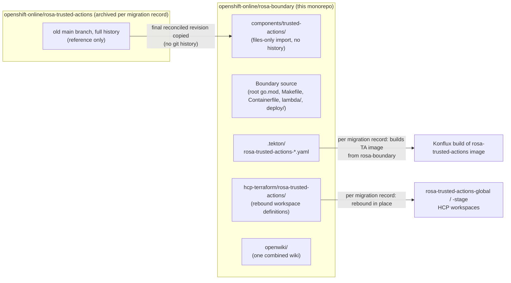

## Why this page exists

Trusted Actions (TA) source now lives inside the `openshift-online/rosa-boundary`
repository alongside Boundary, but the two products remain separate
components with separate build systems and (mostly) separate owners. This
page describes that co-existence based on the current repository state and
on [`docs/trusted-actions-monorepo-migration.md`](../../docs/trusted-actions-monorepo-migration.md),
the single record of what the migration did.

That migration record is explicitly marked as a **point-in-time snapshot
dated 2026-11-11**, not a living status page. It is not expected to be kept
in sync with later changes to source, CI, or infrastructure. Treat the facts
below as "true as of the migration," and **verify current live HCP Terraform
settings, Prow/Tide behavior, and Konflux source bindings directly** rather
than assuming they still match this record.

This is **not** a description of a merged product. Treat Boundary and
Trusted Actions as two components that share one Git repository and one
generated wiki.

## What the migration recorded

Per the migration record, Trusted Actions was imported into
`openshift-online/rosa-boundary` as a **files-only** copy, not a Git-history
merge:

- No Trusted Actions commits or per-file Git history were imported;
  `openshift-online/rosa-trusted-actions`'s old Git history remains available
  only in the archived repository.
- The **final reconciled source revision** carried over from the former
  repository was `119b5d522eb2e12459ee1bdc2835a9385821e9a8`; all subsequent
  Trusted Actions development belongs in `rosa-boundary`.
- Most files were copied as-is. A few required reconciliation rather than a
  verbatim copy: repository-level Renovate configuration now lives in root
  `renovate.json` (root `.coderabbit.yaml` and `.pre-commit-config.yaml`
  govern the combined repository, with component-specific guidance in
  `components/trusted-actions/AGENTS.md`); the original generated
  `openwiki/` tree was **not** imported; and the old repository's GitHub
  release and lockfile workflows were **not** installed at the Boundary
  root (TA's GoReleaser config was imported under the component, but a
  working monorepo GitHub release flow still needs its own review of tag
  namespace, nested paths, credentials, and action pins).

According to the same record, the original
[`openshift-online/rosa-trusted-actions`](https://github.com/openshift-online/rosa-trusted-actions)
repository is now **archived** and kept only as a source-history reference.
Because this is a snapshot rather than a live status feed, confirm the
repository's current archival state and any later development location
directly rather than relying solely on this page.

<!-- openwiki: broken internal link [../../docs/trusted-actions-monorepo-migration.md#L1-L25] heading anchor "L1-L25" does not exist in "../../docs/trusted-actions-monorepo-migration.md". Fix the href or restore the target, then delete this comment. -->
See [migration record: where things live](../../docs/trusted-actions-monorepo-migration.md#L1-L25)
for the full file-location table and
<!-- openwiki: broken internal link [../../docs/trusted-actions-monorepo-migration.md#L26-L48] heading anchor "L26-L48" does not exist in "../../docs/trusted-actions-monorepo-migration.md". Fix the href or restore the target, then delete this comment. -->
[migration outcome](../../docs/trusted-actions-monorepo-migration.md#L26-L48)
for the reconciliation detail; this page summarizes their architectural
consequences rather than repeating the inventory.

## Two components, two toolchains

Boundary and Trusted Actions each own a complete, independent build and
deploy toolchain inside the single repository:

| Component | Source and build | Terraform roots | HCP definitions |
| --- | --- | --- | --- |
| Boundary | Repository root (`go.mod`, `Makefile`, `Containerfile`, `lambda/`) | `deploy/account/`, `deploy/network/`, `deploy/regional/` | `hcp-terraform/rosa-boundary/` and `hcp-terraform/aws-creds/` |
| Trusted Actions | `components/trusted-actions/` (independent `go.mod` module `github.com/openshift-online/rosa-trusted-actions`, `Makefile`, `Containerfile`) | `components/trusted-actions/terraform/global/` and `components/trusted-actions/terraform/regional/` | `hcp-terraform/rosa-trusted-actions/` |

Consequences of this split:

- Run Trusted Actions commands from `components/trusted-actions/` (for
  example, `make -C components/trusted-actions test`). Root `go test ./...`
  and root Makefile targets, which build the `github.com/openshift-online/rosa-boundary`
  module, do **not** exercise the nested `github.com/openshift-online/rosa-trusted-actions`
  module.
- Boundary's `lambda/` applications have **not** moved into
  `components/trusted-actions/` or any other component directory; Boundary's
  root-level source and build layout is unchanged by the import.
- Trusted Actions has its own authentication, credentials, and audit model;
  Boundary's ECS Exec controls do not apply to it. See
  [Trusted Actions overview](trusted-actions-overview.md) for TA's internal
  architecture.
- Root pre-commit hooks (run from the repository root) cover both
  components, scanning TA files for secrets and building the TA Go module
  separately. The imported `components/trusted-actions/.pre-commit-config.yaml`
  is **not** the repository-root hook configuration and should not be
  invoked as a substitute for it.

See [HCP Terraform workspaces](../infrastructure/hcp-terraform-workspaces.md)
for how both components' Terraform roots map to live workspaces.

## Ownership boundaries (OWNERS)

TA-specific `OWNERS` files **add** approvers on top of, rather than replace,
the inherited root approver set — there is no `no_parent_owners` (or
equivalent) exclusion in any of these files today:

- [`components/trusted-actions/OWNERS`](../../components/trusted-actions/OWNERS)
  and [`hcp-terraform/rosa-trusted-actions/OWNERS`](../../hcp-terraform/rosa-trusted-actions/OWNERS)
  each list the same TA maintainer/approver/reviewer set (`bergmannf`,
  `Makdaam`, `Nikokolas3270`, `RaphaelBut`, `rolandmkunkel`, `petrkotas`,
  `zmird-r`, `gvnnn`, `xiaoyu74`) and a `component/trusted-actions` label,
  with no `options` block restricting inheritance.
- The [root `OWNERS`](../../OWNERS) file applies a catch-all `'.*'` filter
  listing Boundary's approvers/reviewers (`tiwillia`, `jhjaggars`,
  `kseiter-rh`, `xiaoyu74`, `bergmannf`, `RaphaelBut`, `geowa4`,
  `AlexSmithGH`, `eth1030`, `BATMAN-JD`) across the whole repository, and its
  own comment states the intent explicitly: "everyone listed here can still
  review and approve either component." A second filter
  (`^(cmd/rosa-boundary/|internal/|lambda/)`) only adds a
  `component/boundary` label and does not restrict approval.
- [`.tekton/OWNERS`](../../.tekton/OWNERS) splits approval **within the same
  directory** by filename pattern, because both components' pipeline
  definitions live in `.tekton/`: its header comment states that parent
  OWNERS approvers can approve any pipeline change in that directory, while
  its filters add component-specific approvers — a Boundary/shared filter
  for `rosa-boundary-*.yaml`, `create-investigation-lambda-*.yaml`, and the
  `OWNERS` file itself, and a TA filter for `rosa-trusted-actions-*.yaml`
  that also attaches a `component/trusted-actions` label.

This matches the migration record's statement that TA-specific `OWNERS`
files under the component, HCP root, and `.tekton/` "add approvers while
inheriting root approvers." However, the files describe the *configured*
intent, not the live merge gate: **check actual Prow/Tide approval and
merge behavior on real pull requests** rather than inferring it solely from
these `OWNERS` files, and do so on an ongoing basis since this is not a
mechanism guaranteed to be re-verified by the migration record itself.

## Tekton pipelines

The Trusted Actions image PipelineRuns,
[`rosa-trusted-actions-pull-request.yaml`](../../.tekton/rosa-trusted-actions-pull-request.yaml)
and [`rosa-trusted-actions-push.yaml`](../../.tekton/rosa-trusted-actions-push.yaml),
live in `.tekton/` and are adapted for the monorepo: their
`build.appstudio.openshift.io/repo` annotation points at
`openshift-online/rosa-boundary`, their build context targets
`components/trusted-actions`, and their `pathChanged()` filters match the
component directory and each pipeline's own file.

In the files as they exist today, the `pipelinesascode.tekton.dev/on-cel-expression`
fields are **not** prefixed with a `false &&` hold — both pipelines'
expressions evaluate normally for pull-request and push events touching the
component or the pipeline file itself. A retained comment above each
expression ("Enable only at the coordinated cutover after checking the
shared image/release destination") is a record of the earlier pre-cutover
state, not an instruction currently acted on by the files. This is
consistent with the migration record's statement that "Konflux now builds
the TA image from Boundary" after the cutover.

Because the migration record is a point-in-time snapshot, do not assume
these PipelineRuns are currently wired to the live Konflux application,
component, and image/release bindings described there — **verify the
current Konflux source binding and build activity directly** rather than
inferring live CI status from the `.tekton/` YAML alone. Konflux release
configuration lives outside this repository, in
[`releng/konflux-release-data`](https://gitlab.cee.redhat.com/releng/konflux-release-data),
and Prow job configuration lives in
[`openshift/release`](https://github.com/openshift/release); neither is
controlled by files in `rosa-boundary`.

## HCP Terraform: rebound workspace definitions

<!-- openwiki: broken internal link [../../hcp-terraform/rosa-trusted-actions] file "../../hcp-terraform/rosa-trusted-actions" does not exist. Fix the href or restore the target, then delete this comment. -->
[`hcp-terraform/rosa-trusted-actions/`](../../hcp-terraform/rosa-trusted-actions)
holds TA's HCP meta-workspace definition (`main.tf`, `variables.tf`,
`terraform.auto.tfvars`). Per the migration record and the current
`main.tf`, the **existing** `rosa-trusted-actions-global` and
`rosa-trusted-actions-stage` HCP workspaces were **rebound in place** to
this repository and the component's Terraform roots rather than replaced:

- `main.tf`'s `rosa-trusted-actions-global` workspace sets
  `github_repo_org = "openshift-online"`, `github_repo_name = "rosa-boundary"`,
  and `working_directory = "components/trusted-actions/terraform/global"` —
  the workspace definition now names this repository and the component path,
  not the original standalone TA repository.
- The migration record states this rebind preserved workspace identity:
  the workspaces' AWS state was **not** moved into Boundary's own Terraform
  stacks, and no duplicate TA stack was created under Boundary's `deploy/`
  roots. The meta-workspace still reads `hcp-terraform/rosa-trusted-actions/`;
  the stage workspace still reads the global workspace's remote state and is
  still triggered after successful global applies.
- `auto_apply` and `auto_apply_run_trigger` for the global and stage
  workspaces were temporarily disabled during the cutover, then
  [restored](https://github.com/openshift-online/rosa-boundary/pull/517) to
  `true` on 2026-11-11 after successful workspace runs — matching the
  `auto_apply = true` / `auto_apply_run_trigger = true` values currently
  set on the `rosa-trusted-actions-global` workspace block in `main.tf`. The
  migration record notes the first meta run after the rebind auto-applied
  unexpectedly, so for later runs check the live HCP workspace settings and
  review the global and stage AWS plans separately — a meta-workspace plan
  does not surface downstream resource changes.

As with CI, treat this as the recorded outcome of a specific, completed
cutover rather than an assurance about today's live HCP state: **inspect
the live workspace VCS binding, auto-apply settings, and queued runs in HCP
Terraform directly** before relying on this page for operational decisions.
See [HCP Terraform workspaces](../infrastructure/hcp-terraform-workspaces.md)
and [Trusted Actions deployment](../infrastructure/trusted-actions-deployment.md)
for workspace topology and operational detail.

## One OpenWiki, not two

There is exactly **one** generated OpenWiki for the monorepo, rooted at
`openwiki/` in the repository root, covering both Boundary and Trusted
Actions. Per the migration record, the former standalone Trusted Actions
wiki's generated output was **not** imported:

- Do not copy the old TA-repo wiki output into `components/trusted-actions/`
  or anywhere else in this repository.
- Do not initialize a second OpenWiki instance under `components/trusted-actions/`.
- Maintain a single combined wiki at the repository root going forward.

## What this page does not establish

[`docs/trusted-actions-monorepo-migration.md`](../../docs/trusted-actions-monorepo-migration.md)
is an ~88-line point-in-time record dated 2026-11-11, documenting the
monorepo "immediately after the successful Trusted Actions migration." It is
explicitly not maintained as a living status page. Do not treat anything on
this page as proof of *current* live system state:

- Current Prow/Tide merge behavior for TA-only, Boundary-only, and
  mixed-path pull requests must be checked on real PRs.
- Current Konflux repository/component/image bindings and build activity
  for `rosa-trusted-actions` must be checked directly in Konflux.
- Current HCP Terraform workspace VCS bindings, variable sets, run
  triggers, and `auto_apply` settings must be checked directly in HCP
  Terraform, not inferred from the committed `.tf` files alone.
- A working, reviewed monorepo GitHub release workflow for Trusted Actions
  (tag namespace, nested paths, credentials, action pins) had not been
  established as of the snapshot and should be verified before relying on
  it.

## Related pages

- [System overview](system-overview.md) — how Boundary and Trusted Actions
  fit into the broader ROSA system.
- [Trusted Actions overview](trusted-actions-overview.md) — TA's own
  architecture inside `components/trusted-actions/`.
- [HCP Terraform workspaces](../infrastructure/hcp-terraform-workspaces.md) —
  workspace topology for both components.
- [Trusted Actions deployment](../infrastructure/trusted-actions-deployment.md) —
  TA-specific deployment and operational detail.
