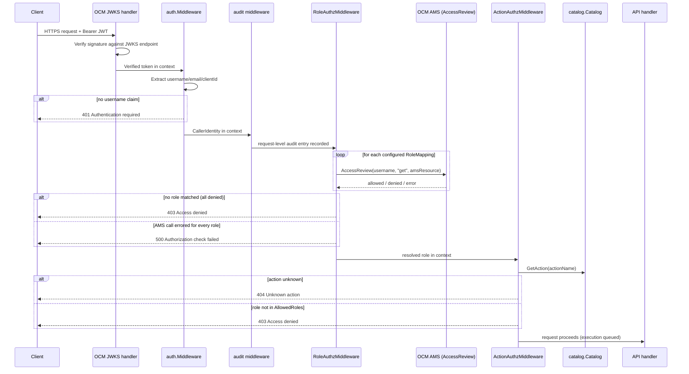

# Trusted Actions Authentication and Authorization

Trusted Actions enforces authorization in two independent layers. The first layer runs entirely in HTTP middleware, before an execution is ever queued: it resolves the caller's identity and role against OCM Account Management Service (AMS), then checks that role against the role allowlist the target action declares in the catalog. The second layer runs later, inside the executor, after an action has already been queued and dequeued by a worker: it checks the concrete resource the action is about to touch (a Kubernetes namespace/secret, or an AWS region/operation) against a separate, independently configured allowlist. A request that clears the first layer can still be denied by the second.

This model is specific to Trusted Actions and shares no trust boundary, token format, or enforcement mechanism with Boundary's CLI/Lambda identity model. Boundary authenticates with Keycloak-issued OIDC ID tokens, assumes AWS IAM roles, and enforces ECS Exec access with session-tag ABAC (`PrincipalTag` vs. `ResourceTag`); see [Identity and access control](identity-and-access.md) and [Credential lifecycle](../security/credential-lifecycle.md). Trusted Actions instead authenticates with OCM-issued JWTs validated against OCM's JWKS endpoint, and resolves authorization through OCM AMS `AccessReview` calls and server-local allowlists. Do not conflate the two systems' roles, tokens, or guarantees.

## Layer 1: caller identity, role resolution, and per-action role allowlisting

### Middleware chain order

Every request under `/api/v0/trusted-actions` passes through a fixed chain, wired in `cmd/server/main.go`:

`/health` is registered directly on the top-level `chi.Router` before the `/api/v0/trusted-actions` sub-route is wired, and is also declared `Public("^/health$")` to the outer JWKS wrapper, so it never passes through any authentication or authorization step — it is reachable even when the rest of the API would reject every request. Everything under `/api/v0/trusted-actions` runs through the following chain, in this order:

0. **OCM JWKS signature validation** — the OCM SDK's `authentication.NewHandler()` wraps the entire `router` (built from `cmd/server/main.go`'s `chi.NewRouter()`, covering both `/health` and `/api/v0/trusted-actions`) in a single outer `http.Handler`, but this wrapper is only built and applied `if cfg.AuthPolicy != config.DisabledAuthPolicy`. When applied, it validates the JWT's signature against OCM's JWKS endpoint (`cfg.JWKCertURL`, sourced from `ROSA_TA_JWK_CERT_URL`, optionally overridden with a local `cfg.JWKCertFile`/`ROSA_TA_JWK_CERT_FILE`) and stores the verified token in the request context; `/health` is marked `Public` so the handler still never touches it. In mock/dev mode (`ROSA_TA_AUTH=disabled`) this entire wrapper — and the network call and startup `Fatal` it could trigger — is skipped, and `mainHandler` is the bare chi router.
1. **JWT authentication** (`internal/auth/authn.go`, `Middleware.AuthenticateAccountJWT`, wired as `r.Use(authnMiddleware.AuthenticateAccountJWT)`) — pulls the verified token out of context via `GetCallerIdentityFromJWT`, extracts `username`/`email`/`clientId` (falling back to `preferred_username` for Red Hat SSO vs. RHD claim shapes), and rejects the request with `401` if no username claim is present. The resolved identity is stored in the request context as `CallerIdentity`. In mock mode this middleware is swapped for `MockMiddleware.AuthenticateAccountJWT`, which injects a hardcoded `dev-user` identity without reading the request at all.
2. **Audit middleware injection** (`middleware.NewAuditLogger`, wired as `r.Use(middleware.NewAuditLogger(dataStore, logger))`) — records the request-level audit entry; it runs immediately after authentication and before role authorization, so the audited identity is always the one JWT auth resolved (real or mock).
3. **`RoleAuthzMiddleware.AuthorizeAPI`** (`internal/auth/authz.go`, wired as `r.Use(authzMiddleware.AuthorizeAPI)`) — iterates `config.RoleMapping` entries from the loaded role config (each mapping a role ID to an AMS resource type) in order, and calls `ocm.Authorization.AccessReview(ctx, username, "get", role.AMSResource)` for each until one returns `allowed=true`. The first matching role is written into the request context (`SetRoleInContext`) and the chain continues. If every AccessReview call errors, the request fails with `500`; if none match, it fails with `403`. In mock mode this is `MockAuthzMiddleware.AuthorizeAPI`, which grants the `SREP` role unconditionally with no AMS call.
4. **`ActionAuthzMiddleware.CheckActionAccess`** (`internal/auth/authz.go`) — not a `router.Use` chi middleware like the previous three; it is instead passed as `openapi.HandlerWithOptions(apiHandler, openapi.ChiServerOptions{BaseRouter: r, Middlewares: []openapi.MiddlewareFunc{actionAuthz.CheckActionAccess}})`, which applies it only to the generated OpenAPI routes, and only to the ones carrying an `{action}` URL parameter (requests without one, e.g. catalog listing, pass straight through, since they are already behind authn/role-authz). It looks the action up in the catalog; an unknown action is `404`. It then compares the role resolved in step 3 against the action's `AllowedRoles`; a role not present in that list is `403`.

`openapi.HandlerWithOptions` is called with `BaseRouter: r` — the same `chi.Router` created by `router.Route("/api/v0/trusted-actions", ...)` — so it registers the generated routes (`GET /`, `GET /{action}`, `POST /{action}/run`, `GET /runs`, `GET /runs/{id}`, `GET /runs/{exec_id}/output`, `GET /audit`) directly on `r` via `r.Get`/`r.Post`, rather than building a fresh router and mounting it onto `r` with `r.Mount("/", ...)`. This is deliberate: `HandlerWithOptions` returns the same `r` it was given when `BaseRouter` is set, so mounting that return value back onto `r` would make `r` route into itself and recurse forever. Registering directly on `r` via `BaseRouter` avoids that infinite routing loop.

The sequence below shows the chain as it runs under the `enabled`/`ocmconfig` auth policies; under `disabled` (mock mode), the JWKS and AMS steps are replaced by the hardcoded `dev-user`/`SREP` shortcuts described above, and `/health` bypasses the whole chain in either case.



### Roles

The catalog (`internal/catalog/catalog.go`) defines three roles that `ActionDefinition.AllowedRoles` draws from: `SREP`, `ConfigurationAnomalyDetection`, and `ROSAAiAgent`. Every registered action but one allows all three roles (`get`, `patch`, `delete`, `describe-nodes`, `get-pull-secret-email`, `list-alerts`, `aws-get`, `aws-reboot`). `aws-terminate` is restricted to `SREP` alone, because terminating an EC2 instance is irreversible and the catalog deliberately keeps it out of reach of an automated caller such as `ROSAAiAgent` or `ConfigurationAnomalyDetection`.

`AllowedRoles` is a property of the `ActionDefinition`, enforced entirely at the HTTP layer by `ActionAuthzMiddleware` before an execution is ever created — a caller whose role is not in the list never reaches the handler that would enqueue the action, regardless of what the action would otherwise do.

Each role ID is mapped to an AMS resource type through server configuration (`config.RoleMapping{ID, AMSResource}`), loaded from the `roles` key of the YAML config file (the legacy `ROSA_TA_ROLES_CONFIG` environment variable is no longer read, and its presence only triggers a startup warning). The server refuses to start under `enabled`/`ocmconfig` auth policy if no roles are configured, or if any role entry has an empty `id` or `amsResource`.

### `ocm.Authorization.AccessReview`

`internal/ocm/authorization.go` implements the single AMS call `RoleAuthzMiddleware` depends on. `AccessReview(ctx, username, action, resourceType)` chooses between AMS's self-access-review and account-access-review endpoints depending on whether `username` matches the OCM connection's own identity, and returns whether that username is allowed to perform `action` ("get") against `resourceType` (the AMS resource backing a role, e.g. `BackplaneOsdSrepResource`). This is the only point where Trusted Actions' role resolution talks to OCM; everything downstream of it operates on the resolved role string, not on AMS directly.

## Layer 2: resource-level authorization inside the executor scope

Resolving a role and clearing the action-level allowlist only establishes that the caller is allowed to invoke an action *kind*; it says nothing about the specific namespace, secret, AWS region, or AWS operation a given invocation targets. That check happens later and separately, inside `Executor.Execute` (`internal/executor/executor.go`), after a worker has dequeued the execution: once the target `Scope` (`KubeScope` or `AWSScope`) derives or receives the request's `Target`, it calls `Scope.Authorize(req)`, and a denial here aborts the run (recorded as `DecisionDenied`/`OutcomeSkipped` in the audit record) without ever calling `Scope.Run`.

<!-- openwiki: mermaid parse failed and this diagram was converted to a text fence so it does not break rendering. Fix the diagram source and restore the mermaid fence. Parser error: Heuristic: a semicolon inside a label breaks rendering; rephrase the label. -->
```text
flowchart TD
    A[HTTP layer: authn + role authz + ActionAuthz pass] --> B[Execution queued]
    B --> C[Worker dequeues execution]
    C --> D{req.Target set?}
    D -- no --> E[Scope.DeriveTarget]
    D -- yes --> F[Scope.Authorize]
    E --> F
    F -- denied --> G[Result.Allowed=false; audit DecisionDenied/OutcomeSkipped]
    F -- allowed --> H[Scope.Run executes the action]
```

### Kubernetes namespace/secret allowlist (`internal/authorization`)

`internal/authorization/authorization.go` defines `Authorizer`, constructed with `authorization.New(logger, allowedNamespaces, allowedSecrets)` and wired into `KubeScope` as its `authorizer`. `KubeScope.Authorize` translates the action's derived `actions.ResourceTarget` (namespace, resource type, resource name, cluster-scoped flag) into an `authorization.Request` and calls `Authorize`:

- **Permissive mode**: if `allowedNamespaces` is empty, every request is allowed (`Reason: "permissive (no namespace allowlist configured)"`). This is intended only for local development; the server does not refuse to start in this mode, so operators must explicitly set `ROSA_TA_ALLOWED_NAMESPACES` in production to get any enforcement at all.
- When an allowlist is configured: a namespaced target with no namespace is denied; a namespace not present in the allowlist is denied; and for `secrets` specifically, the resource name must be non-empty and the `namespace/secretName` key must be present in the separate `allowedSecrets` set, or the request is denied even if the namespace itself is allowed.

`KubeScope.DeriveTarget` always marks a target derived from request params as namespaced (never cluster-scoped), specifically because trusting a caller-supplied or absent namespace to imply cluster scope previously let a caller bypass the namespace allowlist by never supplying one.

### AWS region/operation allowlist (`internal/authorization/aws.go`)

A separate `AWSAuthorizer`, constructed with `authorization.NewAWS(logger, AWSPolicy{AllowedRegions, AllowedOperations})`, is wired into `AWSScope`. It is intentionally not the same type as the Kubernetes `Authorizer` — `AWSRequest` has no namespace or secret concept, so a shared type could let an AWS request be silently judged by Kubernetes rules. Unlike the Kubernetes authorizer, the AWS authorizer has **no permissive mode**: an empty region allowlist denies every request rather than allowing it, and the server refuses to start at all if `ROSA_TA_AWS_ALLOWED_REGIONS` (or `actions.aws_allowed_regions` in the config file) resolves to empty, since reaching that state silently would mean a server that starts cleanly but fails every AWS execution. `AWSAuthorizer.Authorize` checks, in order: the resource is named; the region is in `AllowedRegions`; and, only for actions that declare a write `Operation` (`aws-reboot`'s `"reboot"`, `aws-terminate`'s `"terminate"`), that the operation is in `AllowedOperations`. `AllowedOperations` has no default — leaving `ROSA_TA_AWS_ALLOWED_OPERATIONS` unset permits every AWS read but denies every AWS write.

## Configuration

| Variable | Effect |
|---|---|
| `ROSA_TA_AUTH` | Selects the auth policy: `disabled` uses a hardcoded mock identity (`dev-user`) and grants the `SREP` role unconditionally, skipping JWKS validation, JWT parsing, and AMS calls entirely — never use in production; `enabled` builds a real OCM client from `ROSA_TA_OCM_CLIENT_ID`/`ROSA_TA_OCM_CLIENT_SECRET`/`ROSA_TA_OCM_TOKEN`; `ocmconfig` builds the OCM client from the local `ocm` CLI's saved config/tokens instead, for interactive local use against real AMS. If unset, the legacy `ROSA_TA_ENABLE_AUTH` boolean is consulted as a fallback, defaulting to auth enabled. When `disabled`, the server also refuses to start unless `ROSA_TA_KUBECONFIG` and `ROSA_TA_AWS_ENDPOINT_URL` are both set, so a caller granted the mock role can never reach the real backplane or a real AWS account. |
| `ROSA_TA_ALLOWED_ACCOUNTS` | Loaded into `Config.AllowedAccounts` as a comma-separated list, but as of the current codebase it is not read by any authorization check (`RoleAuthzMiddleware`, `ActionAuthzMiddleware`, or the `internal/authorization` allowlists) — it is a declared, unenforced configuration knob. |
| `ROSA_TA_ALLOWED_NAMESPACES` | Comma-separated Kubernetes namespace allowlist enforced by `KubeScope.Authorize` via `internal/authorization.Authorizer`. Unset means permissive mode (every namespace allowed) — acceptable for local dev only; production deployments must set this. |
| `ROSA_TA_ALLOWED_SECRETS` | Comma-separated `namespace/secretName` allowlist checked in addition to the namespace allowlist whenever a `get`/`patch`/`delete` action targets the `secrets` resource type. A secret not listed here is denied even when its namespace is allowed. |
| `ROSA_TA_AWS_ALLOWED_REGIONS` | Comma-separated AWS region allowlist for `AWSScope`/`AWSAuthorizer`. Falls back to `authorization.DefaultAllowedRegions` (empty) if unset via config file either; an empty result stops the server at startup rather than denying every AWS request at runtime. |
| `ROSA_TA_AWS_ALLOWED_OPERATIONS` | Comma-separated AWS write-operation allowlist (`reboot`, `terminate`). No default: unset means empty, which permits AWS reads but denies every AWS write. Configuring any value is logged as a warning at startup because it widens what the server can do to a customer's cloud infrastructure. |

Role-to-AMS-resource mappings (`roles` key, e.g. `SREP` → `BackplaneOsdSrepResource`) live in the YAML config file rather than an environment variable, and are required (non-empty) whenever `ROSA_TA_AUTH` is `enabled` or `ocmconfig`.

## Invariants and failure semantics

- Layer 1 and layer 2 are independent: passing role/action authorization only permits enqueuing the execution request; it does not imply the specific namespace/secret/region/operation the request resolves to will be allowed once a worker picks it up.
- `RoleAuthzMiddleware` fails closed only when every AMS call for every configured role returns an error (`500`); if calls succeed but none report `allowed=true`, the result is `403`, not `500` — the two cases are deliberately distinguished in the response and in logs.
- `ActionAuthzMiddleware` only runs when the route carries an `{action}` URL parameter, so action-independent endpoints (catalog listing) rely solely on layer 1.
- `authorization.Authorizer` (Kubernetes) fails open when unconfigured (permissive mode); `authorization.AWSAuthorizer` fails closed when unconfigured (empty allowlist denies). This asymmetry is deliberate per authorizer and documented in-line in `aws.go` and `authorization.go` — do not assume the two allowlists share failure behavior.
- `AWSRequest`/`AWSPolicy` are kept as distinct types from the Kubernetes `Request`/namespace-secret allowlists specifically so an AWS action can never be judged by Kubernetes rules (or vice versa) by passing through a shared type.
