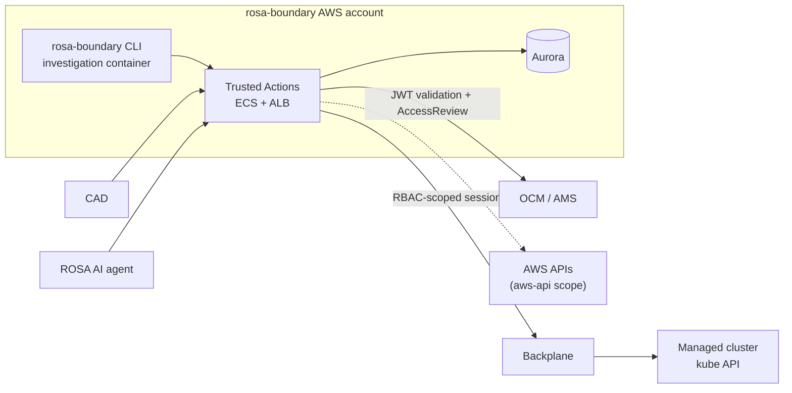
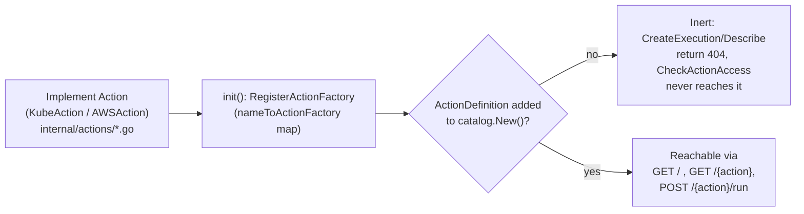

Trusted Actions is an OpenAPI-based HTTP API that executes a fixed catalog of
narrow, audited, role-gated operations ("trusted actions") against a managed
OpenShift cluster, on behalf of callers it cannot otherwise trust with direct
cluster access. Its source lives at
<!-- openwiki: broken internal link [../../components/trusted-actions] file "../../components/trusted-actions" does not exist. Fix the href or restore the target, then delete this comment. -->
[`components/trusted-actions/`](../../components/trusted-actions), as a
separately owned and built component inside the `rosa-boundary` monorepo; see
[Monorepo components: Boundary and Trusted Actions](monorepo-and-trusted-actions.md)
for how that co-location works.

## Context: who calls Trusted Actions, and what it can reach

Trusted Actions runs on ECS behind an ALB, co-located in the rosa-boundary AWS
account. Its intended callers are the `rosa-boundary` CLI running inside an
SRE's investigation container, plus two external consumers: Configuration
Anomaly Detection (CAD) and the ROSA AI agent. All three reach Trusted Actions
over HTTP. Trusted Actions never trusts a caller's identity directly: every
request is validated against OCM/AMS (JWT signature verification plus an
`AccessReview` call), and the service reaches a managed cluster only through a
short-lived, RBAC-scoped Backplane session created per execution — it never
holds a standing credential to any cluster.



The dashed edge to AWS APIs is **not implemented yet**: the `actions` package
already defines an `AWSAction` interface and `AWSTarget`/`AWSActionRequest`
types alongside the Kubernetes-scoped `KubeAction` interface, so the
architecture anticipates a future `aws-api` execution scope, but no action in
the current catalog uses it to reach AWS directly.

**The investigation-container edge is architectural, not yet wired in code.**
Nothing in the Boundary root `Containerfile` or in `internal/cmd` (the
`rosa-boundary` CLI's command package) currently calls the Trusted Actions API
or links an `rta` client — there is no HTTP client code, SDK import, or
command in this repository that issues a Trusted Actions request today.
Treat the CLI-to-Trusted-Actions edge in the diagram above as the intended
target topology, not as a currently exercised code path.

For how identity and role resolution actually work on the wire, see
[Trusted Actions authorization model](trusted-actions-authorization.md). For
the end-to-end request/execution lifecycle, see
[Trusted Actions execution workflow](../workflows/trusted-actions-execution.md).
For the HTTP API surface itself, see
[Trusted Actions API](../integrations/trusted-actions-api.md).

## Two-layer architecture

`ARCHITECTURE.md` splits the codebase into two layers that meet at a
persisted `executions` row:

- **Request handling** (synchronous, HTTP-request-scoped):
  router → middleware → handlers → store
- **Action execution** (asynchronous, background):
  worker pool → runner → executor → action → backplane → cluster/cloud provider

A request to run an action is validated, authorized, and persisted as a
pending execution by the first layer, which then returns immediately. A
background worker in the second layer later claims that pending execution,
resolves and runs the action against the target cluster (or, in the future,
AWS), and writes the result back to the store. Callers poll
`GET /runs/{id}` to retrieve output once it is ready. See
[Trusted Actions execution workflow](../workflows/trusted-actions-execution.md)
for the detailed control flow across both layers, including authorization
checks, the worker poll loop, and the backplane client lifecycle.

### Project structure

```
components/trusted-actions/
├── cmd/
│   ├── server              # main application entry point
│   └── action-cli          # standalone action execution client
├── internal/
│   ├── openapi             # generated from openapi/ via oapi-codegen
│   ├── handlers            # ServerInterface implementation
│   ├── catalog             # action registry
│   ├── actions             # action implementations
│   ├── executor            # authorize -> get client -> execute -> audit
│   ├── worker              # pool + ExecutorRunner, params -> ResourceTarget
│   ├── backplane           # client (real Backplane or kubeconfig for local dev)
│   ├── auth                # action-level authorization, authentication layer
│   ├── authorization       # resource-level authorization
│   ├── ocm                 # OCM SDK client
│   ├── store               # SQLite + Postgres, migrations
│   ├── middleware          # audit, logging, recovery
│   └── config              # env + optional YAML config file
├── openapi/                # OpenAPI 3.0 specification source files
└── api-spec.yaml           # Bundled OpenAPI spec (generated)
```

`cmd/server/main.go` is the composition root: it loads configuration, wires
authentication/authorization middleware (real OCM-backed or a mock, depending
on `ROSA_TA_AUTH`), constructs the Backplane client provider (a real
Backplane-CLI-backed client, or a kubeconfig-backed one for local
development), builds the `catalog.Catalog`, and starts the HTTP server
(chi router) alongside the worker pool. `cmd/action-cli` is a standalone
client that mirrors the same execution pipeline (authorization, audit,
Backplane access) outside the HTTP server, for local/manual action runs.

### Request-handling middleware stack

Applied in order by `cmd/server/main.go`: custom logger, request-ID
generation, panic recovery, real-IP resolution, a 60-second request timeout,
permissive CORS, and — only on action routes — authentication (OCM JWT
identity), request auditing, and authorization (role allowlist per action).
`internal/middleware` implements the transport-level concerns here
(`RequestID`, `Recoverer`, `Timeout`); authentication and authorization are
implemented separately in `internal/auth` because they require OCM/AMS calls
and catalog lookups. See
[Trusted Actions authorization model](trusted-actions-authorization.md) for
exactly how the authn/authz portion of this chain resolves a caller's role
and checks it against an action's allowlist.

## OpenAPI-first code generation

Trusted Actions' HTTP surface is defined before it is implemented:

1. **Author** — multi-file OpenAPI 3.0 sources live under `openapi/`
   (`openapi/openapi.yaml` plus `openapi/paths/` and `openapi/components/`).
2. **Bundle** — `make generate` (via `bundle-spec`, which runs
   `npm run bundle-spec`) merges these files into a single
   `api-spec.yaml` at the component root.
3. **Generate** — `oapi-codegen` (configured by `oapi-codegen.yaml`) reads
   `api-spec.yaml` and emits `internal/openapi/api.go`: the `ServerInterface`,
   request/response types (e.g. `TrustedAction`, `TrustedActionSummary`,
   `ExecutionRequest`, `ActionType`, `Scope`), and chi-based routing
   registration. This file is machine-generated — **do not edit it by hand**;
   its header comment says as much, and any manual edit is lost the next time
   `make generate` runs.
4. **Implement** — `internal/handlers/api.go` defines `APIHandler`, which
   implements the generated `openapi.ServerInterface` (`Catalog`, `Describe`,
   `CreateExecution`, and the runs/audit endpoints) with Trusted Actions'
   actual business logic: looking up actions in the catalog, decoding and
   persisting execution requests to the store, and notifying the worker pool
   of newly queued work.

```
openapi/*.yaml → bundle-spec → api-spec.yaml → generate-api → internal/openapi/api.go
```

This split means the API contract (shapes, routes, required fields) is a
build artifact of the spec, and `internal/handlers/api.go` can be reviewed
purely for behavior, not wire format. See
[Trusted Actions API](../integrations/trusted-actions-api.md) for the
resulting endpoint catalog and request/response shapes.

## Action plugin model

Actions are registered independently of the HTTP layer, through a small
plugin mechanism in `internal/actions`:

1. **Implement** the scope-specific interface for the action, under
   `internal/actions/{action}.go`. `Action` itself only has a `Name() string`
   method and deliberately has no `Execute` method — an action cannot run
   without going through the interface that authorizes it and builds its
   clients:
   - `KubeAction` adds `RequiredRBAC(target ResourceTarget) []backplane.RBACRule`,
     `UsesPodExec() bool`, and
     `Execute(ctx, KubeClients, KubeActionRequest) (*ActionResult, error)`
     for actions that run against a cluster's Kubernetes API.
   - `AWSAction` adds `RequiredServices(target AWSTarget) []awsapi.Service` and
     `Execute(ctx, awsapi.Clients, AWSActionRequest) (*ActionResult, error)`
     for actions that would run against the AWS API directly (the scope the
     context diagram shows as not yet implemented end-to-end).
   - `AWSWriteAction` additionally requires `Operation() string` and
     `Resource() string`, fixed by the action rather than taken from the
     caller's request, so a write cannot be mislabeled as a read or as a
     different, more permissive operation.
2. **Register** the action's factory in that file's `init()`:
   `func init() { RegisterActionFactory(NewGetAction) }`. This populates a
   package-level `nameToActionFactory` map keyed by the action's `Name()`.
   `catalog.New()` relies on this self-registration having already happened
   by the time it runs, since Go runs all imported packages' `init()`
   functions before `main`.
3. **Catalog** the action by adding a mandatory `ActionDefinition` to
   `internal/catalog/catalog.go` (`Catalog.New()`), giving it a `Name`,
   `Description`, `Type` (`openapi.Read`/`openapi.Write`), `Scope`
   (`openapi.KubeApi`, currently the only scope any cataloged action uses),
   `AllowedRoles`, and its `ParamDefinition`s. Optional fields
   (`DryRunAction`, `WriteCooldownSeconds`, `Approval`) support dry-run
   pairing, rate limiting, and an approval requirement for sensitive writes.

**A registered action is inert until it is cataloged.** `RegisterActionFactory`
only makes an action constructible by name via `CreateAction`; nothing in the
request path calls `CreateAction` for a name the catalog does not know.
`APIHandler.CreateExecution` and `Describe` both look the action up through
`catalog.Catalog.Get`/`.All()` first and return `404` for anything absent from
the catalog, and `ActionAuthzMiddleware.CheckActionAccess` enforces the same
catalog-driven allowlist before a request is even queued. Implementing an
`Action` and registering its factory, without adding the matching
`ActionDefinition`, leaves it unreachable from the API.



## Related pages

- [Trusted Actions authorization model](trusted-actions-authorization.md) —
  caller identity resolution, OCM AMS role checks, per-action allowlisting,
  and the separate resource-level (namespace/secret, AWS region/operation)
  authorization inside the executor.
- [Trusted Actions execution workflow](../workflows/trusted-actions-execution.md) —
  the full request-to-result lifecycle across both layers, including the
  worker pool, `ExecutorRunner`, and Backplane client provisioning.
- [Trusted Actions API](../integrations/trusted-actions-api.md) — the
  generated endpoint catalog and request/response schemas.
- [Monorepo components: Boundary and Trusted Actions](monorepo-and-trusted-actions.md) —
  how Trusted Actions coexists with Boundary as a separately owned component
  in this repository.
