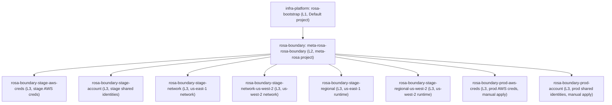

# HCP Terraform workspace integration

This page describes **public-repository-backed configuration and onboarding steps**, not a live HCP run or AWS inventory. It deliberately omits personal accounts, individual service-account ownership and private discussion links. The tenant bootstrap and reusable modules live in [openshift-online/infra-platform](https://github.com/openshift-online/infra-platform); the project-specific meta-workspace and AWS workloads live here. For resource-level details see [regional infrastructure](regional-runtime.md); for the operational walkthrough see [`docs/staging-deployment.md`](../../docs/staging-deployment.md); for the IAM/OIDC trust model see [identity and access](../architecture/identity-and-access.md). Recheck Git and HCP before making changes.

## What was set up, and in which account

| Account | Role in staging/production setup | Access boundary |
|---|---|---|
| `rosa-boundary-stage` (`150100906299`) | Long-lived staging account: HCP federation, shared account roles, and separate network/runtime states in `us-east-1` and `us-west-2` | The [staging AWS credentials stack](../../hcp-terraform/aws-creds/rosa-boundary-stage/main.tf) guards the account with `allowed_account_ids = ["150100906299"]` and targets the `hp-platform-engineering` HCP organization. Its `default` role group allowlists all six staging L3 workspaces. Trusted Actions uses a different role group, not Boundary's plan-role permissions. |
| `rosa-boundary-prod` (`514903006123`) | A **separate, newly bootstrapping** production AWS account, distinct from staging | The [production AWS credentials stack](../../hcp-terraform/aws-creds/rosa-boundary-prod/main.tf) guards this account with `allowed_account_ids = ["514903006123"]` ([L16-L20](../../hcp-terraform/aws-creds/rosa-boundary-prod/main.tf#L16-L20)). Its `default` role group currently allowlists only `rosa-boundary-prod-aws-creds` and `rosa-boundary-prod-account` ([L33-L46](../../hcp-terraform/aws-creds/rosa-boundary-prod/main.tf#L33-L46)) -- there is no production network or regional workspace yet, so this account runs no VPC/ECS/Lambda workload. |
| Other environments | Not part of this deployment | Local `.env`, Makefiles, and tfvars are for local development, not HCP runs. CI and real-infrastructure testing must not be mistaken for either account's HCP runtime. See [the quickstart](../quickstart.md) for local developer setup. |

Each [network-root](../../deploy/network/) instance (staging only, today) defines a dedicated VPC, private subnets, NAT egress, and an S3 gateway endpoint. The east workspace uses the root's east-region defaults; the west workspace explicitly selects `us-west-2`, two west-region AZs, a separate CIDR range, and single-NAT routing. Consult network outputs and the matching [regional workspace inputs](../../hcp-terraform/rosa-boundary/main.tf) for actual IDs; Backplane allowlisting is a separate network concern, not an HCP permission grant. Both staging regional definitions use the Red Hat EmployeeIDP issuer (`auth.redhat.com`, `ai-sd-sre` role/group, `uuid` ABAC key), separate from the `app.terraform.io` OIDC provider used for Terraform's AWS credentials.

## Onboarding sequence and permissions

1. **Separate AWS account provisioning from Terraform deployment.** Each AWS account is a prerequisite for HCP Terraform; this repository declares the account ID as a provider guard but does not provision the AWS account itself. HCP onboarding is defined in [infra-platform's ROSA tenant configuration](https://github.com/openshift-online/infra-platform/blob/main/hcp-terraform/tenants/rosa/main.tf), not via app-interface `terraform-repo`.
2. **Bootstrap the tenant (L1).** [infra-platform PR #56](https://github.com/openshift-online/infra-platform/pull/56) established the tenant bootstrap and [#80](https://github.com/openshift-online/infra-platform/pull/80) registered the `rosa-boundary` project and meta-workspace. The [`rosa-bootstrap` definition](https://github.com/openshift-online/infra-platform/blob/main/hcp-terraform/tenants/rosa/main.tf) grants the SSO-mapped `ai-sd-sre` team admin access to the bootstrap workspace and the `meta-rosa`/`rosa-boundary` projects, and attaches the deletion-protection policy set. The initial bootstrap run requires platform-admin credentials; project access does not confer AWS access by itself. A new AWS account (such as production) reuses this same `rosa-boundary` project rather than requiring a new L1 project.
3. **Grant VCS access.** The **Terraform Cloud GitHub App** is the HCP Terraform VCS connection for `openshift-online/rosa-boundary`, as declared in the [L1 project](https://github.com/openshift-online/infra-platform/blob/main/hcp-terraform/tenants/rosa/main.tf) and [L2 workspace definitions](../../hcp-terraform/rosa-boundary/main.tf). The org's App installation must include the repository; the account authorizing the integration needs effective repository **Read** access and an HCP identity. Installation and repository access are distinct from HCP project permissions. See the [infra-platform onboarding guide](https://github.com/openshift-online/infra-platform/blob/main/hcp-terraform/tenants/README.md). This is **not** the ROSA BOUNDARY CI GitHub App used by image builds.
4. **Register the meta-workspace (L2).** [Boundary PR #111](https://github.com/openshift-online/rosa-boundary/pull/111) provided the minimal `hcp-terraform/rosa-boundary` scaffold before the L1 configuration pointed a VCS-connected workspace at it. L1 attaches the `rosa-admin-creds` TFE API credential variable set and notification variable set to `meta-rosa-rosa-boundary`; review live variable-set ownership and rotation outside this public wiki. L2 owns the Git-managed L3 workspace definitions and input bindings for **every** AWS account's workspaces, staging and production alike. Do not publish token or webhook values.
5. **Bootstrap AWS dynamic credentials, then workloads (L3).** [Boundary PR #147](https://github.com/openshift-online/rosa-boundary/pull/147) introduced staging's network/credentials workspaces with a minimal network scaffold; [#153](https://github.com/openshift-online/rosa-boundary/pull/153) fixed the TFE provider configuration. [#154](https://github.com/openshift-online/rosa-boundary/pull/154) defined the HCP OIDC provider, phase-scoped AWS plan/apply roles and project variable set, followed by [#164](https://github.com/openshift-online/rosa-boundary/pull/164) and [#165](https://github.com/openshift-online/rosa-boundary/pull/165) for workspace binding. [#173](https://github.com/openshift-online/rosa-boundary/pull/173) introduced the VPC resources after the workspace existed. Regional infrastructure followed in [#182](https://github.com/openshift-online/rosa-boundary/pull/182), [#190](https://github.com/openshift-online/rosa-boundary/pull/190), and [#192](https://github.com/openshift-online/rosa-boundary/pull/192). The production account is following the same sequence today, currently paused after `aws-creds` and `account`; see [Production bootstrap](#production-bootstrap-a-second-separate-aws-account) below. For a new workspace, **merge an empty scaffold before registration**: the initial run may not respect an ordinary manual-apply gate. Follow the public [tenant onboarding guide](https://github.com/openshift-online/infra-platform/blob/main/hcp-terraform/tenants/README.md) and [dynamic credentials guide](https://github.com/openshift-online/infra-platform/blob/main/docs/aws-dynamic-creds.md) rather than copying a person's bootstrap credentials.

## Ownership and why there are multiple workspaces

L1 to L2 to L3 ownership chain: one meta-workspace manages six auto-applying staging workspaces in the `150100906299` account and two manual-apply production workspaces bootstrapping the separate `514903006123` account.

Each box is a separate HCP Terraform workspace with its **own state and run history**. A working directory is a source-code choice, not a state identity: both staging network workspaces use `deploy/network`, both staging regional workspaces use `deploy/regional`, and `rosa-boundary-prod-account` reuses the very same `deploy/account` directory as `rosa-boundary-stage-account`. L1 owns HCP project/team setup; L2 owns project-workspace configuration through the TFE API; the L3 workspaces partition AWS concerns per account. Each account's credentials workspace owns that account's HCP OIDC provider, plan/apply roles, and HCP variable sets. Staging's network states own their VPC/subnets/routing (production has none yet). **One account workspace per AWS account owns that account's shared IAM identities, common managed-policy attachments, user OIDC provider(s), Bedrock budget, and model agreements**. Staging's regional states consume their respective VPC/subnet IDs and own ECS, EFS, Lambda, regional inline IAM policies, KMS, and audit infrastructure; production has no regional state yet, so it owns no such runtime resources. See the [L2 map](../../hcp-terraform/rosa-boundary/main.tf) and [account ownership guide](../../deploy/account/README.md). Separate states are not separate AWS accounts by themselves -- but in this case the production workspaces genuinely are a separate AWS account, not merely a separate state in the same one; Git alone does not prove an applied migration.

| Layer | Configuration authority | Workspace and runtime | Inputs required before runs |
|---|---|---|---|
| L1 | [infra-platform tenant config](https://github.com/openshift-online/infra-platform/blob/main/hcp-terraform/tenants/rosa/main.tf) and its [bootstrap module](https://github.com/openshift-online/infra-platform/blob/main/hcp-terraform/modules/terraform-tfe-bootstrap/main.tf) | `rosa-bootstrap`, `infra-platform` VCS, Terraform `1.13.4`; its `import` block adopts its own workspace | Platform admin and notification variable sets; initial run bootstrapped manually by platform admin |
| L2 | [`hcp-terraform/rosa-boundary/main.tf`](../../hcp-terraform/rosa-boundary/main.tf) and upstream [workspaces module](https://github.com/openshift-online/infra-platform/blob/main/hcp-terraform/modules/terraform-tfe-workspaces/main.tf) | `meta-rosa-rosa-boundary`, `rosa-boundary` VCS, Terraform `1.16.0` | `rosa-admin-creds` (`TFE_TOKEN`) and `rosa-notification-url`, attached by L1 |
| L3: staging AWS credentials | [`hcp-terraform/aws-creds/rosa-boundary-stage/main.tf`](../../hcp-terraform/aws-creds/rosa-boundary-stage/main.tf) | `rosa-boundary-stage-aws-creds`, Terraform `1.16.0` | `rosa-boundary-tfe-creds` for TFE API plus AWS credentials; after bootstrap, its **own** generated dynamic-credentials set |
| L3: staging networks | [`deploy/network/`](../../deploy/network/) | `rosa-boundary-stage-network`, `rosa-boundary-stage-network-us-west-2`, Terraform `1.16.0` | Generated `rosa-boundary-rosa-boundary-stage-default-aws-dynamic-creds` set; region-specific network inputs/defaults |
| L3: staging account | [`deploy/account/`](../../deploy/account/) | `rosa-boundary-stage-account`, Terraform `1.16.0` | Same staging generated AWS set; shared identity, trust, budget, and model-agreement inputs |
| L3: staging regional runtimes | [`deploy/regional/`](../../deploy/regional/) | `rosa-boundary-stage-regional`, `rosa-boundary-stage-regional-us-west-2`, Terraform `1.16.0` | Same staging generated AWS set; each region's VPC/subnet IDs, image pins, and matching shared-IAM contract |
| L3: production AWS credentials | [`hcp-terraform/aws-creds/rosa-boundary-prod/main.tf`](../../hcp-terraform/aws-creds/rosa-boundary-prod/main.tf) | `rosa-boundary-prod-aws-creds`, Terraform `1.16.0`, `execution_mode = "remote"` | `rosa-boundary-tfe-creds` plus its **own** generated `rosa-boundary-rosa-boundary-prod-default-aws-dynamic-creds` set; manual apply |
| L3: production account | [`deploy/account/`](../../deploy/account/) (production inputs) | `rosa-boundary-prod-account`, Terraform `1.16.0`, `execution_mode = "remote"` | Production generated AWS set; `aws_account_id = "514903006123"`, `role_name_prefix = "rosa-boundary-prod"`, `stage = "prod"`; manual apply |

The bootstrap module creates the `rosa-boundary` and `meta-rosa` projects, `ai-sd-sre` team access, and the `rosa-deletion-protection` policy set over the bootstrap and both projects; its project map creates `meta-rosa-rosa-boundary` and connects it to `openshift-online/rosa-boundary`. The private registry modules are version-pinned by **each caller**: the Boundary meta-workspace calls the `workspaces/tfe` module at `0.0.23` ([L16-L18](../../hcp-terraform/rosa-boundary/main.tf#L16-L18)), both credentials stacks call `aws-dynamic-creds/tfe` at `0.0.15`, and the L1 bootstrap module is separately pinned at `0.0.23`; changing upstream module source alone does not upgrade the deployed callers. `cloud.tf` in each control-plane/credentials directory names its own HCP workspace -- staging's and production's `aws-creds` directories each have a distinct `cloud.tf`. The network, account and regional directories are run by their VCS-connected L3 workspaces; local `.env`, `terraform.tfvars`, Makefile and local state are for development, not inputs to the HCP runs.

## Bootstrap order and credential handoff

1. **Tenant and L1:** The HCP GitHub App must be able to read both repositories. The platform team first merged a minimal `infra-platform/hcp-terraform/tenants/rosa` directory, created `rosa-bootstrap` in the Default project with platform variable sets, and manually queued its first run. Its full config then manages that workspace via import and creates the `meta-rosa` project, the `rosa-boundary` project, the team/policies, and the L2 workspace. See the [infra-platform onboarding guide](https://github.com/openshift-online/infra-platform/blob/main/hcp-terraform/tenants/README.md) for the general bot and initial-run sequence. L1 does **not** provision Boundary's AWS resources, staging or production.
2. **L2:** Its working directory must already be on `main` before L1 creates the VCS-connected meta-workspace. L1 attaches tenant-level TFE/notification variable sets and uses `tfe_workspace_run` for the initial L2 run. L2's TFE provider then creates every L3 workspace it declares -- across both AWS accounts -- attaches their project-scoped variable sets, sets their Terraform variables, and queues first runs via the workspaces module.
3. **AWS identity bootstrap:** Each account's credentials workspace needs AWS access to create its own HCP OIDC provider, IAM roles and dynamic-credentials variable set. The historical staging bootstrap used the payer-assumed admin role; [upstream dynamic-credentials guide](https://github.com/openshift-online/infra-platform/blob/main/docs/aws-dynamic-creds.md) documents alternatives and handoff. Each account's final L2 definition attaches `rosa-boundary-tfe-creds` and that account's generated AWS set; do not put tokens or static keys into Git. See the [staging credentials module](../../hcp-terraform/aws-creds/rosa-boundary-stage/main.tf) and the [production credentials module](../../hcp-terraform/aws-creds/rosa-boundary-prod/main.tf).
4. **Workloads:** The staging AWS-credentials module's `default` role group explicitly lists all six staging Boundary workspaces in the `rosa-boundary` project, including both `-us-west-2` entries. The production AWS-credentials module's `default` role group currently lists only `rosa-boundary-prod-aws-creds` and `rosa-boundary-prod-account` ([L33-L46](../../hcp-terraform/aws-creds/rosa-boundary-prod/main.tf#L33-L46)), with a comment that workload workspaces are "authorized separately after registration" -- so a future production network or regional workspace must be added to that allowlist before it can assume AWS credentials, even once it exists as an L2 entry. L2 attaches each account's generated AWS variable set to that account's own workspaces only; a staging workspace is never bound to the production set or vice versa. Both IAM trust allowlisting **and** variable-set binding are required; adding a workspace definition or binding alone does not authorize AWS federation. Each staging network outputs `vpc_id` and `private_subnet_ids`; its regional counterpart receives these as explicit Git-managed L2 workspace variables, **not** through remote state or a network→regional run trigger. Verify the correct region's network inputs before regional runs.

Trusted Actions is intentionally separate: the staging credentials stack declares a `rosa-trusted-actions` role group for `rosa-trusted-actions-global` and `rosa-trusted-actions-stage`. Its plan role adds a narrowly scoped `secretsmanager:GetSecretValue` policy to `ReadOnlyAccess` because refreshing a secret version requires that read even with `ignore_changes`. The addition does **not** widen Boundary's default plan role. Apply-role policy defaults are unchanged. [Role groups and scoped plan policy](repo://hcp-terraform/aws-creds/rosa-boundary-stage/main.tf#L25-L85).

The HCP OIDC provider is for **Terraform's AWS provider**, distinct from the Boundary user's Keycloak OIDC federation described in [identity and access](../architecture/identity-and-access.md). The upstream [AWS dynamic-credentials module](https://github.com/openshift-online/infra-platform/blob/main/hcp-terraform/modules/terraform-tfe-aws-dynamic-creds/main.tf) restricts `app.terraform.io:aud` and `sub` to organization/project/workspace/run phase; by default the plan role has AWS `ReadOnlyAccess`, and the apply role has `AdministratorAccess`. It writes `TFC_AWS_PROVIDER_AUTH`, `TFC_AWS_PLAN_ROLE_ARN` and `TFC_AWS_APPLY_ROLE_ARN` into the project-scoped set, once per AWS account. Each credentials workspace additionally uses a TFE token to manage HCP resources; workload workspaces need only their own account's AWS set. The AWS provider in each credentials stack checks its own expected account ID (`150100906299` for staging, `514903006123` for production), as do the staging network and regional providers.

## Production bootstrap: a second, separate AWS account

The L2 map now also defines two production L3 workspaces inside the same `rosa-boundary` HCP project: `rosa-boundary-prod-aws-creds` ([L695-L708](../../hcp-terraform/rosa-boundary/main.tf#L695-L708)) and `rosa-boundary-prod-account` ([L712-L876](../../hcp-terraform/rosa-boundary/main.tf#L712-L876)). They do not target staging's AWS account: [`hcp-terraform/aws-creds/rosa-boundary-prod/main.tf`](../../hcp-terraform/aws-creds/rosa-boundary-prod/main.tf) guards its AWS provider with `allowed_account_ids = ["514903006123"]` ([L16-L20](../../hcp-terraform/aws-creds/rosa-boundary-prod/main.tf#L16-L20)), a distinct account from staging's `150100906299`, and [`cloud.tf`](../../hcp-terraform/aws-creds/rosa-boundary-prod/cloud.tf) names its own `rosa-boundary-prod-aws-creds` HCP workspace. The module instance's `aws_account_name = "rosa-boundary-prod"` ([L26-L31](../../hcp-terraform/aws-creds/rosa-boundary-prod/main.tf#L26-L31)) keeps its generated dynamic-credentials set and role ARNs entirely independent of staging's.

Trust is scoped narrowly during this bootstrap. The production credentials stack's `role_groups.default.projects.rosa-boundary.workspace_names` allowlists only `rosa-boundary-prod-aws-creds` and `rosa-boundary-prod-account`, with the comment "Authorize workload workspaces separately after registration" ([L33-L46](../../hcp-terraform/aws-creds/rosa-boundary-prod/main.tf#L33-L46)). There is no production network or regional workspace yet, so the production account currently has **no VPC, ECS, or Lambda runtime** -- only the shared account-level IAM identities that `rosa-boundary-prod-account` creates.

`rosa-boundary-prod-account` reuses the same `deploy/account` working directory as `rosa-boundary-stage-account`, but with production-specific Git-managed variables ([L712-L876](../../hcp-terraform/rosa-boundary/main.tf#L712-L876)): `aws_account_id = "514903006123"`, `role_name_prefix = "rosa-boundary-prod"`, `stage = "prod"`, and `legacy_policy_region`/`legacy_role_tag_region` both `us-east-1`, establishing `us-east-1` as production's own legacy-name owner the same way staging designated it (see [Two regions, one shared identity contract](#two-regions-one-shared-identity-contract)). `bedrock_logging_source_regions` is already set to `["us-east-1", "us-west-2"]`, pre-authorizing "both planned production regions" in the Bedrock delivery role's trust condition even though only `us-east-1` exists as a workspace today -- this is advance trust configuration, not evidence that a `us-west-2` production region has been deployed. `adopt_existing_resources = false` reflects a greenfield account with nothing to import, unlike staging's historical handoff described in [`deploy/account/README.md`](../../deploy/account/README.md#existing-deployment-handoff).

Both production workspaces set `execution_mode = "remote"` plus explicit `auto_apply = false` and `auto_apply_run_trigger = false` (`rosa-boundary-prod-aws-creds` at [L701-L702](../../hcp-terraform/rosa-boundary/main.tf#L701-L702), `rosa-boundary-prod-account` at [L718-L719](../../hcp-terraform/rosa-boundary/main.tf#L718-L719)). Every ordinary apply in the production account requires a reviewed manual confirmation -- these two workspaces are, today, the **only** ones in the repository with that Git-managed gate. This is the inverse of the current staging configuration (see below): the manual-apply gate has moved from staging to this in-progress production bootstrap, not disappeared from the system.

## Two regions, one shared identity contract

Both staging regional definitions set `account_role_name_prefix = "rosa-boundary-stage"` and `legacy_policy_region = "us-east-1"`. Only east retains unsuffixed inline-policy names; west appends `-us-west-2` instead of overwriting east's policies on the shared roles. Never independently designate west as a second legacy owner. The account root's [handoff outputs](repo://deploy/account/outputs.tf#L1-L12) define this contract, and the [regional naming logic](repo://deploy/regional/account-iam.tf#L1-L8) implements it. Permissions on shared roles are the union of regional grants, not a region-isolation boundary. Production's account workspace sets the equivalent `legacy_policy_region = "us-east-1"` for itself ([L745-L748](../../hcp-terraform/rosa-boundary/main.tf#L745-L748)), ready for a second production region to apply the same union/suffix contract once one exists.

The staging account input explicitly approves `us-east-1` and `us-west-2` in `bedrock_logging_source_regions`. This extends the Bedrock delivery role's `SourceArn` trust only to those regions while retaining its `SourceAccount` restriction; regional roots still own their own logging destinations and inline delivery grants (see [audit and logging](../operations/audit-and-logging.md) for the logging pipeline itself). Account state also owns the investigation reaper's basic/VPC managed-policy attachments, so a second region must not claim the same shared attachment. The staging L2 account input disables `adopt_existing_resources`; this is not an instruction to re-enable adoption for an additional region. Review live state and plans rather than interpreting leftover migration approvals or comments as proof of ownership transfer. [Staging account inputs](repo://hcp-terraform/rosa-boundary/main.tf#L153-L320) · [logging trust](repo://deploy/account/modules/shared-iam/bedrock-logging.tf#L1-L28) · [reaper attachments](repo://deploy/account/modules/shared-iam/lambda-reap-investigations.tf#L1-L19).

## What causes a plan, and what applies it

There are **two independent event paths**, not just a single linear cascade:

| Event | Plan/run behavior | Apply behavior |
|---|---|---|
| Upstream-branch PR changing a workspace's VCS working directory (or configured trigger prefix) | HCP's GitHub App creates a **speculative plan** for an already initialized matching workspace; inspect the PR checks. Fork PRs do not reliably receive those plans. | A speculative plan is review-only; it does not apply. |
| Merge to `infra-platform` `main` changing `hcp-terraform/tenants/rosa` or its `hcp-terraform/policies` trigger prefix | VCS queues `rosa-bootstrap`; changes elsewhere in infra-platform do not automatically plan this tenant merely because a private registry module's source changed. | Bootstrap `auto_apply` defaults to true. Successful bootstrap apply feeds a `tfe_run_trigger` targeting L2; L2's own VCS connection to Boundary can also independently cause a run. |
| Merge to `rosa-boundary` `main` changing `hcp-terraform/rosa-boundary` | VCS queues L2. | L2's bootstrap-managed `auto_apply` defaults to true; it reconciles workspace configuration and its successful apply can trigger **every** L3 workspace it owns -- staging and production -- even when no files changed in their directories. |
| Merge to `rosa-boundary` `main` changing `deploy/network`, `deploy/account`, `deploy/regional`, `hcp-terraform/aws-creds/rosa-boundary-stage`, or `hcp-terraform/aws-creds/rosa-boundary-prod` | Matching L3 VCS connections queue runs without an L1/L2 change. Both staging regional workspaces share `deploy/regional`; both staging network workspaces share `deploy/network`; `rosa-boundary-prod-account` also shares `deploy/account` with `rosa-boundary-stage-account`, so one PR touching that directory can queue runs in **both AWS accounts**. | All **six staging** workspaces set `auto_apply = true` and `auto_apply_run_trigger = true`, either explicitly (`rosa-boundary-stage-network-us-west-2` at [L76-L78](../../hcp-terraform/rosa-boundary/main.tf#L76-L78), `rosa-boundary-stage-account` at [L158-L159](../../hcp-terraform/rosa-boundary/main.tf#L158-L159), `rosa-boundary-stage-regional` at [L327-L329](../../hcp-terraform/rosa-boundary/main.tf#L327-L329), `rosa-boundary-stage-regional-us-west-2` at [L520-L522](../../hcp-terraform/rosa-boundary/main.tf#L520-L522)) or by omitting the override and inheriting the called module's default (`rosa-boundary-stage-network`, `rosa-boundary-stage-aws-creds`). **The two production workspaces are the only ones that explicitly disable this**: `auto_apply = false` and `auto_apply_run_trigger = false` on both `rosa-boundary-prod-aws-creds` ([L701-L702](../../hcp-terraform/rosa-boundary/main.tf#L701-L702)) and `rosa-boundary-prod-account` ([L718-L719](../../hcp-terraform/rosa-boundary/main.tf#L718-L719)), combined with `execution_mode = "remote"` -- every ordinary production apply needs manual confirmation, while every ordinary staging apply does not. |
| A newly registered L2 or L3 workspace | The owning module's `tfe_workspace_run` queues an **initial** run after workspace settings, variables, bindings and policies; this is distinct from the ordinary run triggers. | The module's initial apply block has `manual_confirm = false`; review readiness and dependencies **before** creating the workspace. |

Run triggers are installed **on the downstream workspace**: bootstrap→meta in the upstream bootstrap module; meta→each L3 in the upstream workspaces module. `source_workspaces` can add further upstream sources, but the present L2 map does not declare any. In particular, there is no network→regional trigger and no guaranteed execution order between L3 siblings, staging or production. VCS working-directory filtering and run triggers can both produce runs for a commit; review run source and state rather than assuming exactly one run. `queue_all_runs = false` is set by both modules for managed downstream workspaces. A failed plan, invalid credentials, policy denial, or missing input does not become an apply; `auto_apply = true` is **not** a promise that every change deploys, and `auto_apply = false` is not by itself proof that a human reviewed a change -- it only means the run stops short of applying until someone confirms it. The `rosa-deletion-protection` OPA policy requires a matching unexpired `_deletion_approvals` entry for deletes; policy overrides, where permitted, are a separate deliberate action. Slack notification setup includes runs needing attention and errors, not just successful runs.

> **Initial-run exception:** The [workspaces module](https://github.com/openshift-online/infra-platform/blob/main/hcp-terraform/modules/terraform-tfe-workspaces/main.tf) queues the first `tfe_workspace_run` separately from ordinary VCS-triggered runs. Its initial run may not require manual confirmation even with `auto_apply = false` -- this is exactly the setting on both current production workspaces, so their very first run is not necessarily gated the way their steady-state `auto_apply = false` suggests. Scaffold an empty root first, inspect any initial run and never rely on the normal manual gate for a newly registered workspace. Confirm the L2 settings have actually reconciled in HCP before approving changes to existing resources.

## Adding a workspace without breaking the chain

The meta-workspace currently manages **eight** L3 workspaces across two AWS accounts -- six staging workspaces in the long-lived `rosa-boundary-stage` account, and two bootstrapping workspaces in the newly separate `rosa-boundary-prod` account -- with more production workspaces (network, regional) expected as that account comes online. Treat the count as a snapshot, not a fixed total; the production bootstrap below is itself a live example of this procedure.

1. **Choose ownership:** new HCP project/team/policy or a new meta-workspace belongs in [infra-platform's ROSA tenant `projects` map](https://github.com/openshift-online/infra-platform/blob/main/hcp-terraform/tenants/rosa/main.tf). A new AWS workload inside the existing `rosa-boundary` project -- whether in the staging account, the production account, or a future third account -- belongs in the `workspaces` map of [`hcp-terraform/rosa-boundary/main.tf`](../../hcp-terraform/rosa-boundary/main.tf). Do not create a workspace manually as a substitute for its owner. Distinguish account-global IAM (`deploy/account/`, one state per AWS account), per-account OIDC credentials, network, and per-region runtime states.
2. **Scaffold first, register second:** merge the new working directory and minimal valid Terraform configuration into the connected repo's default branch **before** adding the workspace definition in a separate PR. A new VCS-connected workspace needs an initial completed run before PR webhook speculative plans work. L1's first run is manual; L2/L3 initial runs are queued by `tfe_workspace_run`, but cannot succeed if the working directory is absent. Specify the `cloud.tf` workspace name for control-plane/credentials directories as appropriate; choose a reviewed exact `terraform_version` compatible with `required_version` and pinned providers. The production `aws-creds` and `account` directories followed exactly this pattern before their L2 entries existed.
3. **Provision prerequisites before registration:** ensure GitHub App/repo access, project/team access, TFE token set if using the TFE provider, AWS account/provider guard, tags, appropriate region and network. For a new AWS account, bootstrap its **own** HCP OIDC/roles/variable set as above -- as production did in [`hcp-terraform/aws-creds/rosa-boundary-prod/main.tf`](../../hcp-terraform/aws-creds/rosa-boundary-prod/main.tf). For a new workload workspace in an **existing** account, extend that account's `role_groups.default.projects.rosa-boundary.workspace_names` allowlist (staging: [`hcp-terraform/aws-creds/rosa-boundary-stage/main.tf`](../../hcp-terraform/aws-creds/rosa-boundary-stage/main.tf); production: [`hcp-terraform/aws-creds/rosa-boundary-prod/main.tf`](../../hcp-terraform/aws-creds/rosa-boundary-prod/main.tf)), apply/verify the credentials stack, then attach its generated set in the L2 entry. Merely adding the set binding does not widen the IAM trust policy -- this is precisely the state production's account workspace is in: its variable-set binding exists, but any future production workload workspace still needs its own allowlist entry.
4. **Add the L2 map entry by PR:** set unique name, VCS org/repo, working directory, Terraform version, `variable_set_names`, and an explicit `variables` list (possibly empty). Set `auto_apply`/`auto_apply_run_trigger` deliberately; their **default is true**. For a workspace that must not auto-apply (as both production workspaces currently do not), also consider `execution_mode = "remote"` as the two production entries do. Set `source_workspaces` only for real cross-workspace run dependencies, and arrange a proper way to supply outputs as inputs: a run trigger does not transfer Terraform outputs. Put stage/region/account, image pins and other workload inputs in this Git-controlled list, not in ad hoc HCP workspace variable edits. For every network, account and regional workspace in either account, this map is the source of truth for variables; do not change them directly through HCP UI/API/MCP.
5. **Review both PR and initial/merge runs:** confirm speculative plans actually appeared on upstream branches; check initial-run history, variable set bindings, policy results, planned AWS account/region, and network inputs. After merge, verify the L2 apply created the workspace, the initial L3 run completed, and subsequent VCS and run-triggered plans/applies behave as intended. For a new account or region -- including the rest of the production bootstrap -- validate live access, routing, audit and recovery rather than assuming staging credentials or VPC IDs generalize. Do not manually trigger/create/apply runs just to paper over a missing source directory, failed policy, or unsatisfied credential prerequisite.

## Prow and image delivery are separate from HCP permissions

Prow's pre-merge LocalStack/Lambda/Go CI is defined in [`openshift/release`](https://github.com/openshift/release/tree/master/ci-operator/config/openshift-online/rosa-boundary), with a test harness in [`tests/localstack/`](../../tests/localstack/). CI secrets are not HCP AWS credentials. Konflux builds Quay images, including the Boundary runtime and investigation Lambda; staging pins image tags by commit in each region's **L2 variables**, requiring another reviewed HCP run for promotion. `container_image` and `lambda_image_tag` select different artifacts; updating the investigation Lambda pin does not update the Fargate runtime image or prove that either region has deployed the change. The **ROSA BOUNDARY CI GitHub App** supplies authenticated GitHub downloads to image builds; its build-secret path is distinct from the Terraform Cloud VCS GitHub App and from AWS plan/apply roles. See the [image build instructions](../../AGENTS.md) and [`build/github_dl.py`](../../build/github_dl.py) for the repository-owned requirements. Prow pre-merge LocalStack tests do **not** demonstrate that a separate nightly real-infrastructure job or Sippy reporting is deployed; verify such a job in `openshift/release` before asserting it exists.

## Sources and verification boundaries

Boundary-owned definitions: [`hcp-terraform/rosa-boundary/main.tf`](../../hcp-terraform/rosa-boundary/main.tf), [`hcp-terraform/aws-creds/rosa-boundary-stage/main.tf`](../../hcp-terraform/aws-creds/rosa-boundary-stage/main.tf), [`hcp-terraform/aws-creds/rosa-boundary-prod/main.tf`](../../hcp-terraform/aws-creds/rosa-boundary-prod/main.tf), [`deploy/network/outputs.tf`](../../deploy/network/outputs.tf), [`deploy/account/README.md`](../../deploy/account/README.md). Cross-repository implementation: [ROSA tenant bootstrap](https://github.com/openshift-online/infra-platform/blob/main/hcp-terraform/tenants/rosa/main.tf), [bootstrap module](https://github.com/openshift-online/infra-platform/blob/main/hcp-terraform/modules/terraform-tfe-bootstrap/main.tf), [workspaces module](https://github.com/openshift-online/infra-platform/blob/main/hcp-terraform/modules/terraform-tfe-workspaces/main.tf), [AWS credentials module](https://github.com/openshift-online/infra-platform/blob/main/hcp-terraform/modules/terraform-tfe-aws-dynamic-creds/main.tf), and [tenant onboarding](https://github.com/openshift-online/infra-platform/blob/main/hcp-terraform/tenants/README.md). These links describe the module source as inspected; Boundary calls published, pinned registry releases, so review the **deployed module version and HCP run history** before relying on module behavior for an operational change.
