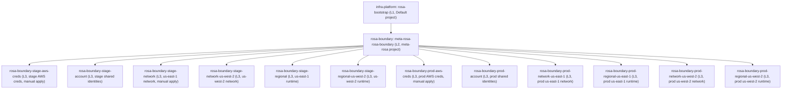

# HCP Terraform workspace integration

This page describes **public-repository-backed configuration and onboarding steps**, not a live HCP run or AWS inventory. It deliberately omits personal accounts, individual service-account ownership and private discussion links. The tenant bootstrap and reusable modules live in [openshift-online/infra-platform](https://github.com/openshift-online/infra-platform); the project-specific meta-workspaces and AWS workloads live here, split across **two independent HCP projects within the same `hp-platform-engineering` organization**: `rosa-boundary` (this page's main subject) and `rosa-trusted-actions` (covered separately below, and in more operational depth in [Trusted Actions deployment](trusted-actions-deployment.md)). These two projects have **independent state, independent VCS-triggered runs, and independent variable sets** -- they share the organization and, since the Trusted Actions monorepo migration, the same GitHub repository, but never a workspace or a Terraform state. For resource-level details see [regional infrastructure](regional-runtime.md); for the operational walkthrough see [`docs/staging-deployment.md`](../../docs/staging-deployment.md); for the IAM/OIDC trust model see [identity and access](../architecture/identity-and-access.md). Recheck Git and HCP before making changes.

## What was set up, and in which account

| Account | Role in staging/production setup | Access boundary |
|---|---|---|
| `rosa-boundary-stage` (`150100906299`) | Long-lived staging account: HCP federation, shared account roles, and separate network/runtime states in `us-east-1` and `us-west-2` | The [staging AWS credentials stack](../../hcp-terraform/aws-creds/rosa-boundary-stage/main.tf) guards the account with `allowed_account_ids = ["150100906299"]` and targets the `hp-platform-engineering` HCP organization. Its `default` role group allowlists all six staging L3 Boundary workspaces ([L36-L43](../../hcp-terraform/aws-creds/rosa-boundary-stage/main.tf#L36-L43)). A separate `rosa-trusted-actions` role group in the **same credentials stack** allowlists Trusted Actions' own `rosa-trusted-actions-global` and `rosa-trusted-actions-stage` workspaces ([L53-L66](../../hcp-terraform/aws-creds/rosa-boundary-stage/main.tf#L53-L66)) -- Trusted Actions federates through Boundary's staging AWS account, but under a distinct role group and plan-role policy, not Boundary's own `default` grant. |
| `rosa-boundary-prod` (`514903006123`) | A **separate** production AWS account, distinct from staging, registered with the same six-workspace topology as staging | The [production AWS credentials stack](../../hcp-terraform/aws-creds/rosa-boundary-prod/main.tf) guards this account with `allowed_account_ids = ["514903006123"]` ([L17-L20](../../hcp-terraform/aws-creds/rosa-boundary-prod/main.tf#L17-L20)). Its `default` role group allowlists all six registered production workspaces: `rosa-boundary-prod-aws-creds`, `rosa-boundary-prod-account`, `rosa-boundary-prod-network-us-east-1`, `rosa-boundary-prod-regional-us-east-1`, `rosa-boundary-prod-network-us-west-2`, and `rosa-boundary-prod-regional-us-west-2` ([L38-L45](../../hcp-terraform/aws-creds/rosa-boundary-prod/main.tf#L38-L45)) -- a full `us-east-1`/`us-west-2` network-and-regional pair exists in each region, mirroring staging's Region A/Region B split. There is no Trusted Actions presence in the production account today. |
| Other environments | Not part of this deployment | Local `.env`, Makefiles, and tfvars are for local development, not HCP runs. CI and real-infrastructure testing must not be mistaken for either account's HCP runtime. See [the quickstart](../quickstart.md) for local developer setup. |

Each [network-root](../../deploy/network/) instance defines a dedicated VPC, private subnets, NAT egress, and an S3 gateway endpoint; both staging and production have two (`us-east-1`, `us-west-2`). Both accounts' east workspaces use the root's east-region defaults; both accounts' west workspaces explicitly select `us-west-2`, two west-region AZs, a separate CIDR range, and single-NAT routing. Consult network outputs and the matching [regional workspace inputs](../../hcp-terraform/rosa-boundary/main.tf) for actual IDs; Backplane allowlisting is a separate network concern, not an HCP permission grant. All Boundary regional definitions -- staging and production alike -- use the Red Hat EmployeeIDP issuer (`auth.redhat.com`, `ai-sd-sre` role/group, `uuid` ABAC key), separate from the `app.terraform.io` OIDC provider used for Terraform's AWS credentials.

## Onboarding sequence and permissions

1. **Separate AWS account provisioning from Terraform deployment.** Each AWS account is a prerequisite for HCP Terraform; this repository declares the account ID as a provider guard but does not provision the AWS account itself. HCP onboarding is defined in [infra-platform's ROSA tenant configuration](https://github.com/openshift-online/infra-platform/blob/main/hcp-terraform/tenants/rosa/main.tf), not via app-interface `terraform-repo`.
<!-- openwiki: broken internal link [#rosa-trusted-actions-is-a-separate-meta-workspace-not-part-of-this-topology] heading anchor "rosa-trusted-actions-is-a-separate-meta-workspace-not-part-of-this-topology" does not exist in /openwiki/infrastructure/hcp-terraform-workspaces.md. Fix the href or restore the target, then delete this comment. -->
2. **Bootstrap the tenant (L1).** [infra-platform PR #56](https://github.com/openshift-online/infra-platform/pull/56) established the tenant bootstrap and [#80](https://github.com/openshift-online/infra-platform/pull/80) registered the `rosa-boundary` project and meta-workspace. The [`rosa-bootstrap` definition](https://github.com/openshift-online/infra-platform/blob/main/hcp-terraform/tenants/rosa/main.tf) grants the SSO-mapped `ai-sd-sre` team admin access to the bootstrap workspace and the `meta-rosa`/`rosa-boundary` projects, and attaches the deletion-protection policy set. The initial bootstrap run requires platform-admin credentials; project access does not confer AWS access by itself. A new AWS account (such as production) reuses this same `rosa-boundary` project rather than requiring a new L1 project. Trusted Actions' own `rosa-trusted-actions` project shares the same `meta-rosa` meta-project but is a **separate** L1 project entry (see [below](#rosa-trusted-actions-is-a-separate-meta-workspace-not-part-of-this-topology)).
3. **Grant VCS access.** The **Terraform Cloud GitHub App** is the HCP Terraform VCS connection for `openshift-online/rosa-boundary`, as declared in the [L1 project](https://github.com/openshift-online/infra-platform/blob/main/hcp-terraform/tenants/rosa/main.tf) and [L2 workspace definitions](../../hcp-terraform/rosa-boundary/main.tf). The org's App installation must include the repository; the account authorizing the integration needs effective repository **Read** access and an HCP identity. Installation and repository access are distinct from HCP project permissions. See the [infra-platform onboarding guide](https://github.com/openshift-online/infra-platform/blob/main/hcp-terraform/tenants/README.md). This is **not** the ROSA BOUNDARY CI GitHub App used by image builds.
4. **Register the meta-workspace (L2).** [Boundary PR #111](https://github.com/openshift-online/rosa-boundary/pull/111) provided the minimal `hcp-terraform/rosa-boundary` scaffold before the L1 configuration pointed a VCS-connected workspace at it. L1 attaches the `rosa-admin-creds` TFE API credential variable set and notification variable set to `meta-rosa-rosa-boundary`; review live variable-set ownership and rotation outside this public wiki. L2 owns the Git-managed L3 workspace definitions and input bindings for **every** AWS account's Boundary workspaces, staging and production alike. Do not publish token or webhook values.
5. **Bootstrap AWS dynamic credentials, then workloads (L3).** [Boundary PR #147](https://github.com/openshift-online/rosa-boundary/pull/147) introduced staging's network/credentials workspaces with a minimal network scaffold; [#153](https://github.com/openshift-online/rosa-boundary/pull/153) fixed the TFE provider configuration. [#154](https://github.com/openshift-online/rosa-boundary/pull/154) defined the HCP OIDC provider, phase-scoped AWS plan/apply roles and project variable set, followed by [#164](https://github.com/openshift-online/rosa-boundary/pull/164) and [#165](https://github.com/openshift-online/rosa-boundary/pull/165) for workspace binding. [#173](https://github.com/openshift-online/rosa-boundary/pull/173) introduced the VPC resources after the workspace existed. Regional infrastructure followed in [#182](https://github.com/openshift-online/rosa-boundary/pull/182), [#190](https://github.com/openshift-online/rosa-boundary/pull/190), and [#192](https://github.com/openshift-online/rosa-boundary/pull/192). The production account followed the same sequence: its credentials and account workspaces bootstrapped first (comments in the L2 map reference a `T3-PR5`/`T3-PR6` sequence), and its `us-west-2` network/regional pair was registered afterward, completing parity with staging (a `T3-PR8 (#428)` network-apply output now backs the west regional workspace's VPC/subnet inputs); see [Production: a second, separate AWS account at staging parity](#production-a-second-separate-aws-account-at-staging-parity) below. For a new workspace, **merge an empty scaffold before registration**: the initial run may not respect an ordinary manual-apply gate. Follow the public [tenant onboarding guide](https://github.com/openshift-online/infra-platform/blob/main/hcp-terraform/tenants/README.md) and [dynamic credentials guide](https://github.com/openshift-online/infra-platform/blob/main/docs/aws-dynamic-creds.md) rather than copying a person's bootstrap credentials.

## Ownership and why there are multiple workspaces

L1 to L2 to L3 ownership chain: one meta-workspace manages twelve L3 workspaces split evenly across the `150100906299` staging account and the `514903006123` production account. **Three** of the twelve now require manual apply confirmation: `rosa-boundary-stage-aws-creds`, `rosa-boundary-stage-network`, and `rosa-boundary-prod-aws-creds`; the other nine auto-apply. This is a change from the staging-only bootstrap era -- `rosa-boundary-stage-network`'s sibling, `rosa-boundary-stage-network-us-west-2`, auto-applies, so the two staging network workspaces are no longer symmetric on this setting. Always check `auto_apply`/`auto_apply_run_trigger` per workspace in the current L2 map rather than assuming a account-wide or tier-wide pattern.

Each box is a separate HCP Terraform workspace with its **own state and run history**. A working directory is a source-code choice, not a state identity: all four `-network*` workspaces (two staging, two production) use `deploy/network`, all four `-regional*` workspaces use `deploy/regional`, and `rosa-boundary-prod-account` reuses the very same `deploy/account` directory as `rosa-boundary-stage-account` -- three directories, twelve states. L1 owns HCP project/team setup; L2 owns project-workspace configuration through the TFE API; the L3 workspaces partition AWS concerns per account. Each account's credentials workspace owns that account's HCP OIDC provider, plan/apply roles, and HCP variable sets. Network states own their VPC/subnets/routing -- two per account. **One account workspace per AWS account owns that account's shared IAM identities, common managed-policy attachments, user OIDC provider(s), Bedrock budget, and model agreements** -- `module.shared_iam` in [`deploy/account/main.tf`](repo://deploy/account/main.tf#L42-L77) is the single place these identities are declared, independently of any regional resource state. Regional states consume their respective VPC/subnet IDs and own ECS, EFS, Lambda, regional inline IAM policies, KMS, and audit infrastructure; production's two regional workspaces are registered with concrete VPC/subnet/image inputs wired in and, unlike the credentials workspace, both auto-apply -- but `auto_apply = true` is still not proof of a completed apply on its own, so check live run history rather than assuming from Git alone. See the [L2 map](../../hcp-terraform/rosa-boundary/main.tf) and [account ownership guide](../../deploy/account/README.md). Separate states are not separate AWS accounts by themselves -- but in this case the production workspaces genuinely are a separate AWS account, not merely a separate state in the same one; Git alone does not prove an applied migration.

| Layer | Configuration authority | Workspace and runtime | Inputs required before runs |
|---|---|---|---|
| L1 | [infra-platform tenant config](https://github.com/openshift-online/infra-platform/blob/main/hcp-terraform/tenants/rosa/main.tf) and its [bootstrap module](https://github.com/openshift-online/infra-platform/blob/main/hcp-terraform/modules/terraform-tfe-bootstrap/main.tf) | `rosa-bootstrap`, `infra-platform` VCS, Terraform `1.13.4`; its `import` block adopts its own workspace | Platform admin and notification variable sets; initial run bootstrapped manually by platform admin |
| L2 | [`hcp-terraform/rosa-boundary/main.tf`](../../hcp-terraform/rosa-boundary/main.tf) and upstream [workspaces module](https://github.com/openshift-online/infra-platform/blob/main/hcp-terraform/modules/terraform-tfe-workspaces/main.tf) pinned at `0.0.23` ([L36-L37](../../hcp-terraform/rosa-boundary/main.tf#L36-L37)) | `meta-rosa-rosa-boundary`, `rosa-boundary` VCS, Terraform `1.16.0` | `rosa-admin-creds` (`TFE_TOKEN`) and `rosa-notification-url`, attached by L1; the module's own `notification` block ([L44-L52](../../hcp-terraform/rosa-boundary/main.tf#L44-L52)) fires on `run:needs_attention`, `run:errored`, and check/drift/assessment failures |
| L3: staging AWS credentials | [`hcp-terraform/aws-creds/rosa-boundary-stage/main.tf`](../../hcp-terraform/aws-creds/rosa-boundary-stage/main.tf) | `rosa-boundary-stage-aws-creds`, Terraform `1.16.0`, **manual apply** (`auto_apply = false` / `auto_apply_run_trigger = false`, [L167-L168](../../hcp-terraform/rosa-boundary/main.tf#L167-L168)) | `rosa-boundary-tfe-creds` for TFE API plus AWS credentials; after bootstrap, its **own** generated dynamic-credentials set |
| L3: staging networks | [`deploy/network/`](../../deploy/network/) | `rosa-boundary-stage-network` (**manual apply**: `auto_apply = false` / `auto_apply_run_trigger = false`, [L60-L61](../../hcp-terraform/rosa-boundary/main.tf#L60-L61)), `rosa-boundary-stage-network-us-west-2` (auto-applies, [L97-L98](../../hcp-terraform/rosa-boundary/main.tf#L97-L98)), Terraform `1.16.0` | Generated `rosa-boundary-rosa-boundary-stage-default-aws-dynamic-creds` set; region-specific network inputs/defaults |
| L3: staging account | [`deploy/account/`](../../deploy/account/) | `rosa-boundary-stage-account`, Terraform `1.16.0`, auto-apply ([L181-L182](../../hcp-terraform/rosa-boundary/main.tf#L181-L182)) | Same staging generated AWS set; shared identity, trust, budget, and model-agreement inputs |
| L3: staging regional runtimes | [`deploy/regional/`](../../deploy/regional/) | `rosa-boundary-stage-regional`, `rosa-boundary-stage-regional-us-west-2`, Terraform `1.16.0`, both auto-apply ([L358-L359](../../hcp-terraform/rosa-boundary/main.tf#L358-L359), [L563-L564](../../hcp-terraform/rosa-boundary/main.tf#L563-L564)) | Same staging generated AWS set; each region's VPC/subnet IDs, image pins, and matching shared-IAM contract |
| L3: production AWS credentials | [`hcp-terraform/aws-creds/rosa-boundary-prod/main.tf`](../../hcp-terraform/aws-creds/rosa-boundary-prod/main.tf) | `rosa-boundary-prod-aws-creds`, Terraform `1.16.0`, `execution_mode = "remote"` ([L755](../../hcp-terraform/rosa-boundary/main.tf#L755)), **manual apply** (`auto_apply = false` / `auto_apply_run_trigger = false`, [L756-L757](../../hcp-terraform/rosa-boundary/main.tf#L756-L757)) | `rosa-boundary-tfe-creds` plus its **own** generated `rosa-boundary-rosa-boundary-prod-default-aws-dynamic-creds` set |
| L3: production account | [`deploy/account/`](../../deploy/account/) (production inputs) | `rosa-boundary-prod-account`, Terraform `1.16.0`, `execution_mode = "remote"`, auto-apply ([L773-L774](../../hcp-terraform/rosa-boundary/main.tf#L773-L774)) | Production generated AWS set; `aws_account_id = "514903006123"`, `role_name_prefix = "rosa-boundary-prod"`, `stage = "prod"` |
| L3: production networks | [`deploy/network/`](../../deploy/network/) (production inputs) | `rosa-boundary-prod-network-us-east-1`, `rosa-boundary-prod-network-us-west-2`, Terraform `1.16.0`, `execution_mode = "remote"`, both auto-apply ([L956-L957](../../hcp-terraform/rosa-boundary/main.tf#L956-L957), [L1190-L1191](../../hcp-terraform/rosa-boundary/main.tf#L1190-L1191)) | Production generated AWS set; `aws_account_id = "514903006123"`, `aws_region` per workspace, `stage = "prod"` |
| L3: production regional runtimes | [`deploy/regional/`](../../deploy/regional/) (production inputs) | `rosa-boundary-prod-regional-us-east-1`, `rosa-boundary-prod-regional-us-west-2`, Terraform `1.16.0`, `execution_mode = "remote"`, both auto-apply ([L1012-L1013](../../hcp-terraform/rosa-boundary/main.tf#L1012-L1013), [L1273-L1274](../../hcp-terraform/rosa-boundary/main.tf#L1273-L1274)) | Production generated AWS set; `account_role_name_prefix = "rosa-boundary-prod"`, `legacy_policy_region = "us-east-1"` in both, concrete `vpc_id`/`subnet_ids` and image pins per region |

The bootstrap module creates the `rosa-boundary` and `meta-rosa` projects, `ai-sd-sre` team access, and the `rosa-deletion-protection` policy set over the bootstrap and both projects; its project map creates `meta-rosa-rosa-boundary` and connects it to `openshift-online/rosa-boundary`. The private registry modules are version-pinned by **each caller**: the Boundary meta-workspace calls the `workspaces/tfe` module at `0.0.23` ([L36-L37](../../hcp-terraform/rosa-boundary/main.tf#L36-L37)), both credentials stacks call `aws-dynamic-creds/tfe` at `0.0.15`, and the L1 bootstrap module is separately pinned at `0.0.23`; changing upstream module source alone does not upgrade the deployed callers. This single `rosa_boundary` module call declares all twelve L3 workspaces inside one `workspaces = { ... }` map -- six staging workspaces from `rosa-boundary-stage-network` through `rosa-boundary-stage-regional-us-west-2` ([L55-L747](../../hcp-terraform/rosa-boundary/main.tf#L55-L747)) and six production workspaces from `rosa-boundary-prod-aws-creds` through `rosa-boundary-prod-regional-us-west-2` ([L750-L1454](../../hcp-terraform/rosa-boundary/main.tf#L750-L1454)). `cloud.tf` in each control-plane/credentials directory names its own HCP workspace -- staging's and production's `aws-creds` directories each have a distinct `cloud.tf`. The network, account and regional directories are run by their VCS-connected L3 workspaces; local `.env`, `terraform.tfvars`, Makefile and local state are for development, not inputs to the HCP runs. A separate `moved.tf` ([`hcp-terraform/rosa-boundary/moved.tf`](../../hcp-terraform/rosa-boundary/moved.tf)) renames the Git-managed `tfe_variable` key for both account workspaces' replication input (`lambda_ecr_replication_regions` → `replication`) so an in-place variable-key rename does not delete and recreate the underlying HCP variable resource; it currently holds only these two variable-key moves, not any workspace-level move.

## Bootstrap order and credential handoff

1. **Tenant and L1:** The HCP GitHub App must be able to read both repositories. The platform team first merged a minimal `infra-platform/hcp-terraform/tenants/rosa` directory, created `rosa-bootstrap` in the Default project with platform variable sets, and manually queued its first run. Its full config then manages that workspace via import and creates the `meta-rosa` project, the `rosa-boundary` project, the team/policies, and the L2 workspace. See the [infra-platform onboarding guide](https://github.com/openshift-online/infra-platform/blob/main/hcp-terraform/tenants/README.md) for the general bot and initial-run sequence. L1 does **not** provision Boundary's AWS resources, staging or production.
2. **L2:** Its working directory must already be on `main` before L1 creates the VCS-connected meta-workspace. L1 attaches tenant-level TFE/notification variable sets and uses `tfe_workspace_run` for the initial L2 run. L2's TFE provider then creates every L3 workspace it declares -- across both AWS accounts -- attaches their project-scoped variable sets, sets their Terraform variables, and queues first runs via the workspaces module.
3. **AWS identity bootstrap:** Each account's credentials workspace needs AWS access to create its own HCP OIDC provider, IAM roles and dynamic-credentials variable set. The historical staging bootstrap used the payer-assumed admin role; [upstream dynamic-credentials guide](https://github.com/openshift-online/infra-platform/blob/main/docs/aws-dynamic-creds.md) documents alternatives and handoff. Each account's final L2 definition attaches `rosa-boundary-tfe-creds` and that account's generated AWS set; do not put tokens or static keys into Git. See the [staging credentials module](../../hcp-terraform/aws-creds/rosa-boundary-stage/main.tf) and the [production credentials module](../../hcp-terraform/aws-creds/rosa-boundary-prod/main.tf). Both credentials workspaces, staging and production, have `auto_apply = false` today ([L167-L168](../../hcp-terraform/rosa-boundary/main.tf#L167-L168) and [L756-L757](../../hcp-terraform/rosa-boundary/main.tf#L756-L757)), so an identity-bootstrap change to either requires explicit confirmation even after a successful plan.
4. **Workloads:** The staging AWS-credentials module's `default` role group explicitly lists all six staging Boundary workspaces in the `rosa-boundary` project, including both `-us-west-2` entries ([L36-L43](../../hcp-terraform/aws-creds/rosa-boundary-stage/main.tf#L36-L43)). The production AWS-credentials module's `default` role group lists all six registered production workspaces -- `rosa-boundary-prod-aws-creds`, `rosa-boundary-prod-account`, `rosa-boundary-prod-network-us-east-1`, `rosa-boundary-prod-regional-us-east-1`, `rosa-boundary-prod-network-us-west-2`, and `rosa-boundary-prod-regional-us-west-2` -- in its `workspace_names` allowlist ([L38-L45](../../hcp-terraform/aws-creds/rosa-boundary-prod/main.tf#L38-L45)), so both east- and west-region production workloads are authorized for AWS federation, not just the east pair. Its inline comment, "Authorize workload workspaces separately after registration," reflects the account's bootstrap history rather than a remaining gap: all four workload workspaces (both regions' network and regional stacks) already appear in the allowlist today, so treat such comments as provenance, not as current-state proof -- verify the live list rather than trusting a comment that may predate a later addition. L2 attaches each account's generated AWS variable set to that account's own workspaces only; a staging workspace is never bound to the production set or vice versa. Both IAM trust allowlisting **and** variable-set binding are required; adding a workspace definition or binding alone does not authorize AWS federation. Each network workspace outputs `vpc_id` and `private_subnet_ids`; its regional counterpart receives these as explicit Git-managed L2 workspace variables, **not** through remote state or a network→regional run trigger -- both of production's regional workspaces already have concrete `vpc_id`/`subnet_ids` values copied in this way, annotated as network-apply outputs ([L1077-L1088](../../hcp-terraform/rosa-boundary/main.tf#L1077-L1088) for `us-east-1`, [L1343-L1355](../../hcp-terraform/rosa-boundary/main.tf#L1343-L1355) for `us-west-2`). Verify the correct region's network inputs before regional runs.

Trusted Actions is intentionally separate: the staging credentials stack declares a `rosa-trusted-actions` role group for `rosa-trusted-actions-global` and `rosa-trusted-actions-stage` ([L53-L66](../../hcp-terraform/aws-creds/rosa-boundary-stage/main.tf#L53-L66)). Its plan role adds a narrowly scoped `secretsmanager:GetSecretValue` policy to `ReadOnlyAccess` because refreshing a secret version requires that read even with `ignore_changes`. The addition does **not** widen Boundary's default plan role. Apply-role policy defaults are unchanged.

The HCP OIDC provider is for **Terraform's AWS provider**, distinct from the Boundary user's Keycloak OIDC federation described in [identity and access](../architecture/identity-and-access.md). The upstream [AWS dynamic-credentials module](https://github.com/openshift-online/infra-platform/blob/main/hcp-terraform/modules/terraform-tfe-aws-dynamic-creds/main.tf) restricts `app.terraform.io:aud` and `sub` to organization/project/workspace/run phase; by default the plan role has AWS `ReadOnlyAccess`, and the apply role has `AdministratorAccess`. It writes `TFC_AWS_PROVIDER_AUTH`, `TFC_AWS_PLAN_ROLE_ARN` and `TFC_AWS_APPLY_ROLE_ARN` into the project-scoped set, once per AWS account. Each credentials workspace additionally uses a TFE token to manage HCP resources; workload workspaces need only their own account's AWS set. The AWS provider in each credentials stack checks its own expected account ID (`150100906299` for staging, `514903006123` for production), as do the staging and production network and regional providers.

## Production: a second, separate AWS account at staging parity

The L2 map defines **six** production L3 workspaces inside the same `rosa-boundary` HCP project, exactly mirroring staging's six: `rosa-boundary-prod-aws-creds` ([L750-L763](../../hcp-terraform/rosa-boundary/main.tf#L750-L763)), `rosa-boundary-prod-account` ([L767-L946](../../hcp-terraform/rosa-boundary/main.tf#L767-L946)), `rosa-boundary-prod-network-us-east-1` ([L950-L1002](../../hcp-terraform/rosa-boundary/main.tf#L950-L1002)), `rosa-boundary-prod-regional-us-east-1` ([L1006-L1180](../../hcp-terraform/rosa-boundary/main.tf#L1006-L1180)), `rosa-boundary-prod-network-us-west-2` ([L1184-L1264](../../hcp-terraform/rosa-boundary/main.tf#L1184-L1264)), and `rosa-boundary-prod-regional-us-west-2` ([L1267-L1448](../../hcp-terraform/rosa-boundary/main.tf#L1267-L1448)). None of them target staging's AWS account: [`hcp-terraform/aws-creds/rosa-boundary-prod/main.tf`](../../hcp-terraform/aws-creds/rosa-boundary-prod/main.tf) guards its AWS provider with `allowed_account_ids = ["514903006123"]` ([L17-L20](../../hcp-terraform/aws-creds/rosa-boundary-prod/main.tf#L17-L20)), a distinct account from staging's `150100906299`, and [`cloud.tf`](../../hcp-terraform/aws-creds/rosa-boundary-prod/cloud.tf) names its own `rosa-boundary-prod-aws-creds` HCP workspace. The module instance's `aws_account_name = "rosa-boundary-prod"` keeps its generated dynamic-credentials set and role ARNs entirely independent of staging's.

Trust now covers the full six-workspace production workload set. The production credentials stack's `role_groups.default.projects.rosa-boundary.workspace_names` allowlists all six workspace names ([L38-L45](../../hcp-terraform/aws-creds/rosa-boundary-prod/main.tf#L38-L45)). An inline comment on that block still reads "Authorize workload workspaces separately after registration," and a comment on the L2 `rosa-boundary-prod-account` entry itself still says AWS access "stays gated by the aws-creds role group until T3-PR5 adds this workspace to workspace_names" ([L765-L766](../../hcp-terraform/rosa-boundary/main.tf#L765-L766)) -- both predate the current list, which already includes every one of the six workspaces, west-region workloads included. Treat such in-repo comments as historical breadcrumbs, not as the current authorization boundary; always check the live `workspace_names` array. With network and regional workspaces registered in both regions, the production account has a defined `us-east-1` and `us-west-2` VPC pair and two regional stacks with real-looking inputs; only the credentials workspace (`rosa-boundary-prod-aws-creds`) still carries a manual-apply gate -- see [What causes a plan, and what applies it](#what-causes-a-plan-and-what-applies-it) before assuming the credentials workspace's own downstream changes have applied.

`rosa-boundary-prod-account` reuses the same `deploy/account` working directory as `rosa-boundary-stage-account`, but with production-specific Git-managed variables ([L767-L946](../../hcp-terraform/rosa-boundary/main.tf#L767-L946)): `aws_account_id = "514903006123"` ([L793-L796](../../hcp-terraform/rosa-boundary/main.tf#L793-L796)), `role_name_prefix = "rosa-boundary-prod"` ([L807-L811](../../hcp-terraform/rosa-boundary/main.tf#L807-L811)), `stage = "prod"`, and `legacy_policy_region`/`legacy_role_tag_region` both `us-east-1` ([L812-L823](../../hcp-terraform/rosa-boundary/main.tf#L812-L823)), establishing `us-east-1` as production's own legacy-name owner the same way staging designated it (see [Two regions, one shared identity contract](#two-regions-one-shared-identity-contract)). `bedrock_logging_source_regions` is set to `["us-east-1", "us-west-2"]` ([L824-L831](../../hcp-terraform/rosa-boundary/main.tf#L824-L831)), authorizing both production regions' Bedrock delivery role `SourceArn` trust now that both are live workspaces, not merely planned ones. `adopt_existing_resources = false` ([L914-L919](../../hcp-terraform/rosa-boundary/main.tf#L914-L919)) reflects a greenfield account with nothing to import, unlike staging's historical handoff described in [`deploy/account/README.md`](../../deploy/account/README.md#existing-deployment-handoff). This workspace sets `execution_mode = "remote"` ([L772](../../hcp-terraform/rosa-boundary/main.tf#L772)) and `auto_apply = true` / `auto_apply_run_trigger = true` ([L773-L774](../../hcp-terraform/rosa-boundary/main.tf#L773-L774)).

`rosa-boundary-prod-network-us-east-1` reuses `deploy/network` with a comment noting its topology "comes from the `deploy/network` root defaults (`10.80.0.0/20`, `us-east-1a/b`, single NAT), matching staging Region A" ([L948-L949](../../hcp-terraform/rosa-boundary/main.tf#L948-L949)). `rosa-boundary-prod-regional-us-east-1` reuses `deploy/regional` and is annotated as a "Clean deployment -- no state migration, so no `removed{}` blocks, imports, or `_deletion_approvals` from the staging rollout" ([L1004-L1005](../../hcp-terraform/rosa-boundary/main.tf#L1004-L1005)). Its `vpc_id` and `subnet_ids` variables carry concrete values (`vpc-0f7b78f35f6edd98b` and two private subnet IDs in `us-east-1a`/`us-east-1b`) annotated as a "T3-PR6 (#408) network apply output" ([L1077-L1088](../../hcp-terraform/rosa-boundary/main.tf#L1077-L1088)) -- strong evidence that the east network workspace has produced a real VPC, copied into the east regional workspace's Git-managed variables exactly as staging's network→regional handoff works.

`rosa-boundary-prod-network-us-west-2` is commented "Region B network. Every topology input is explicit here: the `deploy/network` root defaults describe Region A" ([L1182-L1183](../../hcp-terraform/rosa-boundary/main.tf#L1182-L1183)), setting `aws_region = "us-west-2"`, its own availability zones, VPC/subnet CIDRs, and single-NAT routing. `rosa-boundary-prod-regional-us-west-2` is annotated "Production Region B regional workspace" ([L1266](../../hcp-terraform/rosa-boundary/main.tf#L1266)) and carries concrete `vpc_id`/`subnet_ids` values (`vpc-0090f03fd69c0d808` and two private subnets in `us-west-2a`/`us-west-2b`) annotated as a "T3-PR8 (#428) network apply output" ([L1343-L1355](../../hcp-terraform/rosa-boundary/main.tf#L1343-L1355)). It sets `account_role_name_prefix = "rosa-boundary-prod"` and keeps `legacy_policy_region = "us-east-1"` ([L1292-L1302](../../hcp-terraform/rosa-boundary/main.tf#L1292-L1302)) -- it never designates itself a second legacy owner, instead taking the `-us-west-2` inline-policy suffix exactly as staging's west regional workspace does. It also sets its own `bedrock_model_agreements`, `claude_default_model`, `container_image`/`lambda_image_tag` pins, and `log_retention_days = 90`, matching the staging west regional workspace's pattern of a fully self-contained Git-managed input set rather than inheriting east's values.

Of the six production workspaces, only `rosa-boundary-prod-aws-creds` sets explicit `auto_apply = false` and `auto_apply_run_trigger = false` ([L756-L757](../../hcp-terraform/rosa-boundary/main.tf#L756-L757)), combined with `execution_mode = "remote"` ([L755](../../hcp-terraform/rosa-boundary/main.tf#L755)). The other five -- `rosa-boundary-prod-account` ([L773-L774](../../hcp-terraform/rosa-boundary/main.tf#L773-L774)), `rosa-boundary-prod-network-us-east-1` ([L956-L957](../../hcp-terraform/rosa-boundary/main.tf#L956-L957)), `rosa-boundary-prod-regional-us-east-1` ([L1012-L1013](../../hcp-terraform/rosa-boundary/main.tf#L1012-L1013)), `rosa-boundary-prod-network-us-west-2` ([L1190-L1191](../../hcp-terraform/rosa-boundary/main.tf#L1190-L1191)), and `rosa-boundary-prod-regional-us-west-2` ([L1273-L1274](../../hcp-terraform/rosa-boundary/main.tf#L1273-L1274)) -- explicitly set `auto_apply = true` and `auto_apply_run_trigger = true`, while still keeping `execution_mode = "remote"`. Only the AWS credentials bootstrap workspace retains the manual-confirmation gate within production; every ordinary apply to the production account, network, or regional workspaces proceeds without manual confirmation. Staging's parallel gate is wider: both `rosa-boundary-stage-aws-creds` *and* `rosa-boundary-stage-network` are manual-apply today (see [What causes a plan, and what applies it](#what-causes-a-plan-and-what-applies-it)), so do not assume staging and production share an identical apply-gating shape just because they share a workspace topology.

## Two regions, one shared identity contract

Both staging regional definitions set `account_role_name_prefix = "rosa-boundary-stage"` and `legacy_policy_region = "us-east-1"`. Only east retains unsuffixed inline-policy names; west appends `-us-west-2` instead of overwriting east's policies on the shared roles. Never independently designate west as a second legacy owner. The account root's [handoff outputs](repo://deploy/account/outputs.tf#L6-L12) define this contract, and the [regional naming logic](repo://deploy/regional/account-iam.tf#L1-L8) implements it. Permissions on shared roles are the union of regional grants, not a region-isolation boundary. Production's account workspace sets the equivalent `legacy_policy_region = "us-east-1"` for itself ([L812-L823](../../hcp-terraform/rosa-boundary/main.tf#L812-L823)), and **both** of its regional workspaces independently set the matching `account_role_name_prefix = "rosa-boundary-prod"` and `legacy_policy_region = "us-east-1"` -- east at [L1023-L1036](../../hcp-terraform/rosa-boundary/main.tf#L1023-L1036) with a comment warning that "every other production region must keep this same value," and west at [L1290-L1302](../../hcp-terraform/rosa-boundary/main.tf#L1290-L1302) with a matching comment to "keep us-east-1 as the legacy policy region so Region B uses region-suffixed IAM inline policies without conflicting with Region A." Production's west regional workspace is live proof that the contract holds across a second region exactly as designed: `us-east-1` remains the sole legacy owner in both AWS accounts, and `us-west-2` always takes the suffix, never a second unsuffixed identity.

The staging account input explicitly approves `us-east-1` and `us-west-2` in `bedrock_logging_source_regions` ([L234](../../hcp-terraform/rosa-boundary/main.tf#L234)). This extends the Bedrock delivery role's `SourceArn` trust only to those regions while retaining its `SourceAccount` restriction; regional roots still own their own logging destinations and inline delivery grants (see [audit and logging](../operations/audit-and-logging.md) for the logging pipeline itself). Account state also owns the investigation reaper's basic/VPC managed-policy attachments, so a second region must not claim the same shared attachment. The staging L2 account input disables `adopt_existing_resources` ([L319-L324](../../hcp-terraform/rosa-boundary/main.tf#L319-L324)); this is not an instruction to re-enable adoption for an additional region. Review live state and plans rather than interpreting leftover migration approvals or comments as proof of ownership transfer. [Staging account inputs](repo://hcp-terraform/rosa-boundary/main.tf#L176-L351) · [logging trust](repo://deploy/account/modules/shared-iam/bedrock-logging.tf#L1-L28) · [reaper attachments](repo://deploy/account/modules/shared-iam/lambda-reap-investigations.tf#L1-L19).

## What causes a plan, and what applies it

There are **two independent event paths**, not just a single linear cascade:

| Event | Plan/run behavior | Apply behavior |
|---|---|---|
| Upstream-branch PR changing a workspace's VCS working directory (or configured trigger prefix) | HCP's GitHub App creates a **speculative plan** for an already initialized matching workspace; inspect the PR checks. Fork PRs do not reliably receive those plans. | A speculative plan is review-only; it does not apply. |
| Merge to `infra-platform` `main` changing `hcp-terraform/tenants/rosa` or its `hcp-terraform/policies` trigger prefix | VCS queues `rosa-bootstrap`; changes elsewhere in infra-platform do not automatically plan this tenant merely because a private registry module's source changed. | Bootstrap `auto_apply` defaults to true. Successful bootstrap apply feeds a `tfe_run_trigger` targeting L2; L2's own VCS connection to Boundary can also independently cause a run. |
| Merge to `rosa-boundary` `main` changing `hcp-terraform/rosa-boundary` | VCS queues L2. | L2's bootstrap-managed `auto_apply` defaults to true; it reconciles workspace configuration and its successful apply can trigger **every** L3 workspace it owns -- staging and production -- even when no files changed in their directories. |
| Merge to `rosa-boundary` `main` changing `deploy/network`, `deploy/account`, `deploy/regional`, `hcp-terraform/aws-creds/rosa-boundary-stage`, or `hcp-terraform/aws-creds/rosa-boundary-prod` | Matching L3 VCS connections queue runs without an L1/L2 change. All three shared working directories span both AWS accounts: `deploy/network` is used by all four network workspaces (two staging, two production); `deploy/regional` is used by all four regional workspaces; `deploy/account` is used by `rosa-boundary-stage-account` **and** `rosa-boundary-prod-account`. A single PR touching any of these three directories can therefore queue runs in **both** AWS accounts at once. | **Nine of the twelve** L3 workspaces set `auto_apply = true` and `auto_apply_run_trigger = true`. Five of staging's six do so, either explicitly (`rosa-boundary-stage-network-us-west-2` at [L97-L98](../../hcp-terraform/rosa-boundary/main.tf#L97-L98), `rosa-boundary-stage-account` at [L181-L182](../../hcp-terraform/rosa-boundary/main.tf#L181-L182), `rosa-boundary-stage-regional` at [L358-L359](../../hcp-terraform/rosa-boundary/main.tf#L358-L359), `rosa-boundary-stage-regional-us-west-2` at [L563-L564](../../hcp-terraform/rosa-boundary/main.tf#L563-L564)). **`rosa-boundary-stage-network` and `rosa-boundary-stage-aws-creds` are the staging exceptions**, both explicitly setting `auto_apply = false` / `auto_apply_run_trigger = false` ([L60-L61](../../hcp-terraform/rosa-boundary/main.tf#L60-L61) and [L167-L168](../../hcp-terraform/rosa-boundary/main.tf#L167-L168)); neither sets `execution_mode = "remote"`. Five of production's six do the same, explicitly: `rosa-boundary-prod-account` ([L773-L774](../../hcp-terraform/rosa-boundary/main.tf#L773-L774)), `rosa-boundary-prod-network-us-east-1` ([L956-L957](../../hcp-terraform/rosa-boundary/main.tf#L956-L957)), `rosa-boundary-prod-regional-us-east-1` ([L1012-L1013](../../hcp-terraform/rosa-boundary/main.tf#L1012-L1013)), `rosa-boundary-prod-network-us-west-2` ([L1190-L1191](../../hcp-terraform/rosa-boundary/main.tf#L1190-L1191)), and `rosa-boundary-prod-regional-us-west-2` ([L1273-L1274](../../hcp-terraform/rosa-boundary/main.tf#L1273-L1274)). `rosa-boundary-prod-aws-creds` is production's one exception, combined with `execution_mode = "remote"` ([L755-L757](../../hcp-terraform/rosa-boundary/main.tf#L755-L757)). In total, three workspaces across both accounts require manual apply confirmation for an ordinary change: the two credentials workspaces plus staging's primary (`us-east-1`) network workspace. |
| A newly registered L2 or L3 workspace | The owning module's `tfe_workspace_run` queues an **initial** run after workspace settings, variables, bindings and policies; this is distinct from the ordinary run triggers. | The module's initial apply block has `manual_confirm = false`; review readiness and dependencies **before** creating the workspace. |

<!-- openwiki: broken internal link [#rosa-trusted-actions-is-a-separate-meta-workspace-not-part-of-this-topology] heading anchor "rosa-trusted-actions-is-a-separate-meta-workspace-not-part-of-this-topology" does not exist in /openwiki/infrastructure/hcp-terraform-workspaces.md. Fix the href or restore the target, then delete this comment. -->
Run triggers are installed **on the downstream workspace**: bootstrap→meta in the upstream bootstrap module; meta→each L3 in the upstream workspaces module. `source_workspaces` can add further upstream sources; the Boundary L2 map does not declare any -- unlike Trusted Actions' meta-workspace, which does use `source_workspaces` between its own two L3 workspaces (see [below](#rosa-trusted-actions-is-a-separate-meta-workspace-not-part-of-this-topology)). In particular, there is no network→regional trigger within Boundary and no guaranteed execution order between Boundary's L3 siblings, staging or production. VCS working-directory filtering and run triggers can both produce runs for a commit; review run source and state rather than assuming exactly one run. `queue_all_runs = false` is set by both modules for managed downstream workspaces. A failed plan, invalid credentials, policy denial, or missing input does not become an apply; `auto_apply = true` is **not** a promise that every change deploys, and `auto_apply = false` is not by itself proof that a human reviewed a change -- it only means the run stops short of applying until someone confirms it. The `rosa-deletion-protection` OPA policy requires a matching unexpired `_deletion_approvals` entry for deletes; policy overrides, where permitted, are a separate deliberate action. Slack notification setup includes runs needing attention and errors, not just successful runs.

> **Initial-run exception:** The [workspaces module](https://github.com/openshift-online/infra-platform/blob/main/hcp-terraform/modules/terraform-tfe-workspaces/main.tf) queues the first `tfe_workspace_run` separately from ordinary VCS-triggered runs. Its initial run may not require manual confirmation even with `auto_apply = false` -- this is exactly the setting on `rosa-boundary-prod-aws-creds`, `rosa-boundary-stage-aws-creds`, and `rosa-boundary-stage-network` today, so each workspace's very first run was not necessarily gated the way its steady-state `auto_apply = false` suggests. Scaffold an empty root first, inspect any initial run and never rely on the normal manual gate for a newly registered workspace. Confirm the L2 settings have actually reconciled in HCP before approving changes to existing resources.

## Adding a workspace without breaking the chain

The meta-workspace currently manages **twelve** L3 workspaces across two AWS accounts -- six workspaces in the long-lived `rosa-boundary-stage` account, and six workspaces (credentials, account, two networks, and two regionals) in the parallel `rosa-boundary-prod` account. Treat the count as a snapshot, not a fixed total: production's `us-west-2` network/regional pair was itself added this way after the account, credentials, and `us-east-1` workspaces came online, completing parity with staging's two-region layout; a third region in either account would follow the identical procedure.

1. **Choose ownership:** new HCP project/team/policy or a new meta-workspace belongs in [infra-platform's ROSA tenant `projects` map](https://github.com/openshift-online/infra-platform/blob/main/hcp-terraform/tenants/rosa/main.tf). A new AWS workload inside the existing `rosa-boundary` project -- whether in the staging account, the production account, or a future third account -- belongs in the `workspaces` map of [`hcp-terraform/rosa-boundary/main.tf`](../../hcp-terraform/rosa-boundary/main.tf). Do not create a workspace manually as a substitute for its owner. Distinguish account-global IAM (`deploy/account/`, one state per AWS account), per-account OIDC credentials, network, and per-region runtime states. A new Trusted Actions workspace belongs in the **separate** `hcp-terraform/rosa-trusted-actions/main.tf` module call instead, not in this map.
2. **Scaffold first, register second:** merge the new working directory and minimal valid Terraform configuration into the connected repo's default branch **before** adding the workspace definition in a separate PR. A new VCS-connected workspace needs an initial completed run before PR webhook speculative plans work. L1's first run is manual; L2/L3 initial runs are queued by `tfe_workspace_run`, but cannot succeed if the working directory is absent. Specify the `cloud.tf` workspace name for control-plane/credentials directories as appropriate; choose a reviewed exact `terraform_version` compatible with `required_version` and pinned providers. The production `aws-creds`, `account`, network, and regional directories all followed exactly this pattern before their L2 entries existed -- none of them needed a new source directory, since each reuses the same `hcp-terraform/aws-creds/rosa-boundary-prod`, `deploy/account`, `deploy/network`, or `deploy/regional` tree staging already uses.
3. **Provision prerequisites before registration:** ensure GitHub App/repo access, project/team access, TFE token set if using the TFE provider, AWS account/provider guard, tags, appropriate region and network. For a new AWS account, bootstrap its **own** HCP OIDC/roles/variable set as above -- as production did in [`hcp-terraform/aws-creds/rosa-boundary-prod/main.tf`](../../hcp-terraform/aws-creds/rosa-boundary-prod/main.tf). For a new workload workspace in an **existing** account, extend that account's `role_groups.default.projects.rosa-boundary.workspace_names` allowlist (staging: [`hcp-terraform/aws-creds/rosa-boundary-stage/main.tf`](../../hcp-terraform/aws-creds/rosa-boundary-stage/main.tf); production: [`hcp-terraform/aws-creds/rosa-boundary-prod/main.tf`](../../hcp-terraform/aws-creds/rosa-boundary-prod/main.tf)), apply/verify the credentials stack, then attach its generated set in the L2 entry -- exactly the sequence production's `us-west-2` network and regional workspaces already completed: their names appear in both the allowlist and the L2 map, and (unlike the credentials workspace) their runs auto-apply once queued.
4. **Add the L2 map entry by PR:** set unique name, VCS org/repo, working directory, Terraform version, `variable_set_names`, and an explicit `variables` list (possibly empty). Set `auto_apply`/`auto_apply_run_trigger` deliberately; their **default is true**. For a workspace that must not auto-apply (as `rosa-boundary-stage-aws-creds`, `rosa-boundary-stage-network`, and `rosa-boundary-prod-aws-creds` currently do not), also consider `execution_mode = "remote"` as all six production entries do regardless of their own `auto_apply` setting -- note that the two staging exceptions do **not** currently pair their manual-apply setting with `execution_mode = "remote"`, so that combination is not required. Set `source_workspaces` only for real cross-workspace run dependencies, and arrange a proper way to supply outputs as inputs: a run trigger does not transfer Terraform outputs by itself -- both of production's regional workspaces received their network's `vpc_id`/`subnet_ids` as plain Git-managed variable values, not via a trigger (Trusted Actions, by contrast, does use `source_workspaces` together with `remote_state_consumer_workspaces` to both trigger and read outputs -- see below). Put stage/region/account, image pins and other workload inputs in this Git-controlled list, not in ad hoc HCP workspace variable edits. For every network, account and regional workspace in either account, this map is the source of truth for variables; do not change them directly through HCP UI/API/MCP.
5. **Review both PR and initial/merge runs:** confirm speculative plans actually appeared on upstream branches; check initial-run history, variable set bindings, policy results, planned AWS account/region, and network inputs. After merge, verify the L2 apply created the workspace, the initial L3 run completed, and subsequent VCS and run-triggered plans/applies behave as intended. For a new account or region -- including confirming whether a newly registered production regional workspace has actually applied its concrete `vpc_id`/`subnet_ids` inputs -- validate live access, routing, audit and recovery rather than assuming staging credentials or VPC IDs generalize. Do not manually trigger/create/apply runs just to paper over a missing source directory, failed policy, or unsatisfied credential prerequisite.

## `rosa-trusted-actions` is a separate meta-workspace, with its own two-workspace topology

[`hcp-terraform/rosa-trusted-actions/main.tf`](../../hcp-terraform/rosa-trusted-actions/main.tf) is its **own** `terraform-tfe-workspaces` module call (`project_name = "rosa-trusted-actions"`, [L15-L22](../../hcp-terraform/rosa-trusted-actions/main.tf#L15-L22)), using the same `meta-rosa` meta-project, `hp-platform-engineering` organization, and `workspaces/tfe` module version `0.0.23` as Boundary's own meta-workspace ([L16-L17](../../hcp-terraform/rosa-trusted-actions/main.tf#L16-L17)) -- but it is **not** one of the twelve `rosa_boundary` L3 workspaces described above, and it declares only two workspaces of its own, `rosa-trusted-actions-global` and `rosa-trusted-actions-stage` ([L34-L239](../../hcp-terraform/rosa-trusted-actions/main.tf#L34-L239)). It is a fully independent HCP project with its own state, its own variable sets (`rosa-trusted-actions-rosa-boundary-stage-rosa-trusted-actions-aws-dynamic-creds`), and its own `tfe` provider version pin (`0.81.0`, vs. Boundary's `0.83.0`).

**Both workspaces are now VCS-bound into the `rosa-boundary` monorepo, not the original `rosa-trusted-actions` repository.** Both `github_repo_org = "openshift-online"` / `github_repo_name = "rosa-boundary"` ([L44-L45](../../hcp-terraform/rosa-trusted-actions/main.tf#L44-L45) for global, [L119-L120](../../hcp-terraform/rosa-trusted-actions/main.tf#L119-L120) for stage), and their working directories point into the monorepo's component tree: `components/trusted-actions/terraform/global` for `rosa-trusted-actions-global` ([L43](../../hcp-terraform/rosa-trusted-actions/main.tf#L43)) and `components/trusted-actions/terraform/regional` for `rosa-trusted-actions-stage` ([L118](../../hcp-terraform/rosa-trusted-actions/main.tf#L118)), matching the two-tier global/regional Terraform layout described in [Trusted Actions deployment](trusted-actions-deployment.md). This is the current state of this Git-managed meta-workspace definition; it does not by itself prove the **live** HCP workspace has already reconciled to this VCS source and working directory -- a workspace's VCS connection and working directory are themselves Git-managed `tfe_workspace` arguments, so the same caution about Git vs. live HCP state applies here as everywhere else on this page: confirm the actual HCP workspace settings before assuming this committed configuration has already taken effect, and treat any other page or document describing this as still bound to the standalone `rosa-trusted-actions` repository as describing an earlier revision, not necessarily the current one.

Both workspaces auto-apply: `auto_apply = true` / `auto_apply_run_trigger = true` on `rosa-trusted-actions-global` ([L41-L42](../../hcp-terraform/rosa-trusted-actions/main.tf#L41-L42)) and on `rosa-trusted-actions-stage` ([L116-L117](../../hcp-terraform/rosa-trusted-actions/main.tf#L116-L117)) -- unlike Boundary's staging topology, neither Trusted Actions workspace currently has a manual-apply gate.

The two workspaces are wired together by **two distinct mechanisms**, not one:

- **State access:** `rosa-trusted-actions-global` declares `remote_state_consumer_workspaces = ["rosa-trusted-actions-stage"]` ([L50](../../hcp-terraform/rosa-trusted-actions/main.tf#L50)), granting the regional workspace permission to read the global workspace's state via a `data "terraform_remote_state" "global"` block in the regional root itself (documented further in [Trusted Actions deployment](trusted-actions-deployment.md)). This is how IAM ARNs and the Secrets Manager ARN cross from global to regional without being hand-copied into Git-managed variables.
- **Run ordering:** `rosa-trusted-actions-stage` separately declares `source_workspaces = ["rosa-trusted-actions-global"]` ([L124](../../hcp-terraform/rosa-trusted-actions/main.tf#L124)), which the module resolves into a `tfe_run_trigger` so a regional run is automatically queued whenever the global workspace applies successfully. This is the one place in either meta-workspace's committed configuration where `source_workspaces` is actually used -- Boundary's own L2 map declares none.

Both workspaces set an identical `internal_fqdn = "rosa-trusted-actions.dev0.rosav1.devshift.net"` Git-managed variable -- on global "used only to obtain the ACM validation CNAME token" ([L68-L73](../../hcp-terraform/rosa-trusted-actions/main.tf#L68-L73)) and on regional explicitly must "match the value in the global workspace" ([L193-L198](../../hcp-terraform/rosa-trusted-actions/main.tf#L193-L198)); a mismatch between the two would desynchronize ACM validation from the certificate actually requested. Both workspaces also carry matching `default_tags` (`owner = "app-sre"`, `service-phase = "stage"`) and `ignored_tag_keys` blocks, following the same tagging convention used throughout the Boundary L2 map.

[`hcp-terraform/rosa-trusted-actions/variables.tf`](../../hcp-terraform/rosa-trusted-actions/variables.tf) declares the sensitive `notification_url`, `ocm_client_id`, `ocm_client_secret`, and `backplane_client_secret` inputs (passed through into the regional workspace's variables, not stored in this repository) plus an `aws_region` input (default `us-east-1`) used to parameterize the regional workspace's `app_config` and `aws_region` variable, and a `_deletion_approvals` variable matching the same OPA deletion-protection pattern used by Boundary's regional workspaces. [`hcp-terraform/rosa-trusted-actions/terraform.auto.tfvars`](../../hcp-terraform/rosa-trusted-actions/terraform.auto.tfvars) currently populates that list with three time-boxed approvals (each expiring `2026-11-14T00:00:00Z`) for the `rosa-trusted-actions-stage` workspace's `backplane_client_id`, `backplane_url`, and `ocm_client_id` `tfe_variable` resources -- the same per-resource, time-boxed-approval mechanism as Boundary's regional `_deletion_approvals` list (compare [`rosa-boundary-stage-regional`'s own list](../../hcp-terraform/rosa-boundary/main.tf#L531-L554)), guarding against an unreviewed deletion of those specific Terraform-managed variables rather than against deleting AWS resources directly.

Do not confuse this separate meta-workspace definition with the `rosa-trusted-actions` **role group** declared inside the staging Boundary AWS-credentials stack discussed above ([Onboarding sequence and permissions](#onboarding-sequence-and-permissions)) -- that role group only scopes AWS federation for Trusted Actions' own `rosa-trusted-actions-global` and `rosa-trusted-actions-stage` workspaces within the staging AWS account; it does not make those workspaces part of the Boundary L2 map, and Trusted Actions still has no presence in the production AWS account. For the Trusted Actions component's own deployment topology, two-tier global/regional apply order, and remote-state wiring in more operational depth, see [Trusted Actions deployment](trusted-actions-deployment.md) and [monorepo and Trusted Actions](../architecture/monorepo-and-trusted-actions.md) rather than relying on this page's summary.

## Prow and image delivery are separate from HCP permissions

Prow's pre-merge LocalStack/Lambda/Go CI is defined in [`openshift/release`](https://github.com/openshift/release/tree/master/ci-operator/config/openshift-online/rosa-boundary), with a test harness in [`tests/localstack/`](../../tests/localstack/). CI secrets are not HCP AWS credentials. Konflux builds Quay images, including the Boundary runtime and investigation Lambda; both staging and production pin image tags by commit in each region's **L2 variables**, requiring another reviewed HCP run for promotion. `container_image` and `lambda_image_tag` select different artifacts; updating the investigation Lambda pin does not update the Fargate runtime image or prove that any region has deployed the change. The **ROSA BOUNDARY CI GitHub App** supplies authenticated GitHub downloads to image builds; its build-secret path is distinct from the Terraform Cloud VCS GitHub App and from AWS plan/apply roles. See the [image build instructions](../../AGENTS.md) and [`build/github_dl.py`](../../build/github_dl.py) for the repository-owned requirements. Prow pre-merge LocalStack tests do **not** demonstrate that a separate nightly real-infrastructure job or Sippy reporting is deployed; verify such a job in `openshift/release` before asserting it exists.

## Sources and verification boundaries

Boundary-owned definitions: [`hcp-terraform/rosa-boundary/main.tf`](../../hcp-terraform/rosa-boundary/main.tf), [`hcp-terraform/rosa-boundary/moved.tf`](../../hcp-terraform/rosa-boundary/moved.tf), [`hcp-terraform/aws-creds/rosa-boundary-stage/main.tf`](../../hcp-terraform/aws-creds/rosa-boundary-stage/main.tf), [`hcp-terraform/aws-creds/rosa-boundary-prod/main.tf`](../../hcp-terraform/aws-creds/rosa-boundary-prod/main.tf), [`deploy/network/outputs.tf`](../../deploy/network/outputs.tf), [`deploy/account/README.md`](../../deploy/account/README.md). Trusted Actions-owned definitions: [`hcp-terraform/rosa-trusted-actions/main.tf`](../../hcp-terraform/rosa-trusted-actions/main.tf), [`hcp-terraform/rosa-trusted-actions/variables.tf`](../../hcp-terraform/rosa-trusted-actions/variables.tf), [`hcp-terraform/rosa-trusted-actions/terraform.auto.tfvars`](../../hcp-terraform/rosa-trusted-actions/terraform.auto.tfvars) -- a **separate HCP project with independent state**, not part of this page's twelve-workspace `rosa_boundary` topology; see [Trusted Actions deployment](trusted-actions-deployment.md) for operational depth on that component. Cross-repository implementation: [ROSA tenant bootstrap](https://github.com/openshift-online/infra-platform/blob/main/hcp-terraform/tenants/rosa/main.tf), [bootstrap module](https://github.com/openshift-online/infra-platform/blob/main/hcp-terraform/modules/terraform-tfe-bootstrap/main.tf), [workspaces module](https://github.com/openshift-online/infra-platform/blob/main/hcp-terraform/modules/terraform-tfe-workspaces/main.tf), [AWS credentials module](https://github.com/openshift-online/infra-platform/blob/main/hcp-terraform/modules/terraform-tfe-aws-dynamic-creds/main.tf), and [tenant onboarding](https://github.com/openshift-online/infra-platform/blob/main/hcp-terraform/tenants/README.md). These links describe the module source as inspected; both meta-workspaces call published, pinned registry releases, so review the **deployed module version and HCP run history** before relying on module behavior for an operational change.
