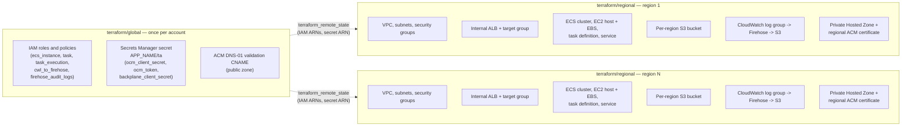
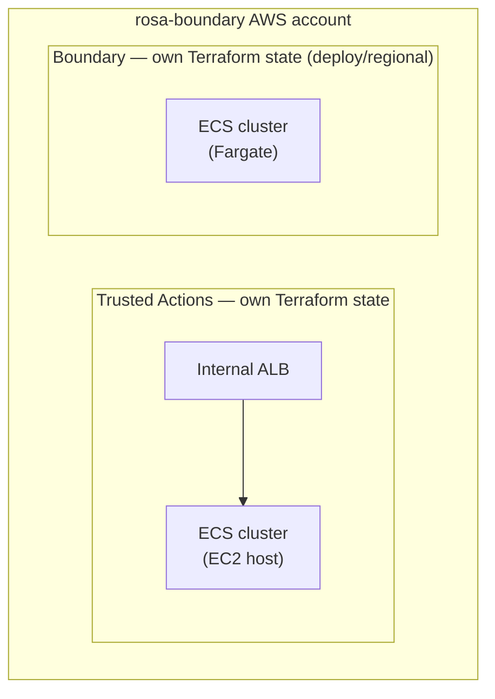
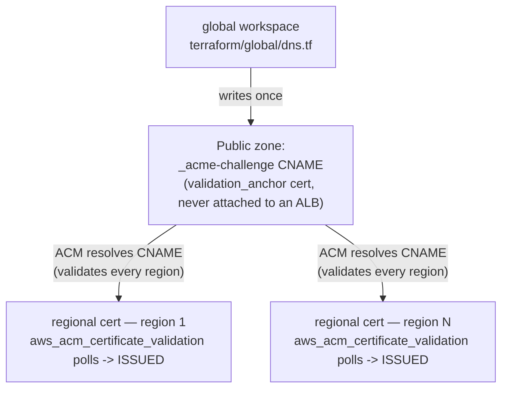
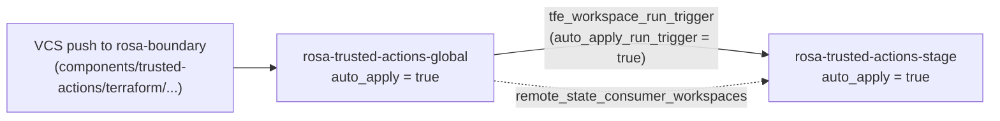
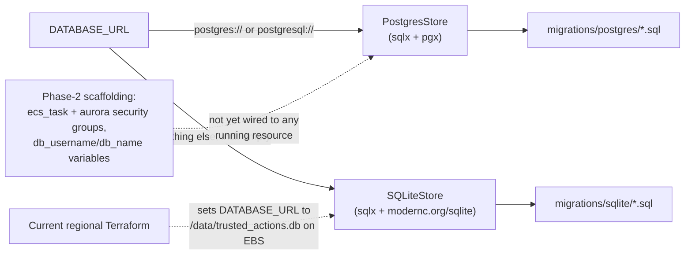

## Overview

Trusted Actions (TA) is deployed with its own, fully independent Terraform
stack, distinct from Boundary's `deploy/account` / `deploy/network` /
`deploy/regional` roots even though the compiled runtime ends up next to
Boundary's own regional infrastructure. TA's roots live under
`components/trusted-actions/terraform/` and are split into two tiers that
must be applied in order:

| Root | Path | Scope | Apply cadence |
|---|---|---|---|
| **global** | `terraform/global/` | Account-wide: IAM roles/policies, Secrets Manager secret, ACM DNS-01 validation CNAME | Once per AWS account |
| **regional** | `terraform/regional/` | One deployment per AWS region: VPC, internal ALB, ECS cluster + EC2 host + EBS volume, task definition/service, per-region S3 bucket, CloudWatch→Firehose audit pipeline, private hosted zone + regional ACM certificate | Once per region |

The regional root never receives global's ARNs as hand-copied variables. It
reads them directly from the global workspace's state via
`data "terraform_remote_state" "global"`, aliased to `local.global`
([`terraform/regional/remote_state.tf`](../../components/trusted-actions/terraform/regional/remote_state.tf)).
Adding a new region only requires a new regional tfvars file / workspace;
global's IAM wildcard ARNs (`ACCOUNT-ENVIRONMENT-SUFFIX-*`) already cover any
future region's resources by construction, so global is applied exactly once
and never touched again for fan-out.
See [deployment.md](../../components/trusted-actions/docs/deployment.md) for
the full operator runbook (local testing, verification commands, and the
step-by-step procedure for adding a region).

*Global IAM/secrets/DNS resources fan out by reference to any number of
independently-applied regional stacks.*

### What lives in each tier

**Global** (`terraform/global/`):

- IAM roles and policies that must be account-unique regardless of region:
  the ECS instance role, the ECS task and task-execution roles, and the
  CloudWatch-Logs-to-Firehose and Firehose-to-S3 roles. Three of these
  policies reference per-region resources (the Firehose delivery stream, its
  error log group, and the per-region S3 bucket) using `arn:aws:*:*`-style
  wildcards so the same global role set works against every region without
  a re-apply ([`terraform/global/iam.tf`](../../components/trusted-actions/terraform/global/iam.tf)).
- A single Secrets Manager secret (`APP_NAME/ta`) holding `ocm_client_secret`,
  `ocm_token`, and `backplane_client_secret`, with `ignore_changes` on the
  secret string so out-of-band rotation does not show as Terraform drift
  ([`terraform/global/secrets.tf`](../../components/trusted-actions/terraform/global/secrets.tf)).
- A DNS-01 ACM validation CNAME, written once to the shared public hosted
  zone when `internal_fqdn` and a public zone (existing or newly created)
  are both set ([`terraform/global/dns.tf`](../../components/trusted-actions/terraform/global/dns.tf)).
  See [Private networking and DNS](#private-networking-and-dns) below.
- Outputs: `secretsmanager_secret_arn`, `iam_role_task_arn`,
  `iam_role_task_execution_arn`, `iam_instance_profile_name`,
  `iam_role_cwl_to_firehose_arn`, `iam_role_firehose_audit_logs_arn`,
  `internal_fqdn`, and `public_zone_name_servers`
  ([`terraform/global/outputs.tf`](../../components/trusted-actions/terraform/global/outputs.tf)).

**Regional** (`terraform/regional/`):

- A VPC (or an existing one, if `vpc_id` is supplied), an internal-only ALB,
  an ECS cluster running on a single EC2 host (`launch_type = "EC2"`, bridge
  networking, binpack placement), and a dedicated encrypted `gp3` EBS volume
  attached to that host for SQLite storage
  ([`terraform/regional/ecs.tf`](../../components/trusted-actions/terraform/regional/ecs.tf),
  [`ec2.tf`](../../components/trusted-actions/terraform/regional/ec2.tf),
  [`ebs.tf`](../../components/trusted-actions/terraform/regional/ebs.tf)).
- A per-region S3 bucket (`ACCOUNT-ENVIRONMENT-SUFFIX-REGION`), object-lock
  enabled at creation, versioned, TLS-only, and optionally WORM-enforced via
  COMPLIANCE-mode object lock for audit retention
  ([`terraform/regional/s3.tf`](../../components/trusted-actions/terraform/regional/s3.tf)).
- A CloudWatch Logs subscription filter that forwards lines matching
  `{ $.msg = "audit record" }` to a Kinesis Data Firehose delivery stream,
  which writes to the region's own bucket under `audit-logs/`
  ([`terraform/regional/audit_logs.tf`](../../components/trusted-actions/terraform/regional/audit_logs.tf)).
  See [Trusted Actions audit and logging](../operations/trusted-actions-audit.md)
  for how audit records are produced and shipped end to end.
- A private hosted zone and regional ACM certificate for the shared internal
  FQDN (see below).
- `s3_bucket_name_suffix` must be identical between the global and regional
  workspaces: global's IAM wildcard ARN is built from that suffix, and the
  regional bucket name embeds the same suffix, so a mismatch silently breaks
  the task role's S3 access rather than failing Terraform validation.
- Two "Phase 2" resources are already created (but not yet wired to
  anything): an `ecs_task` security group sized for a future Fargate task
  and an `aurora` security group allowing inbound Postgres (`5432`) from
  that `ecs_task` group
  ([`terraform/regional/security_groups.tf`](../../components/trusted-actions/terraform/regional/security_groups.tf)).
  The `aurora` security group's own comment says it is "referenced in
  aurora.tf", but no `aurora.tf` file — and no `aws_rds_cluster`/Aurora
  resource of any kind — exists in the regional root yet; see
  [Data store](#data-store-postgresstore-vs-sqlitestore) below.

### The ECS task definition: config-init, SQLite, and the `compat_env` compatibility shim

The task definition runs a non-essential `config-init` container that copies
a rendered `config.yaml` (the full application config — `roles` catalog,
worker tuning, allowlists, OCM/Backplane settings) from S3 into a shared
`config-data` volume before the main `rosa-trusted-actions` container
starts, and the main container mounts the SQLite EBS volume at `/data` and
the same `config-data` volume read-only at `/config`, invoked with
`--config-file /config/config.yaml`
([`terraform/regional/ecs.tf`](../../components/trusted-actions/terraform/regional/ecs.tf)).
Sensitive environment variables (`ROSA_TA_OCM_CLIENT_SECRET`,
`ROSA_TA_OCM_TOKEN`, `ROSA_TA_BACKPLANE_CLIENT_SECRET`) are injected as ECS
`secrets` entries pointing at the global Secrets Manager secret's individual
JSON keys, never baked into the task definition as plain environment values.

`terraform/regional/variables.tf` still carries a block of **deprecated
per-setting variables** (`worker_concurrency`, `worker_poll_interval`,
`worker_execution_timeout`, `roles`, `allowed_namespaces`,
`allowed_secrets`, `ocm_client_id`, `backplane_url`, `backplane_client_id`,
`ocm_base_url`) that `app_config` replaced. They exist only for one
compatibility window and the file explicitly says they, and the
`compat_env`/`container_environment` merge in `ecs.tf` that consumes them,
are to be removed in the next change. The mechanism works as follows:

- `locals.container_environment` in `ecs.tf` concatenates a fixed list of
  always-present environment variables (listen address, log settings,
  `DATABASE_URL`, S3 bucket/prefix, JWK URL, allowed accounts, AWS region)
  with the entries of `locals.compat_env`, filtering out any `compat_env`
  entry whose value is an empty string.
- `locals.compat_env` computes one environment value per deprecated setting
  (`ROSA_TA_WORKER_CONCURRENCY`, `ROSA_TA_WORKER_POLL_INTERVAL`,
  `ROSA_TA_WORKER_EXECUTION_TIMEOUT`, `ROSA_TA_ALLOWED_NAMESPACES`,
  `ROSA_TA_ALLOWED_SECRETS`, `ROSA_TA_OCM_BASE_URL`,
  `ROSA_TA_BACKPLANE_URL`, `ROSA_TA_BACKPLANE_CLIENT_ID`): for each one, the
  corresponding deprecated Terraform variable wins when it is explicitly set
  (non-null); otherwise the value falls back to the matching key read out of
  the decoded `app_config` YAML via `try(...)` (for example
  `workers.concurrency` or `backplane.base_url`). A setting absent from both
  the deprecated variable and the config file resolves to `""` and is then
  dropped from the environment entirely by the filter above, rather than
  being injected as an empty-string override.
- `roles` is handled separately because it has no environment-variable form:
  `locals.app_config_effective` merges a non-null deprecated `var.roles`
  into the decoded config only when the file itself defines no `roles` key
  at all — an explicit empty `roles: []` in the file counts as "defined" and
  wins, while a missing key does not.

The comment above `container_environment` spells out why this exists: the
deployed container image at any given moment may predate the config-file
keys for backplane/OCM/workers/allowlists settings and read only
`ROSA_TA_*` environment variables, while a newer image reads those same
settings from the mounted `config.yaml` and ignores the deprecated env vars
once they are gone. Because the Go config loader applies env-over-file
precedence, setting the `compat_env` value to exactly what the file already
says is harmless for a new image (the env value and the file value agree)
while still being authoritative for an old image that has no file-reading
path for those settings at all — the same Terraform apply delivers
consistent configuration to whichever image is actually running during the
rollout window. `app_config`'s own validation additionally rejects a plan
where both the file and the deprecated `roles` variable are absent, so
`roles` — required whenever auth is enabled — can never silently resolve to
nothing.

## Co-location with Boundary's regional infrastructure

Trusted Actions runs on ECS behind an internal ALB **inside the same
`rosa-boundary` AWS account** that hosts Boundary's own regional
infrastructure (the account targeted by Boundary's `deploy/regional` root;
see [Regional AWS runtime infrastructure](regional-runtime.md)). This is
co-location only, not shared ownership: TA's `terraform/global` and
`terraform/regional` are independently applied, independently state-owned
Terraform roots with their own IAM roles, their own S3 buckets, and their own
HCP Terraform workspaces. Nothing in TA's Terraform reads or writes Boundary's
`deploy/*` state, and nothing in Boundary's Terraform references TA's
resources. The two stacks happen to share an AWS account boundary the way two
unrelated tenants can share a building. TA's own `container_image` variable
is a digest-pinned image built by its own Tekton/Konflux pipeline (see
[Monorepo components: Boundary and Trusted Actions](../architecture/monorepo-and-trusted-actions.md));
that image and its ECS runtime are unrelated to the Fargate container build
described in [Container image and task runtime](../runtime/container-image.md),
which documents Boundary's own image.

*Both services run in the same AWS account but are provisioned and owned by entirely separate Terraform state.*

## Private networking and DNS

TA exposes one stable FQDN (for example
`rosa-trusted-actions.internal.company.com`) that resolves to a **different
ALB depending on which VPC the caller is in**, with no public DNS entry and
no publicly reachable endpoint — the same model Kubernetes uses for
`my-service.my-namespace.svc.cluster.local`, implemented with AWS Route 53
Private Hosted Zones. See
[networking.md](../../components/trusted-actions/docs/networking.md) for
diagrams of per-VPC resolution and cross-region isolation.

- Each regional deployment creates its own Route 53 Private Hosted Zone
  (PHZ) named after `internal_fqdn` and associated with exactly one VPC, plus
  an alias `A` record pointing at that region's internal ALB
  ([`terraform/regional/route53-private.tf`](../../components/trusted-actions/terraform/regional/route53-private.tf)).
  Every region's PHZ has the identical name but a distinct zone ID — AWS
  Route 53 resolves by zone ID, not name, and each VPC's built-in resolver
  only ever sees zones associated with that VPC. There is no routing policy,
  latency record, or failover: isolation is structural, not configuration
  that could be misconfigured.
- The ALB itself is **internal-only** (`internal = true`,
  `aws_lb.main` in [`terraform/regional/alb.tf`](../../components/trusted-actions/terraform/regional/alb.tf)),
  placed in private subnets, and reachable only from inside its VPC.
- TLS uses a "shadow zone" pattern, re-verified against the current
  `terraform/global/dns.tf` and `terraform/regional/acm.tf`: a minimal,
  never-attached `aws_acm_certificate.validation_anchor` in the **global**
  workspace exists only to make ACM emit the DNS-01 domain-validation
  options for `internal_fqdn`, which Terraform then writes once as
  `aws_route53_record.cert_validation` in the shared **public** Route 53
  zone. Because ACM derives an identical validation CNAME for a given
  domain name regardless of which region requests the certificate, this one
  record satisfies validation for every region's certificate at once. Each
  regional workspace then creates its own `aws_acm_certificate.app` for the
  same `internal_fqdn` — ACM is a regional service, so every region needs
  its own certificate — and `aws_acm_certificate_validation.app` simply
  polls ACM until it reports `ISSUED`; it derives the expected validation
  FQDN from its own certificate and never reads or writes the shared
  Route 53 record. The regional certificate's `precondition` additionally
  enforces that the regional `internal_fqdn` matches the value the global
  workspace used to derive the CNAME, so a typo cannot produce a
  certificate that can never validate. The code comments in both files
  note that this design superseded an older `manage_validation_record` flag
  that was previously needed to stop parallel regional applies from racing
  on the same Route 53 record; because no regional workspace touches that
  record today, regional applies and destroys run fully in parallel with no
  ordering constraints between regions, and only the global→regional apply
  order (global first) still matters.

*Global writes the shared validation CNAME once; every region's certificate validates against it independently and in parallel.*

## HCP Terraform workspace topology

Trusted Actions' two HCP Terraform workspaces are declared in
[`hcp-terraform/rosa-trusted-actions/main.tf`](../../hcp-terraform/rosa-trusted-actions/main.tf),
a single `terraform-tfe-workspaces` module call that is a fully independent
HCP project from Boundary's own `hcp-terraform/rosa-boundary/main.tf`
topology. For the full workspace-level detail — project/meta-project
structure, AWS dynamic-credential role groups, variable sets, and
deletion-protection variables — see
<!-- openwiki: broken internal link [hcp-terraform-workspaces.md#rosa-trusted-actions-is-a-separate-meta-workspace-not-part-of-this-topology] heading anchor "rosa-trusted-actions-is-a-separate-meta-workspace-not-part-of-this-topology" does not exist in "hcp-terraform-workspaces.md". Fix the href or restore the target, then delete this comment. -->
[HCP Terraform workspaces](hcp-terraform-workspaces.md#rosa-trusted-actions-is-a-separate-meta-workspace-not-part-of-this-topology);
this section summarizes only what is operationally relevant to applying
these two Terraform roots.

| Workspace | Working directory | Role |
|---|---|---|
| `rosa-trusted-actions-global` | `components/trusted-actions/terraform/global` | Must apply before all regional workspaces |
| `rosa-trusted-actions-stage` | `components/trusted-actions/terraform/regional` | Reads global outputs via `terraform_remote_state` |

Both workspace blocks currently set `github_repo_org = "openshift-online"`
and `github_repo_name = "rosa-boundary"` and point their `working_directory`
into this monorepo's `components/trusted-actions/terraform/` tree. These
workspaces were **rebound in place** from the archived standalone
`openshift-online/rosa-trusted-actions` repository as part of the Trusted
Actions monorepo migration — they were not re-created, and their AWS state
was not moved into Boundary's own stacks. A push that changes
`components/trusted-actions/terraform/` in **this** repository is the
current trigger path for both workspaces' plans and applies, not the
archived standalone repository. See
[Monorepo components: Boundary and Trusted Actions](../architecture/monorepo-and-trusted-actions.md#hcp-terraform-rebound-workspace-definitions)
for the migration-record detail behind this rebind, including the caveat
that it is a point-in-time record and the live VCS binding, working
directory, and run history should still be confirmed directly in HCP
Terraform before relying on it operationally.

Both workspaces currently set `auto_apply = true` and
`auto_apply_run_trigger = true`, so a clean VCS-triggered plan applies
without a manual "Confirm & Apply" step. The regional workspace declares
`source_workspaces = ["rosa-trusted-actions-global"]`, which the module
resolves into a `tfe_workspace_run_trigger`: a successful global apply
automatically queues a regional run, and because the trigger is also
auto-apply, the whole chain from a global push to a regional apply requires
no manual intervention today. The global workspace additionally lists
`rosa-trusted-actions-stage` in `remote_state_consumer_workspaces`, granting
it read access to global's state so its `terraform_remote_state` data source
resolves without extra configuration. Per
[`components/trusted-actions/docs/deployment.md`](../../components/trusted-actions/docs/deployment.md),
both `auto_apply` settings were **temporarily disabled** during the
migration cutover and then restored to `true` after successful workspace
runs, and the first post-cutover meta-workspace run auto-applied
unexpectedly — treat the committed `main.tf` values as a starting point and
confirm the live HCP workspace settings (and review the global and stage
AWS plans separately) before assuming a given push will or will not apply
automatically.

*A successful global apply automatically triggers and auto-applies the regional run; the regional workspace also reads global's state directly. Confirm live auto-apply settings before relying on this diagram operationally.*

Adding a region means adding a new regional workspace entry (new tfvars, new
`working_directory = "components/trusted-actions/terraform/regional"` block,
including the region's `app_config`) plus a new run trigger pointing at the
global workspace and a new entry in `remote_state_consumer_workspaces` — the
global workspace itself is never re-applied.

## Data store: PostgresStore vs. SQLiteStore

The server abstracts persistence behind a `Store` interface
(`CreateExecution`, `GetExecution`, `ListExecutions`,
`UpdateExecutionWithResult`, `ClaimNextExecution`, `CreateAuditEntry`,
`ListAuditEntries`, `Close`) and picks an implementation at startup purely by
inspecting the `DATABASE_URL` scheme
([`internal/store/store.go`](../../components/trusted-actions/internal/store/store.go)):

- A URL beginning with `postgres://` or `postgresql://` selects
  **`PostgresStore`**, built on `sqlx` over `pgx`, intended for local testing
  against a real Postgres instance and for production deployments on AWS RDS
  or Aurora PostgreSQL
  ([`internal/store/postgres.go`](../../components/trusted-actions/internal/store/postgres.go)).
- Any other value — including an empty string — falls back to
  **`SQLiteStore`**, built on `sqlx` over `modernc.org/sqlite`, intended for
  local development and testing. An empty `DATABASE_URL` defaults to the
  local file `trusted_actions.db` with a logged warning that data will be
  lost in ephemeral environments; the SQLite connection pool is pinned to a
  single connection (`SetMaxOpenConns(1)`) to avoid "database is locked"
  errors on a file-backed database and to keep `:memory:` databases from
  splitting across pooled connections
  ([`internal/store/sqlite.go`](../../components/trusted-actions/internal/store/sqlite.go)).

Both implementations run their own migration set on startup via
`runMigrations(ctx, db, dialect)`, with dialect-specific SQL under
`internal/store/migrations/postgres/` and `internal/store/migrations/sqlite/`
respectively; a failed migration closes the freshly opened connection and
aborts startup rather than running against a partially-migrated schema.

**Current regional Terraform deploys SQLite, not Postgres or Aurora.** The
ECS task definition hardcodes `DATABASE_URL = "/data/trusted_actions.db"`
against the file-backed EBS volume attached to the single EC2 host
([`terraform/regional/ecs.tf`](../../components/trusted-actions/terraform/regional/ecs.tf),
[`ebs.tf`](../../components/trusted-actions/terraform/regional/ebs.tf)). An
Aurora PostgreSQL store is architecturally anticipated and partially
scaffolded ahead of time, but not yet built:

- The service's own architecture diagram shows an `Aurora` datastore, and
  `terraform/regional/variables.tf` carries placeholder `db_username` /
  `db_name` "Phase 2" variables.
- `terraform/regional/security_groups.tf` already creates two **live
  (uncommented)** Phase-2 security groups — an `ecs_task` group sized for a
  future Fargate task and an `aurora` group permitting inbound Postgres
  (`5432`) only from that `ecs_task` group — but neither is referenced by
  any other resource yet. The `aurora` security group's comment claims it is
  "referenced in aurora.tf", but no `aurora.tf` file, and no
  `aws_rds_cluster` or other Aurora/RDS resource of any kind, exists in the
  regional root today.
- The ALB target group is still `target_type = "instance"` for the single
  EC2 host ([`terraform/regional/alb.tf`](../../components/trusted-actions/terraform/regional/alb.tf)),
  not the `"ip"` target type Fargate `awsvpc` networking would require.

Treat the Postgres path in `internal/store/postgres.go` as implemented and
ready, and the Aurora Terraform resources as not-yet-created — the two live
security groups are pre-provisioned scaffolding for that future work, not
evidence that Aurora is wired up.

*`store.New` dispatches purely on the `DATABASE_URL` scheme; today's deployed Terraform exercises only the SQLite path, with unused Phase-2 scaffolding already in place for an eventual Aurora cutover.*

## Related pages

- [Monorepo components: Boundary and Trusted Actions](../architecture/monorepo-and-trusted-actions.md) — the files-only import and the HCP Terraform rebind this page summarizes above, including caveats about the migration record's point-in-time nature.
- [HCP Terraform workspaces](hcp-terraform-workspaces.md) — Boundary's own twelve-workspace topology plus the full detail on `rosa-trusted-actions`'s separate meta-workspace, role groups, and variable sets.
- [Regional AWS runtime infrastructure](regional-runtime.md) — Boundary's own regional stack in the same `rosa-boundary` AWS account.
- [Trusted Actions audit and logging](../operations/trusted-actions-audit.md) — how the audit records shipped by `terraform/regional/audit_logs.tf` are produced inside the application.
- [Container image and task runtime](../runtime/container-image.md) — Boundary's own Fargate container build; distinct from TA's own `container_image` variable and image pipeline described here.
