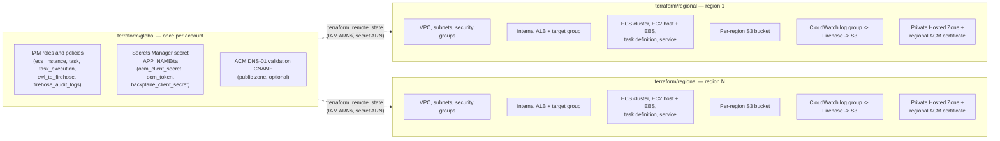
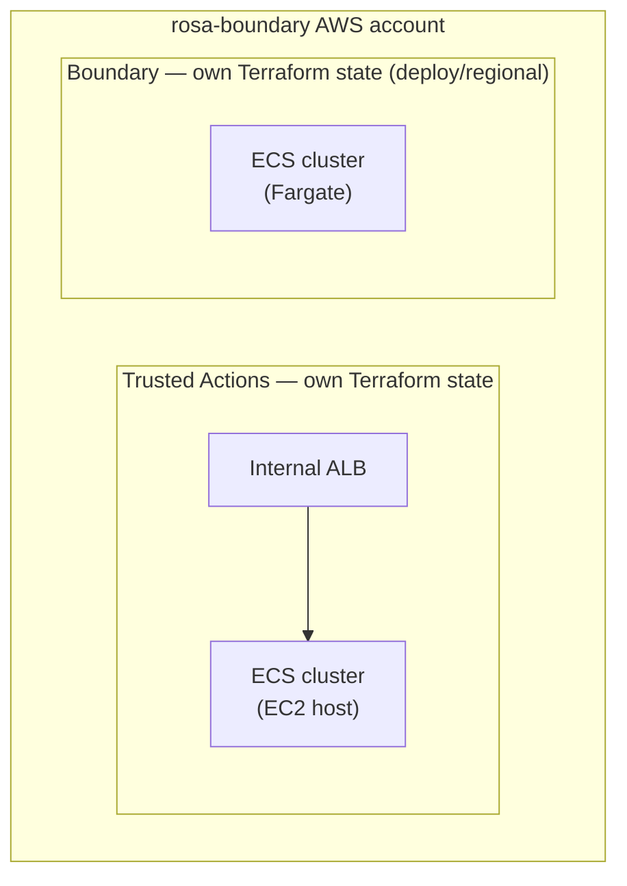
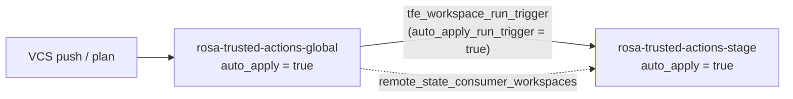
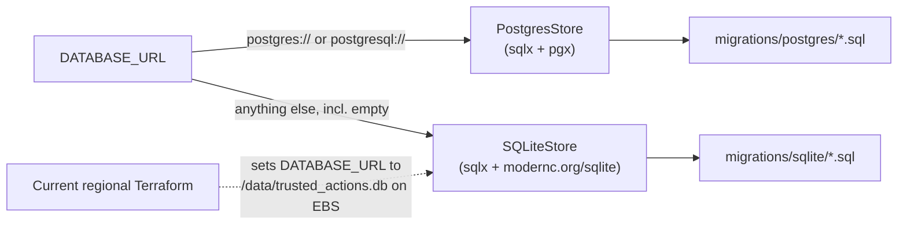

## Overview

Trusted Actions (TA) is deployed with its own, fully independent Terraform
stack, distinct from Boundary's `deploy/account` / `deploy/network` /
`deploy/regional` roots even though the compiled runtime ends up next to
Boundary's own regional infrastructure. TA's roots live under
<!-- openwiki: broken internal link [../../components/trusted-actions/terraform] file "../../components/trusted-actions/terraform" does not exist. Fix the href or restore the target, then delete this comment. -->
[`components/trusted-actions/terraform/`](../../components/trusted-actions/terraform)
and are split into two tiers that must be applied in order:

| Root | Path | Scope | Apply cadence |
|---|---|---|---|
| **global** | `terraform/global/` | Account-wide: IAM roles/policies, Secrets Manager secret, optional ACM validation CNAME | Once per AWS account |
| **regional** | `terraform/regional/` | One deployment per AWS region: VPC, internal ALB, ECS cluster + EC2 host + EBS volume, task definition/service, per-region S3 bucket, CloudWatch→Firehose audit pipeline, private hosted zone + regional ACM certificate | Once per region |

The regional root never receives global's ARNs as hand-copied variables. It
reads them directly from the global workspace's state via
`data "terraform_remote_state" "global"`, aliased to `local.global`
([`terraform/regional/remote_state.tf`](../../components/trusted-actions/terraform/regional/remote_state.tf)).
Adding a new region only requires a new regional tfvars file / workspace;
global's IAM wildcard ARNs (`ACCOUNT-ENVIRONMENT-SUFFIX-*`) already cover any
future region's resources by construction, so global is applied exactly once
and never touched again for fan-out.
See [deployment.md](../../components/trusted-actions/docs/deployment.md) for
the full operator runbook (local testing, verification commands, and the
step-by-step procedure for adding a region).

*Global IAM/secrets/DNS resources fan out by reference to any number of
independently-applied regional stacks.*

### What lives in each tier

**Global** (`terraform/global/`):

- IAM roles and policies that must be account-unique regardless of region:
  the ECS instance role, the ECS task and task-execution roles, and the
  CloudWatch-Logs-to-Firehose and Firehose-to-S3 roles. Three of these
  policies reference per-region resources (the Firehose delivery stream, its
  error log group, and the per-region S3 bucket) using `arn:aws:*:*`-style
  wildcards so the same global role set works against every region without
  a re-apply ([`terraform/global/iam.tf`](../../components/trusted-actions/terraform/global/iam.tf)).
- A single Secrets Manager secret (`APP_NAME/ta`) holding `ocm_client_secret`,
  `ocm_token`, and `backplane_client_secret`, with `ignore_changes` on the
  secret string so out-of-band rotation does not show as Terraform drift
  ([`terraform/global/secrets.tf`](../../components/trusted-actions/terraform/global/secrets.tf)).
- An optional ACM DNS-01 validation CNAME, written once to the shared public
  hosted zone when `internal_fqdn` and `public_zone_id` are both set
  ([`terraform/global/dns.tf`](../../components/trusted-actions/terraform/global/dns.tf)).
  See [Private networking and DNS](#private-networking-and-dns) below.
- Outputs: `secretsmanager_secret_arn`, `iam_role_task_arn`,
  `iam_role_task_execution_arn`, `iam_instance_profile_name`,
  `iam_role_cwl_to_firehose_arn`, `iam_role_firehose_audit_logs_arn`, and
  `internal_fqdn` ([`terraform/global/outputs.tf`](../../components/trusted-actions/terraform/global/outputs.tf)).

**Regional** (`terraform/regional/`):

- A VPC (or an existing one, if `vpc_id` is supplied), an internal-only ALB,
  an ECS cluster running on a single EC2 host (`launch_type = "EC2"`, bridge
  networking, binpack placement), and a dedicated encrypted `gp3` EBS volume
  attached to that host for SQLite storage
  ([`terraform/regional/ecs.tf`](../../components/trusted-actions/terraform/regional/ecs.tf),
  [`ec2.tf`](../../components/trusted-actions/terraform/regional/ec2.tf),
  [`ebs.tf`](../../components/trusted-actions/terraform/regional/ebs.tf)).
- A per-region S3 bucket (`ACCOUNT-ENVIRONMENT-SUFFIX-REGION`), object-lock
  enabled at creation, versioned, TLS-only, and optionally WORM-enforced via
  COMPLIANCE-mode object lock for audit retention
  ([`terraform/regional/s3.tf`](../../components/trusted-actions/terraform/regional/s3.tf)).
- A CloudWatch Logs subscription filter that forwards lines matching
  `{ $.msg = "audit record" }` to a Kinesis Data Firehose delivery stream,
  which writes to the region's own bucket under `audit-logs/`
  ([`terraform/regional/audit_logs.tf`](../../components/trusted-actions/terraform/regional/audit_logs.tf)).
- A private hosted zone and regional ACM certificate for the shared internal
  FQDN (see below).
- `s3_bucket_name_suffix` must be identical between the global and regional
  workspaces: global's IAM wildcard ARN is built from that suffix, and the
  regional bucket name embeds the same suffix, so a mismatch silently breaks
  the task role's S3 access rather than failing Terraform validation.

The ECS task definition runs a non-essential `config-init` container that
copies a rendered `config.yaml` (containing the `roles` catalog, which cannot
be expressed purely through environment variables) from S3 into a shared
`config-data` volume before the main `rosa-trusted-actions` container starts,
and the main container mounts the SQLite EBS volume at `/data`
([`terraform/regional/ecs.tf`](../../components/trusted-actions/terraform/regional/ecs.tf)).
Sensitive environment variables (`ROSA_TA_OCM_CLIENT_SECRET`,
`ROSA_TA_OCM_TOKEN`, `ROSA_TA_BACKPLANE_CLIENT_SECRET`) are injected as ECS
`secrets` entries pointing at the global Secrets Manager secret's individual
JSON keys, never baked into the task definition as plain environment values.

## Co-location with Boundary's regional infrastructure

Trusted Actions runs on ECS behind an internal ALB **inside the same
`rosa-boundary` AWS account** that hosts Boundary's own regional
infrastructure (the account targeted by Boundary's `deploy/regional` root;
see [Regional AWS runtime infrastructure](regional-runtime.md)). This is
co-location only, not shared ownership: TA's `terraform/global` and
`terraform/regional` are independently applied, independently state-owned
Terraform roots with their own IAM roles, their own S3 buckets, and their own
HCP Terraform workspaces. Nothing in TA's Terraform reads or writes Boundary's
`deploy/*` state, and nothing in Boundary's Terraform references TA's
resources. The two stacks happen to share an AWS account boundary the way two
unrelated tenants can share a building.

*Both services run in the same AWS account but are provisioned and owned by entirely separate Terraform state.*

## Private networking and DNS

TA exposes one stable FQDN (for example
`rosa-trusted-actions.internal.company.com`) that resolves to a **different
ALB depending on which VPC the caller is in**, with no public DNS entry and
no publicly reachable endpoint — the same model Kubernetes uses for
`my-service.my-namespace.svc.cluster.local`, implemented with AWS Route 53
Private Hosted Zones. See
[networking.md](../../components/trusted-actions/docs/networking.md) for
diagrams of per-VPC resolution and cross-region isolation.

- Each regional deployment creates its own Route 53 Private Hosted Zone
  (PHZ) named after `internal_fqdn` and associated with exactly one VPC, plus
  an alias `A` record pointing at that region's internal ALB
  ([`terraform/regional/route53-private.tf`](../../components/trusted-actions/terraform/regional/route53-private.tf)).
  Every region's PHZ has the identical name but a distinct zone ID — AWS
  Route 53 resolves by zone ID, not name, and each VPC's built-in resolver
  only ever sees zones associated with that VPC. There is no routing policy,
  latency record, or failover: isolation is structural, not configuration
  that could be misconfigured.
- The ALB itself is **internal-only** (`internal = true`,
  `aws_lb.main` in [`terraform/regional/alb.tf`](../../components/trusted-actions/terraform/regional/alb.tf)),
  placed in private subnets, and reachable only from inside its VPC.
- TLS uses a "shadow zone" pattern: a DNS-01 validation CNAME for
  `internal_fqdn` is written once to the shared **public** Route 53 zone by
  the global root (`aws_route53_record.cert_validation` in
  [`terraform/global/dns.tf`](../../components/trusted-actions/terraform/global/dns.tf)),
  while the service FQDN itself has no public `A` record and is unresolvable
  from the public internet. Each region then requests its own ACM
  certificate for the same `internal_fqdn` — ACM is a regional service, so
  every region needs its own cert — and `aws_acm_certificate_validation`
  simply polls ACM until it reports `ISSUED`, because the shared CNAME the
  global root already placed satisfies validation for every region's
  certificate simultaneously
  ([`terraform/regional/acm.tf`](../../components/trusted-actions/terraform/regional/acm.tf)).
  Regional workspaces never write to the shared public zone and hold no
  Terraform dependency on each other, so they can apply and destroy in
  parallel. A `precondition` on the regional certificate enforces that the
  regional `internal_fqdn` matches the value the global workspace used to
  derive the CNAME.

## HCP Terraform workspace topology

Trusted Actions' HCP Terraform workspaces are declared in
[`hcp-terraform/rosa-trusted-actions/main.tf`](../../hcp-terraform/rosa-trusted-actions/main.tf),
a single `terraform-tfe-workspaces` module call distinct from Boundary's own
`hcp-terraform/rosa-boundary/main.tf` topology (see
[HCP Terraform workspaces](hcp-terraform-workspaces.md)):

| Workspace | Working directory | Role |
|---|---|---|
| `rosa-trusted-actions-global` | `terraform/global` | Must apply before all regional workspaces |
| `rosa-trusted-actions-stage` | `terraform/regional` | Reads global outputs via `terraform_remote_state` |

Both workspaces set `auto_apply = true` and `auto_apply_run_trigger = true`,
so a clean VCS-triggered plan applies without a manual "Confirm & Apply"
step. The regional workspace declares `source_workspaces =
["rosa-trusted-actions-global"]`, which the module resolves into a
`tfe_workspace_run_trigger`: a successful global apply automatically queues a
regional run, and because the trigger is also auto-apply, the whole chain
from a global push to a regional apply requires no manual intervention. The
global workspace additionally lists `rosa-trusted-actions-stage` in
`remote_state_consumer_workspaces`, granting it read access to global's state
so its `terraform_remote_state` data source resolves without extra
configuration.

*A successful global apply automatically triggers and auto-applies the regional run; the regional workspace also reads global's state directly.*

Adding a region means adding a new regional workspace entry (new tfvars, new
`working_directory = "terraform/regional"` block) plus a new run trigger
pointing at the global workspace and a new entry in
`remote_state_consumer_workspaces` — the global workspace itself is never
re-applied.

### These workspaces are not bound to this monorepo yet

`hcp-terraform/rosa-trusted-actions/main.tf` still declares
`github_repo_org = "openshift-online"` and `github_repo_name =
"rosa-trusted-actions"` for both workspaces — it remains VCS-connected to the
original, standalone `openshift-online/rosa-trusted-actions` repository, not
to this `rosa-boundary` monorepo. The files under
`components/trusted-actions/terraform/` in this repository are a files-only
copy (see
[Monorepo components: Boundary and Trusted Actions](../architecture/monorepo-and-trusted-actions.md)),
and the `hcp-terraform/rosa-trusted-actions/` definition itself is likewise a
byte-for-byte copy that **describes** the live workspaces without
**controlling** them from here. A push to this monorepo's
`components/trusted-actions/terraform/` tree does not trigger a plan or apply
in `rosa-trusted-actions-global` or `rosa-trusted-actions-stage` today; those
runs still fire only from pushes to the original TA repository. Do not treat
any part of this page as describing a completed cutover — the monorepo copy
and the live HCP workspaces are two independently-updated artifacts until a
coordinated VCS-source switch happens, and that switch has not happened.

## Data store: PostgresStore vs. SQLiteStore

The server abstracts persistence behind a `Store` interface
(`CreateExecution`, `GetExecution`, `ListExecutions`,
`UpdateExecutionWithResult`, `ClaimNextExecution`, `CreateAuditEntry`,
`ListAuditEntries`, `Close`) and picks an implementation at startup purely by
inspecting the `DATABASE_URL` scheme
([`internal/store/store.go`](../../components/trusted-actions/internal/store/store.go)):

- A URL beginning with `postgres://` or `postgresql://` selects
  **`PostgresStore`**, built on `sqlx` over `pgx`, intended for local testing
  against a real Postgres instance and for production deployments on AWS RDS
  or Aurora PostgreSQL
  ([`internal/store/postgres.go`](../../components/trusted-actions/internal/store/postgres.go)).
- Any other value — including an empty string — falls back to
  **`SQLiteStore`**, built on `sqlx` over `modernc.org/sqlite`, intended for
  local development and testing. An empty `DATABASE_URL` defaults to the
  local file `trusted_actions.db` with a logged warning that data will be
  lost in ephemeral environments; the SQLite connection pool is pinned to a
  single connection (`SetMaxOpenConns(1)`) to avoid "database is locked"
  errors on a file-backed database and to keep `:memory:` databases from
  splitting across pooled connections
  ([`internal/store/sqlite.go`](../../components/trusted-actions/internal/store/sqlite.go)).

Both implementations run their own migration set on startup via
`runMigrations(ctx, db, dialect)`, with dialect-specific SQL under
`internal/store/migrations/postgres/` and `internal/store/migrations/sqlite/`
respectively; a failed migration closes the freshly opened connection and
aborts startup rather than running against a partially-migrated schema.

**Current regional Terraform deploys SQLite, not Postgres or Aurora.** The
ECS task definition hardcodes `DATABASE_URL = "/data/trusted_actions.db"`
against the file-backed EBS volume attached to the single EC2 host
([`terraform/regional/ecs.tf`](../../components/trusted-actions/terraform/regional/ecs.tf),
[`ebs.tf`](../../components/trusted-actions/terraform/regional/ebs.tf)). An
Aurora PostgreSQL store is architecturally anticipated — the service's own
architecture diagram shows an `Aurora` datastore, and `terraform/regional/variables.tf`
already carries placeholder `db_username` / `db_name` variables and a
commented "Phase 2" Aurora security group explicitly scoping inbound Postgres
traffic from the ECS tasks — but no `aws_rds_cluster`/Aurora resources exist
in the regional root yet, and the target group is still `target_type =
"instance"` for the single EC2 host rather than Fargate `awsvpc` networking.
Treat the Postgres path in `internal/store/postgres.go` as implemented and
ready, and the Aurora Terraform resources as not-yet-created.

*`store.New` dispatches purely on the `DATABASE_URL` scheme; today's deployed Terraform exercises only the SQLite path.*

## Related pages

- [Monorepo components: Boundary and Trusted Actions](../architecture/monorepo-and-trusted-actions.md) — what the files-only import did and did not change, including the still-separate VCS binding this page restates above.
- [HCP Terraform workspaces](hcp-terraform-workspaces.md) — Boundary's own workspace topology and why `rosa-trusted-actions` workspaces are explicitly out of scope there.
- [Regional AWS runtime infrastructure](regional-runtime.md) — Boundary's own regional stack in the same `rosa-boundary` AWS account.
