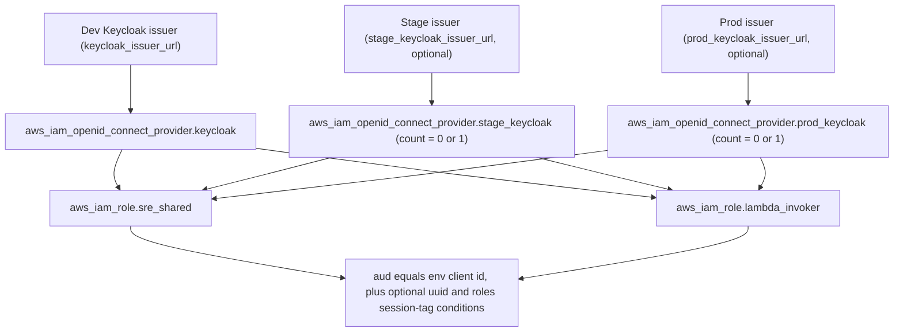

# Keycloak and OIDC provider integration

Boundary configures trust in an external OIDC provider; it does not operate Keycloak. Personal development uses an approved existing instance. Staging and production use Red Hat EmployeeIDP.

This page covers the identity-provider deployment itself and its direct consumers — the IAM trust it feeds, and the shape of the Lambda's token checks. For the CLI's actual PKCE/device-code token-acquisition mechanics, caching, and the end-to-end two-stage role-assumption flow, see [Identity and Access Architecture](../architecture/identity-and-access.md).

## AWS IAM OIDC provider resources per environment

`deploy/account/oidc.tf` creates up to three `aws_iam_openid_connect_provider` resources, one per Keycloak environment:

- `aws_iam_openid_connect_provider.keycloak` — always created, from `var.keycloak_issuer_url`, `var.oidc_client_id`, and `var.keycloak_thumbprint`. This is the primary (dev) issuer.
- `aws_iam_openid_connect_provider.stage_keycloak` — created only when `var.stage_keycloak_issuer_url` is non-empty; a `count`-gated resource whose `lifecycle.precondition` blocks fail the plan if `stage_oidc_client_id` or `stage_keycloak_thumbprint` are left blank while the issuer URL is set.
- `aws_iam_openid_connect_provider.prod_keycloak` — the same optional, precondition-guarded pattern for `var.prod_keycloak_issuer_url`, `var.prod_oidc_client_id`, and `var.prod_keycloak_thumbprint`.

Each provider's ARN is computed in `deploy/account/main.tf` and passed into the `shared_iam` module as `keycloak_provider_arn`, `stage_keycloak_provider_arn`, and `prod_keycloak_provider_arn` (the latter two only resolved when their issuer URL is non-empty, otherwise passed as an empty string). The module never creates its own OIDC provider; it only consumes ARNs and issuer URLs the account root resolves, and derives each provider's trust-condition domain from its ARN with `split("oidc-provider/", ...)` (`deploy/account/modules/shared-iam/oidc.tf`). Thumbprints are not validated for format beyond the stage/prod preconditions, and the primary thumbprint is marked `sensitive` at the variable but unwrapped with `nonsensitive()` before use so it does not appear as an opaque diff when the existing provider is imported.

Enabling a stage or production provider is therefore an additive, independently gated step per environment: dev is mandatory, and stage/prod only start participating in trust once both their issuer URL and client ID (and thumbprint) are set together.

## Session and role controls on the shared roles

Two account-global IAM roles trust these OIDC providers, both defined in the `shared-iam` module and both built from the same `concat()` pattern of up to three conditional trust-policy statements (primary, stage, prod):

- `aws_iam_role.sre_shared` (`modules/shared-iam/oidc.tf`) — the single ABAC role every SRE assumes for ECS Exec and cleanup operations. Its `max_session_duration` is `var.oidc_session_duration`, constrained by the module variable's own validation to between 3600 and 43200 seconds.
- `aws_iam_role.lambda_invoker` (`modules/shared-iam/lambda-invoker.tf`) — assumed to call the `create-investigation` Lambda Function URL with SigV4 credentials. Its `max_session_duration` is hard-coded to 3600 seconds (the AWS minimum) rather than configurable, since invoker sessions are short-lived by design.

Each per-provider trust statement grants `sts:AssumeRoleWithWebIdentity` and `sts:TagSession`, and always includes a `StringEquals` condition pinning `<provider-domain>:aud` to that environment's own client ID (`oidc_client_id`, `stage_oidc_client_id`, or `prod_oidc_client_id`) — an identity federated from the stage provider cannot satisfy the dev audience condition or vice versa. Two further conditions are merged in only when their switches are enabled, uniformly across every environment's statement and both roles:

- `enable_uuid_allowlist` adds `aws:RequestTag/uuid` restricted to `allowed_uuids` (a list validated to be lowercase UUIDs); a module precondition fails the plan if the allowlist is enabled with an empty list.
- `enable_oidc_group_enforcement` (default `true` in the account root) adds `aws:RequestTag/roles` restricted to `required_oidc_role` (default `"ai-sd-sre"`); a module precondition fails the plan if group enforcement is enabled with a blank role name.

Both conditions read from AWS STS session tags rather than raw token claims: the Keycloak-issued ID token must carry a `https://aws.amazon.com/tags` principal-tags claim that STS maps into `aws:RequestTag/*` during `AssumeRoleWithWebIdentity`, which is also why both trust statements must additionally grant `sts:TagSession`.

*Each configured Keycloak environment produces its own OIDC provider, and both shared roles trust all configured providers under the same per-environment audience and optional ABAC session-tag conditions.*

## Development realm ownership

Configure a public client on the existing instance for S256 PKCE and the exact local callback. Manage operator imports outside Boundary with the instance configuration.

## OIDC consumption by the application

The CLI and the `create-investigation` Lambda are this deployment's two direct OIDC consumers:

- **CLI**: configures a Keycloak base URL, realm, and OIDC client ID, then authenticates against that realm's `/protocol/openid-connect/auth` and `/protocol/openid-connect/token` endpoints using either a browser-based PKCE authorization-code flow or an OAuth device-code flow. Both flows require the Keycloak client to be public (no client secret) with PKCE and standard-flow support enabled, and a registered redirect URI matching the CLI's local callback (`http://localhost:8400/callback`). The detailed flow mechanics, token caching, and the subsequent two-stage AWS role assumption are covered in [Identity and Access Architecture](../architecture/identity-and-access.md); this page is only concerned with what the identity-provider side must expose for that flow to work.
- **Lambda**: the `create-investigation` Lambda receives issuer/realm/client settings as environment variables per configured environment (primary, and optional stage/prod). It routes an incoming token by its unverified `iss` claim to the matching issuer's JWKS endpoint and verifies RS256 signature, expiry, and audience before trusting any identity/group/session-tag claims; stage and production issuers are accepted only when their environment variables are configured. After validation it checks that the token's `groups` claim (or, if absent, `realm_access.roles`) contains at least one of the Lambda's configured `REQUIRED_GROUPS`, and extracts the configured ABAC tag (`ABAC_TAG_KEY`, default `username`) from the token's `https://aws.amazon.com/tags` → `principal_tags` claim — falling back to `preferred_username` only when the configured key is the default `username`, and otherwise failing closed with a 403 if that tag is missing.
- **`get_config` bootstrap path**: the Lambda's `get_config` action is dispatched before any OIDC token extraction or validation runs, so it is reachable without a valid ID token at all. It returns a fixed allowlist of deployment metadata (function name, invoker/SRE role ARNs, EFS filesystem ID, ECS cluster name, AWS region, and the Keycloak URL/realm/client ID) read from Lambda environment variables; AWS IAM authorizes the invocation itself (the CLI's `GetConfig` calls the Lambda via the SDK without attaching an OIDC token, relying on the invoker-role session's SigV4 credentials), and any principal with `lambda:InvokeFunction` on the function can read this metadata. This lets `rosa-boundary config init` discover realm/issuer settings for a profile before the operator has completed OIDC login.

## Required ID token claims

The audience must include the configured client ID, group membership must match the regional requirements, and AWS principal tags must identify the individual caller. If IAM role enforcement is enabled, supply the required role tag as well as the group claim Lambda checks. See the [realm configuration guide](../../docs/configuration/keycloak-realm-setup.md).

## Related pages

- [Identity and Access Architecture](../architecture/identity-and-access.md)
- [System overview](../architecture/system-overview.md)
- [Credential lifecycle](../security/credential-lifecycle.md)
