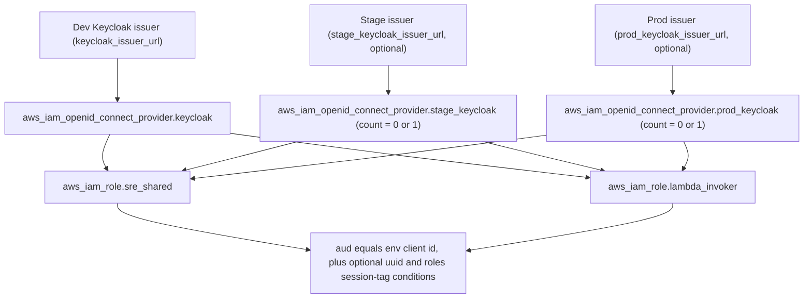

# Keycloak and OIDC provider integration

Boundary integrates with Keycloak on two separately configured surfaces that must be read together: `deploy/account` Terraform registers one or more Keycloak realms as AWS IAM OIDC providers and uses them to gate the shared SRE and Lambda-invoker role trust policies, while a Kustomize deployment under `deploy/keycloak/` runs a development Keycloak instance on OpenShift. The CLI and the `create-investigation` Lambda are the two application-side OIDC consumers of whichever issuer(s) are configured. Staging uses Red Hat EmployeeIDP rather than the dev Keycloak instance deployed by the Kustomize manifests, which define no OIDC realm or client resource themselves.

This page covers the identity-provider deployment itself and its direct consumers — the IAM trust it feeds, and the shape of the Lambda's token checks. For the CLI's actual PKCE/device-code token-acquisition mechanics, caching, and the end-to-end two-stage role-assumption flow, see [Identity and Access Architecture](../architecture/identity-and-access.md).

## AWS IAM OIDC provider resources per environment

`deploy/account/oidc.tf` creates up to three `aws_iam_openid_connect_provider` resources, one per Keycloak environment:

- `aws_iam_openid_connect_provider.keycloak` — always created, from `var.keycloak_issuer_url`, `var.oidc_client_id`, and `var.keycloak_thumbprint`. This is the primary (dev) issuer.
- `aws_iam_openid_connect_provider.stage_keycloak` — created only when `var.stage_keycloak_issuer_url` is non-empty; a `count`-gated resource whose `lifecycle.precondition` blocks fail the plan if `stage_oidc_client_id` or `stage_keycloak_thumbprint` are left blank while the issuer URL is set.
- `aws_iam_openid_connect_provider.prod_keycloak` — the same optional, precondition-guarded pattern for `var.prod_keycloak_issuer_url`, `var.prod_oidc_client_id`, and `var.prod_keycloak_thumbprint`.

Each provider's ARN is computed in `deploy/account/main.tf` and passed into the `shared_iam` module as `keycloak_provider_arn`, `stage_keycloak_provider_arn`, and `prod_keycloak_provider_arn` (the latter two only resolved when their issuer URL is non-empty, otherwise passed as an empty string). The module never creates its own OIDC provider; it only consumes ARNs and issuer URLs the account root resolves, and derives each provider's trust-condition domain from its ARN with `split("oidc-provider/", ...)` (`deploy/account/modules/shared-iam/oidc.tf`). Thumbprints are not validated for format beyond the stage/prod preconditions, and the primary thumbprint is marked `sensitive` at the variable but unwrapped with `nonsensitive()` before use so it does not appear as an opaque diff when the existing provider is imported.

Enabling a stage or production provider is therefore an additive, independently gated step per environment: dev is mandatory, and stage/prod only start participating in trust once both their issuer URL and client ID (and thumbprint) are set together.

## Session and role controls on the shared roles

Two account-global IAM roles trust these OIDC providers, both defined in the `shared-iam` module and both built from the same `concat()` pattern of up to three conditional trust-policy statements (primary, stage, prod):

- `aws_iam_role.sre_shared` (`modules/shared-iam/oidc.tf`) — the single ABAC role every SRE assumes for ECS Exec and cleanup operations. Its `max_session_duration` is `var.oidc_session_duration`, constrained by the module variable's own validation to between 3600 and 43200 seconds.
- `aws_iam_role.lambda_invoker` (`modules/shared-iam/lambda-invoker.tf`) — assumed to call the `create-investigation` Lambda Function URL with SigV4 credentials. Its `max_session_duration` is hard-coded to 3600 seconds (the AWS minimum) rather than configurable, since invoker sessions are short-lived by design.

Each per-provider trust statement grants `sts:AssumeRoleWithWebIdentity` and `sts:TagSession`, and always includes a `StringEquals` condition pinning `<provider-domain>:aud` to that environment's own client ID (`oidc_client_id`, `stage_oidc_client_id`, or `prod_oidc_client_id`) — an identity federated from the stage provider cannot satisfy the dev audience condition or vice versa. Two further conditions are merged in only when their switches are enabled, uniformly across every environment's statement and both roles:

- `enable_uuid_allowlist` adds `aws:RequestTag/uuid` restricted to `allowed_uuids` (a list validated to be lowercase UUIDs); a module precondition fails the plan if the allowlist is enabled with an empty list.
- `enable_oidc_group_enforcement` (default `true` in the account root) adds `aws:RequestTag/roles` restricted to `required_oidc_role` (default `"ai-sd-sre"`); a module precondition fails the plan if group enforcement is enabled with a blank role name.

Both conditions read from AWS STS session tags rather than raw token claims: the Keycloak-issued ID token must carry a `https://aws.amazon.com/tags` principal-tags claim that STS maps into `aws:RequestTag/*` during `AssumeRoleWithWebIdentity`, which is also why both trust statements must additionally grant `sts:TagSession`.

*Each configured Keycloak environment produces its own OIDC provider, and both shared roles trust all configured providers under the same per-environment audience and optional ABAC session-tag conditions.*

## OpenShift deployment composition

`deploy/keycloak/base/` establishes the `keycloak` namespace. The `overlays/dev` Kustomization adds a ClusterSecretStore and includes the CloudNativePG and Keycloak components. The CNPG component creates a PostgreSQL `Cluster`; the Keycloak component creates a Keycloak custom resource and OpenShift Route. The deployment therefore depends on the cluster already providing the corresponding operators and external-secrets integration.

The database credentials are sourced from AWS Systems Manager Parameter Store keys `/keycloak/db/username` and `/keycloak/db/password` through the `aws-ssm-keycloak` ClusterSecretStore. An ExternalSecret materializes them as the `keycloak-db-app` Kubernetes secret, which both CNPG bootstrap and the Keycloak custom resource reference. Keycloak is configured for HTTP behind a proxy that supplies `X-Forwarded` headers; the OpenShift Route terminates TLS at the edge and redirects insecure requests.

The dev ClusterSecretStore reads Parameter Store in `us-east-2` using the external-secrets operator's service account. The overlay also contains a namespace SecretStore and a separately annotated service account; do not assume that this namespace-scoped store is the one used by the database ExternalSecret, which explicitly names the ClusterSecretStore.

Neither the base nor the dev overlay defines an actual Keycloak realm, client, group, or protocol mapper — those are the `KeycloakRealmImport` custom resource described in `docs/configuration/keycloak-realm-setup.md`, which is a separate, optional resource layered on top of this Kustomize composition (see the realm-setup drift notes below for where that walkthrough's example configuration needs adjustment before it satisfies this deployment's actual requirements).

## OIDC consumption by the application

The CLI and the `create-investigation` Lambda are this deployment's two direct OIDC consumers:

- **CLI**: configures a Keycloak base URL, realm, and OIDC client ID, then authenticates against that realm's `/protocol/openid-connect/auth` and `/protocol/openid-connect/token` endpoints using either a browser-based PKCE authorization-code flow or an OAuth device-code flow. Both flows require the Keycloak client to be public (no client secret) with PKCE and standard-flow support enabled, and a registered redirect URI matching the CLI's local callback (`http://localhost:8400/callback`). The detailed flow mechanics, token caching, and the subsequent two-stage AWS role assumption are covered in [Identity and Access Architecture](../architecture/identity-and-access.md); this page is only concerned with what the identity-provider side must expose for that flow to work.
- **Lambda**: the `create-investigation` Lambda receives issuer/realm/client settings as environment variables per configured environment (primary, and optional stage/prod). It routes an incoming token by its unverified `iss` claim to the matching issuer's JWKS endpoint and verifies RS256 signature, expiry, and audience before trusting any identity/group/session-tag claims; stage and production issuers are accepted only when their environment variables are configured. After validation it checks that the token's `groups` claim (or, if absent, `realm_access.roles`) contains at least one of the Lambda's configured `REQUIRED_GROUPS`, and extracts the configured ABAC tag (`ABAC_TAG_KEY`, default `username`) from the token's `https://aws.amazon.com/tags` → `principal_tags` claim — falling back to `preferred_username` only when the configured key is the default `username`, and otherwise failing closed with a 403 if that tag is missing.
- **`get_config` bootstrap path**: the Lambda's `get_config` action is dispatched before any OIDC token extraction or validation runs, so it is reachable without a valid ID token at all. It returns a fixed allowlist of deployment metadata (function name, invoker/SRE role ARNs, EFS filesystem ID, ECS cluster name, AWS region, and the Keycloak URL/realm/client ID) read from Lambda environment variables; AWS IAM authorizes the invocation itself (the CLI's `GetConfig` calls the Lambda via the SDK without attaching an OIDC token, relying on the invoker-role session's SigV4 credentials), and any principal with `lambda:InvokeFunction` on the function can read this metadata. This lets `rosa-boundary config init` discover realm/issuer settings for a profile before the operator has completed OIDC login.

## Realm-setup walkthrough versus the deployment's actual OIDC requirements

The root README's "OIDC Identity Requirements" table and the Terraform/Lambda configuration it describes require a Keycloak realm whose tokens carry specific claims, and the realm-setup walkthrough's example `KeycloakRealmImport` does not fully satisfy them as written:

- **Audience — consistent.** The README requires `aud` to match `rosa-boundary-sre`, and the walkthrough's example client configures an `oidc-audience-mapper` with `included.client.audience: "rosa-boundary-sre"`, matching both the README and the client ID (`rosa-boundary-sre`) used throughout the example. No drift here.
- **Groups — drift.** The README states the `groups` claim "must contain `sre-team`", matching the Lambda's `REQUIRED_GROUPS` environment variable (populated from the regional `required_groups` Terraform variable, commonly `["sre-team"]`). The walkthrough's example realm instead creates `sre-admins`, `sre-operators`, and `sre-viewers` groups (plus separately named `sre-admin`/`sre-user` realm roles) and never creates or mentions an `sre-team` group. A realm built exactly as documented will emit a `groups` claim that does not intersect the Lambda's default `REQUIRED_GROUPS`, so every token it issues will be rejected with a 403 "not authorized" response unless the deployer either adds an `sre-team` group (or renames an existing one) or reconfigures `required_groups` to match the example's group names — a reconciliation step the walkthrough does not call out.
- **AWS session tags — drift.** The README requires a mapper emitting an AWS session-tags claim (`https://aws.amazon.com/tags`) that maps `preferred_username` to `principal_tags.username`, and this page's own IAM trust conditions (`aws:RequestTag/uuid`, `aws:RequestTag/roles`) and the regional ECS Exec policy's `PrincipalTag`/`ResourceTag` comparison all depend on that claim being present. The walkthrough's example `protocolMappers` list defines only `groups`, `email`, `name`, and `audience` mappers — no AWS session-tags (`oidc-hardcoded-attribute-mapper`/session-tags style) mapper is configured anywhere in `docs/configuration/keycloak-realm-setup.md`. A realm built exactly from this example therefore issues tokens with no `https://aws.amazon.com/tags` claim at all. The Lambda's own ABAC extraction silently falls back to the `preferred_username` claim only because its configured `ABAC_TAG_KEY` default is `username`, so investigation creation itself would still proceed; however, `sts:TagSession` would have no principal tags to apply during `AssumeRoleWithWebIdentity`, so the shared SRE role would never receive `aws:PrincipalTag/username`, and both the optional `aws:RequestTag/roles`/`aws:RequestTag/uuid` trust conditions (if enabled) and the regional ECS Exec resource-tag match would fail closed. Anyone following this walkthrough for a Keycloak-backed deployment needs to add the missing session-tags mapper before ECS Exec or UUID/role-gated role assumption can work.

These are gaps in the example `KeycloakRealmImport` payload the walkthrough tells readers to copy, not in the Terraform or Lambda code that consumes its output — the account Terraform and Lambda correctly enforce `aud`, group membership, and ABAC session tags; a realm actually configured to emit all three (audience, `sre-team` membership or an aligned `required_groups`, and the AWS session-tags mapper) works as intended.

## Evidence-backed claims

- The dev Kustomize overlay composes the namespace base with a ClusterSecretStore and the CNPG and Keycloak components. [base](repo://deploy/keycloak/base/kustomization.yaml#L1-L4) · [dev overlay](repo://deploy/keycloak/overlays/dev/kustomization.yaml#L1-L10)
- The database ExternalSecret reads two SSM Parameter Store entries and creates `keycloak-db-app`, which is referenced by CNPG initialization and the Keycloak database settings. [ExternalSecret](repo://deploy/keycloak/components/cnpg/external-secret-db.yaml#L1-L25) · [CNPG cluster](repo://deploy/keycloak/components/cnpg/cluster.yaml#L1-L17) · [Keycloak resource](repo://deploy/keycloak/components/keycloak/keycloak.yaml#L1-L28)
- The Keycloak resource enables HTTP and X-Forwarded proxy headers, while its OpenShift Route uses edge TLS termination and redirects insecure traffic. [Keycloak settings](repo://deploy/keycloak/components/keycloak/keycloak.yaml#L21-L28) · [Route](repo://deploy/keycloak/components/keycloak/route.yaml#L1-L14)
- Account Terraform creates up to three OIDC providers (`keycloak`, `stage_keycloak`, `prod_keycloak`), with the stage and prod providers gated by `count` on their issuer URL and failing their plan via `lifecycle.precondition` if their matching client ID or thumbprint is left blank while enabled. [OIDC providers](repo://deploy/account/oidc.tf#L1-L51)
- The `shared_iam` module receives each provider's ARN and issuer URL from the account root rather than creating its own provider, and derives each trust condition's audience domain from the ARN. [main.tf wiring](repo://deploy/account/main.tf#L52-L64) · [domain derivation](repo://deploy/account/modules/shared-iam/oidc.tf#L1-L7)
- `aws_iam_role.sre_shared`'s session duration is the configurable, validated `oidc_session_duration` (3600-43200 seconds), while `aws_iam_role.lambda_invoker`'s session duration is hard-coded to the AWS minimum of 3600 seconds. [sre_shared duration](repo://deploy/account/modules/shared-iam/oidc.tf#L19-L21) · [session duration validation](repo://deploy/account/modules/shared-iam/variables.tf#L13-L19) · [lambda_invoker duration](repo://deploy/account/modules/shared-iam/lambda-invoker.tf#L9-L11)
- Both `sre_shared` and `lambda_invoker` build an identical per-environment trust-condition pattern: an always-present audience match against that environment's own client ID, plus an optional `aws:RequestTag/uuid` condition when `enable_uuid_allowlist` is set and an optional `aws:RequestTag/roles` condition restricted to `required_oidc_role` when `enable_oidc_group_enforcement` is set (default `true`, default role `ai-sd-sre`), each backed by a module precondition that rejects a blank allowlist or role name while its switch is enabled. [sre_shared trust](repo://deploy/account/modules/shared-iam/oidc.tf#L19-L109) · [lambda_invoker trust](repo://deploy/account/modules/shared-iam/lambda-invoker.tf#L9-L86) · [variable defaults](repo://deploy/account/variables.tf#L195-L214)
- The Lambda routes tokens to issuer-specific JWKS endpoints and validates signature, expiry, and audience before trusting any identity/group/session-tag claims, then requires the token's `groups` (or `realm_access.roles`) claim to intersect its configured `REQUIRED_GROUPS`, and extracts its ABAC tag from the `https://aws.amazon.com/tags` → `principal_tags` claim, falling back to `preferred_username` only for the default `username` key. [issuer/JWKS validation](repo://lambda/create-investigation/handler.py#L374-L410) · [group and ABAC claim handling](repo://lambda/create-investigation/handler.py#L179-L228)
- The Lambda's `get_config` action is dispatched before any OIDC token is extracted or validated, and the CLI's corresponding `GetConfig` call invokes the Lambda via the AWS SDK without attaching an OIDC token at all, relying solely on the invoker role's SigV4-authorized invocation permission; this lets configuration discovery happen before OIDC login completes. [early dispatch before token extraction](repo://lambda/create-investigation/handler.py#L92-L121) · [config response contents](repo://lambda/create-investigation/handler.py#L1091-L1111) · [CLI GetConfig invocation](repo://internal/lambda/client.go#L212-L234)
- The realm-setup walkthrough's example `KeycloakRealmImport` configures an audience mapper consistent with the README's `aud` requirement, but its example groups (`sre-admins`/`sre-operators`/`sre-viewers`) do not include the `sre-team` group the README and the Lambda's default `required_groups`/`REQUIRED_GROUPS` configuration expect, and its `protocolMappers` list omits any AWS session-tags mapper for the `https://aws.amazon.com/tags` claim the README, the IAM trust conditions, and the regional ECS Exec ABAC policy all require. [example client/groups/mappers](repo://docs/configuration/keycloak-realm-setup.md#L51-L179) · [README OIDC identity requirements](repo://README.md#L82-L99)

## Related pages

- [Identity and Access Architecture](../architecture/identity-and-access.md)
- [System overview](../architecture/system-overview.md)
- [Credential lifecycle](../security/credential-lifecycle.md)
