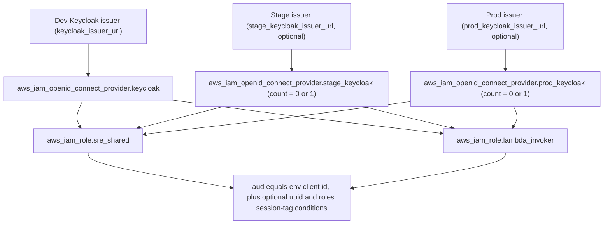

# Keycloak and OIDC provider integration

Boundary integrates with Keycloak on two separately configured surfaces that must be read together: `deploy/account` Terraform registers one or more Keycloak realms as AWS IAM OIDC providers and uses them to gate the shared SRE and Lambda-invoker role trust policies, while a Kustomize deployment under `deploy/keycloak/` runs a development Keycloak instance on OpenShift. The CLI and the `create-investigation` Lambda are the two application-side OIDC consumers of whichever issuer(s) are configured. Staging uses Red Hat EmployeeIDP rather than the dev Keycloak instance deployed by the Kustomize manifests, which define no OIDC realm or client resource themselves.

For the end-to-end authorization model that these resources feed into — ABAC session tags, ECS Exec isolation, and the two-stage CLI role assumption — see [Identity and Access Architecture](../architecture/identity-and-access.md).

## AWS IAM OIDC provider resources per environment

`deploy/account/oidc.tf` creates up to three `aws_iam_openid_connect_provider` resources, one per Keycloak environment:

- `aws_iam_openid_connect_provider.keycloak` — always created, from `var.keycloak_issuer_url`, `var.oidc_client_id`, and `var.keycloak_thumbprint`. This is the primary (dev) issuer.
- `aws_iam_openid_connect_provider.stage_keycloak` — created only when `var.stage_keycloak_issuer_url` is non-empty; a `count`-gated resource whose `lifecycle.precondition` blocks fail the plan if `stage_oidc_client_id` or `stage_keycloak_thumbprint` are left blank while the issuer URL is set.
- `aws_iam_openid_connect_provider.prod_keycloak` — the same optional, precondition-guarded pattern for `var.prod_keycloak_issuer_url`, `var.prod_oidc_client_id`, and `var.prod_keycloak_thumbprint`.

Each provider's ARN is computed in `deploy/account/main.tf` and passed into the `shared_iam` module as `keycloak_provider_arn`, `stage_keycloak_provider_arn`, and `prod_keycloak_provider_arn` (the latter two only resolved when their issuer URL is non-empty, otherwise passed as an empty string). The module never creates its own OIDC provider; it only consumes ARNs and issuer URLs the account root resolves, and derives each provider's trust-condition domain from its ARN with `split("oidc-provider/", ...)` (`deploy/account/modules/shared-iam/oidc.tf`). Thumbprints are not validated for format beyond the stage/prod preconditions, and the primary thumbprint is marked `sensitive` at the variable but unwrapped with `nonsensitive()` before use so it does not appear as an opaque diff when the existing provider is imported.

Enabling a stage or production provider is therefore an additive, independently gated step per environment: dev is mandatory, and stage/prod only start participating in trust once both their issuer URL and client ID (and thumbprint) are set together.

## Session and role controls on the shared roles

Two account-global IAM roles trust these OIDC providers, both defined in the `shared-iam` module and both built from the same `concat()` pattern of up to three conditional trust-policy statements (primary, stage, prod):

- `aws_iam_role.sre_shared` (`modules/shared-iam/oidc.tf`) — the single ABAC role every SRE assumes for ECS Exec and cleanup operations. Its `max_session_duration` is `var.oidc_session_duration`, constrained by the module variable's own validation to between 3600 and 43200 seconds.
- `aws_iam_role.lambda_invoker` (`modules/shared-iam/lambda-invoker.tf`) — assumed to call the `create-investigation` Lambda Function URL with SigV4 credentials. Its `max_session_duration` is hard-coded to 3600 seconds (the AWS minimum) rather than configurable, since invoker sessions are short-lived by design.

Each per-provider trust statement grants `sts:AssumeRoleWithWebIdentity` and `sts:TagSession`, and always includes a `StringEquals` condition pinning `<provider-domain>:aud` to that environment's own client ID (`oidc_client_id`, `stage_oidc_client_id`, or `prod_oidc_client_id`) — an identity federated from the stage provider cannot satisfy the dev audience condition or vice versa. Two further conditions are merged in only when their switches are enabled, uniformly across every environment's statement and both roles:

- `enable_uuid_allowlist` adds `aws:RequestTag/uuid` restricted to `allowed_uuids` (a list validated to be lowercase UUIDs); a module precondition fails the plan if the allowlist is enabled with an empty list.
- `enable_oidc_group_enforcement` (default `true` in the account root) adds `aws:RequestTag/roles` restricted to `required_oidc_role` (default `"ai-sd-sre"`); a module precondition fails the plan if group enforcement is enabled with a blank role name.

Both conditions read from AWS STS session tags rather than raw token claims: the Keycloak-issued ID token must carry a `https://aws.amazon.com/tags` principal-tags claim that STS maps into `aws:RequestTag/*` during `AssumeRoleWithWebIdentity`, which is also why both trust statements must additionally grant `sts:TagSession`.

*Each configured Keycloak environment produces its own OIDC provider, and both shared roles trust all configured providers under the same per-environment audience and optional ABAC session-tag conditions.*

## OpenShift deployment composition

`deploy/keycloak/base/` establishes the `keycloak` namespace. The `overlays/dev` Kustomization adds a ClusterSecretStore and includes the CloudNativePG and Keycloak components. The CNPG component creates a PostgreSQL `Cluster`; the Keycloak component creates a Keycloak custom resource and OpenShift Route. The deployment therefore depends on the cluster already providing the corresponding operators and external-secrets integration.

The database credentials are sourced from AWS Systems Manager Parameter Store keys `/keycloak/db/username` and `/keycloak/db/password` through the `aws-ssm-keycloak` ClusterSecretStore. An ExternalSecret materializes them as the `keycloak-db-app` Kubernetes secret, which both CNPG bootstrap and the Keycloak custom resource reference. Keycloak is configured for HTTP behind a proxy that supplies `X-Forwarded` headers; the OpenShift Route terminates TLS at the edge and redirects insecure requests.

The dev ClusterSecretStore reads Parameter Store in `us-east-2` using the external-secrets operator's service account. The overlay also contains a namespace SecretStore and a separately annotated service account; do not assume that this namespace-scoped store is the one used by the database ExternalSecret, which explicitly names the ClusterSecretStore.

## OIDC consumption by the application

The CLI configures a Keycloak base URL, realm, and OIDC client ID, then obtains an ID token through either a browser-based PKCE authorization-code flow (`internal/auth/oidc.go`) or an OAuth device-code flow (`internal/auth/device.go`), selected via `Options.UseDeviceCode`. Both flows are entered through `GetTokenWithOptions`, whose internal `getTokenWithOptionsAndDeps` helper does the actual work shared by both paths: it checks the on-disk token cache first (unless a forced refresh is requested), dispatches to `acquireDeviceToken` or `acquireBrowserToken` depending on `Options.UseDeviceCode`, validates the returned ID token's expiration against a buffer, and then writes the token back to the cache. Tokens are cached on disk scoped to the configured issuer and client ID (`internal/auth/token.go`), so switching Keycloak URL, realm, or client invalidates any previously cached token.

The device-code flow (`acquireDeviceToken`) requests a PKCE-protected device authorization from `{issuer}/protocol/openid-connect/auth/device`, validates the response's device code, user code, verification URI, and expiry before printing the verification URL and user code for the operator, and then polls `{issuer}/protocol/openid-connect/token` at the provider-supplied interval (capped and defaulted defensively) until it receives an ID token or a terminal `access_denied`/`expired_token` response; `authorization_pending` and `slow_down` responses extend polling rather than failing it. The browser flow (`acquireBrowserToken`) starts a local callback server before opening the system browser to the Keycloak authorization endpoint and exchanges the returned authorization code and PKCE verifier for an ID token at the token endpoint.

The create-investigation Lambda receives issuer/client settings as environment variables. It routes an incoming token by its issuer to the matching configured JWKS endpoint and verifies its signature, expiry, and audience before interpreting identity/group/session-tag claims. Stage and production issuers are accepted only when configured. The Lambda's `get_config` action is a separate bootstrap path authenticated by the AWS invoker role; it returns configuration identifiers before the CLI has completed OIDC setup.

## Evidence-backed claims

- The dev Kustomize overlay composes the namespace base with a ClusterSecretStore and the CNPG and Keycloak components. [base](repo://deploy/keycloak/base/kustomization.yaml#L1-L4) · [dev overlay](repo://deploy/keycloak/overlays/dev/kustomization.yaml#L1-L10)
- The database ExternalSecret reads two SSM Parameter Store entries and creates `keycloak-db-app`, which is referenced by CNPG initialization and the Keycloak database settings. [ExternalSecret](repo://deploy/keycloak/components/cnpg/external-secret-db.yaml#L1-L25) · [CNPG cluster](repo://deploy/keycloak/components/cnpg/cluster.yaml#L1-L17) · [Keycloak resource](repo://deploy/keycloak/components/keycloak/keycloak.yaml#L1-L28)
- The Keycloak resource enables HTTP and X-Forwarded proxy headers, while its OpenShift Route uses edge TLS termination and redirects insecure traffic. [Keycloak settings](repo://deploy/keycloak/components/keycloak/keycloak.yaml#L21-L28) · [Route](repo://deploy/keycloak/components/keycloak/route.yaml#L1-L14)
- Account Terraform creates up to three OIDC providers (`keycloak`, `stage_keycloak`, `prod_keycloak`), with the stage and prod providers gated by `count` on their issuer URL and failing their plan via `lifecycle.precondition` if their matching client ID or thumbprint is left blank while enabled. [OIDC providers](repo://deploy/account/oidc.tf#L1-L51)
- The `shared_iam` module receives each provider's ARN and issuer URL from the account root rather than creating its own provider, and derives each trust condition's audience domain from the ARN. [main.tf wiring](repo://deploy/account/main.tf#L52-L64) · [domain derivation](repo://deploy/account/modules/shared-iam/oidc.tf#L1-L7)
- `aws_iam_role.sre_shared`'s session duration is the configurable, validated `oidc_session_duration` (3600-43200 seconds), while `aws_iam_role.lambda_invoker`'s session duration is hard-coded to the AWS minimum of 3600 seconds. [sre_shared duration](repo://deploy/account/modules/shared-iam/oidc.tf#L19-L21) · [session duration validation](repo://deploy/account/modules/shared-iam/variables.tf#L13-L19) · [lambda_invoker duration](repo://deploy/account/modules/shared-iam/lambda-invoker.tf#L9-L11)
- Both `sre_shared` and `lambda_invoker` build an identical per-environment trust-condition pattern: an always-present audience match against that environment's own client ID, plus an optional `aws:RequestTag/uuid` condition when `enable_uuid_allowlist` is set and an optional `aws:RequestTag/roles` condition restricted to `required_oidc_role` when `enable_oidc_group_enforcement` is set (default `true`, default role `ai-sd-sre`), each backed by a module precondition that rejects a blank allowlist or role name while its switch is enabled. [sre_shared trust](repo://deploy/account/modules/shared-iam/oidc.tf#L19-L109) · [lambda_invoker trust](repo://deploy/account/modules/shared-iam/lambda-invoker.tf#L9-L86) · [variable defaults](repo://deploy/account/variables.tf#L195-L214)
- The Lambda routes tokens to issuer-specific JWKS endpoints and validates signature, expiry, and audience before trusting any identity/group/session-tag claims. [Lambda issuer validation](repo://lambda/create-investigation/handler.py#L374-L410)
- The CLI derives its authorization and token endpoints from the configured Keycloak base URL, realm, and client ID, starts a local callback server before opening the browser, and exchanges the returned authorization code with a PKCE code verifier for an ID token. [PKCE flow](repo://internal/auth/oidc.go#L118-L188)
- The CLI also supports an OAuth device-code flow as an alternative to the browser flow, sharing the same token cache, expiration check, and status-reporting path as the PKCE flow. [device flow](repo://internal/auth/device.go#L40-L124) · [shared orchestration](repo://internal/auth/oidc.go#L63-L103)
- Lambda's `get_config` action is dispatched before OIDC validation and returns only configuration identifiers through the IAM-authenticated invocation path. [early dispatch](repo://lambda/create-investigation/handler.py#L88-L117) · [config response](repo://lambda/create-investigation/handler.py#L1048-L1072) · [CLI invocation](repo://internal/lambda/client.go#L200-L222)
