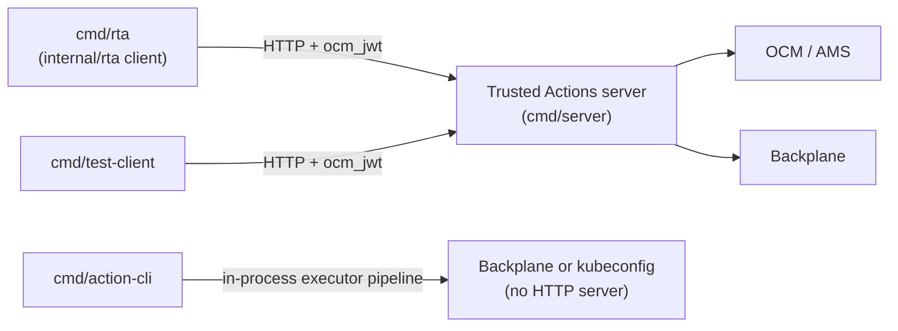

Trusted Actions exposes a single HTTP API, defined OpenAPI-first in
<!-- openwiki: broken internal link [../../components/trusted-actions/openapi] file "../../components/trusted-actions/openapi" does not exist. Fix the href or restore the target, then delete this comment. -->
[`components/trusted-actions/openapi/`](../../components/trusted-actions/openapi),
for discovering, executing, and auditing a fixed catalog of narrow operations
("trusted actions") against managed OpenShift clusters and AWS resources. The
spec is the source of truth for the wire contract; server handlers and the Go
client are generated from it (see
[Trusted Actions architecture](../architecture/trusted-actions-overview.md)
for the codegen pipeline and the two-layer request/execution design). This
page documents the contract itself, the external services it depends on at
request time, and the command-line tooling built around it.

## Route surface

All routes are rooted at `/api/v0/trusted-actions`, as declared by the
`servers` entry in
[`openapi/openapi.yaml`](../../components/trusted-actions/openapi/openapi.yaml).
Each path is defined in its own file under
<!-- openwiki: broken internal link [../../components/trusted-actions/openapi/paths] file "../../components/trusted-actions/openapi/paths" does not exist. Fix the href or restore the target, then delete this comment. -->
[`openapi/paths/`](../../components/trusted-actions/openapi/paths) and
`$ref`'d from the root document:

| Path | Method | Purpose |
|---|---|---|
| `/` | `GET` | Catalog listing — name, scope, type, description for every registered trusted action (no parameter detail) |
| `/{action}` | `GET` | Describe one action — full parameter definitions, authorization policy, write cooldown, dry-run config; `404` for an unknown action |
| `/{action}/run` | `POST` | Execute an action; returns `202 Accepted` with an execution ID. `400` for invalid/missing parameters, `404` for unknown action, `429` for write-cooldown or max-concurrent limits, `500`/`502` for internal or dispatch failures |
| `/runs` | `GET` | List executions for the authenticated account, paginated and filterable by status, action, target, operator, scope, type, approval state, dry-run/force flags, and a `since` duration or RFC3339 timestamp; sorted newest-first; metadata only |
| `/runs/{id}` | `GET` | Retrieve one execution's metadata; `?include=output,logs` opts into content; `404` if not found |
| `/runs/{exec_id}/output` | `GET` | Retrieve an execution's output; only populated once the execution reaches a terminal state (`succeeded`, `failed`, `timed_out`); `404` otherwise |
| `/audit` | `GET` | List API call audit log entries (every call except catalog/describe), paginated and filterable similarly to `/runs`; `404` if audit logging is not enabled |
| `/health` | `GET` | Liveness/readiness probe; outside the OpenAPI document, served directly by `cmd/server/main.go` and explicitly marked public so health checks work without a token |

Catalog and describe (`GET /` and `GET /{action}`) declare `security: []` in
the OpenAPI spec, i.e. they are documented as not requiring the bearer token.
At the server, however, the entire `/api/v0/trusted-actions` sub-tree —
including these two routes — is currently wrapped in authentication,
audit-logging, and authorization middleware as one chi route group; a `TODO`
in `cmd/server/main.go` notes this mismatch and proposes splitting discovery
into its own unauthenticated group, or having clients degrade gracefully, but
neither has been done yet. Only `/health` is registered outside that group and
listed as a public path to the OCM authentication handler.

The one security scheme, `ocm_jwt`, is declared in
[`openapi/components/securitySchemes/ocm_jwt.yaml`](../../components/trusted-actions/openapi/components/securitySchemes/ocm_jwt.yaml)
and applied globally in `openapi.yaml`: an HTTP bearer token in JWT format,
validated against the Red Hat SSO JWKS endpoint, with caller identity read
from the `username` claim (falling back to `preferred_username`).

## External dependencies at request time

Two external systems sit on the hot path of every authenticated, executing
request; neither is bundled into the Trusted Actions binary.

**OCM/AMS**, for identity and authorization:

- JWT validation: when `cfg.AuthPolicy` is not disabled, `cmd/server/main.go`
  wraps the router in an OCM SDK authentication handler
  (`sdk.authentication.NewHandler`) configured with a JWKS URL (and optionally
  a local keys file), which verifies the bearer token's signature before any
  handler runs. `internal/auth.Middleware.AuthenticateAccountJWT` then pulls
  the verified claims out of the request context and extracts the caller's
  username, rejecting the request with `401` if that claim is empty.
- Authorization: `internal/ocm.Authorization.AccessReview` calls the OCM SDK's
  `AccessReview` (or `SelfAccessReview`, when the caller matches the service's
  own connection identity) endpoint, asking AMS whether the given username may
  perform a given action on a given resource type. This is distinct from the
  per-action, Kubernetes-RBAC authorization performed later against the
  target cluster — see
  [Trusted Actions authorization](../architecture/trusted-actions-authorization.md)
  for how the two layers combine.

**Backplane**, for scoped cluster access. `internal/backplane` defines the
`ClientProvider` interface (`GetClient` for a dynamic Kubernetes client,
`GetPodExecutor` for exec-style operations) that the execution pipeline uses
to reach a target cluster; the server selects one of two concrete
implementations at startup, mirrored in `cmd/action-cli/main.go`:

- **`BackplaneProvider`** (`internal/backplane/client.go`) is the real
  integration. It authenticates to Backplane using an OCM SDK connection
  (client-credentials grant against `cfg.OCMBaseURL`), requests access for a
  specific `clusterID` and `actionName` with an explicit list of `RBACRule`s,
  and turns the returned proxy URI into a `rest.Config` whose transport
  attaches a fresh bearer token per request. It also pins the resolved proxy
  URL's scheme and host to the Backplane base URL's, refusing to build a
  config that would point at a different origin. This is what gives each
  execution a short-lived, RBAC-scoped session rather than a standing
  credential to any managed cluster.
- **`KubeconfigProvider`** (`internal/backplane/kubeconfig.go`) is the
  local-dev fallback, selected whenever `cfg.Kubeconfig` is set. It builds a
  client directly from a kubeconfig file via `clientcmd.BuildConfigFromFlags`
  and explicitly ignores the `rbacRules` argument (logged at debug level),
  since a kubeconfig already carries whatever permissions its own context
  grants. The server requires `cfg.BackplaneURL` to be HTTPS whenever this
  fallback is not in use.

Both providers implement the same `ClientProvider` interface, so the rest of
the execution pipeline (authorization, action execution, audit) is unaware of
which one backs a given deployment.

## Command-line entry points

Three independent `main` packages under `cmd/` call or sidestep this API in
different ways; they are not interchangeable and solve different problems.

- **`cmd/rta`** is the end-user CLI. It is a thin `main` that builds and
  executes the cobra command tree from `internal/rta.NewCommand()`; all logic
  lives in `internal/rta` (`client.go`, `action.go`, `execution.go`,
  `audit.go`, `command.go`, `auth.go`). It talks to a *running* Trusted
  Actions server over HTTP, prefixing every request with
  `/api/v0/trusted-actions`. Its `Client` type refuses to send a bearer token
  over plain HTTP unless the target is `localhost`/loopback, and rejects
  HTTP-downgrade redirects outright. Token resolution follows `--token` flag
  first, then an OCM CLI config file's access token (`internal/rta/auth.go`),
  failing with a clear "not authenticated" error rather than silently sending
  an expired or empty token. Subcommands mirror the API surface: `rta action
  list|describe|run`, `rta execution ...`, and `rta audit ...`.
- **`cmd/action-cli`** does **not** talk to the HTTP API at all. Per its
  `README.md`, it is a standalone test CLI that wires up the full
  authorization → audit → backplane/executor pipeline in-process — the same
  components the server uses internally — to run a single primitive action
  (`get`, `patch`, `delete`, plus AWS actions) directly against a cluster via
  kubeconfig, bypassing the server and its HTTP contract entirely. It exists
  to exercise executor behavior end-to-end without standing up a server,
  JWT validation, or OCM access.
- **`cmd/test-client`** is a development/test helper: a small cobra command
  that issues raw HTTP requests against a running server's `/{action}/run`
  and `/runs/{id}` endpoints using `net/http` directly (not the `internal/rta`
  client package), resolving its bearer token from `ocm token` when none is
  given, and polling until the execution reaches a terminal status. It is
  lighter-weight than `rta` and intended for quick manual or scripted checks
  rather than end-user use. `scripts/test-api.sh` provides a shell-script
  equivalent, curling `/health`, the catalog, describe, run, `/runs`, and
  `/audit` in sequence to smoke-test a locally running server.

## No current Boundary CLI call site

Unlike the `rosa-boundary` CLI's investigation-container role sketched in
architectural diagrams, no code in this repository currently calls the
Trusted Actions API from that CLI. At this import, there is no HTTP client
code, SDK import, or `rta`/Trusted-Actions reference in `internal/cmd` (the
Boundary CLI's command package) or in the root `Containerfile`. Treat any
Boundary-CLI-to-Trusted-Actions edge as an intended future integration, not a
call path that exists in code today; re-verify against current source before
relying on this absence.

## Test harnesses that exercise the API without live dependencies

Two harnesses under `components/trusted-actions/tests/` let the API surface
be exercised without a real Backplane or OCM/AMS dependency:

- **`tests/mock-backplane/`** runs an [Imposter](https://www.imposter.sh/)
  mock server that stands in for Backplane's HTTP surface, letting the
  Trusted Actions server (or `test-client`/`rta`) be pointed at a fake
  backplane endpoint instead of a real one.
- **`tests/proxy-backplane/`** is a Go test proxy/handler implementation
  serving the same role programmatically, for finer-grained integration
  tests.

Both are purely test infrastructure, not alternate production code paths; see
[Trusted Actions testing](../testing/trusted-actions-testing.md) for how they
are wired into the test suites and CI.

## Related pages

- [Trusted Actions architecture](../architecture/trusted-actions-overview.md) — two-layer design, OpenAPI codegen, plugin model for actions
- [Trusted Actions authorization](../architecture/trusted-actions-authorization.md) — how OCM AccessReview and per-action Kubernetes RBAC combine
- [Trusted Actions execution](../workflows/trusted-actions-execution.md) — the asynchronous execution/worker pipeline behind `POST /{action}/run`
- [Trusted Actions testing](../testing/trusted-actions-testing.md) — depth on mock-backplane, proxy-backplane, and integration test setup
