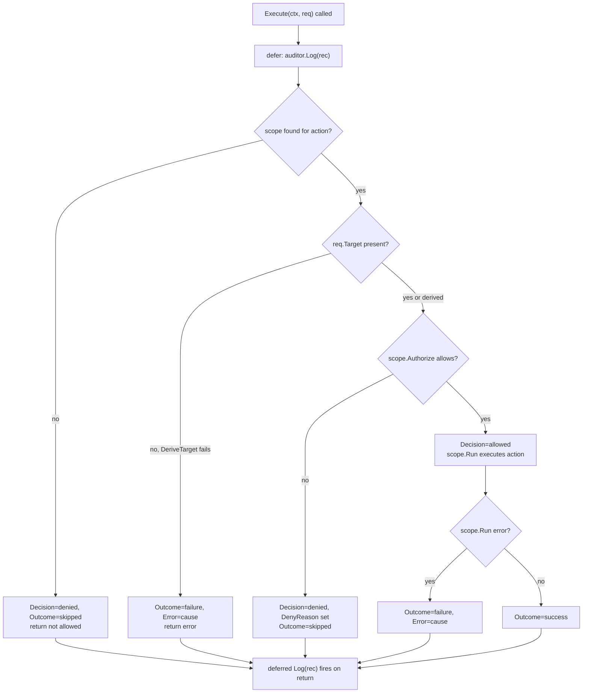
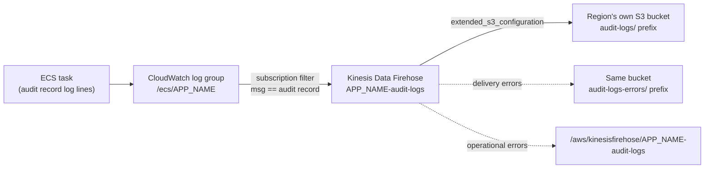

# Trusted Actions audit and logging

`components/trusted-actions` is a separate service from ROSA Boundary, deployed into its own AWS footprint, and it produces its own single-shaped audit record rather than Boundary's set of session transcripts, S3 snapshots, Bedrock payload logs, and CloudTrail events. **Do not treat the two as one unified audit pipeline.** See [ROSA Boundary auditing and logging flows](audit-and-logging.md) for Boundary's model; this page covers only Trusted Actions.

Trusted Actions layers two audit mechanisms:

- An HTTP middleware that writes one `models.AuditEntry` row per API request to the service's own database-backed store.
- An `audit.Record` that the executor logs for every attempted action execution, regardless of how that execution turns out.

Both ultimately surface as structured log lines that the regional Terraform pipeline ships out of CloudWatch into S3.

## The `audit.Record` shape

`internal/audit/audit.go` defines the canonical per-execution audit record:

```go
type Record struct {
    Timestamp time.Time
    CallerID  string
    Action    string
    Target     actions.Target // concrete type determines the serialized payload shape
    ClusterID  string
    Decision   Decision        // "allowed" | "denied"
    DenyReason string          // set when Decision is "denied"
    Outcome    Outcome         // "success" | "failure" | "skipped"
    Error      string          // set when Outcome is "failure"
}
```

- `Decision` is `allowed` or `denied` — whether the request passed the scope's `Authorize` check.
- `Outcome` is `success`, `failure`, or `skipped` — what happened once execution was (or was not) attempted. `skipped` covers both "no execution scope configured for this action" and "denied by authorization," since in neither case did the action actually run.
- `DenyReason` is populated only alongside a `denied` decision.
- `Error` carries the underlying cause string, stripped of any caller-facing framing a `Scope.Failure` added (see below), and is populated only on `failure`.

Records are written through the `audit.Logger` interface (`Log(record Record)`), which the executor is constructed with and which middleware wires up as a per-request audit sink.

(repo://components/trusted-actions/internal/audit/audit.go)

## Injection and emission: middleware and the executor

`internal/middleware/audit.go`'s `NewAuditLogger` middleware runs on every API request. It attaches an empty `*AuditContext` to the request context before calling the next handler, letting downstream handlers enrich it (execution ID, Jira reference, approval state, target cluster) via `SetAuditContext`/`GetAuditContext`. After the handler returns, the middleware builds a `models.AuditEntry` — method, path, caller username (from the authenticated identity), status code, and whatever `AuditContext` fields handlers set — and persists it with `store.CreateAuditEntry`, using a detached 5-second-timeout context so the write is not lost just because the inbound request's context is already cancelled. A failed write is logged but does not fail the response.

This `AuditEntry` model (`internal/models/audit.go`) is a separate, broader "one row per HTTP request" audit trail, independent of the narrower `audit.Record` described above, and is exposed to API clients via `AuditEntry.ToOpenAPI()`.

The `audit.Record` itself is emitted by `internal/executor.Executor.Execute`, which is invoked once per action attempt. It builds the record at the top of the call and defers logging it immediately:

```go
rec := audit.Record{Timestamp: time.Now(), CallerID: req.CallerID, Action: req.Action.Name(), ClusterID: req.ClusterID}
defer func() { e.auditor.Log(rec) }()
```

Because the `Log` call is deferred, every exit path through `Execute` — no scope configured, target derivation failure, authorization denial, scope execution failure, or success — fills in `rec`'s remaining fields and then logs exactly one record on the way out. There is no path through `Execute` that skips the audit write.


*Every return path out of `Executor.Execute` fills in the audit record before the deferred `Log` call fires.*

A `Scope.Run` failure is wrapped in `executor.Failure`, which separates the caller-facing `Message` from the underlying `Cause`; `auditedCause` unwraps a `*Failure` so the audit trail records the real cause rather than the pipeline's user-facing wording.

(repo://components/trusted-actions/internal/executor/executor.go, repo://components/trusted-actions/internal/middleware/audit.go, repo://components/trusted-actions/internal/models/audit.go)

## Regional CloudWatch → Firehose → S3 pipeline

Trusted Actions' structured audit records reach durable storage through a per-region Terraform-managed pipeline, kept separate from Boundary's own CloudWatch groups and S3 buckets.

1. **CloudWatch log group.** `terraform/regional/cloudwatch.tf` creates `/ecs/${var.app_name}` (`aws_cloudwatch_log_group.app`), the ECS task's application log group, retained 30 days.
2. **Subscription filter → Firehose.** `terraform/regional/audit_logs.tf` attaches `aws_cloudwatch_log_subscription_filter.audit` to that log group with filter pattern `{ $.msg = "audit record" }`, forwarding only lines logged with that marker to a Kinesis Data Firehose delivery stream (`aws_kinesis_firehose_delivery_stream.audit_logs`). The filter assumes `local.global.iam_role_cwl_to_firehose_arn`, a role defined in the global IAM workspace.
3. **Firehose → S3.** The Firehose stream's `extended_s3_configuration` writes to the region's own app S3 bucket (`aws_s3_bucket.app`) under the `audit-logs/` prefix, buffering up to 5 MB or 300 seconds and compressing with GZIP. It assumes `local.global.iam_role_firehose_audit_logs_arn`. Delivery failures land under `audit-logs-errors/!{firehose:error-output-type}/` in the same bucket, and the stream's own operational errors are logged to a dedicated Firehose CloudWatch log group/stream (`/aws/kinesisfirehose/${var.app_name}-audit-logs`). The delivery stream explicitly depends on `aws_s3_bucket_object_lock_configuration.app` so Firehose never writes before the bucket's WORM retention is in place.


*Regional audit pipeline: each region's ECS log group feeds Firehose, which writes into that same region's own S3 bucket.*

### Per-region scoping and the global wildcard IAM policy

Each AWS region that runs a Trusted Actions regional workspace gets its own log group, Firehose stream, and S3 bucket — there is no cross-region aggregation. IAM for the Firehose roles is defined once in the account-global `terraform/global/iam.tf` workspace and shared across every region by using **wildcarded ARNs** rather than per-region resource references:

- `cwl_to_firehose`'s policy allows `firehose:PutRecord`/`PutRecordBatch` against `arn:aws:firehose:*:ACCOUNT:deliverystream/APP_NAME-audit-logs` — region-wildcarded, since every region deploys a Firehose stream with that same predictable name.
- `firehose_audit_logs`'s policy allows `s3:PutObject`/`PutObjectRetention`/`AbortMultipartUpload` against `local.s3_bucket_arn_pattern` (`arn:aws:s3:::ACCOUNT-ENVIRONMENT-SUFFIX-*`), where the trailing `*` stands in for the region segment of the per-region bucket name built by `terraform/regional/s3.tf`. The same pattern (plus a `GetBucketLocation`/`ListBucket`/`GetBucketObjectLockConfiguration` statement) lets one global role work against any region's bucket without the global workspace needing to enumerate which regions exist, scoped further with an `aws:ResourceAccount` condition.
- The same policy also wildcards `logs:PutLogEvents` across `arn:aws:logs:*:ACCOUNT:log-group:/aws/kinesisfirehose/APP_NAME-audit-logs:*` for the Firehose error log group, for the same cross-region reuse reason.

The global IAM comment documents a known, accepted limitation: AWS ARN wildcards are not path-aware, so a crafted S3 key embedding a prefix like `audit-logs/` deeper in its path could in principle slip past the suffix-anchored statements. The risk is treated as low because only the Trusted Actions task role (which already has broad `GetObject`/`ListBucket` on the whole bucket) could craft such a key, and closing the gap would require enumerating concrete per-region bucket ARNs — defeating the purpose of keeping the global workspace region-count-agnostic.

(repo://components/trusted-actions/terraform/regional/cloudwatch.tf, repo://components/trusted-actions/terraform/regional/audit_logs.tf, repo://components/trusted-actions/terraform/global/iam.tf#L1-L41, repo://components/trusted-actions/terraform/global/iam.tf#L219-L263)

## Audit logging as one of two security controls

Trusted Actions' `ARCHITECTURE.md` lists exactly two controls under its Security section: account allowlisting and audit logging of all API calls with caller identity. In practice:

- **Account allowlisting** is enforced via the `ROSA_TA_ALLOWED_ACCOUNTS` environment variable (comma-separated AWS account IDs), read into `config.Config.AllowedAccounts` and set per regional deployment through `terraform/regional/ecs.tf`'s `var.allowed_accounts`. It gates which calling AWS accounts may use the API at all, independent of the audit pipeline.
- **Audit logging** is the two-layer mechanism described above: the per-request `AuditEntry` store and the per-execution `audit.Record` / CloudWatch → Firehose → S3 pipeline.

The two controls are complementary, not interchangeable: allowlisting is a preventive control decided before a request is authorized, while the audit record set is a detective control recording what was attempted and its outcome — including attempts an allowlisted but unauthorized caller made and that were denied or skipped.

(repo://components/trusted-actions/ARCHITECTURE.md#L162-L166, repo://components/trusted-actions/internal/config/config.go#L230-L240, repo://components/trusted-actions/terraform/regional/ecs.tf#L38-L44)

## Relationship to other pages

- [Trusted Actions deployment](../infrastructure/trusted-actions-deployment.md) covers the full regional/global Terraform layout that this audit pipeline is part of (VPC, ALB, ECS, S3 bucket, IAM roles) and where `audit_logs.tf`/`cloudwatch.tf` sit within it.
- [Trusted Actions execution workflow](../workflows/trusted-actions-execution.md) covers the request lifecycle (authentication, authorization, worker-based execution) in which `Executor.Execute` and the audit middleware run.
- [ROSA Boundary auditing and logging flows](audit-and-logging.md) documents Boundary's unrelated CloudWatch/S3/Bedrock/CloudTrail audit surface. The two services' audit data never mix: different AWS footprint, different buckets, different retention and Object Lock configuration, different record shape.
