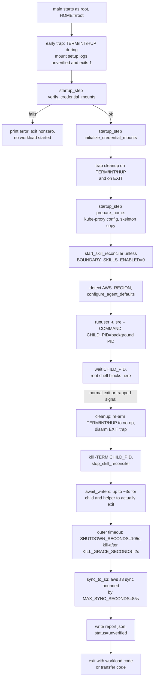

# Container image and task runtime

The image built from `Containerfile` is the operator environment run by ECS Fargate for ephemeral SRE investigations. It is based on a digest-pinned UBI 9 image and built from separate tool/download stages; only the production `final` stage is shipped. The final image bundles the SRE command-line toolchain, several coding agents (Claude Code, OpenCode, the Codex CLI, and pi), their search dependencies, tmux, shell setup, the OCM credential helper, a skill-reconciliation helper, and the entrypoint. As the `Containerfile`'s own header documents, SREs connect to a running task via SSM/ECS Exec as the non-root `sre` user, never as root; the entrypoint itself stays root only for the privileged setup it needs and then drops the requested workload to `sre` (see [Container startup and workload](#container-startup-and-workload)).

## Build and multi-architecture image layout

The root Makefile's `build-amd64` and `build-arm64` targets each invoke `podman build` with `--platform linux/amd64` / `linux/arm64` against the root `Containerfile`, forwarding GitHub credentials as build secrets (`GITHUB_TOKEN` and the three `GITHUB_APP_*` values) only when those environment variables are set. The `manifest` target depends on `build` (both architecture builds) and then uses `podman manifest create`/`add` to combine the two per-architecture tags (`rosa-boundary:latest-amd64`, `rosa-boundary:latest-arm64`) into one manifest list; `all` runs `build` followed by `manifest`. `verify-image-tools` separately runs the already-built image's own filesystem, unprivileged and network-isolated, through the embedded tool-inventory check rather than rebuilding anything.

The Containerfile pins its UBI 9 base image by digest (`ARG BASE_IMAGE=registry.access.redhat.com/ubi9/ubi@sha256:...`), a pin that Renovate keeps current rather than tracking a floating tag, and defines nine stages: `tools-base`, `sre-tools`, `claude-builder`, `opencode-builder`, `codex-builder`, `pi-builder`, `search-builder`, `tmux-builder`, and a `final` production stage that alone is shipped. `tools-base` installs `github_dl` (`build/github_dl.py`) and `platform_convert` (`build/platforms.sh`) and asserts that `TARGETARCH` matches what `platform_convert` reports for the architecture Podman actually built for, failing the build rather than mislabeling a host-architecture binary. Per the Containerfile's own header comment, `sre-tools` and the four coding-agent builders (`claude-builder`, `opencode-builder`, `codex-builder`, `pi-builder`) all depend on `tools-base`; `search-builder` also derives from `tools-base`; `tmux-builder` depends solely on `BASE_IMAGE`. With BuildKit or `podman build --layers`, stages 2 through 8 therefore run in parallel once their respective dependencies complete, instead of strictly serializing all nine stages.

Trusted Actions, a separate component under `components/trusted-actions/`, ships its own `Containerfile` and Make targets (a Go build image layered onto a minimal runtime image) that this page and the root Makefile do not build or cover; see that component's own build tooling for details.

## Tool installation and verification

The `sre-tools` stage installs `ocm`, `ocm-backplane`, `osdctl`, `yq`, `oc`, and the AWS CLI, each via a pinned `ARG …_VERSION` consumed by `build/sre_tools.py`, a fixed-source installer kept separate from `github_dl`'s own verification path. The build secrets mounted into each `sre_tools.py` invocation feed straight through to `github_dl`, which prefers a GitHub App token when the three app secrets are present and otherwise falls back to the bare `GITHUB_TOKEN`. For the four GitHub-hosted CLIs (`ocm`, `ocm-backplane`, `osdctl`, `yq`), `sre_tools.py` shells out to `github_dl download --exact_asset <arch-specific-name>` so GitHub credentials and checksum verification stay in `github_dl`; `aws` and `oc` are fetched directly instead: the AWS CLI verifies its detached publisher signature against a pinned signer fingerprint, while the OpenShift client release verifies a GPG-signed checksum manifest fetched from `mirror.openshift.com` against a separate pinned Red Hat signer fingerprint before hashing the downloaded archive. Every tool install is followed by a separate `--network=none --validate-installed` run of `sre_tools.py` that re-derives the installed binary's actual version and architecture from its own output and compares them against the pinned, recorded values, so verification never shares a build step with network access; the stage ends by running `build/verify_sre_tools.py combine` to merge the six per-tool inventory records into one `/opt/tool-versions.json`.

Four independent builder stages add coding agents under the same pinned, checksum-verified contract: `claude-builder` downloads Claude Code via `github_dl download --checksum_file SHASUMS256.txt`; `opencode-builder` downloads OpenCode via `github_dl` against an exact, architecture-specific asset name and a `SHA256SUMS` checksum file (selecting the glibc build, never the `-musl`/`-baseline`/desktop variants also published); `codex-builder` downloads the OpenAI Codex CLI's canonical package archive against a `codex-package_SHA256SUMS` manifest — the only Linux Codex artifact covered by a published SHA256 list, since the bare binary ships only a Sigstore bundle and the DotSlash descriptor uses blake3; and `pi-builder` downloads the pi coding agent via `github_dl` against a `SHA256SUMS` file. In every case `github_dl` resolves the matching checksum record for the exact requested asset and hashes the downloaded bytes before accepting them, and no downloaded tool ever runs while GitHub secrets are still mounted. `search-builder` (also `tools-base`-derived) adds `fd` and `ripgrep`, which pi needs from `PATH`: `fd` has no published checksum asset upstream, so its two architecture-specific SHA256 digests are hard-coded constants in the Containerfile that must be updated together with its version; `ripgrep` is verified against its own published checksum file. `tmux-builder` is independent of `tools-base`: it downloads a pinned tmux source tarball, checks it against a hard-coded SHA256 before extracting it, and builds tmux from source because UBI 9's repositories do not carry it.

The `final` stage installs runtime packages, copies only the selected outputs from `sre-tools` (including the combined `tool-versions.json`), the four coding-agent builders, `search-builder`, and `tmux-builder` — never the builder stages' secrets or verification tooling — registers only the AWS CLI through `alternatives` (not `oc`), symlinks each coding agent's binary into `/usr/local/bin`, generates shell completions for `ocm`/`ocm-backplane`/`oc`/`osdctl`, creates the non-root `sre` user with passwordless `sudo`, and copies `skel/sre/` to `/etc/skel-sre` for the entrypoint to seed `/home/sre` at first run. It also installs the OCM credential helper, the skill-sync helper, an agent-defaults helper, and `entrypoint.sh`, and sets the image-level `HOME=/home/sre` used by ECS Exec sessions. A final `--network=none`, bind-mounted `RUN` runs `build/verify_sre_tools.py runtime --containerfile ...` as `sre` to re-verify the shipped filesystem offline — ELF architecture, pinned versions and signer identities for the six SRE tools, offline `--version` probes for the four coding agents and the two search tools, and the absence of removed tools or elevated-mode files — before the image is tagged; `ENTRYPOINT`/`CMD` then wire the image to `entrypoint.sh` with a default command of `sleep infinity`.

## Container startup and workload

The entrypoint's `main()` overrides `HOME=/root` for the privileged setup phase, so root-owned operations (chown, the eventual S3 sync) never create root-owned files under the persistent, EFS-backed `/home/sre`; ECS Exec sessions still inherit the image-level `HOME=/home/sre`. Before any credential mount is touched, `main()` installs an early `TERM`/`INT`/`HUP` trap that simply logs `reason=interrupted_mount_setup` and exits 1 — a signal during this narrow window aborts cleanly without attempting an upload, since nothing durable has been prepared yet. Mount preparation and the eventual workload are each run through `startup_step`, a small helper that backgrounds one function as `CHILD_PID`, waits for it, and clears `CHILD_PID` again; this keeps PID 1 in an interruptible `wait` even if a setup step blocks on EFS.

`verify_credential_mounts` checks that `/home/sre/.config/ocm` and `/home/sre/.kube` are each a task-scoped mount point and not backed by an `nfs*` filesystem, failing closed with a descriptive error if either check fails; `initialize_credential_mounts` then creates both directories with `sre:sre` ownership and mode `0700`. These two steps are kept as separate functions because `HOME` and `~` resolve to `/root` while the entrypoint itself runs privileged, so the Fargate-mounted paths under `/home/sre` must be named explicitly. Once both steps succeed, `main()` swaps in the real shutdown handling — `trap cleanup TERM INT HUP` and `trap 'cleanup $?' EXIT` — so every later exit path, signaled or not, now runs the same cleanup sequence described below.

`main()` then runs `prepare_home` (through `startup_step`), which writes a localhost kubeconfig when `KUBE_PROXY_PORT` is set (so `oc`/`kubectl` target an enabled kube-proxy sidecar) and copies `/etc/skel-sre` into `/home/sre` without overwriting existing user files (`cp -rn`, idempotent on later runs). `start_skill_reconciler` then launches `/usr/local/libexec/rosa-boundary-skill-sync.sh` as `sre` (via `runuser --user sre -- env HOME=/home/sre bash ...`) in the background unless `BOUNDARY_SKILLS_ENABLED` is explicitly set to a value other than `1`; the helper polls `/opt/rosa-content/rosa-claude-plugins` on a lock-protected, configurable interval (`BOUNDARY_SKILL_RECONCILE_INTERVAL`, default 60s, accepted range 5–86400s) and symlinks each published collection's skills into both `~/.claude/skills` and `~/.agents/skills` under a `boundary--<collection>--<skill>` name, removing only the links it manages when a skill is retired and leaving unrelated or conflicting entries untouched.

If Bedrock is enabled (`CLAUDE_CODE_USE_BEDROCK`, default on), `main()` auto-detects `AWS_REGION` from the ECS task metadata's task ARN when `AWS_REGION` is unset, falling back to `us-east-1` if detection fails or times out (bounded by `METADATA_SECONDS`, 3s). `configure_agent_defaults` then seeds credential-free agent settings as `sre` via the bundled `rosa-boundary-agent-defaults.py` helper whenever Bedrock is selected (`BOUNDARY_AI_USE_BEDROCK`, defaulting to `CLAUDE_CODE_USE_BEDROCK`); a failure in this optional helper only warns and lets startup continue. `main()` also warns if no S3 audit destination is configured and prints an informational `TASK_TIMEOUT` notice (enforcement itself lives outside the entrypoint, in a periodic reaper Lambda). Finally, `main()` backgrounds the requested command (default `sleep infinity`) as `sre` via `runuser -u sre -- "${@:-sleep infinity}" &`, records its PID as `CHILD_PID`, and blocks on `wait "$CHILD_PID"` so the root shell stays alive to handle signals; when the child exits, `main()` calls `cleanup` with the workload's exit code.

*Entrypoint control flow: a single `cleanup()` function now handles both the normal workload exit and any trapped `SIGTERM`/`SIGINT`/`SIGHUP`, so both paths signal the workload and skill reconciler, wait briefly for them to exit, and reach the same bounded, unverified S3 sync before the container exits.*

## Shutdown and the audit-sync watchdog

`entrypoint.sh` defines its shutdown time budget as four named constants at the top of the file: `SHUTDOWN_SECONDS=105` bounds the entire cleanup sequence, `KILL_GRACE_SECONDS=2` is the forced-kill grace `timeout --kill-after` applies if that bound is exceeded, `MAX_SYNC_SECONDS=85` caps the `aws s3 sync` transfer itself, and `METADATA_SECONDS=3` bounds each ECS task-metadata lookup. The file's own comment documents the arithmetic: 105s plus a 2s forced kill plus up to 3s of startup metadata lookup leaves roughly 10s of margin inside the regional task definition's 120s `stopTimeout`, with the writer grace (3s), metadata (3s), transfer (85s + 2s kill-after) and report upload (6s + 2s kill-after) all running inside that outer watchdog.

`cleanup()` is the single function invoked both by the `TERM`/`INT`/`HUP` trap and by the `EXIT` trap at the end of `main()`, so the same sequence runs whether the workload exited on its own or the task was signaled. On entry it immediately re-arms `TERM`/`INT`/`HUP` to a no-op and disarms its own `EXIT` trap, so a repeated signal during shutdown cannot re-enter `cleanup` or escape the function uncontrolled. It then signals the managed writers before attempting any transfer: if `CHILD_PID` is still set it sends the workload `SIGTERM`, and `stop_skill_reconciler` sends `SIGTERM` to the skill-sync helper's `runuser` supervisor (which forwards it to the Bash child) and clears `SKILL_RECONCILER_PID`. `await_writers` then polls for up to roughly three seconds (30 iterations of a 0.1s sleep) for both the child and the helper to actually exit — this is a short flush grace, explicitly not a fence against surviving descendants, concurrent ECS Exec sessions, or other tasks still writing to the same EFS-backed home. Once that grace elapses (or both writers exit early), `cleanup` runs `await_writers` and `sync_to_s3` together inside one `timeout --kill-after="$KILL_GRACE_SECONDS" "$SHUTDOWN_SECONDS" bash -c ...` invocation, so a sync that hangs past the outer budget is killed rather than blocking the container's exit indefinitely; a nonzero result from that outer timeout is logged as `audit_sync result=unverified shutdown_rc=<rc>`. `cleanup` finally exits with the workload's own nonzero exit code when there was one, or with the transfer's result code otherwise.

`sync_to_s3` first generates a fresh per-attempt UUID and resolves the ECS task ID from `ECS_CONTAINER_METADATA_URI_V4` (bounded by `METADATA_SECONDS`); if the task ID is not a 32-character hex string or `INVESTIGATION_ID` is not set to an acceptable value, it logs `reason=missing_correlation` and returns without ever invoking `aws`. It then resolves a destination from an explicit `S3_AUDIT_ESCROW` or builds one from `S3_AUDIT_BUCKET`/`CLUSTER_ID`/`INVESTIGATION_ID` plus the date and task ID; a missing destination logs `reason=missing_destination` and likewise skips the upload. The actual object path always includes `attempts/<uuid>/workspace/`, so every shutdown attempt gets a fresh prefix rather than overwriting a previous one. The transfer itself runs as `timeout --foreground --kill-after=2 "$(sync_seconds)" aws s3 sync /home/sre "$dest" --exclude ".config/ocm/*" --exclude ".kube/*" --no-follow-symlinks --quiet`, where `sync_seconds` honors an operator-supplied `SYNC_TIMEOUT` only when it is a small positive integer at or under `MAX_SYNC_SECONDS` (85), otherwise falling back to 85 outright — so a misconfigured or malicious `SYNC_TIMEOUT` can never disable or exceed the bound. Regardless of the transfer's outcome, `sync_to_s3` always logs `audit_sync result=unverified transfer_rc=<rc> ...` and writes a `report.json` object (via a second, 6-second-bounded `aws s3 cp`) with `schema_version`, `investigation_id`, `task_id`, `attempt_id`, `workspace_uri`, `transfer_rc`, and `status: "unverified"`. The `status` field is unconditionally `"unverified"`, never `"verified"` or similar, because other tasks and ECS Exec sessions can keep writing to the same `/home/sre` throughout the transfer window — the resulting S3 object and its `report.json` are evidence of a best-effort copy, not authoritative proof of the workspace's final state at close. If the `report.json` upload itself fails, `sync_to_s3` logs `reason=report_failed` and returns nonzero even though the data transfer may have succeeded.

The Terraform task definition can include a `kube-proxy` sidecar. It writes the cluster kubeconfig to temporary storage, starts `oc proxy` on loopback, and exposes a health check; the main container depends on that health check when the option is enabled. See [Regional runtime](../infrastructure/regional-runtime.md) for the task definition's stop-timeout configuration that this watchdog budget is designed to fit inside.

## Tests and operational linkage

The bats suite sources the entrypoint without running it, using stub `aws` and `curl` scripts to observe exactly what the real functions would invoke. It checks that `start_skill_reconciler` runs the helper as `sre` with an explicit `HOME` and can be disabled via `BOUNDARY_SKILLS_ENABLED`; that `configure_agent_defaults` runs as `sre` with explicit `HOME`, honors the `BOUNDARY_AI_USE_BEDROCK`/`CLAUDE_CODE_USE_BEDROCK` opt-out, and never aborts startup under `set -e` when the optional helper fails; that `verify_credential_mounts`/`initialize_credential_mounts` reject missing or EFS-backed overlays and otherwise prepare mode-`0700` directories owned by `sre`, with `main()` running verification strictly before initialization; and that both the explicit and auto-generated S3 destinations use a fresh `attempts/<uuid>/` path each run, retain the OCM/kubeconfig exclusions and symlink protections, and always produce a correlated, `status: "unverified"` report. Dedicated shutdown tests drive `cleanup` and `main` under real signals and a stalled `aws` stub: they confirm a `TERM` during mount setup exits before any upload is attempted; that a stalled sync still produces a `transfer_rc=124` timeout report rather than hanging; that shortening `SHUTDOWN_SECONDS` interrupts a blocked upload without ever reaching the `report.json` step; that a hard `SIGKILL` mid-upload leaves no report for that attempt while a retried attempt still succeeds; and that `SIGTERM`, `SIGINT`, and `SIGHUP` on a waiting entrypoint each allow exactly one final managed write and exactly one sync-plus-report pair. ECS task-definition source supplies the mount paths, stop timeout, Bedrock variables, and optional sidecar behavior consumed by the script.

## Related pages

- [System overview and boundaries](../architecture/system-overview.md) places the container within the CLI/Lambda/ECS request flow.
- [Regional runtime](../infrastructure/regional-runtime.md) covers the ECS task definition, EFS mounts, stop timeout, and kube-proxy sidecar that this entrypoint depends on.
- [ROSA Boundary auditing and logging flows](../operations/audit-and-logging.md) covers the S3 audit escrow alongside CloudWatch and CloudTrail evidence, and why the escrow is treated as unverified.
- [Investigation lifecycle](../workflows/investigation-lifecycle.md) covers how a task reaches this container and how it is torn down.
