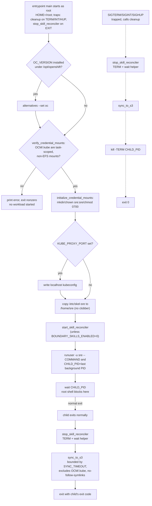

# Container image and task runtime

The image built from `Containerfile` is the operator environment run by ECS Fargate for ephemeral SRE investigations. It is based on a digest-pinned UBI 9 image and built from separate tool/download stages; only the final stage is shipped. The final image includes the SRE command-line toolchain, Claude Code, tmux, shell setup, the OCM credential helper, a skill-reconciliation helper, and the entrypoint. As the `Containerfile`'s own header documents, SREs connect to a running task via SSM/ECS Exec as the non-root `sre` user, never as root; the entrypoint itself stays root only for the privileged setup it needs and then drops the requested workload to `sre` (see [Container startup and workload](#container-startup-and-workload) and `entrypoint.sh` for that runtime behavior).

## Build and architecture selection

The root Makefile's `build-amd64` and `build-arm64` targets each invoke `podman build` with `--platform linux/amd64` / `linux/arm64` against the root `Containerfile`, forwarding GitHub credentials as build secrets (`GITHUB_TOKEN` and the three `GITHUB_APP_*` values) only when those environment variables are set. The `manifest` target depends on `build` (both architecture builds) and then uses `podman manifest create`/`add` to combine the two per-architecture tags (`rosa-boundary:latest-amd64`, `rosa-boundary:latest-arm64`) into one manifest list; `all` runs `build` followed by `manifest`. `verify-image-tools` separately runs the already-built image's own filesystem, unprivileged and network-isolated, through the embedded tool-inventory check rather than rebuilding anything.

The Containerfile pins its UBI 9 base image by digest (`ARG BASE_IMAGE=registry.access.redhat.com/ubi9/ubi@sha256:...`), a pin that Renovate keeps current rather than tracking a floating tag, and defines five stages — `tools-base`, `sre-tools`, `claude-builder`, `tmux-builder`, and a `final` production stage that alone is shipped. `tools-base` installs `github_dl` (`build/github_dl.py`) and `platform_convert` (`build/platforms.sh`) and asserts that `TARGETARCH` matches what `platform_convert` reports for the architecture Podman actually built for, failing the build rather than mislabeling a host-architecture binary. `platform_convert` resolves `@@PLATFORM@@` placeholders from the real build platform: it reads `uname -m` (`x86_64`/`amd64` or `aarch64`/`arm64`) and substitutes a caller-supplied ARM or x86 string into either a positional argument or a file in place. Per the Containerfile's own header comment, only `sre-tools` and `claude-builder` depend on `tools-base`; `tmux-builder` depends solely on `BASE_IMAGE`. With BuildKit or `podman build --layers`, stages 2 through 5 (`sre-tools`, `claude-builder`, `tmux-builder`, and `final`) therefore run in parallel once their respective dependencies complete, instead of strictly serializing all five stages.

The `sre-tools` stage installs `ocm` (the OCM CLI), `ocm-backplane`, `osdctl`, `yq`, `oc`, and the AWS CLI, each via a pinned `ARG …_VERSION` consumed by `build/sre_tools.py`, a fixed-source installer kept separate from `github_dl`'s own verification path. The build secrets mounted into each `sre_tools.py` invocation (`GITHUB_TOKEN` and the three `rosa-boundary-github-app/GITHUB_APP_*` values) feed straight through to `github_dl`, which prefers a GitHub App token when the three app secrets are present and otherwise falls back to the bare `GITHUB_TOKEN`, so the GitHub-hosted downloads can authenticate either way. For the four GitHub-hosted CLIs (`ocm`, `ocm-backplane`, `osdctl`, `yq`), `sre_tools.py` shells out to `github_dl download --exact_asset <arch-specific-name>` so GitHub credentials and checksum verification stay in `github_dl`; `aws` and `oc` are fetched directly instead: AWS CLI verifies its detached publisher signature with a pinned signer, while the OpenShift release verifies its signed checksum manifest with a pinned Red Hat signer. Every tool install is followed by a separate `--network=none` `--validate-installed` run of `sre_tools.py` that re-derives the installed binary's actual version and architecture from its own output and compares them against the pinned, recorded values, so verification never shares a build step with network access; the stage ends by running `build/verify_sre_tools.py combine` to merge the six per-tool inventory records into one `/opt/tool-versions.json`. `claude-builder` downloads Claude Code the same way, directly through `github_dl download --platform ... --checksum_file SHASUMS256.txt`, which lists the release's assets, resolves the matching SHA256 record, downloads that exact asset, and hashes the bytes before accepting them. `tmux-builder` is independent of `tools-base`: it downloads a pinned tmux source tarball, checks it against a hard-coded SHA256 before extracting or compiling it, and builds tmux from source because UBI 9's repositories do not carry it.

The `final` stage installs runtime packages, copies only the selected outputs from `sre-tools` (including the combined `tool-versions.json`), `claude-builder`, and `tmux-builder` (never the builder stages' secrets or verification tooling), registers the AWS CLI through `alternatives`, generates shell completions, creates the non-root `sre` user with passwordless `sudo`, and copies `skel/sre/` to `/etc/skel-sre` for the entrypoint to seed `/home/sre` at first run. It also installs the OCM credential helper (`utils/rosa-boundary-credential-helper`) and the skill-sync helper (`utils/rosa-boundary-skill-sync.sh`, run as `rosa-boundary-skill-sync.sh` under `/usr/local/libexec`) alongside `entrypoint.sh`, and sets the image-level `HOME=/home/sre` used by ECS Exec sessions. A final `--network=none` bind-mounted `RUN` runs `build/verify_sre_tools.py runtime` as `sre` to re-verify the shipped filesystem offline — checking ELF architecture, pinned versions, signer identities, and the absence of removed tools — before the image is tagged, and `ENTRYPOINT`/`CMD` wire the image to `entrypoint.sh` with a default command of `sleep infinity`. (The entrypoint also contains an `OC_VERSION`-driven `alternatives --set oc` switch over per-version binaries under `/opt/openshift/<version>/oc`; the current `final` stage installs only the single pinned `oc` build directly at `/usr/local/bin/oc` and does not populate that directory, so this switch is presently a no-op that falls through to its "using default" warning unless `/opt/openshift` is populated some other way.)

Trusted Actions, a separate component under `components/trusted-actions/`, ships its own `Containerfile` and Make targets (a Go build image layered onto a minimal runtime image) that this page and the root Makefile do not build or cover; see that component's own build tooling for details.

## Container startup and workload

The entrypoint's `main()` overrides `HOME=/root` for the privileged setup phase, so root-owned operations (`alternatives`, the eventual S3 sync) never create root-owned files under the persistent, EFS-backed `/home/sre`; ECS Exec sessions still inherit the image-level `HOME=/home/sre`. It installs a `cleanup` trap on `SIGTERM`/`SIGINT`/`SIGHUP` and a separate `stop_skill_reconciler` trap on `EXIT`, so the skill-sync helper is always reaped regardless of which path terminates the entrypoint. If `OC_VERSION` names an installed `/opt/openshift/<version>/oc`, it switches the `oc` alternative to that version; otherwise it warns and keeps the default build (see the no-op note above). Before any workload is started, `verify_credential_mounts` checks that `/home/sre/.config/ocm` and `/home/sre/.kube` are each a task-scoped mount point and not backed by an `nfs*` filesystem, failing closed with a descriptive error if either check fails; `initialize_credential_mounts` then creates both directories with `sre:sre` ownership and mode `0700`. These two steps are kept as separate functions because `HOME` and `~` resolve to `/root` while the entrypoint itself runs privileged, so the Fargate-mounted paths under `/home/sre` must be named explicitly. The entrypoint can then write a localhost kubeconfig for an enabled kube-proxy sidecar and copy skeleton files into `/home/sre` without overwriting existing user files (`cp -rn`, idempotent on later runs).

After the skeleton copy, `start_skill_reconciler` launches `/usr/local/libexec/rosa-boundary-skill-sync.sh` as `sre` (via `runuser --user sre -- env HOME=/home/sre bash ...`) in the background unless `BOUNDARY_SKILLS_ENABLED` is explicitly set to a value other than `1`; the helper polls `/opt/rosa-content/rosa-claude-plugins` on an interval (`BOUNDARY_SKILL_RECONCILE_INTERVAL`, default 60s) and symlinks each published collection's skills into `~/.claude/skills` under a `boundary--<collection>--<skill>` name, removing only the links it manages when a skill is retired, while leaving unrelated or conflicting entries untouched. `stop_skill_reconciler` sends `SIGTERM` to the helper's `runuser` supervisor (which forwards it to the Bash child) and waits for it before continuing, so the helper cannot keep mutating `/home/sre` while an audit sync is in flight; both `cleanup()` (the signal path) and the end of `main()` (the normal-exit path) call `stop_skill_reconciler` immediately before `sync_to_s3`, in that order.

The Terraform task definition can include a `kube-proxy` sidecar. It writes the cluster kubeconfig to temporary storage, starts `oc proxy` on loopback, and exposes a health check; the main container depends on that health check when the option is enabled. Claude Code's Bedrock environment and default model are set on the task definition; `main()` auto-detects `AWS_REGION` from the ECS task metadata's task ARN when `AWS_REGION` is unset and `CLAUDE_CODE_USE_BEDROCK` is enabled (default on), falling back to `us-east-1` if detection fails.

Finally, `main()` backgrounds the requested command (default `sleep infinity`) as `sre` via `runuser -u sre -- "$@" &` and blocks on `wait "${CHILD_PID}"`, so the root shell stays alive to handle signals. On a normal workload exit it stops the skill reconciler, runs the bounded S3 sync, and exits with the workload's own exit code; on a trapped `SIGTERM`/`SIGINT`/`SIGHUP` the `cleanup` trap stops the skill reconciler, runs the same sync, forwards `SIGTERM` to the child, and exits 0. `sync_to_s3` builds `S3_AUDIT_ESCROW` from `S3_AUDIT_BUCKET`/`CLUSTER_ID`/`INVESTIGATION_ID` (plus the ECS task ID from task metadata) when an explicit escrow path is not set, then runs `timeout "${SYNC_TIMEOUT:-300}" aws s3 sync /home/sre ...` excluding `.config/ocm/*` and `.kube/*` and passing `--no-follow-symlinks` so a symlink pointing outside `/home/sre` cannot exfiltrate host-level files. This audit copy is best-effort: a missing destination only warns, and a failed or timed-out sync does not block the container's exit indefinitely.

*Entrypoint control flow: privileged setup and mount verification happen before the privilege drop; the root shell then blocks on `wait` so a trapped signal or the workload's own exit both reap the skill reconciler and reach the same bounded S3 sync before the container exits.*

## Tests and operational linkage

The bats suite sources the entrypoint without running it. It checks that `start_skill_reconciler` runs the helper as `sre` with an explicit `HOME` and can be disabled via `BOUNDARY_SKILLS_ENABLED`, that `stop_skill_reconciler` runs before the audit sync on both the signal path and the `EXIT` trap, that `verify_credential_mounts`/`initialize_credential_mounts` reject missing or EFS-backed overlays and otherwise prepare mode-`0700` directories owned by `sre`, and that both the explicit and auto-generated S3 destinations retain the OCM/kubeconfig exclusions and symlink protections. ECS task-definition source supplies the mount paths, stop timeout, Bedrock variables, and optional sidecar behavior consumed by the script.

## Related pages

- [System overview and boundaries](../architecture/system-overview.md) places the container within the CLI/Lambda/ECS request flow.
- [Regional runtime](../infrastructure/regional-runtime.md) covers the ECS task definition, EFS mounts, and kube-proxy sidecar that this entrypoint depends on.
- [ROSA Boundary auditing and logging flows](../operations/audit-and-logging.md) covers the S3 audit escrow alongside CloudWatch and CloudTrail evidence.
- [Investigation lifecycle](../workflows/investigation-lifecycle.md) covers how a task reaches this container and how it is torn down.

## Evidence-backed claims

- The root Makefile's `build-amd64`/`build-arm64` targets build separate AMD64 and ARM64 images with Podman and the `manifest` target assembles their tags into one manifest list; the Containerfile uses a digest-pinned, Renovate-managed UBI 9 base and five stages (`tools-base`, `sre-tools`, `claude-builder`, `tmux-builder`, `final`) where only `final` ships, and only `final`'s dependency on the other three builder stages' outputs forces it to wait — `sre-tools`/`claude-builder` (via `tools-base`) and `tmux-builder` (via `BASE_IMAGE` directly) can otherwise build in parallel under BuildKit/`podman build --layers`. [build-amd64/build-arm64](repo://Makefile#L30-L50) · [manifest target](repo://Makefile#L67-L75) · [base and tools-base stage](repo://Containerfile#L1-L23) · [final stage](repo://Containerfile#L194-L279)
- `sre_tools.py` (run from the `sre-tools` stage with `GITHUB_TOKEN`/GitHub App secrets mounted) calls `github_dl` to fetch exact, architecture-named release assets for GitHub-hosted CLIs (`ocm`, `ocm-backplane`, `osdctl`, `yq`) while verifying AWS CLI with a detached signature and `oc` against a signed checksum manifest; `github_dl` itself prefers a GitHub App token when all three app secrets are present and otherwise falls back to `GITHUB_TOKEN`, and matches a checksum record to the requested asset and hashes the downloaded bytes before accepting them. `verify_sre_tools.py` combines per-tool inventories at build time and re-verifies the shipped filesystem offline as `sre` before tagging. Claude Code is fetched the same way via `github_dl` in `claude-builder`, and tmux's source tarball is SHA256-checked before compilation in the independent `tmux-builder` stage. [sre-tools stage](repo://Containerfile#L54-L120) · [claude-builder/tmux-builder stages](repo://Containerfile#L123-L189) · [final-stage runtime verification](repo://Containerfile#L268-L273) · [github_dl asset/checksum matching](repo://build/github_dl.py#L225-L271) · [github_dl auth priority](repo://build/github_dl.py#L1-L58) · [verify_sre_tools runtime/combine](repo://build/verify_sre_tools.py#L54-L95)
- Before launching the workload, the entrypoint requires `/home/sre/.config/ocm` and `/home/sre/.kube` to be task-scoped mounts that are not NFS/EFS-backed, prepares both with `sre:sre` ownership and mode `0700`, then runs the requested command as `sre` in the background while the root shell blocks on `wait` so it keeps handling signals. [mount verification](repo://entrypoint.sh#L69-L87) · [mount initialization](repo://entrypoint.sh#L92-L100) · [drop privilege and wait](repo://entrypoint.sh#L190-L203)
- `main()` traps `SIGTERM`/`SIGINT`/`SIGHUP` into `cleanup` and `EXIT` into `stop_skill_reconciler`; both the signal path and the normal-exit path at the end of `main()` stop the unprivileged skill reconciler before running the bounded, credential-excluding S3 sync, so the helper cannot keep mutating `/home/sre` during the audit copy. [cleanup and sync_to_s3](repo://entrypoint.sh#L3-L45) · [skill reconciler start/stop](repo://entrypoint.sh#L47-L64) · [traps and exit ordering in main](repo://entrypoint.sh#L111-L122) · [reconciler/cleanup ordering tests](repo://tests/shell/entrypoint.bats#L8-L53) · [sync exclusion tests](repo://tests/shell/entrypoint.bats#L135-L181)
- The current Containerfile's final stage ships only a single pinned `oc` build directly at `/usr/local/bin/oc` and does not populate `/opt/openshift/<version>/oc`, so the entrypoint's `OC_VERSION`-driven `alternatives --set oc` version switch is presently a no-op that falls through to its "using default" warning unless that directory is populated by some other means. [oc pin and install](repo://Containerfile#L106-L111) · [final-stage oc copy](repo://Containerfile#L223-L229) · [entrypoint OC_VERSION switch](repo://entrypoint.sh#L115-L122)
- The ECS task definition configures a persistent EFS home with task-scoped OCM/kubeconfig overlays and can optionally gate the main container on a healthy loopback kube-proxy sidecar. [task config](repo://deploy/regional/ecs.tf#L88-L111) · [credential overlays](repo://deploy/regional/ecs.tf#L122-L136) · [proxy sidecar](repo://deploy/regional/ecs.tf#L168-L188) · [health-check dependency](repo://deploy/regional/ecs.tf#L197-L244)
