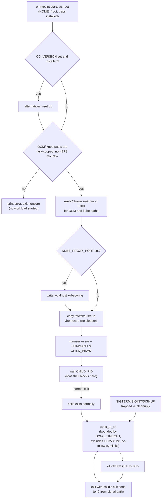

# Container image and task runtime

The image built from `Containerfile` is the operator environment run by ECS Fargate. It is based on a digest-pinned UBI 9 image and built from separate tool/download stages; only the final stage is shipped. The final image includes the SRE command-line toolchain, Claude Code, tmux, shell setup, the OCM credential helper, and the entrypoint. ECS Exec launches an interactive login as the non-root `sre` user, while the entrypoint remains root only for initialization and then drops the requested workload to `sre`.

## Build and architecture selection

The root Makefile's `build-amd64` and `build-arm64` targets each invoke `podman build` with `--platform linux/amd64` / `linux/arm64` against the root `Containerfile`, forwarding GitHub credentials as build secrets (`GITHUB_TOKEN` and the three `GITHUB_APP_*` values) only when those environment variables are set. The `manifest` target depends on `build` (both architecture builds) and then uses `podman manifest create`/`add` to combine the two per-architecture tags (`rosa-boundary:latest-amd64`, `rosa-boundary:latest-arm64`) into one manifest list; `all` runs `build` followed by `manifest`. `verify-image-tools` separately runs the already-built image's own filesystem, unprivileged and network-isolated, through the embedded tool-inventory check rather than rebuilding anything.

The Containerfile pins its UBI 9 base image by digest (`registry.access.redhat.com/ubi9/ubi@sha256:...`) and defines four builder stages — `tools-base`, `sre-tools`, `claude-builder`, `tmux-builder` — feeding a single `final` stage that is the only one shipped. `tools-base` installs `github_dl` (`build/github_dl.py`) and `platform_convert` (`build/platforms.sh`) and asserts that `TARGETARCH` matches the architecture Podman actually built for, failing the build rather than mislabeling a host-architecture binary. `platform_convert` resolves `@@PLATFORM@@` placeholders from the real build platform: it reads `uname -m` (`x86_64`/`amd64` or `aarch64`/`arm64`) and substitutes a caller-supplied ARM or x86 string into either a positional argument or a file in place.

The `sre-tools` stage installs `ocm`, `ocm-backplane`, `osdctl`, `yq`, `oc`, and the AWS CLI through `build/sre_tools.py`, a fixed-source installer kept separate from `github_dl`'s own verification path: for the four GitHub-hosted CLIs it shells out to `github_dl download --exact_asset <arch-specific-name>` so GitHub credentials and checksum verification stay in `github_dl`, while `aws` and `oc` are fetched directly and checked against a GPG-signed manifest (`verify_signature`, pinned signer key fingerprints) instead of a GitHub release checksum. Every tool install is followed by a separate `--network=none` `--validate-installed` run that re-derives the installed binary's actual version and architecture from its own output and compares them against the pinned, recorded values, so verification never shares a build step with network access. `claude-builder` downloads Claude Code directly through `github_dl download --platform ... --checksum_file SHASUMS256.txt`, which lists the release's assets, resolves the matching SHA256 record, downloads that exact asset, and hashes the bytes before accepting them. `tmux-builder` is independent of `tools-base`: it downloads a pinned tmux source tarball, checks it against a hard-coded SHA256 before extracting or compiling it, and builds tmux from source because UBI 9's repositories do not carry it.

The `final` stage installs runtime packages, copies only the selected outputs from `sre-tools`, `claude-builder`, and `tmux-builder` (never the builder stages' secrets or verification tooling), registers the AWS CLI through `alternatives`, generates shell completions, creates the non-root `sre` user with passwordless `sudo`, and copies `skel/sre/` to `/etc/skel-sre` for the entrypoint to seed `/home/sre` at first run. OpenShift client versions are installed under `/opt/openshift` and selected by the entrypoint when `OC_VERSION` names an installed version. A final `--network=none` bind-mounted `RUN` re-verifies the shipped filesystem offline as `sre` before the image is tagged, and `ENTRYPOINT`/`CMD` wire the image to `entrypoint.sh` with a default command of `sleep infinity`.

Trusted Actions, a separate component under `components/trusted-actions/`, ships its own `Containerfile` and Make targets (a Go build image layered onto a minimal runtime image) that this page and the root Makefile do not build or cover; see that component's own build tooling for details.

## Container startup and workload

The entrypoint sets root's `HOME` to `/root` to avoid root-created files in the persistent EFS home and installs traps for SIGTERM, SIGINT, and SIGHUP. Before any workload is started, it checks that `/home/sre/.config/ocm` and `/home/sre/.kube` are mounted and not backed by NFS/EFS, then creates those directories with `sre` ownership and mode `0700`. It can switch the OpenShift CLI alternative, write a localhost kubeconfig for an enabled kube-proxy sidecar, and copy skeleton files without overwriting existing user files.

The Terraform task definition can include a `kube-proxy` sidecar. It writes the cluster kubeconfig to temporary storage, starts `oc proxy` on loopback, and exposes a health check; the main container depends on that health check when the option is enabled. Claude Code's Bedrock environment and default model are set on the task definition; the entrypoint can discover `AWS_REGION` from ECS task metadata and otherwise uses its configured fallback.

After setup, the entrypoint backgrounds the requested command (default `sleep infinity`) as `sre` and waits so the root shell can handle signals. On normal exit and trapped shutdown it attempts an S3 sync of `/home/sre`, bounded by `SYNC_TIMEOUT`; sync excludes OCM and kubeconfig state and uses `--no-follow-symlinks`. This audit copy is best-effort: a missing destination warns, and a failed or timed-out sync does not block the container's exit indefinitely.

*Entrypoint control flow: privileged setup and mount verification happen before the privilege drop; the root shell then blocks on `wait` so a trapped signal or the workload's own exit both reach the same bounded S3 sync before the container exits.*

## Tests and operational linkage

The bats suite sources the entrypoint without running it, checks that startup rejects missing or EFS-backed credential overlays, and verifies both explicit and auto-generated S3 destinations retain credential exclusions and symlink protections. ECS task-definition source supplies the mount paths, stop timeout, Bedrock variables, and optional sidecar behavior consumed by the script.

## Related pages

- [System overview and boundaries](../architecture/system-overview.md) places the container within the CLI/Lambda/ECS request flow.
- [ROSA Boundary auditing and logging flows](../operations/audit-and-logging.md) covers the S3 audit escrow alongside CloudWatch and CloudTrail evidence.
- [Verification and testing](../testing/verification.md) describes how the bats suite fits the broader test strategy.
- [Investigation lifecycle](../workflows/investigation-lifecycle.md) covers how a task reaches this container and how it is torn down.

## Evidence-backed claims

- The root Makefile's `build-amd64`/`build-arm64` targets build separate AMD64 and ARM64 images with Podman and the `manifest` target assembles their tags into one manifest list; the Containerfile uses a digest-pinned UBI 9 base and five builder stages feeding one final image that alone ships. [build-amd64/build-arm64](repo://Makefile#L30-L50) · [manifest target](repo://Makefile#L67-L75) · [base and tools-base stage](repo://Containerfile#L1-L23) · [final stage](repo://Containerfile#L191-L274)
- `sre_tools.py` calls `github_dl` to fetch exact, architecture-named release assets for GitHub-hosted CLIs while verifying `aws`/`oc` against GPG-signed manifests instead; `github_dl` itself matches a checksum record to the requested asset and hashes the downloaded bytes before accepting them, and tmux's source tarball is SHA256 checked before compilation. [sre-tools stage](repo://Containerfile#L47-L124) · [claude-builder/tmux-builder stages](repo://Containerfile#L127-L164) · [github_dl asset/checksum matching](repo://build/github_dl.py#L225-L271) · [platform resolution](repo://build/platforms.sh#L120-L140)
- The entrypoint rejects credential paths that are missing or EFS-backed, prepares them as mode `0700`, then runs the requested workload as `sre` while the root shell retains signal handling. [mount verification/setup](repo://entrypoint.sh#L46-L80) · [workload process and traps](repo://entrypoint.sh#L82-L93) · [drop privilege and wait](repo://entrypoint.sh#L167-L183)
- Both normal exit and signal cleanup use a bounded S3 sync that excludes OCM and kubeconfig paths and disables symlink following; bats tests assert those protections. [sync and cleanup](repo://entrypoint.sh#L3-L44) · [sync tests](repo://tests/shell/entrypoint.bats#L88-L134) · [exit-path test](repo://tests/shell/entrypoint.bats#L176-L204)
- The ECS task definition configures a persistent home with task-scoped OCM/kubeconfig overlays and can gate startup on a healthy loopback kube-proxy sidecar. [task mounts and dependency](repo://deploy/regional/ecs.tf#L103-L159) · [proxy sidecar](repo://deploy/regional/ecs.tf#L175-L224)
