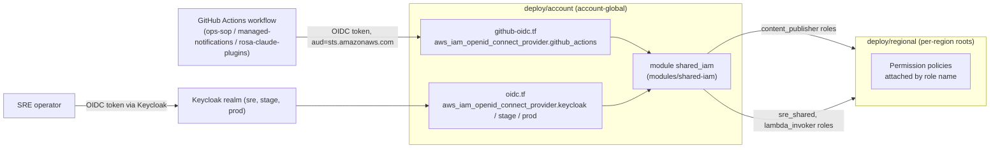

# Credential Lifecycle

Boundary never distributes long-lived AWS access keys. Every human and automated actor that needs AWS permissions gets them by federating an external identity token into a short-lived STS session, through one of two OIDC trust relationships that terminate in the account-global `shared-iam` Terraform module:

- **GitHub Actions OIDC** — CI workflows in three trusted source repositories assume per-repository publisher roles to push content, with no stored AWS secret in any workflow.
- **Keycloak OIDC federation** — SREs (and a Lambda-invoking caller) assume a shared, attribute-based role using a Keycloak-issued JWT, with per-user isolation enforced through session tags rather than per-user IAM roles.

This page covers only Boundary's own AWS-identity federation and role issuance. It is separate from Trusted Actions' JWT/OCM-based credential model (its own token validation and AMS checks), which is documented in [Trusted Actions authorization](../architecture/trusted-actions-authorization.md), and from the task-scoped OCM credential handoff for SRE sessions, which is a distinct mechanism from the AWS role vending described here. For how these roles fit into the broader identity architecture, see [Identity and Access](../architecture/identity-and-access.md); for the Keycloak realm/client side of the federation, see [Keycloak Deployment](../integrations/keycloak-deployment.md); for how the sessions these roles create are logged, see [Audit and Logging](../operations/audit-and-logging.md).

## Where identities are defined

All identity and trust live in `deploy/account`, the account-global Terraform root. This root has no dependency on any regional state: it references no bucket, KMS key, or other regional resource, only identities. The actual AWS permissions granted to these identities are attached separately by regional Terraform roots, which look the roles up by name through the `regional_iam_contract` output — so a role can exist and be assumable before it holds any permissions, and permission changes never require recreating the identity.

*Identity creation and trust are account-global; the matching permission grants are a later, separate regional apply.*

## GitHub OIDC for CI and content publishing

`deploy/account/github-oidc.tf` manages the account's GitHub Actions OIDC provider (issuer `https://token.actions.githubusercontent.com`) in one of three modes, selected by `create_github_actions_oidc_provider` and `adopt_existing_resources`:

- **create** (default) — this state creates and owns `aws_iam_openid_connect_provider.github_actions`.
- **reference** — `create_github_actions_oidc_provider = false` looks the provider up by issuer URL via a data source instead of managing it; an account with no such provider fails the plan rather than silently creating one.
- **adopt** — `create_github_actions_oidc_provider = true` together with `adopt_existing_resources = true` imports an existing provider into this state using Terraform's declarative `import` block.

Because AWS allows only one OIDC provider per issuer URL per account, an operator in the wrong mode fails loudly instead of creating a duplicate or silently destroying anything. No thumbprint is pinned for this provider: the argument is optional on the AWS provider version this root uses, and AWS maintains the GitHub Actions trust chain itself. Whichever mode produced the provider, `local.github_actions_provider_arn` resolves to its ARN, and the account root's `github_actions_oidc_provider_arn` output exposes that ARN so other consumers do not need to know which mode created it.

The audience, `sts.amazonaws.com`, is a hardcoded local rather than a variable, specifically so that no workspace configuration can widen which audience the publisher trust policies accept.

### Per-repository publisher roles

`modules/shared-iam/content-publishing.tf` creates one `aws_iam_role.content_publisher` per entry in `var.content_publisher_sources` — never a single shared role for all sources. This is a deliberate isolation boundary: a compromised workflow in one source repository cannot write another repository's published content once the matching regional grants exist, because each role's trust policy pins a distinct GitHub ref subject.

The default `content_publisher_sources` map pins three agreed sources:

| Key | Repository | Branch |
|---|---|---|
| `ops-sop` | `openshift/ops-sop` | `master` |
| `managed-notifications` | `openshift/managed-notifications` | `master` |
| `rosa-claude-plugins` | `openshift-online/rosa-claude-plugins` | `main` |

Each publisher role's trust policy requires `sts:AssumeRoleWithWebIdentity` from the GitHub Actions federated principal, under a `StringEquals` condition matching both the fixed audience and a subject built from a template: `repo:<repository>:ref:refs/heads/<branch>`. Terraform input validation on `content_publisher_sources` enforces syntax, not trust scope — it rejects a repository/branch value containing its own `:` segment, a `*`, or a full ref (such as `refs/pull/1/merge`), which is what would otherwise let an input turn into a pull-request, merge-ref, or environment subject. It does not and is not meant to restrict which owner, repository, or branch is configured; widening the trusted set is a deliberate, reviewed configuration change. A `aws_iam_role.content_publisher` precondition fails the plan if `github_actions_provider_arn` is ever empty, since the account root always resolves it by creating or looking up the provider.

Each publisher role's `max_session_duration` is `var.content_publisher_session_duration` (default 3,600 seconds), reflecting that a publishing workflow run is short-lived and needs no long-lived session. `content-publishing.tf` attaches no permissions itself — a publisher role is assumable immediately but holds no content access until the matching regional grant exists, which is the module's fail-safe default. The per-source role, ARN, repository, branch, and exact rendered subject are exposed through the `content_publisher_roles` output, and the account root also publishes a flattened `content_publisher_role_arns` map that a publishing workflow assumes directly.

A separate `aws_iam_role.content_replication` identity exists unconditionally, independent of audit replication, for S3 replication of Boundary content buckets. Its trust policy is service-only (`s3.amazonaws.com`, unconditioned `sts:AssumeRole`), deliberately matching the existing audit replication role's trust shape exactly, since adding a confused-deputy condition to only one of the two would be a drift that could surface at the worst time, during regional replication work.

## Keycloak-federated IAM roles for SREs

`deploy/account/oidc.tf` creates up to three Keycloak OIDC providers — a primary (`keycloak_issuer_url`), and optional `stage` and `prod` providers that are each created only when their issuer URL variable is non-empty. Unlike the GitHub Actions provider, these providers pin an explicit `thumbprint_list`, since they are existing singleton providers managed with their original identity (name, tags, audience, and thumbprint preserved across the migration into this root).

`modules/shared-iam/oidc.tf` defines `aws_iam_role.sre_shared`, a single shared role every SRE assumes — not one role per user. Isolation across SREs is enforced through **attribute-based access control (ABAC)** rather than per-user roles:

1. The Keycloak-issued JWT carries the user's unique identifier under the `https://aws.amazon.com/tags` claim.
2. AWS STS automatically converts that claim into session tags during `AssumeRoleWithWebIdentity`, provided the trust policy also grants `sts:TagSession`.
3. Regional permission policies reference `${aws:PrincipalTag/<tag-key>}` against resource tags (for example `ecs:ResourceTag/<tag-key>` on ECS tasks), so each SRE can only exec into tasks tagged as their own — enforced by the AWS API itself, with no per-user IAM role to create or retire.

The role's trust policy has one `Allow` statement per configured Keycloak provider (primary always, `stage`/`prod` only when their issuer URL is set), each requiring `sts:AssumeRoleWithWebIdentity` and `sts:TagSession` and a `StringEquals` condition on `<issuer-domain>:aud` against that environment's own OIDC client ID. Two optional layers compose on top of the per-environment audience check:

- `enable_uuid_allowlist` adds a `aws:RequestTag/uuid` condition restricting the session tag to an explicit `allowed_uuids` list. A `sre_shared` precondition fails the plan if the allowlist is enabled with an empty UUID list.
- `enable_oidc_group_enforcement` adds a `aws:RequestTag/roles` condition requiring a specific `required_oidc_role` (default `ai-sd-sre`). A matching precondition fails the plan if group enforcement is enabled without a configured role.

`aws_iam_role.lambda_invoker`, in `modules/shared-iam/lambda-invoker.tf`, renders the identical trust-policy shape (same providers, same audience/UUID/role conditions) so that an SRE's Keycloak token also yields SigV4 credentials for invoking the create-investigation Lambda's function URL. This is a first authentication layer at the AWS IAM/SigV4 level; the Lambda performs its own independent OIDC token validation afterward for application-level authorization. Its `max_session_duration` is fixed at the AWS minimum of 3,600 seconds, since its sessions are expected to be very short-lived regardless of the configurable `oidc_session_duration` used by `sre_shared`.

`sre_shared`'s `max_session_duration` is `var.oidc_session_duration` (default 3,600 seconds, validated to the AWS-allowed range of 3,600–43,200 seconds across every session-duration variable in this module).

## The shared-iam module as the issuance boundary

`modules/shared-iam` is the one place that defines every account-global identity Boundary roles consume: ECS execution/task roles, the SRE and Lambda-invoker Keycloak-federated roles, GitHub Actions content-publisher and replication roles, Lambda reaper/invoker roles, optional S3 replication and metrics-read roles, and Bedrock invocation-logging roles. The module's own comments establish an explicit convention: it declares identity and trust only, never `inline_policy`, `managed_policy_arns`, or exclusive policy-attachment resources, because regional roots augment these same roles with permissions afterward. This separation is what lets the account root be applied independently of any region, and lets permission changes land without recreating or re-trusting an identity.

The account root (`deploy/account/main.tf`) is the only caller of this module, passing in both OIDC trust material (`keycloak_provider_arn`, `stage`/`prod` variants, `github_actions_provider_arn`, `github_actions_audience`) resolved from `oidc.tf`/`github-oidc.tf`, and all scoping knobs (`content_publisher_sources`, `*_session_duration`, `enable_uuid_allowlist`, `allowed_uuids`, `enable_oidc_group_enforcement`, `required_oidc_role`). The module's `outputs.tf` exposes a flat `roles` map for the fixed identity set plus two separately shaped, configuration-dependent outputs — `content_publisher_roles` (per-source map) and `content_replication_role` — kept apart from `roles` specifically so that map's entries stay fixed flat name/ARN objects rather than varying by workspace.

### Key invariants enforced in Terraform

- `github_actions_audience` has no account-root variable at all, and `content_publisher_sources` validation rejects wildcards, colons, and full refs — both closing off ways a workspace could widen GitHub Actions trust.
- A `content_publisher_sources` validation rejects two keys mapping to the same `repository:branch` pair, and another caps each rendered role name (`<prefix>-publisher-<key>`) at IAM's 64-character limit.
- `metrics_read_trusted_principal_arns` validation requires a complete IAM role ARN or STS assumed-role session ARN — rejecting account roots, service principals, and especially a bare `*`, which IAM itself would otherwise accept as an anonymous principal.
- Every `*_session_duration` variable is validated to the 3,600–43,200 second range AWS enforces for `max_session_duration`.

## Verification

`deploy/account/tests/shared-iam.tftest.hcl` and `content-publishing.tftest.hcl` run mocked `terraform test` applies (no real AWS calls) asserting the rendered JSON trust-policy documents: that `sre_shared` and `lambda_invoker` share an identical three-statement trust policy keyed to the primary/stage/prod providers with the configured audiences, UUID allowlist, and role-tag conditions; that session durations match configuration; and that the three content-publisher roles are separate identities with exactly the three agreed `repo:<repository>:ref:refs/heads/<branch>` subjects — never a fork, pull request, or environment subject. The suite explicitly notes a mocked test's limit: it shows what trust policy *document* this configuration renders, not that AWS STS actually refuses a mismatched token; that evidence requires a real `AssumeRoleWithWebIdentity` call against the live publishing workflow.

## Evidence-backed claims

- Boundary federates two distinct OIDC trust relationships — GitHub Actions for CI/content publishing and Keycloak (primary/stage/prod) for SREs and the Lambda invoker — into the account-global `shared-iam` module, which defines identity and trust only; permissions are attached separately by regional Terraform roots that look roles up by name. [account root wiring](repo://deploy/account/main.tf#L40-L77) · [module convention](repo://deploy/account/modules/shared-iam/iam.tf#L1-L1) · [regional contract output](repo://deploy/account/outputs.tf#L6-L12)
- The GitHub Actions OIDC provider supports create/reference/adopt modes gated by `create_github_actions_oidc_provider` and `adopt_existing_resources`, pins no thumbprint, and resolves to `local.github_actions_provider_arn` regardless of which mode produced it; the trust audience `sts.amazonaws.com` is a hardcoded local with no corresponding account-root variable, closing off workspace-level audience widening. [provider modes](repo://deploy/account/github-oidc.tf#L1-L63) · [fixed audience](repo://deploy/account/github-oidc.tf#L29-L39) · [provider ARN output](repo://deploy/account/outputs.tf#L39-L41)
- `modules/shared-iam/content-publishing.tf` creates one dedicated publisher IAM role per entry in `content_publisher_sources` (never a shared role), each trusting only the GitHub Actions provider under a `StringEquals` condition on the fixed audience and a subject built as `repo:<repository>:ref:refs/heads/<branch>`; validation on that variable rejects wildcards, embedded `:` segments, full refs, duplicate repository/branch pairs, and role names exceeding IAM's 64-character limit, and a role precondition fails the plan if the provider ARN is ever empty. [publisher role](repo://deploy/account/modules/shared-iam/content-publishing.tf#L38-L70) · [sources validation](repo://deploy/account/modules/shared-iam/variables.tf#L72-L113) · [default sources](repo://deploy/account/variables.tf#L176-L193)
- A separate `content_replication` IAM role exists unconditionally (independent of audit replication) with a service-only, unconditioned `s3.amazonaws.com` trust policy deliberately mirroring the existing audit replication role's trust shape; neither `content-publishing.tf` role carries any attached permission in this file, so a role is assumable but grants no content access until a later regional change lands. [replication role](repo://deploy/account/modules/shared-iam/content-publishing.tf#L72-L89)
- `sre_shared` and `lambda_invoker` render an identical ABAC trust policy across up to three Keycloak providers (primary always, stage/prod only when configured): each grants `sts:AssumeRoleWithWebIdentity` plus `sts:TagSession` under a per-environment audience condition, with optional `aws:RequestTag/uuid` allowlist and `aws:RequestTag/roles` group-enforcement conditions, each guarded by a plan-failing precondition when enabled without its required value. [sre_shared trust policy](repo://deploy/account/modules/shared-iam/oidc.tf#L9-L109) · [lambda_invoker trust policy](repo://deploy/account/modules/shared-iam/lambda-invoker.tf#L1-L91) · [preconditions](repo://deploy/account/modules/shared-iam/oidc.tf#L100-L109)
- ABAC isolation depends on STS auto-converting the Keycloak JWT's `https://aws.amazon.com/tags` claim into session tags during `AssumeRoleWithWebIdentity` (requiring `sts:TagSession` in the trust policy), which regional permission policies then match via `${aws:PrincipalTag/<tag>}` conditions against resource tags such as `ecs:ResourceTag/<tag>`, enforcing per-SRE task isolation at the AWS API layer without per-user IAM roles. [ABAC design comment](repo://deploy/account/modules/shared-iam/oidc.tf#L9-L18)
- Session durations are bounded per role type: `sre_shared` uses the configurable `oidc_session_duration` (default 3,600s), `content_publisher` roles use `content_publisher_session_duration` (default 3,600s), and `lambda_invoker` is fixed at the AWS minimum of 3,600s regardless of configuration; every configurable session-duration variable is validated to AWS's 3,600–43,200 second range. [lambda_invoker fixed duration](repo://deploy/account/modules/shared-iam/lambda-invoker.tf#L9-L11) · [session duration validations](repo://deploy/account/modules/shared-iam/variables.tf#L13-L19) · [publisher session duration default](repo://deploy/account/variables.tf#L189-L193)
- Mocked `terraform test` suites assert the rendered trust-policy JSON for both the Keycloak-federated roles (provider principals, audiences, session-tag conditions, durations) and the GitHub Actions publisher roles (per-source identity, exact subject set, StringEquals/scalar/single-audience shape), while explicitly scoping that guarantee to the rendered document rather than live STS enforcement. [shared-iam trust assertions](repo://deploy/account/tests/shared-iam.tftest.hcl#L48-L80) · [content-publishing subject assertions](repo://deploy/account/tests/content-publishing.tftest.hcl#L1-L80)
