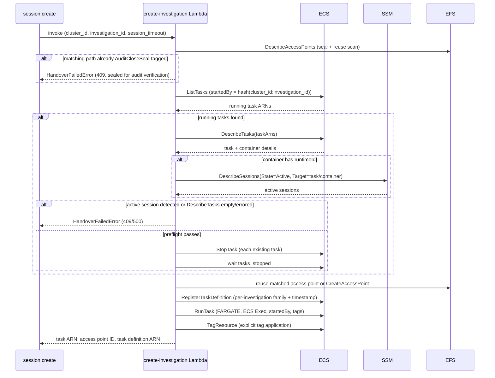

# Investigation lifecycle

An investigation is durable EFS-backed workspace state identified by a ROSA cluster ID and investigation ID. An ECS task — exposed to CLI users as a **session** — is a replaceable execution inside that workspace. The CLI groups commands accordingly: `rosa-boundary investigation {create,list,close}` manages the durable workspace, and `rosa-boundary session {create,list,join,close}` manages the running ECS task inside it (`session start`/`session stop` are retired aliases that now fail with a pointer to `session create`/`session close`). Creating a workspace, launching/replacing a session, closing a session, closing the investigation, and garbage-collecting a stale investigation are separate lifecycle operations; closing a session alone does not remove the EFS access point or workspace data. This page covers the Boundary CLI/Lambda/ECS/EFS workflow only; Trusted Actions' separate run/action execution lifecycle is documented in [Trusted Actions execution](trusted-actions-execution.md).

## Create workspace or create a session

`investigation create` (`runCreateInvestigation`) invokes the Lambda via `CreateInvestigationOnly`, which always sends `skip_task=true`. The Lambda validates the operator and request, finds an available access point with matching `ClusterID` and `InvestigationID` tags, and verifies that its root path is exactly `/<cluster-id>/<investigation-id>`. If none is found, it creates one with `sre` UID/GID ownership and investigation/owner tags. The skip-task path returns the access point without scanning for or launching ECS tasks, allowing a workspace to be prepared with no running session.

Before matching on availability, `find_existing_access_point` scans **every** page of access points for one whose `RootDirectory.Path` equals the expected `/<cluster-id>/<investigation-id>` and that already carries an `AuditCloseSeal` tag; if it finds one, it raises `HandoverFailedError` ("Workspace sealed for audit verification; contact the operator", HTTP 409) before any availability/tag matching runs. This means a workspace an operator has sealed as part of the `investigation close` audit-verification procedure (see below) cannot be reused for `investigation create`, `session create`, or task handover — sealing blocks new Lambda-driven activity on that workspace regardless of the access point's own lifecycle state. Only after this seal check passes does the Lambda fall back to ordinary matching: an `available` access point with matching `ClusterID`/`InvestigationID` tags and a root path equal to the expected path.

`session create` (`runStartSession`) invokes the same Lambda via `CreateInvestigation`, without `skip_task` (`TaskTimeoutSet: true` is always sent so an explicit `0` is distinguishable from "unset"). It may generate a three-word investigation ID, sends the target cluster, OC version, and `--session-timeout` (whole seconds, 0–24h, default 1h; carried to the Lambda as `TaskTimeout` and echoed back as both `session_timeout` and the legacy `task_timeout` JSON keys). The command derives the Boundary session ID directly from the Lambda's response — `sessionID := path.Base(lambdaResp.TaskARN)` — rather than from any dedicated identifier field, matching the convention ECS itself uses for task IDs; from that point on, any further failure in `runStartSession` is wrapped by `sessionCreationError`, which embeds the derived session ID, cluster/investigation IDs, and a ready-made `session close --yes <sessionID>` cleanup command, since a real ECS task already exists by then. The command then assumes the shared SRE role (falling back to the Lambda's own `role_arn` only when no `sre_role_arn` override is configured) and waits for the task to reach `RUNNING` unless `--no-wait` is set. The ROSA cluster ID scopes investigation state; the separately configured ECS cluster is where the task is launched and managed.

With `--no-wait`, optional OCM credential configuration is rejected outright, and `credentialWarning` is pre-populated with a reminder to configure credentials once the task is confirmed `RUNNING`. Otherwise, once the task is `RUNNING`, requested `--with-credentials ocm` setup runs; on failure `credentialWarning` is overwritten with a detailed recovery message (including a ready retry command) and `configureOCM` is forced to `false` so later step numbering reflects that credentials were not applied. Both outcomes — launched-without-credentials via `--no-wait`, and a failed or skipped OCM step — flow into `finishStartSession`, which performs the optional `--connect` handoff (see below) and assembles the final text or JSON result, folding a non-empty `credentialWarning` into a `"warnings"` JSON array or leaving it already printed as a text warning.

`runStartSession` tracks a single `credentialWarning` string: it is pre-populated when `--no-wait` launches without credential configuration, and overwritten (with `configureOCM` forced `false`) when optional OCM credential configuration fails after the task reaches `RUNNING`. `finishStartSession` folds a non-empty `credentialWarning` into the JSON result's `"warnings"` array only when `startOutputFormat == "json"`; in text mode the warning has already been printed via `output.Warning` at the point of failure, so the summary does not repeat it.

## Replace task safely

Before starting a replacement task, the Lambda finds running tasks by a deterministic `startedBy` value derived from both cluster ID and investigation ID. Before stopping any existing task, it calls `DescribeTasks`; an empty result or an ECS/SSM API error blocks handover. For returned tasks, it queries SSM for active sessions only when a container has a `runtimeId`. A detected active session blocks handover, and the full preflight runs before any task is stopped, so a detected session prevents partial stops of other tasks in the same handover. **Current behavior caveat:** if task details contain no containers, or a container has no `runtimeId`, that container is skipped without an SSM lookup and the handover can proceed to stop the task. The unit tests cover empty task details, active sessions, and SSM errors, but do not cover the missing-`runtimeId` case. If preflight passes, the Lambda stops existing tasks and waits for termination before proceeding; a stop or wait failure prevents the new task launch.

The Lambda then reuses the investigation access point or creates one (subject to the same sealed-workspace rejection described above). It registers a uniquely named task definition based on the base family plus cluster ID, investigation ID, and timestamp. This copy points `/home/sre` at the investigation access point, overlays task-scoped OCM/kubeconfig volumes, preserves unrelated mounts, and injects investigation-specific environment values. ECS `RunTask` starts Fargate with ECS Exec enabled, private-IP networking, a deterministic `startedBy`, and task tags for owner/ABAC, investigation, access point, creation time, and timeout. A deadline tag is added only when timeout is greater than zero. Tags are also applied explicitly after launch for timely IAM evaluation.

If task-definition registration or task launch fails, the Lambda cleans up a newly created access point and deregisters the new task definition where possible. If applying task tags fails after launch, it also stops the task. A reused access point is retained during rollback because it may hold existing investigation data.

*Task handover: scan for a sealed access point first (fail closed), discover running tasks by `startedBy`, preflight for active sessions, stop and wait, then reuse/create the EFS access point and relaunch.*

## Connect and inspect

`session join <session-id>` (`runJoinSession`) builds an ECS client for the configured cluster and delegates to `connectToSession`, which describes the task, waits for `RUNNING` unless `--no-wait` is set, then polls up to 30 seconds for the chosen container's ECS Exec agent (the SSM data channel closes immediately if the agent has not registered yet) before calling `ExecuteCommand` and handing control to `session-manager-plugin`.

`session create --connect` reaches the identical `connectToSession` implementation through the package-level `openInteractiveSession` variable, invoked from `finishStartSession` after the RUNNING wait and the optional OCM credential step. Connecting proceeds whether or not that credential step was requested or succeeded — success only changes the printed step label from "Step 4: Connecting to session" to "Step 5: Connecting to session"; a skipped or failed credential step leaves the connect step numbered 4 and the task still reachable with a recorded `credentialWarning`. `--connect` requires a terminal and cannot combine with `--no-wait`. Disconnecting from either `session join` or `session create --connect` only ends the interactive shell; it does not stop the task or close the investigation.

`session list` queries ECS and presents task tags (status, owner, start time) under the `session_id`/`session_arn` names, while the underlying resource remains an ECS task; `investigation list` discovers workspaces from EFS access point tags, so a workspace remains listed even when no session is running.

## Close a session, then close an investigation

`session close <session-id>` (`runStopSession`) resolves the task, rejects a target that is already `STOPPED` (pointing the operator at `investigation close` instead), prints the target investigation/owner, and — unless `--yes` is given in an interactive terminal — prompts for confirmation before calling ECS `StopTask`. `--wait` blocks for `STOPPED`; without it the command reports how to poll `session list --status all`. Closing a session stops only its task and explicitly leaves the investigation workspace open. Container shutdown is handled by the entrypoint and attempts an S3 sync, but the resulting `report.json` is explicitly marked `"status":"unverified"` by the entrypoint itself — it is evidence a human or tool can inspect, never a self-certifying record that `investigation close` can trust (see below). The reaper Lambda (`reap-tasks`) provides independent timeout enforcement: EventBridge invokes it periodically, it paginates RUNNING tasks, describes them in batches of up to 100, and stops tasks whose ISO-8601 `deadline` has passed **unless an active ECS Exec/SSM session is detected** — if that session state cannot be determined, `SessionCheckError` makes the Lambda fail closed for that task (count it as an error, not a stop) rather than guess. Tasks without deadlines, with future deadlines, with malformed deadline values, or with active sessions are skipped; per-task stop/describe failures are counted without abandoning the rest of the batch. `reap-tasks` is unrelated to the sealing mechanism described below: it only ever acts on individual ECS tasks by deadline, never on an investigation's EFS access point.

### Plan, preview, and confirmation gating

`investigation close <cluster-id> <investigation-id>` (`runCloseInvestigation`) builds a `closePlan` via `resolveClosePlan` before touching any resource: it finds the access point by investigation tag and optional cluster tag (omitting cluster ID is rejected when that investigation ID matches multiple clusters), requires the `ManagedBy=rosa-boundary-lambda` tag, requires the access point's filesystem/path to match the requested workspace, and requires the authenticated caller's token subject to match the access point's `oidc_sub` tag — only the investigation owner may close it. The plan separates sessions still to stop (`SessionIDs`) from sessions already shutting down (`SessionsWaiting`, `DesiredStatus=STOPPED`, wait-only) and from sessions ECS already reports `STOPPED` (`VisibleStopped`), and lists task definitions matching a family prefix scoped to the ECS cluster, cluster ID, and investigation ID, keeping only the ones whose mounted access point actually matches (`ActiveTaskDefinitionAccessPoint`) so a similarly prefixed, unrelated investigation's definitions are never touched. The plan also captures the access point's `AuditCloseSeal`/`AuditCloseVerified`/`AuditCloseBucket` tags (as `Seal`/`VerifiedSeal`/`Bucket`) for the receipt check described below.

If any sessions remain active or shutting down, the command refuses to continue unless `--force` or `--dry-run` is given. The plan is always printed; `--dry-run` stops there without mutating anything, reporting whether finalization would currently be blocked and why. Without `--yes`, the CLI prompts interactively (both Cobra argument validation and the handler itself require a terminal or `--dry-run` otherwise). **Immediately before mutating anything**, `closeInvestigation` re-resolves the plan a second time and aborts with "close plan changed before mutation" if `sameClosePlan` finds any difference in the seal/receipt tags, access point identity, or any of the session/task-definition lists — this exists specifically so a resource that changed while the operator was reading the confirmation prompt (a new session starting, a seal being added or removed, a task definition disappearing) cannot be silently acted on with stale information.

### Fail-fast execution and the audit-receipt gate

Execution is strictly sequential and fails closed at every step — this is not a partial-progress "warn and continue" cleanup:

1. Stop each session still marked active; a single `StopTask` failure aborts immediately, reporting how many of the total were stopped, leaving task definitions and the access point untouched.
2. Wait for `STOPPED` on both the just-stopped and already-shutting-down sessions; a wait failure also aborts, leaving task definitions and the access point untouched.
3. Check whether the investigation can be **finalized**: the plan's `blockingReason()` returns non-empty — and the command aborts, listing visible unresolved task IDs and retaining the access point and task definitions — whenever any session is still active/waiting, or the independently-verified operator receipt is missing, unreadable, or invalid. Critically, `VisibleStopped` (sessions ECS itself already reports `STOPPED`) does **not** clear this block by itself: neither ECS's own task visibility nor the task-written, self-reported `report.json` marker from the container's shutdown sync is treated as authoritative evidence that the workspace is safe to finalize. Only a receipt the CLI reads back from S3 and validates can clear the block (see below).
4. Before deregistering each task definition, and once more before the final delete, `checkBeforeCleanup` re-resolves the plan and requires it to still equal the expected state (`sameClosePlan`, with already-deregistered definitions trimmed from the expectation) **and** `blockingReason()` to still be empty; any drift — a new task appearing, the receipt becoming unreadable, a seal tag changing — aborts immediately and retains the access point.
5. Deregister each verified task definition; an individual deregistration failure aborts, leaving the access point in place.
6. After the last definition, run `checkBeforeCleanup` one final time, then delete the EFS access point.

Every abort message reports exact partial counts (e.g. "stopped N/M sessions") and points the operator at `session list --status all` or the deployment operator to reconcile before retrying. Deleting the access point never deletes its underlying EFS directory contents — the text summary explicitly states "EFS data remains; operator close receipt verified" — so `investigation close` is not a transactional filesystem purge; it only ever removes the access point and its own task definitions once an operator's independently verified receipt says the data has already been accounted for.

### The audit-receipt (seal) mechanism

Investigation close's safety model does not let the CLI decide on its own that evidence has been preserved. Before sessions are even stopped, `closePlan` carries three access-point tags verbatim: `AuditCloseSeal` (an operator-chosen UUIDv4 "hold" token), `AuditCloseVerified` (set by the operator only after independent verification, and required to equal the seal), and `AuditCloseBucket` (the regional audit bucket to read the receipt from). Once no sessions remain active or waiting, `checkReceipt` fetches `s3://<AuditCloseBucket>/_boundary-close/<access-point-id>/<seal>.json` via a dedicated `CloseReceiptReader` (capped at 16 KiB, `ExpectedBucketOwner`-pinned) and accepts it only if: `VerifiedSeal == Seal`, both look like a lowercase UUIDv4 and a syntactically valid bucket name, the JSON decodes with `schema_version == 1`, and its `cluster_id`, `investigation_id`, `access_point_id`, `seal`, and `status == "verified"` fields all match the plan exactly with a non-empty `manifest_ref`. Only then does `blockingReason()` clear and `ReceiptDigest` (a SHA-256 of the raw receipt bytes) get set; that digest is itself compared on every subsequent `sameClosePlan` check, so a receipt that changes underneath the operation (even to another "valid" receipt) is treated as drift and aborts the close.

Producing a legitimate receipt is an out-of-band deployment-operator procedure, not something the CLI or the SRE/task roles can do themselves: the operator stops writers, tags the access point with a fresh `AuditCloseSeal` (which immediately blocks `create-investigation` and `reap-investigations` from touching that workspace, as described above and in [infrastructure/regional-runtime.md](../infrastructure/regional-runtime.md)), independently verifies the investigation's evidence against an out-of-band manifest, writes the receipt object with `If-None-Match: *` (create-only), reads it back, and only then sets `AuditCloseVerified` to the same seal. IAM enforces the same rule as a backstop: the SRE shared role's `elasticfilesystem:DeleteAccessPoint` permission is conditioned on `aws:ResourceTag/AuditCloseVerified == aws:ResourceTag/AuditCloseSeal` with the seal tag required to be present — so even a defect in the CLI's own checks cannot delete an access point that IAM does not also consider sealed-and-verified. Setting only `AuditCloseSeal` without `AuditCloseVerified` creates a pure retention hold: `investigation close --dry-run` will report finalization blocked, and (per the reaper's own rule, below) the workspace is also excluded from garbage collection for as long as the seal remains.

These cleanup paths have different triggers and scopes: `investigation close` is operator-initiated, ownership-checked, and acts on one named investigation; `reap-tasks` enforces per-task deadlines; and `reap-investigations` periodically reclaims eligible investigation state. They never call one another directly, but they coordinate through the same access-point tags on shared ECS/EFS state: an `AuditCloseSeal` set as part of the close procedure makes `create-investigation` refuse new sessions on that workspace and makes `reap-investigations` skip it outright regardless of staleness, while `investigation close` itself can only finalize once `AuditCloseVerified` matches that same seal and a matching receipt is readable. `reap-tasks` is independent of all of this — it only ever evaluates individual task deadlines.

## Investigation-level garbage collection (reap-investigations)

`reap-investigations` is the investigation-level complement to the task-level `reap-tasks` reaper. It reclaims a workspace that has no matching RUNNING task and is old enough **since creation**, with a legacy exception for missing `CreatedAt`, and it defers entirely to any active audit-close seal. It runs on its own EventBridge schedule (`investigation_reaper_schedule_hours`, Terraform default every 8 hours); it does not use a task's deadline or measure how long the workspace has been idle.

Each run lists every EFS access point on the shared filesystem via `describe_access_points` (no server-side tag filter — filtering happens in the handler), then for each access point:

1. **Skips any access point already carrying an `AuditCloseSeal` tag outright**, before any other check — this is the same tag the `investigation close` audit-verification procedure sets, and it makes a sealed workspace invisible to garbage collection regardless of its age or task state. This check runs ahead of the `ManagedBy` check below.
2. Rejects access points missing the `ManagedBy=rosa-boundary-lambda` tag or missing `ClusterID`/`InvestigationID` tags, as defense-in-depth alongside the IAM policy that already restricts `DeleteAccessPoint` to that tag value and to the *absence* of `AuditCloseSeal`.
3. Validates `ClusterID` and `InvestigationID` against an allow-list pattern and rejects `.`, `..`, or embedded `/` — the same validation style used by `create-investigation` — before either is used to build a filesystem path.
4. Verifies the access point's `RootDirectory.Path` equals the expected `/<cluster-id>/<investigation-id>`, rejecting mismatches as errors rather than silently skipping.
5. Determines staleness using an initial cluster-wide RUNNING-task snapshot whose entries are matched by `cluster_id` and `investigation_id` **tags**. A matching task prevents staleness regardless of age. With no match:
   - A present, valid `CreatedAt` must satisfy `now - CreatedAt > GRACE_PERIOD_HOURS`; equality is not stale. Terraform defaults `investigation_grace_period_hours` to 168 hours (7 days) and passes it into the Lambda environment. The handler's 72-hour fallback applies only when that environment setting is absent.
   - Missing or empty `CreatedAt` is treated as legacy investigation state and is stale immediately when no task is running, regardless of the grace-period value. The implementation does not establish an idle-duration timer or require a new grace wait for legacy data.
   - A malformed or non-comparable present timestamp is counted as a staleness-check error and skipped, not treated as the missing-tag legacy branch.
6. Re-lists RUNNING tasks for this specific investigation immediately before cleanup using the same deterministic `startedBy = sha256(cluster_id:investigation_id)[:36]` scheme as `create-investigation`. A newly found task or an API error prevents cleanup for that investigation. This final check is distinct from the initial tag-based snapshot.

`create-investigation` writes `CreatedAt` when it creates an access point; reusing that point does not refresh or backfill the tag. Restarting a task therefore does not reset the age threshold. An already-old workspace, or a reused legacy workspace missing the tag, can qualify on the next reaper run after its running task stops, with no additional idle grace period.

Cleanup has ordered steps with explicit partial-progress rules:

- **Back up, then delete the EFS directory.** The handler mounts a dedicated root access point (`aws_efs_access_point.reaper`, UID/GID 0) at `/mnt/efs`, builds the investigation path, validates its resolved location stays inside the mount root, and requires EFS to be mounted. For an existing directory, a successful upload to `s3://<bucket>/<cluster_id>/<investigation_id>/reaper-final-backup/` is mandatory before `shutil.rmtree`. Missing `S3_AUDIT_BUCKET`, upload failure, or an exceeded backup deadline blocks directory deletion. The backup excludes `.config/ocm/*` and `.kube/*` and skips symlinks. An already-absent directory is treated as successfully cleaned without requiring another backup.
- **Re-verify the access point is still unsealed, directly before both the directory delete and the access-point delete.** `cleanup_allowed`/`still_unsealed` re-lists access points on the investigation's path and requires exactly one match — the same access point the scan found, with no `AuditCloseSeal` tag — plus remaining time budget. This gate runs a second time, immediately before `shutil.rmtree`, and a third time before `delete_access_point`, so a seal applied by an operator *during* the backup upload (a maintenance window opened mid-run) still defers cleanup rather than racing it.
- **Delete the EFS access point**, only after directory deletion succeeds — directory deletion must happen first because the access point's tags are the only record of where the directory lives, so deleting the access point first would make an undeleted directory unreclaimable.
- **Deregister task definitions** whose family matches `{TASK_DEFINITION_FAMILY}-{cluster_id}-{investigation_id}-<timestamp>`, with an exact `YYYYMMDDTHHMMSS` suffix and numeric ARN revision, avoiding neighboring-investigation prefix collisions. This step runs even if directory cleanup failed or access-point deletion was skipped/failed; it is the partial-progress step, not permission to bypass the backup, seal, or access-point ordering guards.

The handler checks the remaining-time budget before listing access points, before each access point in the main loop, and during backup traversal/uploads, reserving roughly 30 seconds where possible and allowing partial progress across invocations. These checks reduce timeout exposure; they do not make upload/deletion atomic or guarantee that a long individual upload or filesystem operation finishes before Lambda termination. Likewise, the final running-task recheck (step 6 above) and the final unsealed recheck each narrow a race window but are not locks against a task starting, or a seal being applied, immediately afterward. Note the asymmetry with the CLI's `investigation close`: that command aborts the whole operation on a single step's failure, while `reap-investigations` continues to the task-definition deregistration step even when directory or access-point cleanup failed or was skipped.

IAM encodes the GC/close split as a hard boundary, not just an application convention: the reaper's own role may only `DeleteAccessPoint` when `ManagedBy=rosa-boundary-lambda` **and** `AuditCloseSeal` is absent, while the SRE shared role used by `investigation close` may only `DeleteAccessPoint` when `AuditCloseVerified` equals a present `AuditCloseSeal`. The two conditions are mutually exclusive on the same tag, so an access point is always eligible for deletion by at most one of the two paths at any given time.

## How the Lambda itself reaches ECS: packaging and container build

`create-investigation` is the trigger for everything above — a Lambda Function URL invocation (SigV4-authenticated, OIDC token validated inside the handler) that the CLI and `--connect` wiring call for both `investigation create` and `session create`. How that Lambda's own code is packaged is independent of the ECS Fargate investigation container it launches (see [Container image and task runtime](../runtime/container-image.md) for that separate build), but `deploy/regional/lambda-create-investigation.tf` supports two different packaging modes for the Lambda's own deployable artifact, selected by the `lambda_package_type` Terraform variable (`"Zip"` default, or `"Image"`):

- **ZIP packaging (default).** `data.archive_file.create_investigation_lambda` zips `lambda/create-investigation/` excluding `Containerfile`, `pyproject.toml`, `uv.lock`, tests, and other non-runtime files, and `aws_lambda_function.create_investigation_zip` deploys it with the standard `python3.11` managed runtime.
- **Container image packaging.** `aws_lambda_function.create_investigation_image` deploys from an ordinary same-account regional ECR URI (`<account>.dkr.ecr.<region>.amazonaws.com/<project>/create-investigation-lambda:<lambda_image_tag>`). This mode supports HCP Terraform remote execution and requires a non-empty **40-character lowercase commit-SHA** tag. The account Terraform root owns the source ECR repository; the regional root may create a matching destination in another Region. Building in Konflux, releasing to ECR and replicating cross-Region are separate delivery steps: verify that the image exists in the Lambda's own Region before applying a pin. See `docs/runbooks/lambda-zip-to-image-migration.md`.

`lambda/create-investigation/Containerfile` builds that optional container image using AWS's "alternative base image" approach: Red Hat UBI9 Minimal instead of the AWS-provided Lambda base, because Konflux Enterprise Contract policy rejects non-Red Hat base images. It has two stages, both from the same digest-pinned `BASE_IMAGE` to keep glibc ABI compatible with compiled wheels:

1. **`builder`** installs Python 3.11 plus `gcc`/`libffi-devel`/dev headers, copies in a pinned `uv` binary, then runs `uv export --frozen --no-dev --no-emit-project` against `pyproject.toml`/`uv.lock` to produce a pip-compatible lockfile and `pip install`s those pinned wheels into `/deps`. Exporting from the lockfile (rather than installing from `pyproject.toml` directly) keeps the image's dependency set frozen to exactly what `uv.lock` records, including transitive pins.
2. **The final stage** installs only the bare Python 3.11 interpreter (no compiler, no `pip`), copies `/deps` and `handler.py` from the builder, sets `LAMBDA_TASK_ROOT=/var/task` and `PYTHONPATH`, and runs the handler through `awslambdaric` (`ENTRYPOINT ["python3.11", "-m", "awslambdaric"]`, `CMD ["handler.lambda_handler"]`) — the pip-installed AWS Lambda Runtime Interface Client that replaces the bootstrap the official AWS base image would otherwise supply. The Containerfile deliberately omits a `USER` directive: AWS Lambda overrides the container's runtime identity with its own non-root user regardless, so a `USER` instruction would have no effect; this is unrelated to the investigation container's own `sre`-user requirement.

`pyproject.toml` pins the Lambda's runtime dependencies — `PyJWT`, `cryptography`, `requests`, `boto3`, and `awslambdaric==4.2.3` — with a separate `dev` group (`moto[ecs,efs,iam,kms,s3,sts]`, `pytest`, `pytest-cov`, `pytest-mock`) that `--no-dev`/`--no-emit-project` excludes from both the ZIP package and the container image; only `handler.py` and its pinned runtime dependencies ship. The Lambda's own `Makefile` mirrors this for local work: `make deps`/`make build`/`make package` produce the ZIP artifact (installing dependencies inside the official `public.ecr.aws/lambda/python:3.11` image for Linux-compatible wheels), while `make build-image`/`make push-image` build and publish the optional container image from the same `Containerfile`. Both packaging paths ship identical handler logic — the ZIP/image choice affects only how the Lambda's code and dependencies are delivered to AWS Lambda, not the trigger, authentication, EFS access-point, or ECS task-launch behavior documented above.

## Failure boundaries and tests

Lambda unit tests cover skip-task behavior, access-point reuse, the sealed-workspace rejection, handover guards, task definition shaping, and rollback differences for newly created versus reused access points. For the handover guard, they cover empty task details and active-session/SSM-error failures, but not a task whose container lacks `runtimeId`. `close_investigation_test.go` covers owner-tag rejection and acceptance, malformed/missing ID-token subject claims, family-prefix scoping that excludes neighboring investigations, and `sameClosePlan` detecting both a newly appeared session and a session transitioning into the shutting-down state — the checks that gate the pre-mutation re-resolve. `close_gate_test.go` separately drives `checkReceipt`/`blockingReason` through every rejection path (unreadable object, wrong schema version, wrong cluster/investigation/access-point identity, stale seal, a self-reported "uploaded" transfer status instead of an operator "verified" one, an empty manifest reference, and trailing bytes after the JSON object) plus seal/bucket tag mutations and an in-flight session reappearing. The `reap-investigations` unit tests cover the happy-path reap, running-task and grace-period skips, strict age boundaries, legacy missing timestamps at zero/nonzero grace values, tag/path validation failures, partial-failure cleanup rules, required S3 backup configuration and failure/exclusion behavior, pagination, and the `AuditCloseSeal` skip/defer behavior. A separate pytest module under `tests/unit/` checks legacy eligibility and matching-task protection, 168-hour ages, and unrelated-task filtering; the Lambda Make targets do not discover that module. See [testing and verification](../testing/verification.md). LocalStack integration tests check EFS/ECS relationships, `investigation close` ownership/ambiguity/IAM-policy scoping and the full seal/receipt gate, task-definition family scoping, and the end-to-end deadline-tag/reaper path. Slow cases that require a task to reach `RUNNING` are skipped with LocalStack's local ECS executor.

## Related pages

- [System overview and boundaries](../architecture/system-overview.md) places the Lambda-triggered creation flow within the CLI/Lambda/ECS request path as a whole.
- [Identity and access](../architecture/identity-and-access.md) covers the shared SRE role, ABAC conditions, and the IAM policies (including the `AuditCloseSeal`/`AuditCloseVerified` conditions) referenced above.
- [Regional runtime infrastructure](../infrastructure/regional-runtime.md) details the EFS mounts, IAM conditions, and ordered reaping steps that back this page's GC description.
- [Container image and task runtime](../runtime/container-image.md) covers the separate build and runtime behavior of the ECS Fargate investigation container that `create-investigation` launches — distinct from the Lambda's own packaging covered above.
- [ROSA Boundary auditing and logging flows](../operations/audit-and-logging.md) covers how investigation sessions (ECS Exec transcripts, container shutdown sync, Lambda logs, reaper backups, and the close receipt) are audited across this lifecycle.
- [Testing and verification](../testing/verification.md) covers the unit, Make-target, and LocalStack integration coverage summarized above.

## Evidence-backed claims

- Workspace-only creation uses `skip_task` to make/reuse an EFS access point without launching a task. [skip-task branching and access-point reuse/creation](repo://lambda/create-investigation/handler.py#L728-L872) · [unit tests](repo://lambda/create-investigation/test_handler.py#L880-L1031)
- Before matching an existing access point by availability, tags, and path, `find_existing_access_point` scans every page for one on the expected path already carrying an `AuditCloseSeal` tag and rejects the whole request with a 409 `HandoverFailedError` if found; only once that seal check passes does ordinary matching (available state, matching cluster/investigation tags, expected root path) run. [seal check and reuse matching](repo://lambda/create-investigation/handler.py#L473-L515)
- Task replacement uses deterministic `startedBy` discovery and checks SSM sessions only for containers with a `runtimeId`; empty task details, detected active sessions, and ECS/SSM API errors fail closed, but missing `runtimeId` skips that session lookup and can allow stopping. The handover tests cover the fail-closed cases but not missing `runtimeId`. [discovery](repo://lambda/create-investigation/handler.py#L33-L47) · [conditional session lookup and stop sequence](repo://lambda/create-investigation/handler.py#L743-L826) · [handover tests](repo://lambda/create-investigation/test_handler.py#L1418-L1693)
- The Lambda derives a per-investigation task definition with a unique family, investigation-specific EFS and task-scoped credential mounts, and launches Fargate with ECS Exec and investigation/deadline tags. [task definition registration](repo://lambda/create-investigation/handler.py#L521-L690) · [ECS launch and tags](repo://lambda/create-investigation/handler.py#L874-L1002)
- Rollback removes newly created access points, and tag-application failure also stops an already launched task; reused access points are preserved. [registration-failure cleanup](repo://lambda/create-investigation/handler.py#L895-L914) · [tag-failure cleanup](repo://lambda/create-investigation/handler.py#L1003-L1045) · [reused access-point rollback test](repo://lambda/create-investigation/test_handler.py#L2277-L2343)
- The reaper processes RUNNING tasks, stopping expired deadlines only when no active Exec session is detected, and skipping absent, future, or malformed values; when session state cannot be determined it raises `SessionCheckError` and fails closed (counted as an error, not a stop) rather than guessing. [schedule](repo://deploy/regional/lambda-reap-tasks.tf#L42-L66) · [reaper behavior and fail-closed SessionCheckError](repo://lambda/reap-tasks/handler.py#L40-L175)
- `session join` and `session create --connect` share one connect implementation (`connectToSession`), which waits for task and ECS Exec agent readiness before opening the SSM session and handing off to `session-manager-plugin`; the `--connect` handoff in `finishStartSession` runs after the optional OCM credential step and proceeds regardless of whether that step succeeded, only changing the printed step number; `session close` only stops the task, never the investigation. [join entrypoint](repo://internal/cmd/join_session.go#L22-L44) · [shared wait/connect sequence](repo://internal/cmd/join_session.go#L56-L111) · [finishStartSession connect handoff](repo://internal/cmd/start_session.go#L194-L208) · [session close leaves investigation open](repo://internal/cmd/stop_session.go#L23-L88)
- `session create`'s session ID is derived from `path.Base` of the Lambda's returned task ARN rather than a dedicated identifier field, and every failure from that point on is wrapped with a cleanup-command-bearing error so the operator is pointed at the already-created task. [sessionID derivation and deferred wrapping](repo://internal/cmd/start_session.go#L79-L86) · [sessionCreationError](repo://internal/cmd/start_session.go#L223-L226)
- `runStartSession` tracks a single `credentialWarning` string across `--no-wait` launches and failed OCM credential configuration, then `finishStartSession` folds a non-empty warning into the JSON result's `warnings` array (text mode prints it immediately via `output.Warning`). [credentialWarning assignment paths](repo://internal/cmd/start_session.go#L170-L186) · [JSON warnings assembly](repo://internal/cmd/start_session.go#L210-L215)
- `investigation close` requires the authenticated caller to be the investigation owner (`oidc_sub` tag match) and a Lambda-managed, path-matched access point before planning any cleanup, verifies each candidate task definition's mounted access point before including it, and requires `--force` or `--dry-run` when sessions are active or shutting down. [owner/ManagedBy checks and verified task-definition plan](repo://internal/cmd/close_investigation.go#L279-L332)
- `investigation close` re-resolves its plan immediately before mutating and aborts if the plan (including seal/receipt tags) changed since the confirmation prompt, then executes stop/wait/deregister/delete strictly sequentially, aborting the whole command on the first failed step rather than warning and continuing; only full success reaches the final `DeleteAccessPoint` call. [fail-fast confirm/re-resolve/stop/wait/deregister/delete sequence](repo://internal/cmd/close_investigation.go#L86-L167)
- Neither an ECS-visible `STOPPED` task nor the investigation container's self-reported (`"status":"unverified"`) S3 sync report is treated as authoritative evidence that a workspace may be finalized; `blockingReason()` only clears once `checkReceipt` has validated an independently written, schema-matched, `"status":"verified"` operator receipt read back from S3, and that receipt's digest is itself compared on every later re-resolve. [blockingReason and VisibleStopped exclusion](repo://internal/cmd/close_investigation.go#L134-L153) · [checkReceipt validation](repo://internal/cmd/close_investigation.go#L194-L224) · [CloseReceiptReader](repo://internal/aws/close_receipt.go#L13-L46) · [task-written unverified marker](repo://entrypoint.sh#L21-L56) · [receipt-gate tests](repo://internal/cmd/close_gate_test.go#L19-L60)
- IAM enforces the same seal/receipt rule as a backstop: the SRE shared role may only call `DeleteAccessPoint` when `aws:ResourceTag/AuditCloseVerified` equals a present `aws:ResourceTag/AuditCloseSeal`, independent of whatever the CLI itself checks. [IAM DeleteAccessPoint condition](repo://deploy/regional/iam.tf#L239-L250)
- Investigation listing enumerates tagged EFS access points independently of whether an ECS task is running, so a workspace with no running session still appears with its lifecycle state; `investigation close` never deletes the underlying EFS directory data, only the access point and its own task definitions. [tag-based listing](repo://internal/aws/efs.go#L103-L141) · [close execution](repo://internal/cmd/close_investigation.go#L122-L167) · [list command](repo://internal/cmd/list_investigations.go#L36-L53)
- Operator-initiated `investigation close`, scheduled per-task deadline reaping (`reap-tasks`), and scheduled investigation GC (`reap-investigations`) have distinct triggers and scopes and never call one another directly, but they coordinate through `AuditCloseSeal`/`AuditCloseVerified` access-point tags: a seal set by the close procedure makes `create-investigation` refuse new sessions and makes `reap-investigations` skip the workspace outright, while close itself can only finalize once a matching `AuditCloseVerified` and a readable receipt exist. [close workflow](repo://internal/cmd/close_investigation.go#L279-L332) · [reap-investigations seal skip](repo://lambda/reap-investigations/handler.py#L136-L226) · [create-investigation seal rejection](repo://lambda/create-investigation/handler.py#L489-L495) · [reap-tasks is independent](repo://lambda/reap-tasks/handler.py#L48-L175)
- Close-investigation preserves underlying EFS directory data while deleting its access point and requires an operator's independently verified receipt before doing so, whereas investigation GC discovers work solely by enumerating and filtering access points and defers entirely to an active seal. Once the last matching access point is gone, that retained directory is not discoverable by the reaper's current scan, so close does not itself arrange a later final backup or directory purge — the audit-receipt procedure is what is meant to ensure evidence was captured beforehand. [access-point deletion only](repo://internal/cmd/close_investigation.go#L165-L167) · [EFS data retained in summary](repo://internal/cmd/close_investigation.go#L226-L230) · [access-point-only discovery and seal skip](repo://lambda/reap-investigations/handler.py#L136-L187) · [access-point listing](repo://lambda/reap-investigations/handler.py#L439-L468)
- Investigation GC is independently scheduled, skips any access point already carrying an `AuditCloseSeal` tag before any other check, and otherwise filters managed, identifier-validated, path-matched access points. The initial task snapshot is tag-based; eligibility requires no match plus strict creation age or missing `CreatedAt`, followed by a final `startedBy` task recheck. [schedule](repo://deploy/regional/lambda-reap-investigations.tf#L216-L239) · [seal skip and tag/path validation](repo://lambda/reap-investigations/handler.py#L136-L187) · [age and legacy branch](repo://lambda/reap-investigations/handler.py#L259-L328) · [initial task snapshot](repo://lambda/reap-investigations/handler.py#L331-L374) · [final query and recheck](repo://lambda/reap-investigations/handler.py#L214-L226)
- Successful backup is required before deleting an existing directory; `cleanup_allowed`/`still_unsealed` re-verifies the access point remains the sole, unsealed match on its path immediately before both the directory delete and the access-point delete, deferring cleanup rather than racing an operator's in-flight seal; access-point deletion depends on directory cleanup, while exact-family task-definition deregistration is still attempted after earlier failures — unlike `investigation close`, which aborts the whole command on the first failed step. [still_unsealed/cleanup_allowed](repo://lambda/reap-investigations/handler.py#L471-L483) · [directory delete and backup guard](repo://lambda/reap-investigations/handler.py#L673-L733) · [ordered reap steps](repo://lambda/reap-investigations/handler.py#L486-L526) · [exact-family deregistration](repo://lambda/reap-investigations/handler.py#L760-L825)
- The IAM policies backing the two reapers are mutually exclusive on the same tag: the GC reaper's role may only delete an access point when `AuditCloseSeal` is absent, while the SRE shared role used by `investigation close` may only delete one when `AuditCloseVerified` equals a present `AuditCloseSeal`. [reap-investigations EFS policy](repo://deploy/regional/lambda-reap-investigations.tf#L46-L71) · [close EFS policy](repo://deploy/regional/iam.tf#L236-L250)
- The access-point creation timestamp is written once on creation and is not refreshed/backfilled on reuse; it is not a last-task-stop timestamp, so restarting or stopping a task never resets the investigation's creation-age threshold. [reuse and creation tags](repo://lambda/create-investigation/handler.py#L820-L857) · [age and legacy branch](repo://lambda/reap-investigations/handler.py#L259-L328)
- The Lambda reaper unit-test suite covers strict grace-period boundaries, missing timestamps at zero/nonzero grace, and backup configuration/failure guards; a separate `tests/unit/` pytest module covers legacy eligibility, matching-task protection, 168-hour ages, and unrelated-task filtering, and is not discovered by the Lambda's own Make targets. [Make targets](repo://Makefile#L174-L189) · [backup guard tests](repo://lambda/reap-investigations/test_handler.py#L1156-L1203) · [grace-period boundary tests](repo://lambda/reap-investigations/test_handler.py#L960-L992) · [legacy-timestamp tests](repo://lambda/reap-investigations/test_handler.py#L860-L877) · [separate pytest module](repo://tests/unit/test_reap_investigations_staleness.py#L58-L160)
- The investigation reaper checks its remaining time budget before listing access points, before each access point in the main loop, and throughout backup traversal/uploads, allowing partial progress across invocations; these checks reduce but do not eliminate timeout exposure and do not make an individual upload or the filesystem deletion atomic. Its final running-task recheck and final unsealed recheck each narrow, but do not close, a race with a task launching or a seal being applied immediately afterward. [top-level and per-access-point deadline checks](repo://lambda/reap-investigations/handler.py#L117-L140) · [final task recheck before reap](repo://lambda/reap-investigations/handler.py#L214-L226) · [backup traversal budget](repo://lambda/reap-investigations/handler.py#L552-L632) · [cleanup_allowed re-check](repo://lambda/reap-investigations/handler.py#L481-L483)
- The create-investigation Lambda Terraform variable selects default ZIP (Python 3.11 managed runtime) or Image packaging. Image mode derives an ordinary ECR URI in the Lambda account and Region and requires an immutable lowercase 40-character commit-SHA tag. [packaging selection](repo://deploy/regional/lambda-create-investigation.tf#L11-L41) · [image deployment](repo://deploy/regional/lambda-create-investigation.tf#L83-L136) · [variable](repo://deploy/regional/variables.tf#L121-L141)
- The account Terraform root owns the source Lambda image ECR repository; the regional root optionally creates a matching destination repository in another Region, while image-mode Lambda uses the same-account regional ECR URI. Image build, release, cross-Region replication, and Terraform pinning are separate steps. [source repository](repo://deploy/account/ecr-lambda.tf) · [destination repository](repo://deploy/regional/ecr-lambda-destination.tf#L1-L41) · [Lambda ECR reference](repo://deploy/regional/lambda-create-investigation.tf#L11-L23) · [delivery steps](repo://docs/staging-deployment.md#L121-L148)
- The optional Lambda image Containerfile uses a digest-pinned UBI9 Minimal base in both builder and final stages; the builder exports frozen runtime dependencies from `uv.lock` and installs wheels into `/deps`, while the final stage ships a bare Python 3.11 interpreter with the copied handler/dependencies and uses `awslambdaric` as the Lambda Runtime Interface Client. [stage setup](repo://lambda/create-investigation/Containerfile#L1-L35) · [builder export/install](repo://lambda/create-investigation/Containerfile#L50-L87) · [final stage entrypoint](repo://lambda/create-investigation/Containerfile#L99-L139)
- The Containerfile intentionally omits a `USER` directive because AWS Lambda always overrides the container's runtime identity with its own non-root user regardless of what the image specifies, which is unrelated to the separate ECS Fargate investigation container's own `sre`-user privilege-drop requirement. [no USER directive](repo://lambda/create-investigation/Containerfile#L21-L26)
- `pyproject.toml` pins runtime dependencies (`PyJWT`, `cryptography`, `requests`, `boto3`, `awslambdaric==4.2.3`) separately from a `dev` dependency group (`moto[ecs,efs,iam,kms,s3,sts]`, `pytest`, `pytest-cov`, `pytest-mock`); both the ZIP export and the container-image builder stage use `--no-dev --no-emit-project` so only runtime dependencies and `handler.py` ship in either packaging mode. [ZIP exclusions](repo://deploy/regional/lambda-create-investigation.tf#L26-L51) · [builder export flags](repo://lambda/create-investigation/Containerfile#L82-L86) · [dependency groups](repo://lambda/create-investigation/pyproject.toml#L1-L18)
- The Lambda's own `Makefile` builds the ZIP artifact by installing dependencies inside the official `public.ecr.aws/lambda/python:3.11` image for Linux-compatible wheels (`make deps`/`build`/`package`), and separately builds and pushes the optional container image from the same `Containerfile` via `build-image`/`push-image`; both packaging paths ship identical `handler.py` logic, so the ZIP/image choice affects only delivery of the Lambda's code, not its trigger, authentication, EFS access-point, or ECS task-launch behavior. [image targets](repo://lambda/create-investigation/Makefile#L144-L162) · [ZIP build targets](repo://lambda/create-investigation/Makefile#L54-L120)
