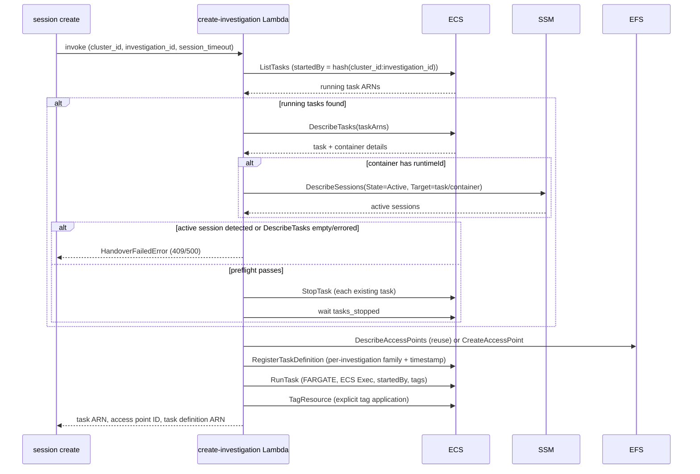

# Investigation lifecycle

An investigation is durable EFS-backed workspace state identified by a ROSA cluster ID and investigation ID. An ECS task — exposed to CLI users as a **session** — is a replaceable execution inside that workspace. The CLI groups commands accordingly: `rosa-boundary investigation {create,list,close}` manages the durable workspace, and `rosa-boundary session {create,list,join,close}` manages the running ECS task inside it (`session start`/`session stop` are retired aliases that now fail with a pointer to `session create`/`session close`). Creating a workspace, launching/replacing a session, closing a session, closing the investigation, and garbage-collecting a stale investigation are separate lifecycle operations; closing a session alone does not remove the EFS access point or workspace data.

## Create workspace or create a session

`investigation create` invokes the Lambda with `skip_task=true`. The Lambda validates the operator and request, finds an available access point with matching `ClusterID` and `InvestigationID` tags, and verifies that its root path is exactly `/<cluster-id>/<investigation-id>`. If none is found, it creates one with `sre` UID/GID ownership and investigation/owner tags. The skip-task path returns the access point without scanning for or launching ECS tasks, allowing a workspace to be prepared with no running session.

`session create` invokes the same Lambda without `skip_task`. It may generate a three-word investigation ID, sends the target cluster, OC version, and `--session-timeout` (whole seconds, 0–24h, default 1h; still carried to the Lambda as `TaskTimeout` and echoed back as both `session_timeout` and the legacy `task_timeout` JSON keys), then assumes the shared SRE role and waits for the task to reach `RUNNING` unless `--no-wait` is set. The ROSA cluster ID scopes investigation state; the separately configured ECS cluster is where the task is launched and managed. `--connect` (requires a terminal, and cannot combine with `--no-wait`) joins the session immediately after any requested `--with-credentials ocm` setup succeeds, by calling the same `connectToSession` logic used by `session join`.

## Replace task safely

Before starting a replacement task, the Lambda finds running tasks by a deterministic `startedBy` value derived from both cluster ID and investigation ID. Before stopping any existing task, it calls `DescribeTasks`; an empty result or an ECS/SSM API error blocks handover. For returned tasks, it queries SSM for active sessions only when a container has a `runtimeId`. A detected active session blocks handover, and the full preflight runs before any task is stopped, so a detected session prevents partial stops of other tasks in the same handover. **Current behavior caveat:** if task details contain no containers, or a container has no `runtimeId`, that container is skipped without an SSM lookup and the handover can proceed to stop the task. The unit tests cover empty task details, active sessions, and SSM errors, but do not cover the missing-`runtimeId` case. If preflight passes, the Lambda stops existing tasks and waits for termination before proceeding; a stop or wait failure prevents the new task launch.

The Lambda then reuses the investigation access point or creates one. It registers a uniquely named task definition based on the base family plus cluster ID, investigation ID, and timestamp. This copy points `/home/sre` at the investigation access point, overlays task-scoped OCM/kubeconfig volumes, preserves unrelated mounts, and injects investigation-specific environment values. ECS `RunTask` starts Fargate with ECS Exec enabled, private-IP networking, a deterministic `startedBy`, and task tags for owner/ABAC, investigation, access point, creation time, and timeout. A deadline tag is added only when timeout is greater than zero. Tags are also applied explicitly after launch for timely IAM evaluation.

If task-definition registration or task launch fails, the Lambda cleans up a newly created access point and deregisters the new task definition where possible. If applying task tags fails after launch, it also stops the task. A reused access point is retained during rollback because it may hold existing investigation data.

*Task handover: discover running tasks by `startedBy`, preflight for active sessions, stop and wait, then reuse/create the EFS access point and relaunch.*

## Connect and inspect

`session join <session-id>` (`runJoinSession`) builds an ECS client for the configured cluster and delegates to `connectToSession`, which describes the task, waits for `RUNNING` unless `--no-wait` is set, then polls up to 30 seconds for the chosen container's ECS Exec agent (the SSM data channel closes immediately if the agent has not registered yet) before calling `ExecuteCommand` and handing control to `session-manager-plugin`. `session create --connect` calls the same `connectToSession` function (wired through the package-level `openInteractiveSession` variable) from `finishStartSession` after any requested credential setup succeeds, so both paths share identical wait/connect behavior; disconnecting from either only ends the interactive shell; it does not stop the task or close the investigation. `session list` queries ECS and presents task tags (status, owner, start time) under the `session_id`/`session_arn` names, while the underlying resource remains an ECS task; `investigation list` discovers workspaces from EFS access point tags, so a workspace remains listed even when no session is running.

## Close a session, then close an investigation

`session close <session-id>` (`runStopSession`) resolves the task, rejects a target that is already `STOPPED` (pointing the operator at `investigation close` instead), prints the target investigation/owner, and — unless `--yes` is given in an interactive terminal — prompts for confirmation before calling ECS `StopTask`. `--wait` blocks for `STOPPED`; without it the command reports how to poll `session list --status all`. Closing a session stops only its task and explicitly leaves the investigation workspace open. Container shutdown is handled by the entrypoint and attempts the S3 audit sync. The reaper Lambda (`reap-tasks`) provides independent timeout enforcement: EventBridge invokes it periodically, it paginates RUNNING tasks, describes them in batches of up to 100, and stops tasks whose ISO-8601 `deadline` has passed **unless an active ECS Exec/SSM session is detected**. Tasks without deadlines, with future deadlines, with malformed deadline values, or with active sessions are skipped; per-task stop/describe failures are counted without abandoning the rest of the batch.

`investigation close <cluster-id> <investigation-id>` (`runCloseInvestigation`) builds a `closePlan` via `resolveClosePlan` before touching any resource: it finds the access point by investigation tag and optional cluster tag (omitting cluster ID is rejected when that investigation ID matches multiple clusters), requires the `ManagedBy=rosa-boundary-lambda` tag, and requires the authenticated caller's token subject to match the access point's `oidc_sub` tag — only the investigation owner may close it. The plan separates sessions still to stop from sessions already shutting down (`DesiredStatus=STOPPED`, wait-only), and lists task definitions matching a family prefix scoped to the ECS cluster, cluster ID, and investigation ID, keeping only the ones whose mounted access point actually matches (`TaskDefinitionAccessPoint`) so a similarly prefixed, unrelated investigation's definitions are never touched. If any sessions remain active or shutting down, the command refuses to continue unless `--force` or `--dry-run` is given. The plan is always printed; `--dry-run` stops there without mutating anything. Without `--yes`, the CLI prompts interactively (both Cobra argument validation and the handler itself require a terminal or `--dry-run` otherwise), then **re-resolves the plan immediately before mutating** and aborts if it changed since the prompt, to avoid acting on resources that changed concurrently.

Execution is strictly sequential and fails closed at every step — this is not a partial-progress "warn and continue" cleanup:

1. Stop each session still marked active; a single `StopTask` failure aborts immediately, reporting how many of the total were stopped.
2. Wait for `STOPPED` on both the just-stopped and already-shutting-down sessions; a wait failure also aborts (task definitions and the access point are left untouched).
3. Re-list tasks for the investigation; a new or errored task here aborts, since a session may have started during the wait.
4. Deregister each verified task definition; any individual deregistration failure aborts, leaving the access point in place.
5. Re-list tasks once more before deletion; any task found aborts and the access point is preserved.
6. Delete the EFS access point.

Every abort message reports exact partial counts (e.g. "stopped N/M sessions") and points the operator at `session list --status all` or the deployment operator to reconcile before retrying. Deleting the access point never deletes its underlying EFS directory contents — the final summary explicitly states "EFS data remains; verify audit evidence separately" — so `investigation close` is not a transactional filesystem purge.

These cleanup paths have different triggers and scopes: `investigation close` is operator-initiated, ownership-checked, and acts on one named investigation; `reap-tasks` enforces per-task deadlines; and `reap-investigations` periodically reclaims eligible investigation state. They do not invoke one another, but they share ECS/EFS state. In particular, deleting the last matching access point through `investigation close` removes the discovery record that the investigation reaper needs to locate the retained directory. The reaper enumerates access points, not orphan directories, so do not assume that close arranges a later final backup or directory deletion.

## Investigation-level garbage collection (reap-investigations)

`reap-investigations` is the investigation-level complement to the task-level `reap-tasks` reaper. It reclaims a workspace that has no matching RUNNING task and is old enough **since creation**, with a legacy exception for missing `CreatedAt`. It runs on its own EventBridge schedule (`investigation_reaper_schedule_hours`, Terraform default every 8 hours); it does not use a task's deadline or measure how long the workspace has been idle.

Each run lists every EFS access point on the shared filesystem via `describe_access_points` (no server-side tag filter — filtering happens in the handler), then for each access point:

1. Rejects access points missing the `ManagedBy=rosa-boundary-lambda` tag or missing `ClusterID`/`InvestigationID` tags, as defense-in-depth alongside the IAM policy that already restricts `DeleteAccessPoint` to that tag value.
2. Validates `ClusterID` and `InvestigationID` against an allow-list pattern and rejects `.`, `..`, or embedded `/` — the same validation style used by `create-investigation` — before either is used to build a filesystem path.
3. Verifies the access point's `RootDirectory.Path` equals the expected `/<cluster-id>/<investigation-id>`, rejecting mismatches as errors rather than silently skipping.
4. Determines staleness using an initial cluster-wide RUNNING-task snapshot whose entries are matched by `cluster_id` and `investigation_id` **tags**. A matching task prevents staleness regardless of age. With no match:
   - A present, valid `CreatedAt` must satisfy `now - CreatedAt > GRACE_PERIOD_HOURS`; equality is not stale. Terraform defaults `investigation_grace_period_hours` to 168 hours (7 days) and passes it into the Lambda environment. The handler's 72-hour fallback applies only when that environment setting is absent.
   - Missing or empty `CreatedAt` is treated as legacy investigation state and is stale immediately when no task is running, regardless of the grace-period value. The implementation does not establish an idle-duration timer or require a new grace wait for legacy data.
   - A malformed or non-comparable present timestamp is counted as a staleness-check error and skipped, not treated as the missing-tag legacy branch.
5. Re-lists RUNNING tasks for this specific investigation immediately before cleanup using the same deterministic `startedBy = sha256(cluster_id:investigation_id)[:36]` scheme as `create-investigation`. A newly found task or an API error prevents cleanup for that investigation. This final check is distinct from the initial tag-based snapshot.

`create-investigation` writes `CreatedAt` when it creates an access point; reusing that point does not refresh or backfill the tag. Restarting a task therefore does not reset the age threshold. An already-old workspace, or a reused legacy workspace missing the tag, can qualify on the next reaper run after its running task stops, with no additional idle grace period.

Cleanup has ordered steps with explicit partial-progress rules:

- **Back up, then delete the EFS directory.** The handler mounts a dedicated root access point (`aws_efs_access_point.reaper`, UID/GID 0) at `/mnt/efs`, builds the investigation path, validates its resolved location stays inside the mount root, and requires EFS to be mounted. For an existing directory, a successful upload to `s3://<bucket>/<cluster_id>/<investigation_id>/reaper-final-backup/` is mandatory before `shutil.rmtree`. Missing `S3_AUDIT_BUCKET`, upload failure, or an exceeded backup deadline blocks directory deletion. The backup excludes `.config/ocm/*` and `.kube/*` and skips symlinks. An already-absent directory is treated as successfully cleaned without requiring another backup.
- **Delete the EFS access point**, only after directory deletion succeeds — directory deletion must happen first because the access point's tags are the only record of where the directory lives, so deleting the access point first would make an undeleted directory unreclaimable.
- **Deregister task definitions** whose family matches `{TASK_DEFINITION_FAMILY}-{cluster_id}-{investigation_id}-<timestamp>`, with an exact `YYYYMMDDTHHMMSS` suffix and numeric ARN revision, avoiding neighboring-investigation prefix collisions. This step runs even if directory cleanup failed or access-point deletion was skipped/failed; it is the partial-progress step, not permission to bypass the backup or access-point ordering guards.

The handler checks the remaining-time budget before each access point and during backup traversal/uploads, reserving roughly 30 seconds where possible and allowing partial progress across invocations. These checks reduce timeout exposure; they do not make upload/deletion atomic or guarantee that a long individual upload or filesystem operation finishes before Lambda termination. Likewise, the final running-task recheck narrows a race window but is not a lock against a task starting afterward. Note the asymmetry with the CLI's `investigation close`: that command aborts the whole operation on a single step's failure, while `reap-investigations` continues to the task-definition deregistration step even when directory or access-point cleanup failed or was skipped.

## How the Lambda itself reaches ECS: packaging and container build

`create-investigation` is the trigger for everything above — a Lambda Function URL invocation (SigV4-authenticated, OIDC token validated inside the handler) that the CLI and `--connect` wiring call for both `investigation create` and `session create`. How that Lambda's own code is packaged is independent of the ECS Fargate investigation container it launches (see [Container image and task runtime](../runtime/container-image.md) for that separate build), but `deploy/regional/lambda-create-investigation.tf` supports two different packaging modes for the Lambda's own deployable artifact, selected by the `lambda_package_type` Terraform variable (`"Zip"` default, or `"Image"`):

- **ZIP packaging (default).** `data.archive_file.create_investigation_lambda` zips `lambda/create-investigation/` excluding `Containerfile`, `pyproject.toml`, `uv.lock`, tests, and other non-runtime files, and `aws_lambda_function.create_investigation_zip` deploys it with the standard `python3.11` managed runtime.
- **Container image packaging.** `aws_lambda_function.create_investigation_image` instead deploys from `image_uri`, built from the resolved ECR pull-through-cache path (`<account>.dkr.ecr.<region>.amazonaws.com/<project>-quay/<lambda_image_repository>:<lambda_image_tag>`). This mode exists for HCP Terraform remote-execution compatibility and requires `lambda_image_repository` and a non-empty, immutable `lambda_image_tag` (a git SHA or release version, not `latest` — Lambda resolves the tag to a digest at deploy time and will not notice if the tag later moves). The `aws_ecr_pull_through_cache_rule.quay` resource only maps the project-scoped ECR prefix to `quay.io`; it does not pull images on demand, so the image must already be copied into ECR (e.g. via `skopeo`) before `terraform apply` creates the Lambda function — see `docs/runbooks/lambda-zip-to-image-migration.md`.

`lambda/create-investigation/Containerfile` builds that optional container image using AWS's "alternative base image" approach: Red Hat UBI9 Minimal instead of the AWS-provided Lambda base, because Konflux Enterprise Contract policy rejects non-Red Hat base images. It has two stages, both from the same digest-pinned `BASE_IMAGE` to keep glibc ABI compatible with compiled wheels:

1. **`builder`** installs Python 3.11 plus `gcc`/`libffi-devel`/dev headers, copies in a pinned `uv` binary, then runs `uv export --frozen --no-dev --no-emit-project` against `pyproject.toml`/`uv.lock` to produce a pip-compatible lockfile and `pip install`s those pinned wheels into `/deps`. Exporting from the lockfile (rather than installing from `pyproject.toml` directly) keeps the image's dependency set frozen to exactly what `uv.lock` records, including transitive pins.
2. **The final stage** installs only the bare Python 3.11 interpreter (no compiler, no `pip`), copies `/deps` and `handler.py` from the builder, sets `LAMBDA_TASK_ROOT=/var/task` and `PYTHONPATH`, and runs the handler through `awslambdaric` (`ENTRYPOINT ["python3.11", "-m", "awslambdaric"]`, `CMD ["handler.lambda_handler"]`) — the pip-installed AWS Lambda Runtime Interface Client that replaces the bootstrap the official AWS base image would otherwise supply. The Containerfile deliberately omits a `USER` directive: AWS Lambda overrides the container's runtime identity with its own non-root user regardless, so a `USER` instruction would have no effect; this is unrelated to the investigation container's own `sre`-user requirement.

`pyproject.toml` pins the Lambda's runtime dependencies — `PyJWT`, `cryptography`, `requests`, `boto3`, and `awslambdaric==4.2.3` — with a separate `dev` group (`moto[ecs,efs,iam,kms,s3,sts]`, `pytest`, `pytest-cov`, `pytest-mock`) that `--no-dev`/`--no-emit-project` excludes from both the ZIP package and the container image; only `handler.py` and its pinned runtime dependencies ship. The Lambda's own `Makefile` mirrors this for local work: `make deps`/`make build`/`make package` produce the ZIP artifact (installing dependencies inside the official `public.ecr.aws/lambda/python:3.11` image for Linux-compatible wheels), while `make build-image`/`make push-image` build and publish the optional container image from the same `Containerfile`. Both packaging paths ship identical handler logic — the ZIP/image choice affects only how the Lambda's code and dependencies are delivered to AWS Lambda, not the trigger, authentication, EFS access-point, or ECS task-launch behavior documented above.

## Failure boundaries and tests

<!-- openwiki: broken internal link [../testing/verification.md#focused-investigation-staleness-regression-tests] heading anchor "focused-investigation-staleness-regression-tests" does not exist in "../testing/verification.md". Fix the href or restore the target, then delete this comment. -->
Lambda unit tests cover skip-task behavior, access-point reuse, handover guards, task definition shaping, and rollback differences for newly created versus reused access points. For the handover guard, they cover empty task details and active-session/SSM-error failures, but not a task whose container lacks `runtimeId`. `close_investigation_test.go` covers owner-tag rejection and acceptance, malformed/missing ID-token subject claims, family-prefix scoping that excludes neighboring investigations, and `sameClosePlan` detecting both a newly appeared session and a session transitioning into the shutting-down state — the checks that gate the pre-mutation re-resolve. The `reap-investigations` unit tests cover the happy-path reap, running-task and grace-period skips, strict age boundaries, legacy missing timestamps at zero/nonzero grace values, tag/path validation failures, partial-failure cleanup rules, required S3 backup configuration and failure/exclusion behavior, and pagination. A separate pytest module under `tests/unit/` checks legacy eligibility and matching-task protection, 168-hour ages, and unrelated-task filtering; the Lambda Make targets do not discover that module. See [testing and verification](../testing/verification.md#focused-investigation-staleness-regression-tests). LocalStack integration tests check EFS/ECS relationships, `investigation close` ownership/ambiguity/ IAM-policy scoping, task-definition family scoping, and the end-to-end deadline-tag/reaper path. Slow cases that require a task to reach `RUNNING` are skipped with LocalStack's local ECS executor.

## Related pages

- [System overview and boundaries](../architecture/system-overview.md) places the Lambda-triggered creation flow within the CLI/Lambda/ECS request path as a whole.
- [Container image and task runtime](../runtime/container-image.md) covers the separate build and runtime behavior of the ECS Fargate investigation container that `create-investigation` launches — distinct from the Lambda's own packaging covered above.
- [ROSA Boundary auditing and logging flows](../operations/audit-and-logging.md) covers how investigation sessions (ECS Exec transcripts, container shutdown sync, Lambda logs, reaper backups) are audited across this lifecycle.

## Evidence-backed claims

- Workspace-only creation uses `skip_task` to make/reuse an EFS access point without launching a task; access-point reuse requires available state, matching cluster/investigation tags, and the expected root path. [skip-task branching](repo://lambda/create-investigation/handler.py#L676-L820) · [path/tag verification](repo://lambda/create-investigation/handler.py#L432-L466) · [unit tests](repo://lambda/create-investigation/test_handler.py#L704-L855)
- Task replacement uses deterministic `startedBy` discovery and checks SSM sessions only for containers with a `runtimeId`; empty task details, detected active sessions, and ECS/SSM API errors fail closed, but missing `runtimeId` skips that session lookup and can allow stopping. The handover tests cover the fail-closed cases but not missing `runtimeId`. [discovery](repo://lambda/create-investigation/handler.py#L31-L45) · [conditional session lookup and stop sequence](repo://lambda/create-investigation/handler.py#L691-L774) · [handover tests](repo://lambda/create-investigation/test_handler.py#L1242-L1517)
- The Lambda derives a per-investigation task definition with a unique family, investigation-specific EFS and task-scoped credential mounts, and launches Fargate with ECS Exec and investigation/deadline tags. [task definition registration](repo://lambda/create-investigation/handler.py#L469-L638) · [ECS launch and tags](repo://lambda/create-investigation/handler.py#L822-L950)
- Rollback removes newly created access points, and tag-application failure also stops an already launched task; reused access points are preserved. [registration-failure cleanup](repo://lambda/create-investigation/handler.py#L843-L862) · [tag-failure cleanup](repo://lambda/create-investigation/handler.py#L951-L993) · [reused access-point rollback test](repo://lambda/create-investigation/test_handler.py#L2091-L2157)
- The reaper processes RUNNING tasks, stopping expired deadlines only when no active Exec session is detected, and skipping absent, future, or malformed values; the integration suite chains task tags into reaper enforcement. [reaper behavior](repo://lambda/reap-tasks/handler.py#L48-L175) · [schedule](repo://deploy/regional/lambda-reap-tasks.tf#L42-L66) · [deadline lifecycle integration](repo://tests/localstack/integration/test_task_timeout.py#L16-L78)
- `session join` and `session create --connect` share one connect implementation (`connectToSession`), which waits for task and ECS Exec agent readiness before opening the SSM session and handing off to `session-manager-plugin`; `session close` only stops the task, never the investigation. [join entrypoint](repo://internal/cmd/join_session.go#L22-L44) · [shared wait/connect sequence](repo://internal/cmd/join_session.go#L56-L111) · [session create --connect handoff](repo://internal/cmd/start_session.go#L164-L188) · [session close leaves investigation open](repo://internal/cmd/stop_session.go#L90-L99)
- `investigation close` requires the authenticated caller to be the investigation owner (`oidc_sub` tag match) and a Lambda-managed access point before planning any cleanup, verifies each candidate task definition's mounted access point before including it, and requires `--force` or `--dry-run` when sessions are active or shutting down. [owner/ManagedBy checks](repo://internal/cmd/close_investigation.go#L201-L217) · [verified task-definition plan](repo://internal/cmd/close_investigation.go#L218-L248) · [force/dry-run gate](repo://internal/cmd/close_investigation.go#L71-L73)
- `investigation close` re-resolves its plan immediately before mutating and aborts if the plan changed since the confirmation prompt, then executes stop/wait/deregister/delete strictly sequentially, aborting the whole command on the first failed step rather than warning and continuing; only full success reaches the final `DeleteAccessPoint` call, which never removes the underlying EFS directory data. [plan re-verification](repo://internal/cmd/close_investigation.go#L94-L101) · [fail-fast stop/wait/recheck/deregister/delete sequence](repo://internal/cmd/close_investigation.go#L102-L140) · [EFS data retained](repo://internal/cmd/close_investigation.go#L263-L267) · [plan-drift tests](repo://internal/cmd/close_investigation_test.go#L67-L84)
- Investigation listing enumerates tagged EFS access points independently of whether an ECS task is running, so a workspace with no running session still appears with its lifecycle state. [tag-based listing](repo://internal/aws/efs.go#L103-L141) · [list command](repo://internal/cmd/list_investigations.go#L36-L53)
- Operator-initiated `investigation close`, scheduled per-task deadline reaping (`reap-tasks`), and scheduled investigation GC (`reap-investigations`) have distinct triggers and scopes and do not invoke one another, but they act on shared ECS/EFS resource state rather than being state-independent cleanup systems. [close workflow](repo://internal/cmd/close_investigation.go#L48-L158) · [reap-investigations](repo://lambda/reap-investigations/handler.py#L85-L223) · [reap-tasks](repo://lambda/reap-tasks/handler.py#L48-L175)
- Close-investigation preserves underlying EFS directory data while deleting its access point, whereas investigation GC discovers work solely by enumerating and filtering access points; once the last matching access point is gone, that retained directory is not discoverable by this reaper's current scan, so close does not arrange a later final backup or directory purge. [access-point deletion only](repo://internal/cmd/close_investigation.go#L138-L140) · [EFS data retained in summary](repo://internal/cmd/close_investigation.go#L263-L267) · [access-point-only discovery](repo://lambda/reap-investigations/handler.py#L119-L180) · [access-point listing](repo://lambda/reap-investigations/handler.py#L432-L461)
- Investigation GC is independently scheduled and filters tagged, path-verified access points. The initial task snapshot is tag-based; eligibility requires no match plus strict creation age or missing `CreatedAt`, followed by a final `startedBy` task recheck. [schedule](repo://deploy/regional/lambda-reap-investigations.tf#L216-L239) · [tag/path validation](repo://lambda/reap-investigations/handler.py#L134-L180) · [eligibility](repo://lambda/reap-investigations/handler.py#L179-L223) · [age and legacy branch](repo://lambda/reap-investigations/handler.py#L252-L321) · [initial task snapshot](repo://lambda/reap-investigations/handler.py#L324-L367) · [final query](repo://lambda/reap-investigations/handler.py#L402-L429)
- Successful backup is required before deleting an existing directory; access-point deletion depends on directory cleanup, while exact-family task-definition deregistration is still attempted after earlier failures — unlike `investigation close`, which aborts the whole command on the first failed step. [ordered steps](repo://lambda/reap-investigations/handler.py#L464-L520) · [backup guard and path validation](repo://lambda/reap-investigations/handler.py#L662-L712) · [exact-family filtering](repo://lambda/reap-investigations/handler.py#L739-L804)
- The access-point creation timestamp is written once on creation and is not refreshed/backfilled on reuse; it is not a last-task-stop timestamp. [reuse and creation tags](repo://lambda/create-investigation/handler.py#L776-L820)
