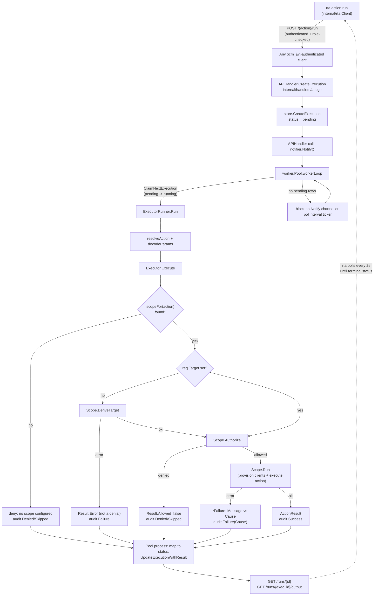

# Trusted Actions execution pipeline

This page traces a single Trusted Actions run end to end: from the CLI/API
request that triggers it, through the HTTP handler that persists it, through
the background worker pool that claims and executes it, to the executor's
scope-based authorization and run, down to the audit record that is always
written, and finally to how a caller retrieves the result. It is scoped to
Trusted Actions (`components/trusted-actions/`) only. Boundary's own
asynchronous investigation system (ECS tasks, EFS workspaces) is an unrelated
mechanism in the same monorepo — see
[Investigation lifecycle](investigation-lifecycle.md) — and shares no code,
store, or worker pool with what is described here.

For the HTTP surface, request/response shapes, and a comparison of the three
command-line entry points (`rta`, `action-cli`, `test-client`), see
[Trusted Actions API](../integrations/trusted-actions-api.md). For how a
caller's identity and role are resolved before an execution is even queued,
and for the second authorization layer inside the executor, see
[Trusted Actions authorization model](../architecture/trusted-actions-authorization.md).
For the catalog/plugin architecture this pipeline runs actions out of, see
[Trusted Actions architecture](../architecture/trusted-actions-overview.md).
For how results are surfaced in the audit log, see
[Trusted Actions audit logging](../operations/trusted-actions-audit.md).

## End-to-end flow



## 1. Discovery and request: the `rta` CLI

`rta` (`cmd/rta` + `internal/rta`) is the reference end-user client for this
whole pipeline; it issues exactly the HTTP requests described in the rest of
this page and nothing else — it holds no in-process executor, catalog, or
store. `rta.NewCommand()` (`internal/rta/command.go`) builds a cobra tree with
three subcommand groups wired to the same `internal/rta.Client`
(`action`, `execution`, `audit`), plus `version`:

- **`rta action list`** calls `Client.Catalog` (`GET /`) and **`rta action
  describe <action>`** calls `Client.Describe` (`GET /{action}`) — this is
  the "discovered" half of the workflow: a caller finds out what actions
  exist and what parameters they take (name, required/optional, default,
  description) before ever submitting one.
- **`rta action run <action> --cluster <id> --jira <ticket> [--param
  k=v]...`** (`internal/rta/action.go`) parses `--param key=value` flags into
  a `map[string]string`, builds an `openapi.ExecutionRequest{TargetCluster,
  Jira, Params, DryRun, Force}`, and calls `Client.CreateExecution` — a plain
  `POST /{action}/run` identical in shape to any other authenticated caller
  of the API. This is the "requested" step: `rta` performs no
  authorization or validation of its own beyond parsing the command line;
  every check described later on this page (role allowlist, scope
  authorization) happens server-side after this call lands.
- With `--no-wait`, `run` prints the `202`-accepted `Execution` (`pending`)
  and returns immediately. Without it, `waitForCompletion` polls
  `Client.GetExecution` (`GET /runs/{id}`) on a 2-second ticker until status
  is `succeeded`, `failed`, or `timed_out`, bounded by the command's
  `--timeout` (default 5 minutes); on success or failure it also fetches
  `Client.GetExecutionOutput` (`GET /runs/{exec_id}/output`) to print the
  action's message/resources or the failure reason.
- **`rta execution list|get|output`** and **`rta audit list`** expose the
  same `GET /runs`, `GET /runs/{id}`, `GET /runs/{exec_id}/output`, and
  `GET /audit` endpoints for inspecting executions and the request-level
  audit trail after the fact, independent of whichever client submitted the
  run.

`Client` (`internal/rta/client.go`) prefixes every call with
`/api/v0/trusted-actions`, resolves its bearer token from `--token` or
(`internal/rta/auth.go`) an OCM CLI config file's access token, refuses to
send that token over a non-HTTPS, non-loopback server URL, and rejects any
redirect that would downgrade HTTPS to plain HTTP — the CLI itself enforces
transport security for the credential that the server-side authentication
layer (see [Trusted Actions authorization model](../architecture/trusted-actions-authorization.md))
will go on to validate. A non-2xx response is decoded into an `*APIError`
carrying the request method/path, status code, and the server's `code`/
`reason` (from `openapi.Error`) when present, so CLI error output reflects
the same denial/failure reasons the server itself produced. `rta` is not the
only way to reach this API — any `ocm_jwt`-authenticated HTTP client can
issue the same `POST /{action}/run`, and `cmd/action-cli` bypasses the HTTP
layer entirely by driving the same `internal/executor.Executor` in-process;
see [Trusted Actions API](../integrations/trusted-actions-api.md) for how all
three command-line entry points (`rta`, `action-cli`, `test-client`) compare.
Everything from here on describes what happens once a `POST /{action}/run`
request — from `rta` or any other caller — reaches the server.

## 2. Persistence: `POST /{action}/run`

`APIHandler.CreateExecution` (`internal/handlers/api.go`) looks the action up
in the catalog (`404` if unknown), decodes the JSON body into
`openapi.ExecutionRequest`, resolves the caller's identity already placed in
the request context by the authentication middleware, and builds a
`models.Execution` via `models.ExecutionFromRequest`. That execution is given
a new UUID, status `pending`, an `ApprovalState` defaulted to
`not_required`, and the caller-supplied `TargetCluster`, `Jira`, `DryRun`,
`Force`, and `Params` (JSON-encoded as a `map[string]string`). It is written
with `store.CreateExecution` before the handler returns `202 Accepted` with a
HAL `self` link to `GET /runs/{id}`. The handler never calls the executor
directly — persistence is the full extent of what happens synchronously on
the request path.

Immediately after persisting, the handler calls `notifier.Notify()` (the
worker pool satisfies this through the `ExecutionNotifier` interface, kept
separate so `internal/handlers` does not import `internal/worker`) to wake a
worker without waiting for the next poll.

### Execution state model (`internal/models/execution.go`)

`models.Execution` is the store's row shape; `ToOpenAPI` converts it to the
generated `openapi.Execution` returned by `GET /runs/{id}` (and, with
`UnderscoreLinks`, from `CreateExecution`/`GetExecution`). Status values are
the `openapi.ExecutionStatus` enum: `pending`, `running`, `succeeded`,
`failed`, and `timed_out` — only the first four are ever written by the
current pipeline (`pending` at creation, `running` on claim, and
`succeeded`/`failed` on completion); `timed_out` is a declared state with no
code path that sets it today, since a worker-side execution timeout surfaces
as an `Executor` error and is mapped to `failed` like any other error (see
§5). `ApprovalState`, `Scope`, `Type`, `Revision`, `ManifestWorkName`,
`RunnerSeconds`, `UploadSeconds`, and `DurationSeconds` are also part of the
persisted/returned shape; `ExecutorRunner` (§4) does not populate the
manifest-work/runner/uploader fields, since it calls `Executor.Execute`
synchronously rather than performing a two-phase dispatch.

## 3. Worker pool: claiming pending work

`worker.Pool` (`internal/worker/pool.go`) is an in-process pool of
goroutines, each running `workerLoop`. On every iteration a worker calls
`store.ClaimNextExecution`, which must atomically select the oldest pending
execution (ordered by `created_at`, then `id`) and transition it to
`running` in one transaction so two workers — or two server replicas backed
by the same Postgres database — never claim the same row:

- **SQLite** serializes all database access through a single connection
  (`SetMaxOpenConns(1)`), so a plain `SELECT` + `UPDATE` inside one
  transaction is sufficient.
- **Postgres** uses `SELECT ... FOR UPDATE SKIP LOCKED`, the standard queue
  pattern that lets concurrent workers (and concurrent server processes)
  claim distinct rows without lock contention.

If `ClaimNextExecution` returns `store.ErrNotFound` (nothing pending), the
worker blocks on a `select` between the pool's buffered `notify` channel
(`Pool.Notify`, drained non-blocking so a call from the HTTP handler never
blocks) and a `time.Ticker` firing every `pollInterval`. This means
correctness never depends on a notify actually arriving: a missed notification,
or a row inserted by some other path, is still picked up on the next poll.
`New` clamps `concurrency` to at least 1 and `pollInterval` to a
`defaultPollInterval` of 5s when given a non-positive value (matching
`ROSA_TA_WORKER_POLL_INTERVAL`'s configured default); production defaults are
`WorkerConcurrency=4`, `WorkerPollInterval=5s`, `WorkerExecutionTimeout=2m`
(`internal/config/config.go`), overridable via `ROSA_TA_WORKER_CONCURRENCY` /
`ROSA_TA_WORKER_POLL_INTERVAL` / `ROSA_TA_WORKER_EXECUTION_TIMEOUT`.

Once claimed, the worker calls `Runner.Run(ctx, exec)` — `ExecutorRunner` is
the only production implementation — and then `Pool.process` persists the
outcome: it converts the `RunResult` into a terminal status and an
`ExecutionOutput` (via `models.OutputFromActionResult`; a conversion error
forces `status = "failed"`), then calls `store.UpdateExecutionWithResult`
with a timeout detached from the worker's own context
(`context.WithoutCancel`) so a shutdown-time cancellation that races the end
of `Run` still lets the terminal status be written rather than leaving the
row stuck at `running` forever. `result.Reason` (a human-readable failure
reason) is only logged today — the executions table and the OpenAPI
`Execution` schema have no column/field to persist it, so it does not survive
past the worker's own logs.

On process shutdown (`cmd/server/main.go`), `SIGINT`/`SIGTERM` cancels the
worker pool's context first, then the HTTP server is given 30s to drain, then
the pool is given the remainder of that same deadline to let in-flight
`Run` calls finish before the process exits.

## 4. `ExecutorRunner`: resolving and decoding a claimed execution

`ExecutorRunner.Run` (`internal/worker/executor_runner.go`) turns the opaque,
persisted `models.Execution` back into a typed request the executor can run:

1. `resolveAction(exec.Action)` looks the action name up via
   `actions.CreateAction`; an unknown action is reported as a run failure
   (this should not normally happen, since `CreateExecution` already
   validated the name against the catalog at enqueue time).
2. `decodeParams(exec.Params)` unmarshals the persisted JSON params back into
   `map[string]string` (an empty map if none were given).
3. A per-execution context is derived with `context.WithTimeout(ctx,
   executionTimeout)` (default 2 minutes, see §3) so a hung backplane or
   cluster call cannot block a worker goroutine indefinitely.
4. `executor.Executor.Execute` is called with `Target` left `nil` — the
   resolved `Scope`'s `DeriveTarget` is responsible for building a target
   from `Params` for every execution queued through this path, since the
   HTTP request body never carries a pre-built target.

`ExecutorRunner` runs the exact same `internal/executor.Executor` as
`cmd/action-cli`, the standalone CLI entry point for the same pipeline; this
runner's only job is moving that otherwise-synchronous call off the HTTP
request path and into the background worker pool.

`ExecutorRunner` distinguishes three outcomes on the way back from
`Execute`, mapped to a `worker.RunResult`:

- `result.Error != nil` → `status: "failed"`, logged as an execution failure.
  This is reached both for a genuine action failure *and* for a request that
  never reached authorization at all (target derivation failed) — see §5 for
  why the executor itself keeps these conceptually distinct even though the
  worker currently collapses both into the same terminal status.
- `result.Error == nil && !result.Allowed` → also mapped to `status:
  "failed"`, with the reason prefixed `"denied: "` and logged as a denial
  rather than an error. The worker pipeline does not expose a distinct
  `denied` execution status; the OpenAPI `ExecutionStatus` enum only has
  `failed` to represent any unsuccessful terminal state.
- `result.Error == nil && result.Allowed` → `status: "succeeded"`, with
  `result.Output` carried through as the `RunResult.Output`.

## 5. `Executor.Execute`: scope resolution, authorization, and run

`internal/executor/executor.go` is the domain-agnostic core of the pipeline.
It holds a list of `Scope`s and, for every `Request`, builds an `audit.Record`
up front and logs it via a **deferred call** (`defer func() {
e.auditor.Log(rec) }()`) before doing anything else — so every execution,
regardless of how it terminates (denial, failure, panic-free early return, or
success), produces exactly one audit entry.

```go
func (e *Executor) Execute(ctx context.Context, req Request) (result *Result) {
    rec := audit.Record{...}
    defer func() { e.auditor.Log(rec) }()
    ...
}
```

The steps, each updating `rec` before any return:

1. **Scope resolution** — `scopeFor(req.Action)` returns the first
   registered `Scope` whose `Supports(action)` is true. If none matches, the
   request is denied (`audit.DecisionDenied` / `audit.OutcomeSkipped`) before
   any target or authorization logic runs.
2. **Target derivation** — if `req.Target` is `nil` (always true for
   executions that came through `ExecutorRunner`), `scope.DeriveTarget(ctx,
   req)` builds one from `req.Params`. **A derivation error is not a
   denial**: authorization never ran, so there was nothing to be denied by.
   It is recorded as `audit.OutcomeFailure` and returned as `&Result{Error:
   err}` with `Allowed` left at its zero value (`false`) — the code comment
   is explicit that reporting this as "denied" would misrepresent a request
   that was never actually judged.
3. **Authorization** — `scope.Authorize(req)` returns an
   `authorization.Result{Allowed, Reason}`. A `false` result is recorded as
   `audit.DecisionDenied` / `audit.OutcomeSkipped` and returned as
   `&Result{Allowed: false, Reason: ...}` with no `Error` set — this is the
   genuine-denial case `ExecutorRunner` distinguishes from the failure case
   above.
4. **Run** — on authorization success, `rec.Decision =
   audit.DecisionAllowed` and `scope.Run(ctx, req)` provisions the clients
   the action needs and executes it. An error here is recorded as
   `audit.OutcomeFailure` with `rec.Error` set to `auditedCause(err)`, and
   returned as `&Result{Allowed: true, Error: err}` (allowed, but failed in
   execution — a third distinct state from "denied" and from "never
   authorized"). Success is `audit.OutcomeSuccess` with the action's
   `*actions.ActionResult` attached to `Result.Output`.

### `Failure`: caller-facing message vs. audited cause

A `Scope.Run` (or `DeriveTarget`) that fails returns an `*executor.Failure`,
not a bare error:

```go
type Failure struct {
    Message string // what the caller/log sees framed as
    Cause   error  // the underlying error; what gets audited
}
```

`Executor.auditedCause` unwraps a `*Failure` via `errors.As` and audits
`Cause` rather than the `Failure`'s own `Error()` string (which is
`Message + ": " + Cause.Error()`). This keeps the audit trail recording the
underlying technical failure (e.g. "failed to get backplane client: ...")
independently of whatever caller-facing framing a scope chose to wrap it in,
and keeps a scope free to change its wording without changing what gets
audited. `Failure.Cause` is allowed to be `nil` (`Error()` falls back to just
`Message`), though every `Failure` raised by `KubeScope`/`AWSScope` today
wraps a non-nil cause. A plain (non-`Failure`) error returned by a scope —
e.g. `AWSScope.DeriveTarget`'s resource-mismatch check — means nothing
technically failed; the request was understood and refused on its own terms,
and is audited as-is.

## 6. `Scope`: the domain boundary

`executor.Scope` is the interface that keeps `Executor` itself domain-agnostic:

```go
type Scope interface {
    Supports(action actions.Action) bool
    DeriveTarget(ctx context.Context, req Request) (actions.Target, error)
    Authorize(req Request) authorization.Result
    Run(ctx context.Context, req Request) (*actions.ActionResult, error)
}
```

A scope owns everything specific to one execution domain: which actions
belong to it, how a target is shaped and derived, how a request is
authorized, and how the clients an action needs are provisioned. The
`Scope` doc comment is explicit that this is a deliberate extension
boundary — "a new scope cannot be added without deciding how it authorizes."
Two concrete scopes are registered today in both `cmd/server/main.go` and
`cmd/action-cli/main.go`:

- **`KubeScope`** (`internal/executor/kube.go`) supports any
  `actions.KubeAction`. `DeriveTarget` builds an `actions.ResourceTarget`
  directly from params (group/version/resource/namespace/name) and never
  fails or needs the context; it deliberately always treats a derived target
  as namespaced (`ClusterScoped: false`) rather than inferring
  cluster-scoping from an absent namespace, since that previously let a
  caller bypass the namespace allowlist. `Authorize` delegates to
  `authorization.Authorizer` (namespace/secret allowlists — see
  [Trusted Actions authorization model](../architecture/trusted-actions-authorization.md)).
  `Run` asks `backplane.ClientProvider.GetClient` (and, for actions that
  declare `UsesPodExec()`, also `GetPodExecutor`) for a session scoped to
  exactly the RBAC rules the action's `RequiredRBAC(target)` declares — one
  Backplane session per action execution, scoped to least privilege, rather
  than one standing session reused across actions.
- **`AWSScope`** (`internal/executor/aws.go`) supports any
  `actions.AWSAction`. `DeriveTarget` always resolves the region from the
  target cluster itself via `awsapi.ClientProvider.DefaultRegion` (never from
  the caller, since a cluster's AWS resources live only in its own account's
  region) and, for the narrower `AWSWriteAction` actions, both refuses a
  caller-supplied `resource` param that disagrees with what the write action
  actually acts on, and resolves the cluster's infrastructure ID from OCM so
  the action can check an EC2 instance's ownership tag before mutating it.
  `Authorize` delegates to `authorization.AWSAuthorizer`, checking the
  resolved region against a region allowlist and, for writes, the action's
  self-declared `Operation()` against a separately configured write
  allowlist (`ROSA_TA_AWS_ALLOWED_OPERATIONS` / `actions.aws_allowed_operations`;
  both allowlists default to empty, so a deployment that configures neither
  can read nothing and write nothing). `Run` asks
  `awsapi.ClientProvider.GetClients` only for the AWS service clients the
  action's `RequiredServices(target)` names.

Both scopes are fully wired into the server and CLI entry points today —
`Scope` is not a single-implementation interface. The extension point it
represents is forward-looking in a narrower sense: each scope independently
owns and hard-codes its own authorization story (Kubernetes
namespace/secret allowlists vs. AWS region/operation allowlists), by design,
so adding a third scope (or extending either existing one to a new resource
kind) still requires designing that domain's own authorization checks rather
than reusing either existing `Authorizer`.

## 7. Write-action safeguards declared in the catalog

`catalog.ActionDefinition` (`internal/catalog/catalog.go`) carries three
fields intended as write-safety metadata, surfaced through
`GET /{action}` via `ToOpenAPIDetail`:

- `DryRunAction` — the name of a read-only action to run instead when a
  caller sets `dry_run` on the request.
- `WriteCooldownSeconds` — a per-action override of a global write-throttle
  interval.
- `Approval` — records that an action requires approval (e.g. `"manual"`)
  before it runs.

As of the current catalog, **no registered action sets any of these three
fields**, and there is no code in the worker, executor, or any scope that
reads or enforces them: `CreateExecution` persists the caller-supplied
`DryRun`/`Force` booleans on the `Execution` row and returns them unchanged
through the API, but nothing branches on `DryRunAction`, throttles on
`WriteCooldownSeconds`, or gates on `Approval` before a worker claims and
runs an execution. `docs/adding-a-trusted-action.md` documents them as
fields a new `openapi.Write` action *should* set, and explicitly notes there
is "no approval enforcement system today" — defaulting to `Approval:
"manual"` is a convention enforced by code review, not by the pipeline
described on this page. The only write-time safeguards actually enforced at
runtime are the resource-level allowlists inside `Scope.Authorize` (the
Kubernetes namespace/secret allowlist and the AWS region/operation
allowlist described in §6), plus the HTTP-layer, per-action
`AllowedRoles` check that runs before an execution is ever queued (see
[Trusted Actions authorization model](../architecture/trusted-actions-authorization.md)).
Treat `DryRunAction`/`WriteCooldownSeconds`/`Approval` as declared intent in
the catalog schema, not as an active gate on the execution path documented
above.

## 8. Retrieving results: `GET /runs/{id}` and `GET /runs/{exec_id}/output`

`APIHandler.GetExecution` (`GET /runs/{id}`) fetches the row via
`store.GetExecution`, converts it with `Execution.ToOpenAPI`, and separately
probes `store.GetExecutionOutput` purely to decide whether to attach an
`output` HAL link — the output itself is not inlined in this response.
`APIHandler.GetExecutionOutput` (`GET /runs/{exec_id}/output`) fetches and
returns the `ExecutionOutput` row (`Message` plus a `Resources` list, always
serialized as an empty list rather than `null` when the action produced
none — see `models.OutputFromActionResult`), written by
`Pool.process`/`UpdateExecutionWithResult` once a run reaches a terminal
status. A caller polling `GET /runs/{id}` before the worker has claimed the
execution sees `status: "pending"`; between claim and completion, `"running"`;
after completion, `"succeeded"` or `"failed"` with output retrievable (for a
successful run) from the output endpoint. There is no push/webhook
notification back to the caller — retrieval is poll-only, as documented in
the OpenAPI spec's suggested workflow (`openapi/openapi.yaml`). `rta action
run` (§1) implements exactly this poll loop on the caller's behalf — a
2-second `GetExecution` ticker followed by one `GetExecutionOutput` call once
a terminal status is reached — so a caller who does not pass `--no-wait`
never has to script the polling described here themselves.
